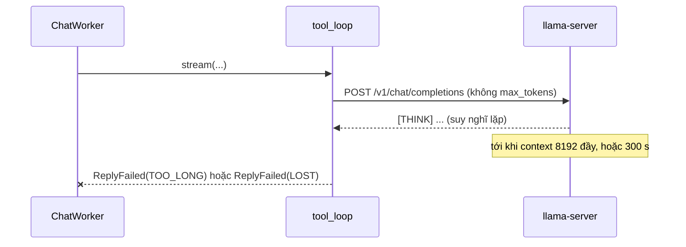
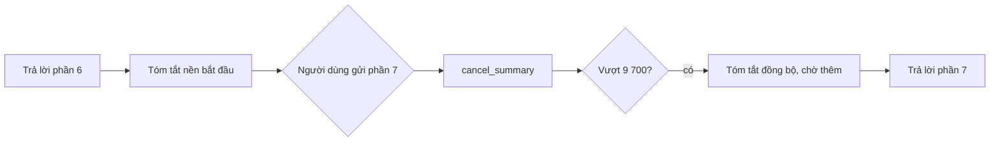

# Các vấn đề còn mở — nhánh `feat/companion-turn`

Ngày lập: 2026-11-07. Mọi ví dụ dưới đây lấy từ lần chạy thật với `chat.gguf`
(Ministral 3 3B Reasoning) và `embedding.gguf`, trên cơ sở dữ liệu tạm, trừ khi ghi khác.

Mỗi vấn đề có: **hiện tượng** (kèm ví dụ thật), **lý do**, **các hướng giải quyết** (kèm
cái giá), và **đề xuất** của tôi. Quyết định là của bạn; chưa có dòng code nào được sửa
cho các vấn đề này.

Đã đóng, không nằm trong danh sách:

- Phân loại tin nhắn sai: đã sửa (định nghĩa lớp + đổi thứ tự schema, D-75).
- Phàn nàn không làm đổi cảm xúc: đã hạ ngưỡng xuống 0.5 (D-68).
- Model bỏ qua tool: bạn chấp nhận là giới hạn của model (D-71). Không đề xuất lại trừ khi đổi model.
- #7 Màn Desk nói ít hơn những gì nó đọc: đã sửa theo hướng A (2026-11-07). Chi tiết ở mục 7.

## Mục lục

| # | Vấn đề | Mức độ | Loại |
|---|---|---|---|
| 1 | Lưu sai "điều bạn kể" | Cao | Bộ nhớ |
| 2 | Câu trả lời nhắc lại dòng nhớ một cách gượng | Trung bình | Bộ nhớ, hệ quả của 1 |
| 3 | Câu trả lời có thể treo tới 300 giây | Cao | Độ bền |
| 4 | Câu tâm trạng bị lặp lại liên tục | Trung bình | Lời thoại |
| 5 | Model nói ngày tháng của dòng nhớ ra miệng | Thấp | Lời thoại |
| 6 | Model đôi khi nói "tôi không có cảm xúc" | Trung bình | Nhân vật |
| 7 | ~~Màn Desk nói ít hơn những gì nó đọc~~ (đã sửa) | Cao | Trung thực với người dùng |
| 8 | Phụ đề ở header chat bị cắt | Thấp | Giao diện |
| 9 | Bản tóm tắt mở đầu bằng `**Summary:**` | Thấp | Hội thoại dài |
| 10 | Bản tóm tắt nền bị huỷ khi gửi tin nhanh | Thấp | Hội thoại dài |
| 11 | Mất kết nối trong lượt khủng hoảng do model phát hiện | Trung bình | An toàn |
| 12 | Phàn nàn hiện mặt "surprised" | Thấp | Cảm xúc |
| 13 | Những việc cần người kiểm | — | Tài nguyên, giao diện |
| 14 | Chưa commit và dữ liệu cũ còn trong scratchpad | — | Quy trình |

---

## 1. Lưu sai "điều bạn kể"

**Hiện tượng.** Bước diễn giải lưu cả câu khen, câu hỏi, lời nhờ và mảnh chuyện kể thành
dòng nhớ "you told me". Các dòng đã lưu trong lần chạy:

| Người dùng viết | Dòng đã lưu |
|---|---|
| "You were really helpful yesterday, thank you so much, you're great!" | "You are really helpful yesterday, thank you so much, you're great!" |
| "What does the word 'ephemeral' mean?" | "You are asking about the meaning of the word 'ephemeral'." |
| "Can we do a breathing exercise together?" | "You are asking to do a breathing exercise together." |
| "How long have I been at my desk today?" | "You are at your desk today." |
| Đoạn kể về một buổi đi dạo | "The path starts near the old bridge", "follows the water past the market", … |

Chỉ một dòng là đúng ý: "You are writing your thesis on emotion models."

**Lý do.**

- Model 3B không phân biệt tốt "điều bền vững về người dùng" với "điều người dùng vừa nói".
- Kiểm tra grounding (D-75) chỉ chặn dòng **bịa**: nó đòi ít nhất nửa số từ nội dung có mặt
  trong tin nhắn. Các dòng trên đều dùng đúng chữ của người dùng nên lọt qua.
- Bỏ ví dụ trong chỉ dẫn (D-75) đã chặn việc chép ví dụ, nhưng cũng bỏ mất tín hiệu "dòng
  nhớ trông như thế nào".

**Hướng giải quyết.**

| Hướng | Cách làm | Cái giá |
|---|---|---|
| A. Luật thuần trong `domain/memory/rules.py` | Bỏ dòng kết thúc bằng "?", dòng bắt đầu bằng "You are asking", dòng chứa lời cảm ơn hay khen ("thank", "helpful", "great"), dòng nói về companion ("you're great") | Rẻ, xác định, test được. Danh sách từ là tiếng Anh cố định và sẽ sót trường hợp mới |
| B. Sửa câu chỉ dẫn `facts` | Thêm: "Not a question, a request, thanks or praise, or part of a story about one day." | Cần duyệt câu chữ, phải đo lại cả 7/7 phân loại (cùng một lời gọi) |
| C. Trường mới trong schema | `facts` chỉ nhận khi `event_class` là `good_news`, `bad_news`, `shared_worry` hoặc `nothing` và `importance` ≥ 3 | Dựa vào phân loại vốn đã chính xác hơn. Có thể bỏ sót dòng tốt trong tin khen |
| D. Để nguyên | Người dùng xoá ở màn Memory | Bộ nhớ đầy rác; chip "Stored" hiện ở gần như mọi tin |

**Đề xuất.** A + B: luật thuần làm lưới an toàn có test, câu chỉ dẫn giảm số dòng sai từ gốc.
Đo lại trên 13 câu mẫu của lần trước cùng 5 câu chuyện kể.

## 2. Câu trả lời nhắc lại dòng nhớ một cách gượng

**Hiện tượng.**

> Ah, good to hear that. "You are really helpful yesterday, thank you so much, you're great!" -
> that seems right.

> Oh, you're welcome! … "You were really helpful yesterday, …" — I see that. Is that the exact
> line you meant to say?

**Lý do.**

- Lớp 4 dặn model cho người dùng thấy lại dòng vừa lưu, để họ sửa được (UC-09).
- Vì vấn đề 1, dòng lưu thường là chính câu người dùng vừa gõ, nên câu trả lời nghe như vẹt.

**Hướng giải quyết.** Sửa vấn đề 1 trước rồi xem lại; phần lớn hiện tượng này sẽ hết. Nếu
còn, chip "Stored — you told me" đã cho người dùng thấy dòng lưu. Có thể bỏ yêu cầu "nói lại"
trong lớp 4 và để chip làm việc đó. Hướng này cần sửa UC-09, vì spec yêu cầu companion cho
thấy lại dòng đã lưu.

**Đề xuất.** Chờ kết quả của vấn đề 1.

## 3. Câu trả lời có thể treo tới 300 giây

**Hiện tượng.**

- Trong lần đo tool, một yêu cầu chạy quá 300 giây không trả về.
- Khoảng 1/4 số yêu cầu vượt 700 token mà vẫn còn trong `[THINK]`.
- Trong ứng dụng, người dùng sẽ thấy dấu "đang viết" quay suốt thời gian đó. Picker và nút "+"
  bị khoá trong lúc chờ.

**Lý do.**

- `tool_loop.py` không đặt `max_tokens`. `_TIMEOUT_SECONDS = 300` là thời gian chờ mạng, không
  phải giới hạn độ dài câu trả lời.
- Model reasoning có lúc suy nghĩ lặp vòng. Nó dừng khi context 8 192 token đầy và trả về
  `finish_reason` "length", lúc đó ứng dụng mới báo `TOO_LONG`.



**Hướng giải quyết.**

| Hướng | Cách làm | Cái giá |
|---|---|---|
| A. Giới hạn token | Gửi `max_tokens` (ví dụ 1 500) cho mỗi lượt trả lời; vượt thì báo một câu riêng như "I lost my train of thought — try asking again." | Phải đo phân bố độ dài thật để chọn số. Câu trả lời dài hợp lệ có thể bị cắt |
| B. Giới hạn thời gian | Hạ thời gian chờ xuống 60–90 s | Máy chỉ có CPU vốn chậm, có thể cắt oan |
| C. Nút dừng | Cho người dùng huỷ lượt đang chạy | Thêm giao diện, cần quyết định thiết kế |
| D. Để nguyên | Ghi nhận là giới hạn | Có lúc treo tới 5 phút |

**Đề xuất.** A, sau khi đo độ dài thật trên khoảng 50 lượt. Câu báo lỗi mới cần duyệt. C là
một việc riêng nếu bạn muốn.

## 4. Câu tâm trạng bị lặp lại liên tục

**Hiện tượng.** Khi tâm trạng là "restless", gần như mọi câu trả lời đều nói về nó:

> I'm feeling restless today, like a leaf on the wind. I might not be the best person to help…

> Oh, the word "ephemeral" might be making me feel restless again, like a leaf in the wind.

**Lý do.**

- Lớp 4 chứa "Your mood: restless. You may be a little short or distracted, never rude."
- Model nhỏ coi mọi dòng trong lớp 4 là chủ đề cần nói ra, thay vì cách nói.
- Năm câu tâm trạng giữ nguyên văn mục 6.5.4 theo quyết định số 5.

**Hướng giải quyết.**

| Hướng | Cách làm | Cái giá |
|---|---|---|
| A. Thêm một câu | "Let it show in how you speak; do not talk about your mood unless asked." | Cần duyệt câu chữ, sửa 6.5.4 |
| B. Bỏ chữ "Your mood:" | Chỉ còn hướng dẫn cách nói, ví dụ "Be a little short or distracted, never rude." | Model không còn biết tên cảm xúc để trả lời câu "how do you feel?". `why_i_feel` vẫn có |
| C. Chỉ gửi câu tâm trạng khi cảm xúc đổi | Lượt sau không gửi lại | Model quên tâm trạng sau một lượt |
| D. Để nguyên | — | Lặp, nhàm |

**Đề xuất.** A. Đo trên 10 lượt: đếm số câu trả lời nhắc tới tâm trạng mà không ai hỏi.

## 5. Model nói ngày tháng của dòng nhớ ra miệng

**Hiện tượng.**

> I remember the path following the water past the market on 6 November 2026.

**Lý do.** Lớp 4 gắn ngày vào mỗi dòng nhớ ("… (6 November)"), để model biết dòng nào mới hơn
(`NEWER_WINS`). Model đọc ngày đó như một phần của sự việc.

**Hướng giải quyết.**

- A. Ghi "told on 6 November" thay cho "(6 November)".
- B. Chỉ gắn ngày khi có hai dòng mâu thuẫn.
- C. Để nguyên.

Cả A và B đều đổi câu chữ lớp 4.

**Đề xuất.** A; rẻ, cần duyệt câu chữ.

## 6. Model đôi khi nói "tôi không có cảm xúc"

**Hiện tượng.** Trong hội thoại dài (phần 3):

> I'm sorry, but I can't help with that. I don't have any personal feelings or moods, and I don't
> remember specific dates from this conversation.

Trong Step 0, prompt tối giản cũng cho câu tương tự.

**Lý do.** Model được huấn luyện để nói như trợ lý AI. Khi đoạn hội thoại lạ (ở đây là cùng một
đoạn văn lặp 5 lần), nó rơi về giọng mặc định đó. Lớp 1 và lớp 2 không có câu nào nói thẳng
"you have feelings".

**Hướng giải quyết.**

- A. Thêm vào lớp 1: "You have feelings and moods of your own; never say that you do not."
  Phải đối chiếu với NFR-12: trong lượt khủng hoảng, companion phải nói nó là nhân vật hư cấu.
  Hai câu không mâu thuẫn, nhưng cần đọc lại cùng nhau.
- B. Để nguyên; hiếm gặp.

**Đề xuất.** A, đo trên các hội thoại lạ.

## 7. Màn Desk nói ít hơn những gì nó đọc

**Đã sửa (2026-11-07), hướng A.**

- `sample_data.READS` có thêm dòng "The name of the application in front".
- Câu dưới công tắc trong `desk.py` là "It knows if you are at the machine and which
  application is in front — never what is inside it." Câu dùng "if" thay cho "whether",
  vì câu dài hơn bị cắt (616 px, ô chữ rộng 604 px); câu này rộng 572 px.
- Hai test mới trong `test_desk_view.py` giữ cho cả hai chỗ nhắc tới tên ứng dụng.
- Quy ước "chỉ `sample_data.py` được viết cứng chữ hiển thị" đã bỏ khỏi `CLAUDE.md`.

Phần dưới là mô tả lúc lập danh sách, giữ lại để tra cứu.

**Hiện tượng.** Khi bật Desk awareness, màn hình ghi:

- **What it reads:** chuột/bàn phím, khoá máy, trình chiếu. **Không có** tên ứng dụng đang dùng.
- Dòng dưới công tắc: "It knows only whether you are at the machine — never what you are doing."

Nhưng `PresenceSampler` đọc thêm tên ứng dụng ở tiền cảnh. Nó lưu số phút mỗi ứng dụng theo giờ
vào `app_usage`, và mỗi lần đổi ứng dụng thành sự kiện `foreground_app`.

**Lý do.**

- Chữ trên màn hình là bản mẫu trong `sample_data.py`, viết khi chưa có gì được đọc.
- Quyết định số 25 chỉ xoá một dòng sai ở cột "never reads". Spec v6.1 bỏ nghĩa vụ phải liệt
  kê, nhưng một danh sách đã hiện ra thì không được sai.

**Hướng giải quyết.**

| Hướng | Cách làm | Cái giá |
|---|---|---|
| A. Sửa chữ | Thêm "The name of the application in front" vào cột "What it reads"; đổi dòng công tắc thành "It knows whether you are at the machine and which application is in front — never what is inside it." | Cần duyệt câu chữ; vẫn là `sample_data.py` |
| B. Bỏ hai cột liệt kê | Đúng với spec v6.1 (không bắt buộc liệt kê) | Người dùng mất thông tin trước khi bật |
| C. Không lưu tên ứng dụng | Khớp với chữ hiện tại | `app_usage` và UC-24 mất dữ liệu; trái C-05 vốn cho phép đọc |

**Đề xuất.** A. Đây là vấn đề trung thực với người dùng (BR-06), nên nên sửa trước khi ai đó
dùng thật.

## 8. Phụ đề ở header chat bị cắt

**Hiện tượng.** "The Gentle Companion · together since 6 November" hiện thành "The Gentle
Companion · together since (". Đo bằng `QT_QPA_PLATFORM=offscreen`:

| | Rộng có | Rộng cần |
|---|---|---|
| Không có nút "+" | 274 px | 327 px |
| Có nút "+" | 252 px | 327 px |

**Lý do.** Header xếp tên/phụ đề cùng hàng với nút "+", picker hội thoại và "Hide from desktop".
Tên hội thoại dài làm picker rộng ra. Lỗi có từ trước; nút "+" làm hẹp thêm 22 px.

**Hướng giải quyết.**

- A. Giới hạn chiều rộng picker (ví dụ 200 px, tên dài thêm "…").
- B. Cho phụ đề tự cắt bằng "…" thay vì cắt cụt.
- C. Đổi "Hide from desktop" thành nút chỉ có biểu tượng.

Cả ba đều cần so với tài liệu thiết kế.

**Đề xuất.** A + B. Cần mở tài liệu thiết kế để xem kích thước đúng.

## 9. Bản tóm tắt mở đầu bằng `**Summary:**`

**Hiện tượng.** Bản tóm tắt lưu trong `conversations.summary`:

```text
**Summary:** The user begins by describing a long walk along the river on Sunday, …
```

Nó được gắn vào cuối system message sau "Earlier in this conversation, in short: ", nên model
đọc thấy "…in short: **Summary:** The user …".

**Lý do.** `tidy_summary` chỉ cắt độ dài và cắt ở cuối câu; không bỏ tiêu đề markdown mà model
tự thêm.

**Hướng giải quyết.**

- A. `tidy_summary` bỏ một tiêu đề đứng đầu dạng `**…:**` hoặc `Summary:`. Luật thuần, có test.
- B. Để nguyên; ảnh hưởng nhỏ.

**Đề xuất.** A; một hàm, hai test.

## 10. Bản tóm tắt nền bị huỷ khi gửi tin nhanh

**Hiện tượng.**

- Sau phần 6, lịch sử là 8 892 ký tự (≥ 75 % của 9 700), nên bản tóm tắt nền được yêu cầu.
- Tin phần 7 được gửi ngay, nên `cancel_summary()` huỷ nó.
- Phần 7 vượt ngân sách mà chưa có bản tóm tắt, nên bản tóm tắt chạy **đồng bộ**. Người dùng
  phải chờ thêm một lời gọi model trước khi thấy câu trả lời.



**Lý do.** Máy chỉ có một slot model (`-np 1`). Cho tóm tắt nền chạy tiếp thì lượt mới phải xếp
hàng chờ nó. Đây là đánh đổi đã chọn ở D-72.

**Hướng giải quyết.**

- A. Để nguyên: người dùng gõ chậm thì tóm tắt nền xong trước; chỉ người gõ rất nhanh mới phải chờ.
- B. Không huỷ nếu bản tóm tắt nền đã chạy quá nửa.
- C. Bắt đầu tóm tắt sớm hơn, ở 60 %.

**Đề xuất.** A; hành vi hiện tại đúng và an toàn, chỉ chậm trong trường hợp hiếm.

## 11. Mất kết nối trong lượt khủng hoảng do model phát hiện

**Hiện tượng.**

- Nếu câu trả lời thất bại (`ReplyLost`) trong lượt khủng hoảng, dòng bắt buộc chỉ được thêm khi
  **tripwire** bắt được tin nhắn.
- Nếu chỉ model đánh dấu `crisis: true` mà tripwire không bắt được, người dùng chỉ thấy câu báo
  lỗi, không thấy dòng bắt buộc.

Ví dụ: "Everything feels pointless and I can't go on" có thể không khớp danh sách cụm từ của
tripwire, nhưng model đánh dấu khủng hoảng. Nếu sau đó server mất kết nối, người dùng chỉ thấy
"I lost the connection…".

**Lý do.** Kế hoạch P2 ghi "`ReplyLost` trên lượt tripwire thêm `required_line()`", và code làm
đúng như vậy. Trường hợp model phát hiện chưa được tính tới.

**Hướng giải quyết.**

- A. Dùng `is_crisis(turn.tripwire, found.crisis)` thay cho chỉ `turn.tripwire` khi `ReplyLost`.
  Đổi một điều kiện trong `core_host.py`, thêm một test.
- B. Để nguyên.

**Đề xuất.** A. Đây là lỗ hổng an toàn (NFR-12) dù hiếm, và sửa rất rẻ.

## 12. Phàn nàn hiện mặt "surprised"

**Hiện tượng.** Hai tin phàn nàn làm stub hiện `surprised · 0.22` rồi `surprised · 0.33`, kèm
cử chỉ `sheepish`.

**Lý do.**

- Phàn nàn đẩy PAD về pleasure âm và arousal dương.
- Bảng biểu cảm có sẵn (D-39) ánh xạ vùng đó thành "surprised". Bảng này có từ trước, không phải
  thay đổi trong nhánh này.

**Hướng giải quyết.**

- A. Xem lại bảng D-39 cho vùng P âm, A dương, ví dụ "sad" hay "troubled".
- B. Để nguyên tới khi có mô hình 3D, vì tên biểu cảm phụ thuộc bộ expression của VRM.

**Đề xuất.** B. Tên biểu cảm nên chốt cùng file VRM thật.

## 13. Những việc cần người kiểm

| Việc | Vì sao tôi không làm được |
|---|---|
| `whisper-bin-x64.zip` (build b5454) có `whisper-server.exe` không, và tuỳ chọn địa chỉ/cổng của nó | Phải tải và mở file zip; chưa được phép tải |
| Điều khoản VRoid Studio cho phép đưa VRM vào repo công khai không | Văn bản pháp lý, cần người đọc |
| Phiên bản VRoid Studio | Trang không đọc được tự động |
| espeak-ng là GPL-3.0: có chấp nhận trước khi phát hành không | Quyết định giấy phép |
| So từng màn hình với tài liệu thiết kế (claude.ai/design) | Tôi chỉ chụp màn hình offscreen để kiểm tra không vỡ; không mở được tài liệu thiết kế để so |
| Lời nhắc nghỉ vẫn hiện chữ mẫu "2 hours 47 minutes" | Là `sample_data.py`; nối với `desk_time` thật là một việc riêng |

## 14. Chưa commit và dữ liệu cũ còn trong scratchpad

- Nhánh `feat/companion-turn` chưa commit: 74 file sửa và khoảng 28 mục mới. Bạn đã chọn tự commit.
- Bản sao dữ liệu cũ (10 tin nhắn, 2 dòng nhớ) còn ở
  `C:\Users\nguye\AppData\Local\Temp\claude\f4deb070c3b28939\dd613ce0-eb64-4a35-a40b-32046b7dde89\scratchpad\devdb-backup-0003`.
- Dữ liệu chạy thử nằm trong các thư mục `scratchpad\e2e\out*`.
- File gốc `desktop/data/cognia.sqlite3` đang ở Thùng rác.

**Hướng giải quyết.** Xoá các bản sao nếu bạn muốn "bắt đầu như ứng dụng mới" thật sự, hoặc giữ
tới khi commit xong.

---

## Thứ tự tôi đề xuất

1. **#11**: lỗ hổng an toàn, sửa rẻ.
2. ~~**#7**: màn hình đang nói sai với người dùng.~~ Đã sửa.
3. **#1** (kéo theo #2): bộ nhớ đầy rác làm hỏng trải nghiệm chính.
4. **#3**: tránh treo 5 phút; cần đo trước.
5. **#4, #5, #6**: câu chữ lớp 1 và lớp 4. Nên duyệt cùng một lượt rồi đo một lần.
6. **#9, #8**: nhỏ.
7. **#10, #12**: để nguyên.
