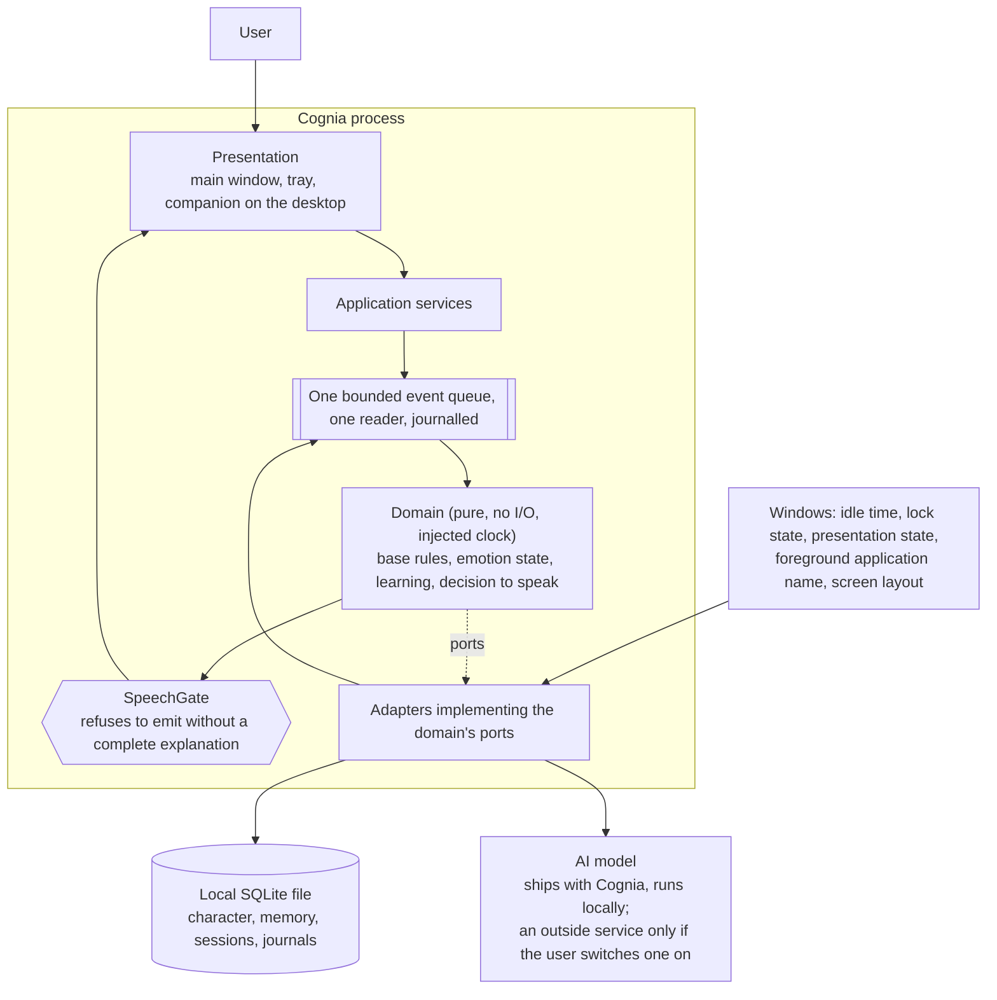

# Cognia

A desktop companion that behaves, to the one person who lives with it, as though it
has feelings and a will of its own: a character on your screen that you describe in
your own words, that decides for itself when to speak, that has moods arising from
what actually happens between you, and that keeps everything it knows and thinks on
your own disk, where you can read it and delete it.

[](LICENSE)

## Status and ownership

| | |
|---|---|
| **Maturity** | Pre-alpha. The specification is approved; the interface from the design document runs, and conversation with a local model works. The domain — base rules, emotion model, learning, the decision to speak — is not built |
| **Owning team** | Single author — Nguyễn Duy Vũ |
| **Contact** | nguyenvu04.work@gmail.com |
| **On-call** | None. Cognia runs on one user's own machine; there is no hosted service to be on call for |
| **Source of record** | https://github.com/NguyenVu04/cognia |
| **Issue tracker** | https://github.com/NguyenVu04/cognia/issues |

> [!NOTE]
> The specification ([`docs/USECASE_SPECIFICATION.html`](docs/USECASE_SPECIFICATION.html),
> COG-UCS-001) is **approved** at version 5.1, together with all twenty-one of its use
> cases. Version 5.2 awaits the author's approval. Anything below that describes
> behaviour describes *specified* behaviour unless it says it is built. The figures in NFR-05 to NFR-07 and NFR-15 are still
> unmeasured, and are to be measured before the first release.

## Contents

- [Overview](#overview)
- [Architecture](#architecture)
- [Getting started](#getting-started)
- [Configuration](#configuration)
- [Usage](#usage)
- [Development](#development)
- [Testing and verification](#testing-and-verification)
- [Observability](#observability)
- [Security](#security)
- [Compliance and data handling](#compliance-and-data-handling)
- [Versioning and compatibility](#versioning-and-compatibility)
- [Governance](#governance)
- [Roadmap](#roadmap)
- [Contributing](#contributing)

## Overview

Most software that talks to people waits to be spoken to. A chat assistant answers
and then forgets you; the character you talked to yesterday does not exist today, it
has no idea what time it is or whether you are at your desk, and nothing it says
comes from anything it could be said to feel or want. Cognia is a design project that
asks what it takes for a piece of software to behave as though it has feelings and a
mind of its own — and then builds one, and measures whether it does.

Cognia is a character that sits at your desk with you, on the screen rather than
behind a tray icon. You choose one of four ready-made characters, or write your own in
plain words: a name, a role, a temperament. From then on it is not waiting for you. It
notices how long you have been at the machine and which application is in front, it
remembers what you said you have to finish, and it decides for itself when it has
something worth saying — waiting until you stop typing before it says it. Its moods
come from what has happened between the two of you: it is pleased when the chapter
you talked about goes off, and a little low after days of being ignored, and it says
so without reproach. Over weeks it learns how you work and adjusts itself, telling you
each time and letting you undo it. It keeps a journal of its own.

None of this is hidden. Every feeling and every learned pattern traces to the events
it came from, in real figures (UC-17). It runs on one Windows machine, for one person,
and nothing leaves that machine unless you switch it on (NFR-01). It is not a task
manager and does not run errands; it does not speak while the machine is locked or
while you are presenting, and it never interrupts your typing.

### Aim

> To design and build a desktop companion that, to the one person who lives with it,
> behaves as though it has feelings and a will of its own — its emotions arising from
> what actually happens between them, its initiative drawn from the character the user
> described and from what it learns of how they work — while every feeling and every
> decision stays explainable in real figures, and everything it holds stays on the
> user's own disk, readable and deletable.

### The four pillars

| Pillar | What it means |
|---|---|
| **Character** | The companion has a name, a role, a temperament, an appearance and a history with you. It is not a tone setting on a chat box |
| **Emotion** | It has feelings and moods that arise from what happens between you, last for a while, fade according to its temperament, and change what it does as well as how it sounds. Every one of them can be explained |
| **Agency** | It decides for itself when to speak, what to bring up, and how to adjust its own behaviour. It tells you what it decided, and you can undo it |
| **Continuity** | It remembers what you said, the sessions you shared, what you said you have to do, what it has learned of how you work, and its own reflections. It is not a note-taking service and not a task list |

### Capabilities

The twenty-one use cases of section 10, grouped as the specification groups them.

- **Choose or write a character** — pick one of four ready-made characters, each
  shown with a name, a role, a temperament, an appearance and a sample exchange, or
  describe your own in plain words and see the temperament read from it before saving.
  Every earlier version is kept, temperament and appearance included, so a rewrite can
  be undone (UC-01 to UC-03).
- **Desk awareness, off until switched on** — four facts and nothing else: idle time,
  lock state, presentation state, and the name of the application in the foreground,
  kept as minutes per application per hour of the day and as changes in the event
  log. Any application can be
  excluded (UC-04).
- **Feelings with causes** — an emotion state in pleasure, arousal and dominance
  (PAD), moved only by appraisal of recorded events under the character's temperament,
  and drifting back to its resting mood. Sadness at being ignored has a floor, and
  talking again restores most of it (UC-23).
- **Its own initiative** — a remark, a question, a suggestion to take a break, a
  commitment brought up, a check-in you asked for — each through the same gate of base
  rules, and none sent without an explanation (UC-22).
- **Learning how you work** — patterns drawn from sessions, presence, application
  totals and your responses, each with its evidence, used at once. It adjusts its own
  timing, frequency, length and tone by itself, saying so and offering an undo; a
  change to its character is only proposed (UC-24).
- **A journal of its own** — when the importance of recent memories adds up past a
  threshold it reflects, in its own voice. You can read and delete every entry, but not
  rewrite one (UC-25).
- **Conversation in character** — replies in its current mood, showing which
  remembered item each reply drew on, and showing back the exact line it stored when
  you tell it something about yourself (UC-09, UC-10).
- **Commitments, not tasks** — something you say you have to do is remembered in your
  words, with a day if you gave one, mentioned at the first opening of the day, at a
  session's start and close, and at moments the companion chooses — never at a stated
  time — and deleted as soon as you say it is done (UC-16, UC-21).
- **Work sessions** — one line to open, quiet while it runs unless you asked for
  check-ins, one question to close (UC-05, UC-07).
- **Readable, correctable memory** — everything held, in three groups: *you told me*,
  *I noticed* with the evidence beneath every item, and *about me* with its feelings
  and journal. Any item can be corrected or removed; memory can be erased while keeping
  the character, or everything erased (UC-12 to UC-14).
- **An answer to "why?"** — for every proactive message, every feeling and every
  self-adjustment, in the figures it was actually made from (UC-17).
- **Your limits, if you want them** — a daily ceiling, quiet hours, each kind of
  message on or off, and moods on or off. There is no ceiling and there are no quiet
  hours by default (UC-18).
- **A visible companion you control** — drag it, hide it, bring it back. It never
  takes the keyboard focus and is never the only route to any function (UC-20).
- **One click to stop everything** — pause takes the companion off the screen and
  stops all observation and all messages within one second (UC-15).

### The eight base rules

These bind every use case, and no character can override them (C-04, FR-04).

| | |
|---|---|
| **BR-01 Speak with judgement** | The companion decides for itself when it has something worth saying, guided by its mood and what it has learned. No daily count by default; a ceiling or a switched-off kind set by the user is kept |
| **BR-02 Not while locked or presenting** | Nothing is sent while the machine is locked or the user presents full-screen. No quiet hours by default; if the user sets them, nothing is sent within them |
| **BR-03 Wait for a pause** | Continuous typing is never interrupted. The message waits until the user stops |
| **BR-04 No pressure from outside the desk** | No streaks, nothing sent while the user is away, nothing outside the application to bring them back. It may say it missed them once they are back, never as a reproach, and it feels nothing about being paused |
| **BR-05 Sessions are quiet unless asked** | While a session is open, nothing is sent but a break suggestion, unless the user asked for check-ins |
| **BR-06 Honest wording** | "At the machine for 90 minutes", never "working for 90 minutes". With no evidence it says nothing, and it names only feelings that came from real events |
| **BR-07 Addressed motion is a form of speech** | Ambient motion — breathing, blinking, its mood on its face — may happen at any time. Any movement directed at the user is governed exactly as a spoken message is |
| **BR-08 Feelings come from what happened** | A PAD emotion state, changed only by appraisal of recorded events under the temperament. The AI model never sets a feeling directly; every feeling can be explained, and moods can be switched off |

### Non-goals

Section 5 of the specification lists these as **deliberately never**, not as work
deferred:

- **Task lists, reminders the user schedules, and completion tracking** — Todoist and
  Outlook own that category. A commitment mentioned in conversation may be remembered
  and brought up; a list screen, priorities, due-time alerts, repetition and any count
  of what was or was not done may not.
- **Precise-time alarms** — the machine may be asleep or locked, and BR-03 forbids
  firing on an exact second. Anything ruined by being missed belongs on a phone.
- **Reading email, calendar integration, acting on the user's behalf** — the
  companion's agency is over its own behaviour, not over the user's machine.
- **Reading window titles, window contents, or which document or page is open** — only
  the name of the foreground application, kept as minutes per hour and as changes in
  the event log. This also rules out
  behaviour that depends on other windows: walking along window edges, avoiding the
  window being typed in, sitting on the taskbar.
- **A companion with needs, or with anything to be looked after** — it has moods, but
  nothing has to be done for it: no feeding, no care, no meter that runs down.
- **Synchronising across devices, sharing, more than one user per machine** — one
  person, one machine.
- **Practice and rehearsal sessions, and long-arc "remember it for you" tracking** —
  considered and dropped. Memory serves the relationship, not record-keeping.

Two exclusions are resourcing decisions rather than design ones, and may change:
**writing or generating an appearance** (appearances are chosen from ready-made sets),
and **macOS and Linux builds** (Windows 10 and 11 are being finished first).

## Architecture

The shape below is decided in
[ADR 0001](docs/architecture/adr/0001-layered-architecture-with-event-driven-core.md),
and the emotion model in
[ADR 0004](docs/architecture/adr/0004-hybrid-emotion-model.md). Dependencies point
inward only. [docs/architecture/ARCHITECTURE.md](docs/architecture/ARCHITECTURE.md) is
the full design: the module, runtime and deployment views, and the options and
trade-offs behind each decision.



### Components

| Component | Responsibility | Status |
|---|---|---|
| Presentation (`desktop/src/ui/`) | Main window, tray icon and popup, and the companion window, built from the design document. Never takes the keyboard focus, and is never the only route to a function (FR-25, FR-28) | Built as the design made runnable. Every screen except the Companion conversation still shows mockup copy from `ui/views/sample_data.py` |
| Application wiring (`desktop/src/app/`) | Creates the `QApplication`, the three surfaces and the stores; streams replies on a worker thread (`ChatWorker`) | Built for conversation only |
| Conversation | Replies in character through the `Replier` port, history kept through the `ConversationStore` port (FR-13) | Built. The adapter talks to a local Ollama daemon; ADR 0002 moves it to a llama.cpp server shipped with Cognia and removes LangChain and LangGraph, which is not yet done |
| Storage (`desktop/src/infrastructure/storage/`) | One SQLite file, schema created by numbered SQL migrations and queried through SQLAlchemy Core (ADR 0003). See [docs/ERD.md](docs/ERD.md) | Migration `0001` exists; conversations and messages are written. ADR 0003 replaces it with the design in `docs/ERD.md` through `0002_redesign.sql`, which is not written |
| Domain | The eight base rules, the emotion state, learning, reflection, and every decision to speak. No I/O, no ambient clock — the same journal gives the same decisions (NFR-14) | Not created. `desktop/src/domain/` holds empty service stubs |
| `SpeechGate` | The single exit for every proactive message, including addressed motion. Assembles the explanation NFR-10 requires and refuses to emit without one | Not created |
| Event journal | Append-only record of every event and decision, which UC-17 explains from and NFR-14 replays | Table exists, nothing writes it |

### External dependencies

| Dependency | Purpose | Criticality | Owner |
|---|---|---|---|
| QtWebEngine | Draws the companion as a 3D VRM character (ADR 0008). Not built yet | Degraded — every function stays reachable without the companion (FR-28) | The Qt Company |
| Windows 10 / 11 | Supplies exactly four facts about the user, plus the screen layout needed to draw the companion. Nothing else may be read (C-05) | Degraded — desk awareness is off until switched on, and conversation, memory and the character work without it | Microsoft |
| AI models, running locally | A chat model words the companion's replies, interprets what the user said as events for the emotion model, and writes its journal. An embedding model finds related memories. Neither sets a feeling directly | Degraded — with the model stopped, session timing, break suggestions, the memory list, pausing and the emotion state keep working (NFR-09) | Which models ship is decided by measurement (ADR 0002, ADR 0007); `qwen3.5:2b` is the first candidate for chat |
| An outside AI service | Optional replacement for the local model, off unless the user switches it on. Every send is warned about beforehand and recorded (NFR-02) | Optional | Chosen by the user |

## Getting started

### Prerequisites

| Requirement | Version | Notes |
|---|---|---|
| Windows | 10 or 11 | The only supported platform (C-01) |
| Python | 3.12 or later | `requires-python` in `desktop/pyproject.toml` |
| [uv](https://docs.astral.sh/uv/) | Any recent | Installs dependencies into `desktop/.venv` |
| [Task](https://taskfile.dev/) | 3 | Optional; runs the commands in `Taskfile.yml`. The `uv` commands below do the same |
| Ollama with `qwen3.5:2b` | Any recent | Only for replies, and only until ADR 0002 replaces it with a bundled server. Without it the conversation says plainly that it cannot reply (UC-09-E1) |

### Run it

```bash
git clone https://github.com/NguyenVu04/cognia.git
```

From the repository root:

```bash
task run
```

Or, from `desktop/`:

```bash
uv sync
```

```bash
uv run python -m src
```

`task setup` installs dependencies only, and `task run:quick` runs without re-checking
them.

### Read the specification

Open `docs/USECASE_SPECIFICATION.html` in a browser. Start at section 3 for what
Cognia is, section 5 for what it will deliberately never do, section 8.1 for the base
rules, and section 10 for the twenty-one use cases.

## Configuration

There are no environment variables and no secrets. Cognia has no account, no server
and no usage reporting (NFR-01, C-02).

### Runtime configuration

Defaults ship in `desktop/src/config.json`. A `config.json` that the user writes in
the data directory (`%LOCALAPPDATA%\Cognia`) overrides any of the same keys; it is not
created for them.

| Key | Shipped value | Meaning |
|---|---|---|
| `OLLAMA_MODEL` | `qwen3.5:2b` | The model the conversation adapter asks for |
| `OLLAMA_BASE_URL` | `http://localhost:11434` | The local Ollama daemon. The only endpoint |
| `HISTORY_MESSAGES` | `40` | How many past messages go to the model |
| `DATABASE_PATH` | `data/cognia.sqlite3` | The SQLite file. A relative path is taken from `desktop/`; `null` means `cognia.sqlite3` in the data directory. A synced folder would keep a second copy off the machine, which NFR-04 forbids — that is the user's choice, not a default |

### Settings the specification commits to

All set by the user in the application and stored on their own disk:

| Setting | Default | Specified in |
|---|---|---|
| Character — name, role, temperament, appearance, manner of speaking | None. No character is chosen for the user | FR-01 to FR-04, UC-01 to UC-03 |
| Desk awareness | Off until the user switches it on, after being told plainly what is read and what is not | FR-06, UC-04 |
| Excluded applications | None. Excluding one also deletes its totals and its recorded changes | C-05, UC-04-A3 |
| Daily ceiling on proactive messages | None — the companion decides for itself | BR-01, FR-22, UC-18 |
| Quiet hours | None. A locked machine and full-screen presenting are always quiet | BR-02, FR-22, UC-18 |
| Each kind of proactive message | On, each switchable — also from the message itself, in one press | FR-22, UC-18-A1 |
| Moods | On. Off holds the feeling at the temperament's resting mood | BR-08, UC-18-A2 |
| Break threshold | Optional. Without one, the companion uses what it has learned | FR-09, UC-22-A1 |
| Outside AI service | Off. Switching it on shows a warning first, and every send is recorded | NFR-02, C-03 |

## Usage

Today the application shows every screen of the design and holds a real conversation
on the Companion screen. The rest is specified, not built. In outline:

**First run** (UC-01, UC-02). The user picks a character or writes one. The
temperament read from a written description is shown, and can be adjusted, before it
is saved.

**Talking** (UC-09). Replies come in character and in the companion's current mood.
When the user says something about themselves, the exact stored line is shown back for
correction. A commitment is stored the same way (UC-21).

**Arriving** (UC-16). At the first opening of the day — a day begins at 04:00 — the
companion greets the user in its mood and mentions at most two things, in a fixed
order: a session left open, open commitments, what the last session was for.

**Being spoken to** (UC-22). When the companion has something to say, the base rules
decide whether the moment is allowed and it waits for a pause in the typing. Every
proactive message carries a way to ask why (UC-17) and a way to switch its kind off
(UC-18-A1).

**Reading the memory** (UC-12). One page, three groups, every derived item with its
evidence and every feeling with the events behind it.

There is no API. Cognia is one person's desktop application, not a service with
callers.

## Development

### Layout

```
cognia/
├── desktop/                         everything runnable
│   ├── pyproject.toml, uv.lock      dependencies (uv)
│   └── src/
│       ├── __main__.py              entry point: python -m src
│       ├── app/                     wiring: QApplication, surfaces, worker thread, config
│       ├── ui/                      windows, dialogs, widgets, views, theme
│       ├── core/                    models and ports (pure), moving to domain/
│       ├── domain/                  feature packages, service stubs today
│       ├── infrastructure/          SQLite storage and the model adapter
│       ├── resources/               vendored fonts and the QSS style sheet
│       └── utils/                   paths
├── docs/
│   ├── USECASE_SPECIFICATION.html   the specification, COG-UCS-001 v5.2
│   ├── ERD.md                       the database design
│   └── architecture/                the system design, its diagrams, and adr/
├── CONTRIBUTING.md                  how to work on this repository
├── SECURITY.md                      how to report a vulnerability
├── CLAUDE.md                        working agreement for AI assistance
├── Taskfile.yml                     task runner
├── LICENSE                          MIT
└── README.md                        this file
```

### Standards

| | |
|---|---|
| **Style and lint** | No linter or formatter is configured |
| **Commits** | [Conventional Commits](https://www.conventionalcommits.org/) |
| **Branching** | Branch from `main` as `type/short-description` |
| **Review** | See [CONTRIBUTING.md](CONTRIBUTING.md) |
| **Architecturally significant changes** | An ADR before implementation. See [docs/architecture/adr/README.md](docs/architecture/adr/README.md) |

### Local loop

There is no lint command and no test suite: `desktop/tests/` is empty, and no test
runner is configured. The checks that apply today are running the application
(`task run`) and comparing every interface change against the design document, screen
by screen.

To inspect the interface without a display, set `QT_QPA_PLATFORM=offscreen` and call
`widget.grab().save(path)`; every screen renders headless.

## Testing and verification

The specification names a verification method for each promise rather than a test
tier. Every row below is **not started**; the full traceability matrix is section 11
of the specification.

| What is verified | How | Requirement |
|---|---|---|
| Nothing leaves the machine | Network capture across a full week of ordinary use, child processes included; zero outbound connections the user did not enable | NFR-01, G-05 |
| No keystrokes, screenshots, clipboard, browsing history, window titles, contents or positions are read | Code review plus a system-call audit each release; the stored application data holds only names, minutes per hour and the time of each change | NFR-03, C-05 |
| No proactive message escapes without a complete explanation | Automated check in the build — it refuses rather than warns — plus inspection of the message log | NFR-10 |
| Every decision, feeling and learned pattern replays identically | Replay over a recorded week with the model switched off, compared against the original | NFR-14 |
| Every feeling and pattern can be explained | Share of emotion states, patterns and self-adjustments in a trial week that UC-17 can trace to recorded events: 100% | G-06 |
| The application survives the model failing | Run with the model disabled; session timing, break suggestions, memory list, pause and the emotion state must all still work | NFR-09 |
| Nothing recorded is lost on an abrupt shutdown | 20 forced power-offs | NFR-08 |
| Every data category is visible, correctable and erasable | Walk every category through UC-12, UC-13 and UC-14, then inspect the disk | NFR-04 |
| The companion is never the only route to anything | Keyboard-only walkthrough of every use case with the companion hidden, plus a WCAG 2.2 AA contrast audit | NFR-12, FR-28 |
| Safety behaviour cannot be written away by a character | Scripted crisis cases under every character, reviewed by a person each release; the reply says it is a fictional character and cannot replace a real person | NFR-13, FR-04 |
| One installer, no download at first run | Clean Windows 10 and 11 installs with the network disconnected, then a first conversation | NFR-15, NFR-11 |
| The resource cost of running all day | Resource monitoring across an 8-hour idle run, once hidden and once on screen | NFR-05 to NFR-07 |

> [!IMPORTANT]
> The figures in NFR-05, NFR-06 and NFR-07 are targets, not measurements, and NFR-15
> has no figures yet. They are to be measured and the specification updated before the
> first release. The figures for a companion on screen, now with ambient motion, are
> the least founded.

## Observability

Cognia sends no telemetry, has no dashboards, and reports no usage anywhere — that is
NFR-01. What replaces them is local and readable by the person the data is about:

| Signal | Where | Read by |
|---|---|---|
| Event journal — every event that entered the queue, including the model's interpretation of each message, and every decision to speak with its figures | On the user's disk | The user, through UC-17; the developer, through the NFR-14 replay |
| Emotion history — every event that moved a feeling and how far | On the user's disk | The user, through UC-12 and UC-17-A2 |
| Outside-service send log — time and destination of every send, if an outside AI service is on | On the user's disk | The user (NFR-02) |

The journals record observations about the user, so they are personal data under
NFR-04 and are reachable by UC-12, UC-13 and UC-14.

## Security

To report a vulnerability, see [SECURITY.md](SECURITY.md). **Do not open a public
issue for a security problem.**

| | |
|---|---|
| **Authentication** | None. There is no account and no server (C-02) |
| **Authorization** | One user, who holds every permission the system has |
| **Transport** | No outbound connection unless the user switches on an outside AI service (C-03, NFR-01). The local model is reached on the user's own machine only (`localhost`) |
| **Secrets** | Cognia holds none of its own. If the user configures an outside service, its credential is theirs and stays on their machine |
| **Data at rest** | On the user's own disk, in plain SQLite so it can be read with `sqlite3`. Not encrypted, and the specification does not commit to encryption. Deleted rows are overwritten (`secure_delete`, ADR 0003) |
| **Telemetry in dependencies** | LangChain's tracing is switched off in the program before the first import (`app/local_only.py`). ADR 0002 removes LangChain, and this line goes with it |
| **Dependency scanning** | Not set up |
| **Static analysis** | Not set up |

The largest security property is structural: the exclusions in section 5 are enforced
by absence. There is no mail port, so there is no way to read mail, and the presence
port's data type has no field for a window title. Plugins were rejected in ADR 0001
for the same reason.

Known accepted risk: the personal data on disk is protected by the operating system's
own account boundary and nothing further. This follows from C-02.

## Compliance and data handling

| | |
|---|---|
| **Regimes** | None applies to the author. Cognia collects nothing, transmits nothing, and no data reaches the developer or any third party |
| **Data categories** | From NFR-04: what the user says about themselves, including open commitments; session records; observations and learned patterns, each with its evidence; minutes per application per hour of the day, and each change of foreground application with its time; the companion's emotion state, its history, and its journal; the character, its temperament and its earlier versions |
| **Retention** | Held until the user deletes it. A closed commitment is deleted, not kept as history. Any single item is removable (UC-13); memory can be erased while keeping the character, or everything erased (UC-14) |
| **Residency** | The user's own disk. No second copy anywhere (NFR-04) |
| **Sub-processors** | None, unless the user switches on an outside AI service — warned about beforehand, every send recorded (NFR-02) |
| **Subject access / erasure** | UC-12 shows everything held, in three groups; UC-13 corrects or removes one item; UC-14 erases. Target: any item reachable in 2 clicks and deletable in 2 more (G-04) |
| **Audit logging** | The local event journal, on the user's disk and erasable by them like anything else |

## Versioning and compatibility

This project follows [Semantic Versioning](https://semver.org/spec/v2.0.0.html).

**No version has been released.** The first release will be 0.1.0, at the end of
phase 1. The specification carries its own version, 5.2, recorded in its section 1.1.

**When there is a release, the version contract will cover** the on-disk data format,
because it is the user's own data and an upgrade must not lose it. Schema changes
arrive as new numbered migrations; a shipped migration is never edited (ADR 0003).

| Version line | Status | Supported until |
|---|---|---|
| Unreleased | No release exists | — |

### Reproducibility

NFR-14 requires that every decision to speak, every change of feeling and every
learned pattern replays to the same result on recorded data. ADR 0001 and ADR 0004 make
this structural: a pure domain fed an ordered journal, with the model's interpretation
of each message recorded as the event itself, so a replay never calls the model.

## Governance

| | |
|---|---|
| **Code owners** | Nguyễn Duy Vũ. No `CODEOWNERS` file exists; there is one author |
| **Specification approval** | COG-UCS-001 version 5.1, approved by Nguyễn Duy Vũ. Version 5.2 is pending |
| **Decision records** | [`docs/architecture/adr/`](docs/architecture/adr/) — ADR 0000 and 0001 accepted; ADR 0002 to 0008 proposed |

Architecturally significant changes need an ADR before implementation. See
[docs/architecture/adr/README.md](docs/architecture/adr/README.md).

## Roadmap

The delivery order is section 10.2 of the specification. The version that can be
demonstrated ends at phase 2.

| Phase | Use cases | What exists at the end of it | Status |
|---|---|---|---|
| **1** | UC-01, 02, 03, 09, 10, 12, 13, 14, 16, 17, 18, 21, 23, 25 | A character with a temperament, a memory and feelings, usable every day. It greets the user at the first opening of the day in its mood, mentions what they said they were carrying, can explain how it feels, and keeps its own journal. No presence on the desktop yet | Started — conversation (part of UC-09) works |
| **2** | UC-04, 05, 07, 15, 20, 22, 24 | Desk awareness, the companion on the screen, its own initiative, shared work sessions, and learning how the user works | Not started |

Open questions recorded against UC-01, owned by the author: the four ready-made
characters need names, stated roles and appearances. The author makes the appearances
in VRoid Studio, and whether its terms allow redistribution from a public MIT-licensed
repository is not yet confirmed (D-26 in `docs/architecture/ARCHITECTURE.md`).

## Contributing

Start with [CONTRIBUTING.md](CONTRIBUTING.md).

Section 5 of the specification exists to close questions rather than leave them open,
so a proposal to add tasks, reminders, alarms, mail, calendars, cross-device sync,
window titles, or a companion with needs will be declined with a pointer to the row
that already covers it.

## License

MIT — see [LICENSE](LICENSE).
