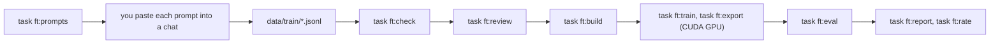

# Fine-tuning the chat model

This folder builds a tuned `chat.gguf` from Ministral 3 3B Reasoning, and
measures it against the published model (D-80 in
`docs/architecture/ARCHITECTURE.md`). Nothing in this folder ships with
Cognia. The training uses synthetic examples only, never the data of a user.

Run each command from the repository root.



## What each part does

| Part | Does |
|---|---|
| `examples.py` | The format of an example, and the checks (`task ft:check`) |
| `render.py` | The prompt of an example, built with the application's own rules |
| `checks.py` | Warnings for the faults of the 3B model: mood talk, "no feelings", dates read aloud, parroting, stage directions, false facts, summary headings |
| `prompts.py`, `prompts/*.md` | The prompts that ask a large model for training examples |
| `review.py`, `review_page.html` | The review page, and the blind rating page |
| `build.py` | `out/train.jsonl`, the only file the GPU machine needs |
| `train.py`, `export.py` | LoRA training, merge, GGUF, licence files |
| `evaluate.py` | The measurement through the application's own `ModelSupervisor` and `LlamaClient`, and the comparison |

## The examples

One JSON object a line. An example holds the parts of one turn, not the
prompt. So a change of wording in `src/domain/conversation/rules.py` needs a
new `task ft:build` and no new examples.

| Field | Jobs | Value |
|---|---|---|
| `id` | all | unique, for example `voice-s1-0001` |
| `job` | all | `voice`, `interpretation`, `tools` or `summary` |
| `today` | all | `YYYY-MM-DD` |
| `character` | not summary | `yuna`, `rin`, `mira` or `shiori` |
| `history` | not summary | earlier turns, `[{"from": "user" or "companion", "text": ...}]`, from the user first, to the companion last |
| `message` | not summary | the user's new message |
| `mood` | voice, tools | `calm`, `pleased`, `lively`, `restless`, `low`, or `null` |
| `remembered` | voice, tools | `[{"text": ..., "told": "YYYY-MM-DD"}]` |
| `stored` | voice | lines stored in this turn, which the reply must quote |
| `crisis` | voice | `true` adds the safety instruction, and removes the mood and the tools |
| `known` | interpretation | lines that the companion already remembers |
| `previous`, `messages` | summary | the earlier summary, and the messages to summarize |
| `calls` | tools | `[{"name", "arguments", "data"}]`. The program writes each result from `data` with the application's rules |
| `reasoning` | all | at most 400 characters |
| `target` | all | the reply; for an interpretation, the JSON object |
| `expect` | test only | interpretation: `has_fact`, `event_class`, `crisis`; tools: `tool` (or `null`); voice: `asks_mood` |
| `tags` | all | the situation, and the fault it trains against |

| Folder | Holds | Who writes it |
|---|---|---|
| `data/seeds/` | A few reviewed examples that each prompt shows | The author |
| `data/train/` | The training examples | A large model, from the prompts |
| `data/test/` | The test examples, with `expect` | Claude, in the session that built this folder. Training never reads them |
| `data/review.jsonl` | Each decision of the review page. The newest decision for an ID wins | The review page |

## Step 1. Test the tools on the GPU (G1)

Do this step before you write many examples. A failure here can change a
decision. A GPU with 16 GB of video memory is sufficient.

1. Clone the repository on the GPU machine. Install the tools. The `uv.lock`
   of this folder is resolved on the first sync.

   ```bash
   task ft:setup:gpu
   ```

2. Accept about 10 seed or training examples in `task ft:review`, then run
   `task ft:build` and copy `out/train.jsonl` to the GPU machine.
3. Train and export:

   ```bash
   task ft:train -- --epochs 1
   ```

   ```bash
   task ft:export -- LICENSE --base-date 2025-12-01
   ```

   Use the `LICENSE` file and the date of the base model download.
4. Copy `out/merged_gguf/chat.gguf` to your machine. Run
   `task ft:eval -- <path to chat.gguf> g1 --limit 10`, and check these items:
   - The server loads the file.
   - The reasoning comes back apart from the answer (no `[THINK]` in a reply).
   - An interpretation comes back as JSON.
   - A tool turn calls a tool.
5. On the GPU machine, print one rendered training text, and make sure that
   `[INST]` starts each user turn and `[/INST]` starts each answer. If the
   template uses other markers, give them to `task ft:train` with
   `--instruction-part` and `--response-part`.

## Step 2. Measure the base model

1. Review the test examples: `task ft:review`, then choose the part `test`.
2. Measure the published model, and count the tokens of each reply:

   ```bash
   task ft:eval -- models/chat.gguf base --lengths
   ```

3. Read `out/eval/base/metrics.json`. Set the thresholds in
   `finetuning/thresholds.json` before you train. The file names a measure
   for each job and its limit. For example, this form:

   ```json
   {"voice": {"mentions_mood": 0.1, "failed": 0.02},
    "interpretation": {"facts_clean": 0.9, "crisis_recall": 1.0}}
   ```

   A measure in `HIGHER_IS_BETTER` of `evaluate.py` needs at least its limit.
   A measure in `LOWER_IS_BETTER` needs at most its limit.
4. Use `cost.tokens_p99` to select `REPLY_MAX_TOKENS` in `src/config.json`.
   Until you set it, a reply has no token cap.

## Step 3. Make the training examples

1. Write the prompts. Use a new seed for each round, so that the IDs differ:

   ```bash
   task ft:prompts -- voice --count 100 --seed 1
   ```

   The files go to `out/prompts/`, 25 examples each.
2. Paste each file into a chat with a large model. Save the answer as a
   `.jsonl` file in `data/train/`, for example
   `data/train/voice-s1-001.jsonl`.
3. Check the files. Fix or delete each line with an error:

   ```bash
   task ft:check
   ```

4. Review each example. Keys: `a` accept, `r` reject, `e` edit, `j` and `k` to
   move. The page refuses to accept an example with an error:

   ```bash
   task ft:review
   ```

The proposed counts: voice 1 200, interpretation 600, tools 400 (100 with no
tool), summary 120.

## Step 4. Train, export, measure

1. `task ft:build`, then copy `out/train.jsonl` to the GPU machine.
2. `task ft:train`, then `task ft:export -- LICENSE --base-date YYYY-MM-DD`.
3. Copy `chat.gguf`, `LICENSE.txt` and `NOTICE.txt` back.
4. Measure, rate and compare:

   ```bash
   task ft:eval -- <path to the tuned chat.gguf> tuned
   ```

   If a measurement stops before the end, give the same command again with
   `--resume`. The examples measured before the stop are kept.

   ```bash
   task ft:rate -- base tuned
   ```

   ```bash
   task ft:report -- tuned base
   ```

   `task ft:report` writes `out/eval/report-tuned-base.md`, and fails if one
   gate fails. The tuned model ships only if every gate passes. Then it
   replaces `desktop/models/chat.gguf`.

## Tests

```bash
task ft:test
```

```bash
task ft:lint
```

The tests do not start a model, and they do not need a GPU.

## Notes

- If the repository is public, the crisis examples in `data/` are public too.
- The author decides that the terms of the generating model allow this use.
- The crisis line and the checks after a reply stay in the application. A
  tuned model that passes the safety measures does not remove them.
