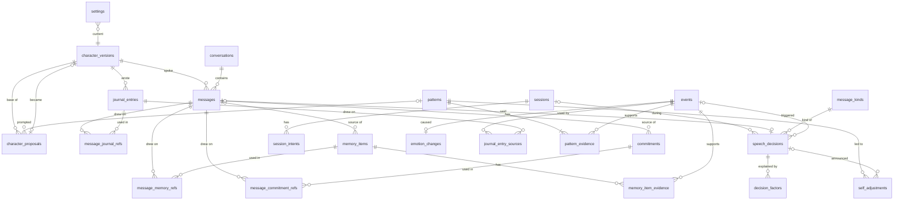
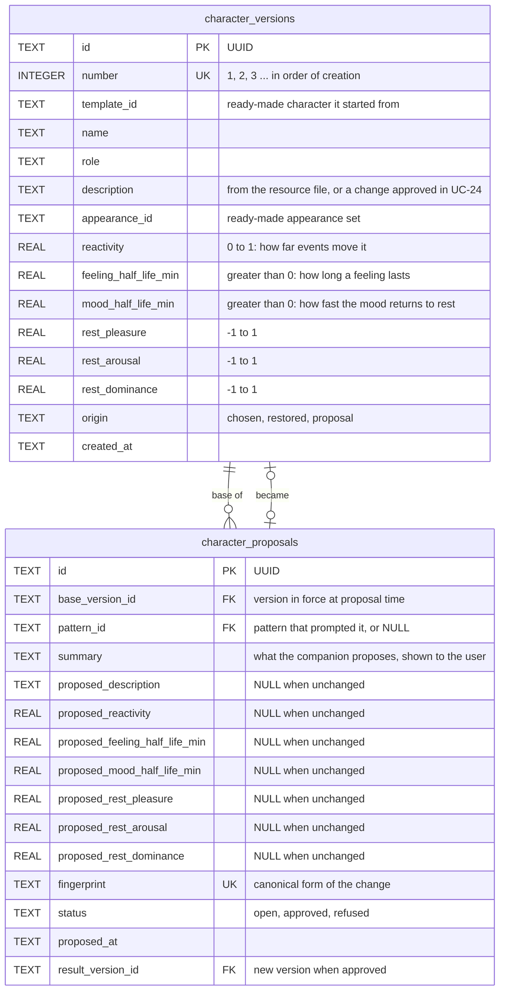
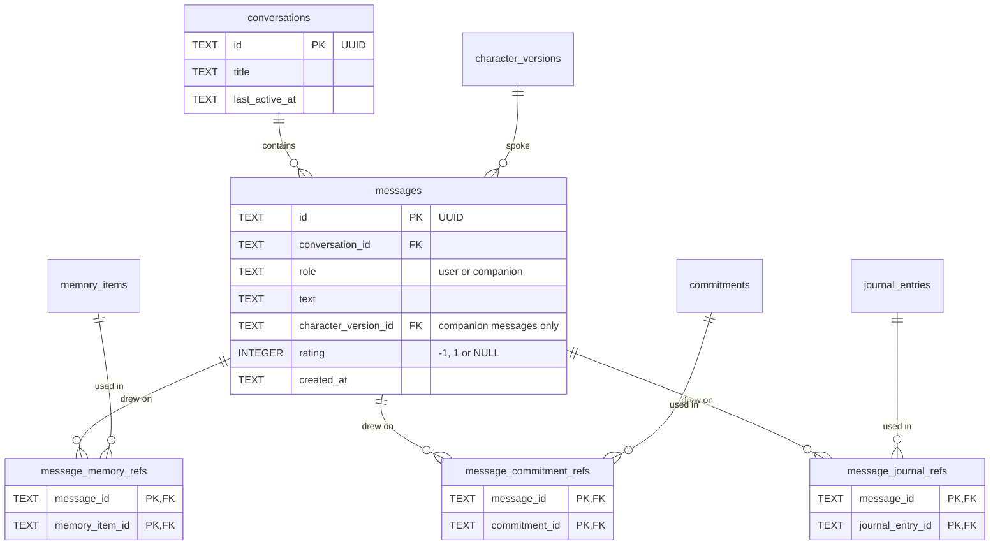
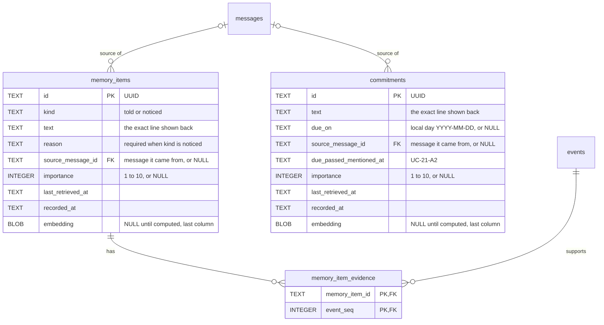
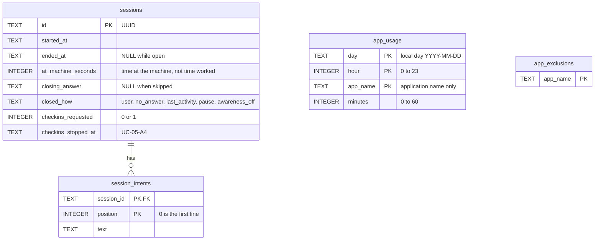
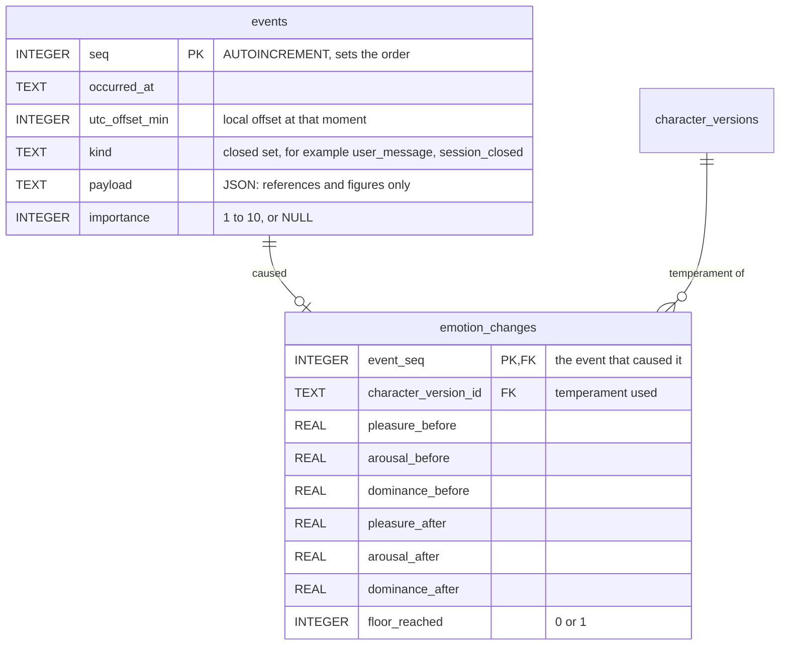
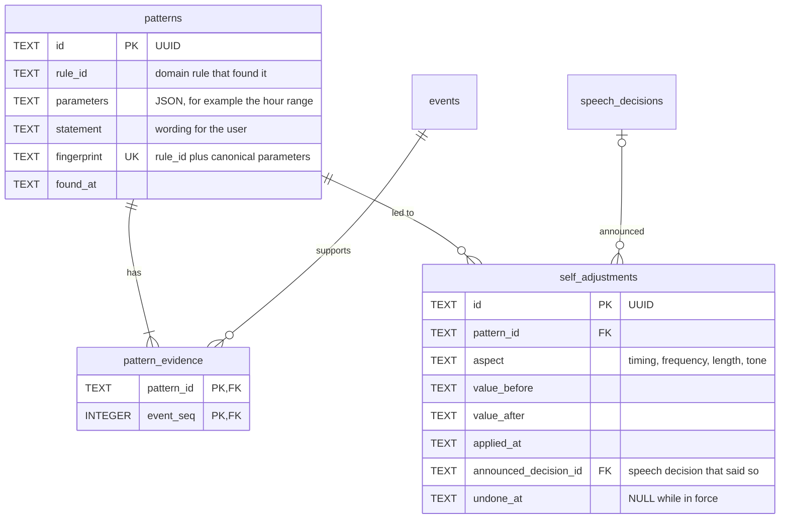
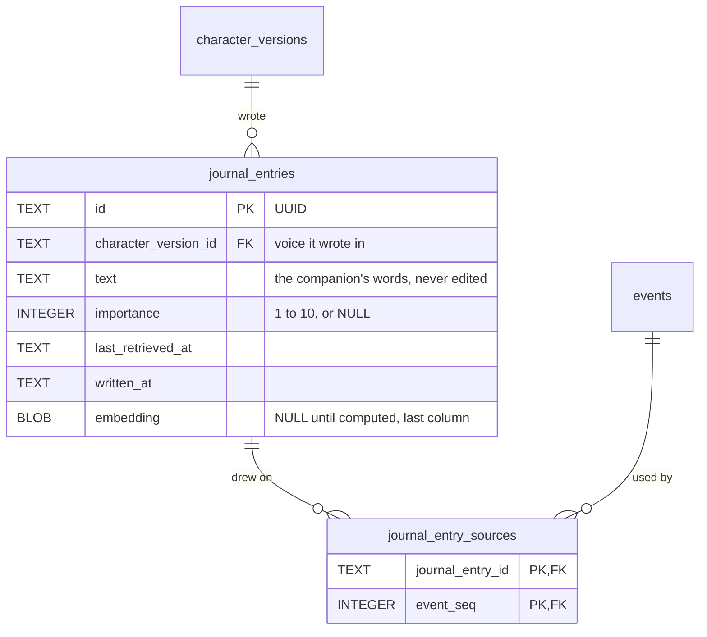
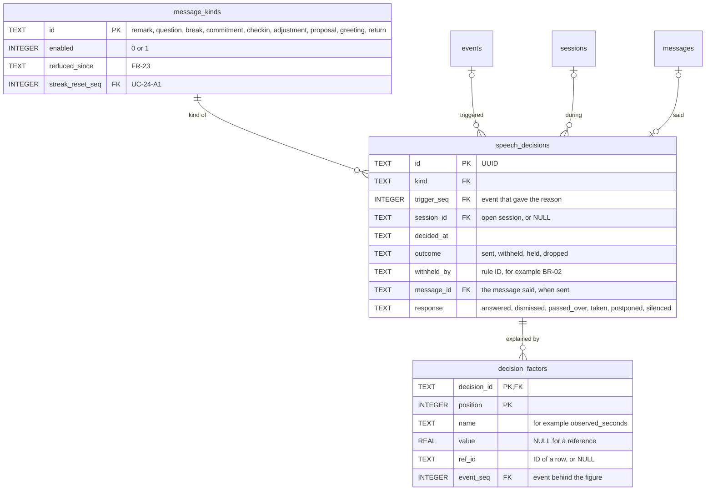
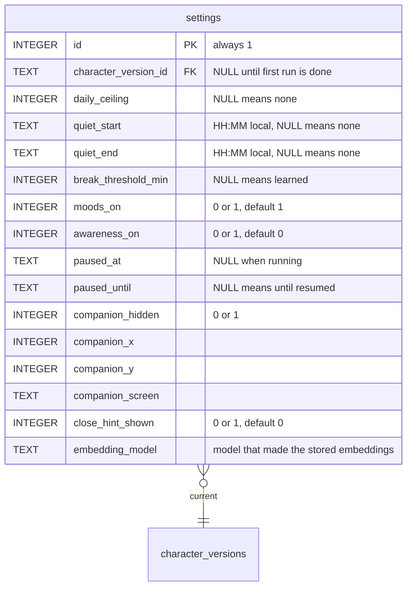

# Cognia — database design

| | |
|---|---|
| **Document** | Entity-relationship design for the Cognia data file |
| **Status** | Proposed, with ADR 0003. The design becomes binding when ADR 0003 is accepted |
| **Date** | 2026-10-25, revised 2026-10-31 |
| **Author** | Nguyễn Duy Vũ |
| **Source of requirements** | COG-UCS-001 version 5.4 ([`USECASE_SPECIFICATION.html`](USECASE_SPECIFICATION.html)) |
| **Related decisions** | ADR 0001 (event log, pure domain), ADR 0002 (readable local storage), ADR 0003 (this schema, its migration and query layer), ADR 0004 (emotion model), ADR 0006 (application names in the event log), ADR 0007 (embeddings), [`ARCHITECTURE.md`](architecture/ARCHITECTURE.md) (the system this file serves) |
| **Writing standard** | ASD-STE100 rules for sentence structure. The lexical rules are a direction only, because this project does not hold the ASD dictionary |

## Contents

1. [Purpose and scope](#1-purpose-and-scope)
2. [Terms](#2-terms)
3. [Design decisions](#3-design-decisions)
4. [Overview diagram](#4-overview-diagram)
5. [Character](#5-character)
6. [Conversation and provenance](#6-conversation-and-provenance)
7. [Memory and commitments](#7-memory-and-commitments)
8. [Work sessions and desk awareness](#8-work-sessions-and-desk-awareness)
9. [Event log and emotion](#9-event-log-and-emotion)
10. [Learning and self-adjustment](#10-learning-and-self-adjustment)
11. [The companion's journal](#11-the-companions-journal)
12. [Speech decisions and explanations](#12-speech-decisions-and-explanations)
13. [Settings](#13-settings)
14. [Deletion and erasure](#14-deletion-and-erasure)
15. [Traceability](#15-traceability)
16. [Open items](#16-open-items)

## 1. Purpose and scope

This document gives the logical design of the one SQLite file that holds all
Cognia data. It shows each table, each column group, each relationship, and the
reason for each design decision.

The design covers all use cases of COG-UCS-001 version 5.4. It also covers the data
categories in NFR-03.

This document does not contain migration scripts. The ORM classes in
`desktop/src/infrastructure/storage/orm.py` state this design in code, and Alembic
revisions apply it to the file (ADR 0003).

## 2. Terms

| Term | Meaning in this document |
|---|---|
| Event log | The append-only table `events`. ADR 0001 calls it "the journal". This document uses "event log" so that the word "journal" has one meaning only |
| Journal | The companion's own written reflections (UC-25), in the table `journal_entries` |
| State table | A table that holds data the user owns and can read, correct or delete. A state table is the source of truth for its data |
| Cache table | A table that the domain computes from the event log. The application can delete a cache table and compute it again with no loss |
| Tombstone | A record that keeps only enough data to stop the companion from repeating a conclusion that the user rejected. A tombstone holds no user text |
| Seq | The sequence number of one row in the event log. It sets the order of events |
| PAD | Pleasure, arousal and dominance. Each axis is a real number from -1 to 1 (ADR 0004) |

## 3. Design decisions

| # | Decision | Reason |
|---|---|---|
| D-01 | The engine is SQLite, in one file | One user and one machine need no server (C-02). WAL mode with `synchronous=FULL` keeps committed rows after a power loss (NFR-07). The user can read the file with the `sqlite3` tool (ADR 0002) |
| D-02 | The design is a hybrid of state tables and an event log | Data that the user owns is easy to correct or delete in a state table (UC-13). Feelings and patterns come from events, so the event log is their source and the domain can replay it (NFR-13) |
| D-03 | The event log holds references and figures, never user text | A user message, a memory line or a commitment exists in one state table only. When the user deletes that row, the text is gone. The event stays, so replay still works |
| D-04 | Primary keys are UUID text. Time is UTC ISO-8601 text | A UUID exists before the write, so the application can link rows in one transaction. Fixed-width UTC text sorts in time order and a person can read it |
| D-05 | Evidence is a join table to event seqs | Each item in "I noticed" points to the exact events behind it. A foreign key proves the link, which G-06 needs at 100% |
| D-06 | The temperament is typed numeric columns with `CHECK` constraints | The database refuses a value out of range. A JSON column can only show that the text is valid JSON |
| D-07 | Mood history is a cache table, `emotion_changes` | UC-17-A2 and UC-12 read each change and its cause with one query. The domain can compute the table again from the event log |
| D-08 | A character version stores the description and structured columns | UC-03 shows the character in force. The specification does not define traits, so the design has no trait tables |
| D-09 | Commitments have their own table | A commitment has a due day that no other item has. Closing a commitment deletes the row (section 5 of the specification) |
| D-10 | Explanation figures are rows in a child table, `decision_factors` | Each kind of message needs different figures. One child table holds all of them, and the `SpeechGate` checks the required factors for each kind |
| D-11 | A rejected pattern and a deleted journal entry are tombstones in the event log | A rule reads only the event log (input closure, section 6.4 of `ARCHITECTURE.md`), so the events `pattern_rejected` and `reflection_deleted` must hold the fingerprint and the seqs. A table would hold a second copy. A refused proposal and an undone adjustment stay as rows in their own tables |
| D-12 | Each kind of reply source has its own join table | A reply can draw on a memory item, a commitment or a journal entry. Separate join tables keep real foreign keys with `ON DELETE CASCADE` |
| D-13 | Each companion message refers to the character version that spoke it | The character can change during a conversation. The link shows which version said each line, which G-03 and replay need |
| D-14 | Settings are one row with typed columns | `CHECK` constraints protect each value. `NULL` means "not set" for the ceiling, quiet hours and break threshold (BR-01, BR-02) |
| D-15 | Each row that a reply can draw on holds its own embedding, in a `BLOB` column | An embedding comes from the row, so it must disappear with the row. No join and no second copy is needed (ADR 0007) |
| D-16 | Each row that a reply can draw on holds its importance and its last retrieval time | Retrieval needs both, and the link from a row to its event can be `NULL` (ADR 0007) |
| D-17 | Each event stores its UTC offset | The 04:00 boundary and the hour of the day are local. A replay must not depend on the time zone of the machine that runs it (NFR-13) |
| D-18 | The event log holds each change of foreground application with its time | UC-22 decides from the application in use, and a replay needs each input (C-05 in version 5.2, ADR 0006) |
| D-19 | The current emotion point stays in memory, and no table stores it | The core thread folds the event log at each start, so nothing would read such a table. A snapshot table is the upgrade if a measurement shows a slow start |
| D-20 | `name` in `decision_factors` sets the unit of `value` and the table of `ref_id` | A stored unit and a stored table name each depend on `name` and not on the key, which breaks third normal form. The set of factors is closed, so the domain holds one lookup |
| D-21 | Each foreign key has an index, with the exceptions in section 3.3 | SQLite makes no index for a foreign key. With no index, each deleted parent row scans the child table |

### 3.1 Rules for all tables

1. Every table is `STRICT`, so SQLite refuses a value of the wrong type.
2. The application sets `PRAGMA foreign_keys=ON` on each connection.
3. `PRAGMA secure_delete=ON` overwrites deleted rows on disk (NFR-03).
4. A UUID is 32 lowercase hexadecimal characters, as `uuid.uuid4().hex` gives it.
5. A timestamp is UTC text in the form `YYYY-MM-DDTHH:MM:SS.mmm+00:00`.
6. A local calendar day is text in the form `YYYY-MM-DD`. Only two columns use it: `commitments.due_on` and `app_usage.day`. The user said "Friday", not an instant in UTC.
7. The database stores no start of day. The domain computes the 04:00 boundary of UC-16 from `events.occurred_at` and `events.utc_offset_min`.
8. A boolean is `INTEGER` with `CHECK (x IN (0, 1))`.
9. A foreign key to `events.seq` uses `ON DELETE CASCADE` in a join table or a cache table. Every other foreign key to `events.seq` uses `ON DELETE SET NULL`. Thus the user can always delete events (UC-13-A2, UC-14).

### 3.2 Normal forms

The design has 25 tables. This check looks at the functional dependencies inside each
table. Twenty-two tables are in Boyce-Codd normal form (BCNF).

| Tables | Result | Reason |
|---|---|---|
| `memory_items`, `commitments`, `journal_entries` | Not in third normal form, by decision | `text` sets `embedding`, and `text` is not a key. The vector is a cache that the application can compute again, and it must disappear with its row (D-15). A separate table would add a join and give no benefit |
| `character_versions` | BCNF | `template_id` seems to set `name`, `role` and `appearance_id`, but a resource file can change between releases. A row is a fixed copy that a restore needs (UC-03), so this is not a dependency |
| `character_proposals`, `patterns` | BCNF | `fingerprint` is a candidate key, so the columns that make it depend on a key |
| `speech_decisions` | BCNF | `message_id` is a candidate key, with a partial unique index |
| `decision_factors` | BCNF | `name` no longer has a stored unit or table (D-20) |
| All other tables | BCNF | Each non-key column depends on the key only |

**JSON columns.** `events.payload` and `patterns.parameters` hold JSON, so they are not in
first normal form in the strict sense. This check treats each as one value, because each
event kind and each rule has a different shape (D-03).

**Copies across tables.** A normal form looks at one table only. Some facts exist in a
state table and in an event, because a rule reads only the event log. These are
`app_usage` and `app_hour_closed`, `messages.rating` and `message_rated`, and
`speech_decisions.response` and `message_answered`. `conversations.last_active_at` is a
copy of the time of the last message. An empty conversation has no message, and the
picker sorts by this column.

### 3.3 Indexes

SQLite makes no index for a foreign key. When foreign keys are on, each deleted parent row
must find its child rows. With no index, this is a scan of the child table (D-21).

*Illustration.* A test in memory held 50,000 events and 30,000 rows in each of three
evidence tables. It deleted 500 events. With no index on `event_seq` the delete took 2.6
seconds. With the index it took 0.001 seconds. UC-04-A3 runs such a delete on the core
thread.

**Rule.** The first column of the primary key or of an index covers each foreign key. An
index on a nullable column is partial, with `WHERE column IS NOT NULL`. A test checks this
rule.

**Exceptions.** These foreign keys have no index.

| Column | Reason |
|---|---|
| `character_version_id` in `messages`, `journal_entries`, `emotion_changes`, `settings` | A character version is deleted only by "erase everything", after its child rows. `messages` also has many writes |
| `message_kinds.streak_reset_seq` | The table has nine rows |

**Other indexes that the design does not use.**

| Index | Reason |
|---|---|
| `conversations (last_active_at)` | Each message updates this column, and the table has few rows |
| `app_usage (app_name)`, or an expression on `events.payload` | Only UC-04-A3 needs them, and it is rare |

**The vector column.** `embedding` is the last column of its table, so a read of the other
columns does not go through the overflow pages of the vector. The ORM marks it as deferred,
so a list does not load it.

## 4. Overview diagram

This diagram shows all tables and their relationships. Sections 5 to 13 show the
columns.

Two tables are not in this diagram: `app_usage` and `app_exclusions`. They refer to no
other table.

## 5. Character

### 5.1 `character_versions`

**Purpose.** One row holds one complete version of the character: who it is, how
it speaks, how it looks and how it feels things (FR-04).

**Immutability.** The application never updates a row. A change of character, a restore
or an approved proposal inserts a new row (UC-03). Thus every earlier version stays
available for restore.

**One character per installation.** The specification gives one companion to one
installation (section 6.1). The design therefore has no `characters` table. The
`settings` row points to the version in force. The `number` column orders the
versions.

**Identity columns.** `name`, `role` and `description` hold the words of the
ready-made character that the user chose. `description` keeps the exact text, because
UC-03 shows it again. `template_id` names that character in the resource file (UC-01).
The user cannot edit these words. Only a change that the user approves in UC-24 makes
a new `description`.

**Appearance.** `appearance_id` names a ready-made appearance set in the resources
(UC-01). The user cannot write an appearance (section 5 of the specification). The
appearance is part of the version, so a restore brings back the old look (UC-03).

**Temperament columns.** The author sets these values by hand for each ready-made
character (UC-01). The application copies them from the resource file. No process
reads them from the text, so feelings replay the same way (NFR-13).

| Column | Range | Meaning |
|---|---|---|
| `reactivity` | 0 to 1 | The fraction of an appraised displacement that reaches the mood |
| `feeling_half_life_min` | Greater than 0 | Minutes until the effect of one feeling falls by half |
| `mood_half_life_min` | Greater than 0 | Minutes until the mood moves half the distance back to rest |
| `rest_pleasure`, `rest_arousal`, `rest_dominance` | -1 to 1 | The resting mood of the temperament |

The three time scales of ALMA (ADR 0004) need two rates. The feeling rate and the
mood rate are separate columns. The ranges are proposals. Trial use sets the final
values, as ADR 0004 states.

**Lineage.** `origin` records how the row came to exist. `number` gives the order of the
versions, so the version that a row replaced is the row with the previous number. A
restored row is a complete copy, so it needs no link to the row that it copied
(UC-03-A1). UC-03-A1 shows the date that each version was in force, which comes from
`created_at`.

**Constraints.**

- `UNIQUE (number)`.
- `CHECK` on each temperament column, as in the table above.
- `CHECK (origin IN ('chosen', 'restored', 'proposal'))`.
- `template_id` is `NOT NULL`, because each character comes from a ready-made one (UC-01).

### 5.2 `character_proposals`

**Purpose.** One row holds one change that the companion proposed to its own
character (UC-24-A2). Only the user can apply such a change (FR-16).

**Content.** `summary` holds the words that the companion showed to the user.
Each `proposed_*` column holds the new value, or `NULL` when the proposal does not
change that column.

**Status and tombstone.** A refused row stays in the table with `status` set to
`refused`. That row is the tombstone for UC-24-A2: "a refused proposal is never
raised again". The domain compares `fingerprint` before it proposes anything. The
unique constraint on `fingerprint` makes a second identical proposal impossible.

**Result.** When the user approves, the application inserts a new character version
with `origin` set to `proposal`. Then it sets `result_version_id` to that version.
The previous version stays, as in UC-03.

**Constraints.**

- `CHECK (status IN ('open', 'approved', 'refused'))`.
- `CHECK ((status = 'approved') = (result_version_id IS NOT NULL))`.
- A partial unique index on `result_version_id`. A version comes from one proposal only.
- `pattern_id` uses `ON DELETE SET NULL`. A proposal can stay after the user deletes
  its pattern.

## 6. Conversation and provenance

### 6.1 `conversations`

**Purpose.** One row groups the messages of one conversation. The conversation
picker reads `title` and `last_active_at`.

**No character column.** A conversation can outlive a character edit. Each companion
message therefore carries its own character version (D-13).

### 6.2 `messages`

**Purpose.** One row holds one message, from the user or from the companion
(FR-13). This table is the only place that holds the words of a conversation.

**Role and speaker.** `role` is `user` or `companion`. A `CHECK` refuses a
`character_version_id` on a user message:
`CHECK (role = 'companion' OR character_version_id IS NULL)`. The store sets the
version on every new companion message. A companion message from migration `0001`
has no version, because the mockup character has no row (ADR 0003).

**Rating.** `rating` holds the up or down mark of UC-09-A2, as 1 or -1. `NULL` means
no rating. The learning rules use a rating as evidence only (UC-24). The application
also writes a `message_rated` event, so the evidence has a seq and a time.

**Proactive messages.** A proactive message that the companion said is also a
companion message. Its decision is in `speech_decisions` (section 12).

**Index.** `(conversation_id, created_at)` supports the history query of ADR 0002.

### 6.3 Reply source tables

**Purpose.** These three tables record which remembered item a reply drew on
(UC-09 step 3, UC-09-A1, UC-25 step 6). Each table links one message to one source.

| Table | Source | Use case |
|---|---|---|
| `message_memory_refs` | A memory item | UC-09 |
| `message_commitment_refs` | A commitment | UC-09, UC-21 |
| `message_journal_refs` | A journal entry | UC-25 |

**Reason for three tables.** Each table has two real foreign keys and
`ON DELETE CASCADE` on both (D-12). When the user deletes a source, its links go
too. UC-13 step 2 reads the same tables to show "what else depends on" an item.

## 7. Memory and commitments

### 7.1 `memory_items`

**Purpose.** One row holds one thing that the companion remembers about the user,
other than a commitment or a learned pattern.

**Kinds.**

- `told` is a line that the user said about themselves (FR-14). UC-12 shows it
  under *you told me*.
- `noticed` is a conclusion that the companion drew, for example a preference that
  the user asked it to keep (UC-10). UC-12 shows it under *I noticed*.

**Exact text.** `text` holds the line exactly as the companion showed it back
(FR-14, UC-09 step 5). A correction in UC-13 updates `text`.

**Reason and evidence.** A `noticed` item needs two things. `reason` holds the
reason in words, for display. `memory_item_evidence` holds the events behind it
(D-05). The `CHECK (kind = 'told' OR coalesce(reason, '') <> '')` refuses a noticed
item with no reason. SQLite cannot require a child row with a `CHECK`. The domain
writes the item and its evidence in one transaction. UC-12 does not show an item
that has no evidence rows (UC-12 step 4).

**Source message.** `source_message_id` uses `ON DELETE SET NULL`. When the user
deletes a conversation, the item stays, and only the link goes.

**Retrieval columns.** `importance` is the score that the AI model gave when the
domain stored the row (UC-25 step 1). `embedding` is the vector of `text`, in the
binary form of 32-bit floats. `last_retrieved_at` sets the recency term of retrieval.
An edit in UC-13 sets `embedding` to `NULL`, and a later job computes it again. The
`embedding` column is derived data. UC-12 does not show it, and `secure_delete`
removes it with the row. `commitments` and `journal_entries` have the same columns
(ADR 0007).

### 7.2 `memory_item_evidence`

**Purpose.** One row links one noticed item to one event in the event log.

**Reason.** UC-17 and G-06 require that every conclusion traces to recorded events.
A foreign key to `events.seq` makes each link a fact that the database checks.

### 7.3 `commitments`

**Purpose.** One row holds one thing that the user said they have to do (UC-21,
FR-29). UC-12 shows commitments under *you told me*.

**Due day.** `due_on` is a local calendar day, or `NULL` if the user gave no day.
The order in UC-16 uses it: the nearest day first, then rows with no day in order of
`recorded_at`.

**No history.** When the user says that a commitment is done or no longer wanted,
the application deletes the row (UC-21-A1). The table has no status column, because
the specification excludes completion tracking (section 5). `secure_delete` removes
the text from the disk.

**Passed day.** `due_passed_mentioned_at` records the one extra mention at the next
first opening after the day passed (UC-21-A2). Later mentions are ordinary
initiatives, and `speech_decisions` records them.

**No time of day.** The table has no time column. Thus no code can schedule a
commitment at a stated time (FR-24).

## 8. Work sessions and desk awareness

### 8.1 `sessions`

**Purpose.** One row holds one work session (UC-05, UC-07, FR-07, FR-10).

**Honest figures.** `at_machine_seconds` holds the time at the machine, not the time
worked (BR-06). The column name states the same rule.

**Closing.** `closed_how` records how the session ended:

| Value | Use case |
|---|---|
| `user` | UC-07 main flow |
| `no_answer` | UC-07-A1 |
| `last_activity` | UC-07-A2 and UC-16-A3, closed as of the last recorded activity |
| `pause` | UC-15-A2 |
| `awareness_off` | UC-04-A2 |

**Check-ins.** `checkins_requested` records that the user asked for check-ins
(UC-05-A4, FR-33). `checkins_stopped_at` records that the user told the companion
to stop. The `SpeechGate` reads both columns before it lets a check-in through
(BR-05).

**One open session.** A partial unique index allows one row with `ended_at IS NULL`
only (UC-05-E2):
`CREATE UNIQUE INDEX one_open_session ON sessions ((ended_at IS NULL)) WHERE ended_at IS NULL`.

**Constraints.** A `CHECK` requires `ended_at` and `closed_how` together, or
neither.

### 8.2 `session_intents`

**Purpose.** One row holds one line of intent for a session (UC-05 step 3).

**Reason for a child table.** UC-05-A2 keeps the original line when the work changes.
The user can change the intent more than once. A child table keeps every line in
order. The current intent is the row with the highest `position`.

**Skipped intent.** A session with no intent has no rows here (UC-05-A1). The
application does not guess an intent for it.

### 8.3 `app_usage`

**Purpose.** One row holds the minutes in one application during one hour of one
local day (C-05, NFR-02, UC-24).

**Privacy by shape.** The table has no column for a window title, a window position
or a time finer than one hour. No code can store such data in it. The system-call
audit of NFR-02 can check the table definition. Since version 5.2 of the specification,
the event log also holds each change of application with its time (section 9.1). That
log has no field for a title or a position either.

**No relationships.** The table refers to no other table. An application name is not
an entity that the user owns, so the design gives it no table of its own.

**Constraints.** `CHECK (hour BETWEEN 0 AND 23)` and `CHECK (minutes BETWEEN 0 AND 60)`.

### 8.4 `app_exclusions`

**Purpose.** One row holds one application that the user excluded (UC-04-A3).

**Behaviour.** The application deletes all `app_usage` rows for that name, and all
`foreground_app` events for that name, in the same transaction. Then the adapter stops
reporting the name. Time in that application is still time at the machine. A replay
after an exclusion replays what is left (ADR 0003).

**Erasure.** This table is a setting, not a memory. "Erase everything remembered"
keeps it (section 14).

## 9. Event log and emotion

### 9.1 `events`

**Purpose.** The event log holds every event that entered the domain queue, in
order (ADR 0001). The domain replays it to get the same decisions, feelings and
patterns (NFR-13).

**Integer key.** This table is the one exception to UUID keys (D-04). The order of
events is part of the data. An `INTEGER PRIMARY KEY AUTOINCREMENT` gives one strict
order and never reuses a number.

**Append-only.** The application inserts rows and never updates them. Only the user
deletes rows, through UC-13-A2 or UC-14.

**Payload rule.** `payload` is JSON. It holds IDs, figures and closed-set values
only, never text that the user wrote (D-03). The `CHECK (json_valid(payload))`
refuses text that is not JSON. Section 6.4 of
[`ARCHITECTURE.md`](architecture/ARCHITECTURE.md) gives the closed set of kinds.
Examples:

| `kind` | `payload` holds |
|---|---|
| `user_message` | The message ID, the event class from the AI model (praise, complaint, good news, bad news, shared worry), and its confidence |
| `presence` | Idle seconds, lock state, presentation state |
| `foreground_app` | The application name, at each change, if the user did not exclude it (C-05) |
| `app_hour_closed` | The local day, the hour, the application name and its minutes |
| `paused`, `resumed` | Nothing. No appraisal rule reads these two kinds (BR-04, UC-23-A4) |
| `setting_changed`, `character_changed` | The setting name and value, or the version ID |
| `session_opened`, `session_closed` | The session ID and figures |
| `message_answered`, `message_passed_over` | The decision ID, and whether the user was at the desk |
| `commitment_closed` | The commitment ID, and whether the user finished it or dropped it |
| `adjustment_applied`, `adjustment_undone` | The adjustment ID |
| `pattern_rejected` | The fingerprint and the evidence seqs. This is the tombstone (section 10.2) |
| `reflection_deleted` | The entry ID and the source seqs. This is the tombstone (section 11.3) |

**Model interpretation.** The AI model classifies a user message once, before the
event enters the queue (ADR 0004). The class is the event. A replay reads the class
and never calls the model. If the user deletes the message, the class stays, so the
replay stays the same.

**Importance.** `importance` holds the score that the AI model gave when the domain
recorded the event (UC-25 step 1). The 1-to-10 scale follows Generative Agents. A replay
reads the stored score and never scores again. `NULL` means that the event has no
importance for reflection.

**Index.** `(kind, seq)` supports the counting rules of UC-24.

### 9.2 The current emotion point

**No table.** The current point in PAD is the mood plus the current feeling (UC-23,
BR-08). The core thread holds it in `CompanionState`, and it computes it from the event
log at each start (D-19). The name that the user sees, for example "pleased", comes from
a fixed lookup table in the code (ADR 0004).

**Moods off.** When the user switches moods off (UC-18-A2), the domain holds the
state at the resting mood of the current temperament. When the user switches moods
on again, the state starts from the resting mood.

### 9.3 `emotion_changes`

**Purpose.** One row holds one change in the emotion state and the event that caused
it (D-07). UC-12 shows these rows as the history of moods under *about me*. UC-17-A2
shows them as the reason for a feeling.

**Key.** One event causes at most one change. `event_seq` is therefore the primary
key and also the foreign key.

**Columns.** The before and after values let UC-17-A2 show "how far it moved it" in
real figures. `character_version_id` shows which temperament values the rules used.
`floor_reached` shows that the floor on sadness stopped the change (BR-08).

**Decay.** Decay between events is not a row. The domain computes it from the time
between events and the temperament. UC-17-A2 shows the temperament values for this
reason.

**Cache.** The domain can compute this table again from the event log. When the user
removes a past mood (UC-13-A2), the application deletes the events behind it, which
removes the changes by `ON DELETE CASCADE`. Then the domain folds the event log again.
ADR 0003 states the cost: a later replay replays what is left.

## 10. Learning and self-adjustment

### 10.1 `patterns`

**Purpose.** One row holds one pattern that the companion learned about how the user
works (UC-24, FR-34). UC-12 shows it under *I noticed*.

**Rule and parameters.** The domain finds patterns by rules: counts and proportions
over events (ADR 0004). `rule_id` names the rule. `parameters` holds the values that
the rule found, for example "mornings, design tool". Each rule has different
parameters, so this column is JSON with `CHECK (json_valid(parameters))`.

**Statement.** The AI model words the pattern for the user. `statement` keeps those
words. The model does not decide the pattern.

**Fingerprint.** `fingerprint` is the rule ID and the parameters in one canonical
form. The unique constraint stops two rows for the same conclusion.

**Evidence.** `pattern_evidence` holds the events behind the pattern. A pattern with
no evidence is not stored (UC-24-E1).

### 10.2 A rejected pattern

**Purpose.** The event `pattern_rejected` is the tombstone for a pattern that the user
marked wrong (UC-13-A1, UC-24-A3). It has no table (D-11).

**Behaviour.** The application undoes every adjustment built on the pattern first.
Then it writes the event and deletes the pattern, in one transaction.

**Content.** The payload holds `fingerprint` and the evidence seqs. It does not hold
`statement`, because that text is about the user. The domain refuses a new pattern with
the same fingerprint from the same evidence. New evidence can still support a new
conclusion.

### 10.3 `self_adjustments`

**Purpose.** One row holds one change that the companion made to its own behaviour
(UC-24, FR-16).

**Aspect.** `aspect` is one of `timing`, `frequency`, `length` or `tone`. These are
the only four things that the companion can change by itself. A `CHECK` holds that
list. A change to the character goes to `character_proposals` instead.

**Values.** `value_before` and `value_after` keep the values as text, so the undo
can restore the earlier value exactly.

**Announcement.** `announced_decision_id` points to the speech decision that told the
user (UC-24 step 4). The column is `NULL` until the companion gets a permitted moment.

**Undo.** An undo sets `undone_at` and keeps the row. The kept row is the tombstone
for an undone adjustment. The domain does not make the same adjustment again from
the same pattern (UC-24 step 6).

**Behaviour in force.** For each aspect, the row in force is the latest row with no
`undone_at`. A preference that the user asked for in UC-10 wins over any row here
(UC-24-A4). The domain applies that order. The table does not store it.

**Pattern link.** `pattern_id` uses `ON DELETE CASCADE`. The application undoes the
adjustments before it deletes a pattern (section 10.2).

## 11. The companion's journal

### 11.1 `journal_entries`

**Purpose.** One row holds one entry that the companion wrote when it reflected
(UC-25, FR-35). UC-12 shows it in full under *about me*.

**No edit.** The application never updates `text`. The user can read and delete an
entry, but cannot rewrite it (UC-13-A2). The words belong to the companion.

**Character version.** `character_version_id` records the voice that wrote the entry.
A later character edit does not change what an old entry means.

### 11.2 `journal_entry_sources`

**Purpose.** One row links one entry to one event that the reflection drew on
(UC-25 step 5, UC-25-A1).

**Reflection count.** The database stores no running total of importance. The domain
adds `events.importance` for the events after the last `reflection_written` event.
If the model is not available, nothing changes, and the total stays for the next
chance (UC-25-E1).

### 11.3 A deleted journal entry

**Purpose.** The event `reflection_deleted` is the tombstone for a journal entry that the
user deleted (UC-25-A2). It has no table (D-11).

**Content.** The payload holds the entry ID and the set of source seqs. It holds no text.
The domain does not write an entry again from the same set of events.

## 12. Speech decisions and explanations

### 12.1 `message_kinds`

**Purpose.** One row holds one kind of proactive message and its switch (FR-22,
UC-18). The application inserts the rows in the migration. The names on screen are
copy in the interface, not data.

**Reduction.** `reduced_since` records when the companion started to send a kind less
often (FR-23, UC-24-A1).

**Streak reset.** UC-24-A1 lets the user keep a kind as it was. Then "those three are
not used as evidence again". `streak_reset_seq` holds the last event seq that the
count must ignore. The domain counts only passed-over messages after that seq.

### 12.2 `speech_decisions`

**Purpose.** One row holds one decision to speak, sent or not sent (UC-22, UC-16,
UC-17). This includes a withheld message, because UC-17 must still explain it
(UC-22 failure postcondition).

**Outcome.**

| Value | Meaning | Use case |
|---|---|---|
| `sent` | The companion said it | UC-22 step 5 |
| `withheld` | A rule refused the moment. `withheld_by` names the rule | UC-22-E1, UC-22-E2 |
| `held` | The companion was hidden, so the message waits | UC-22-A3, UC-20-A1 |
| `dropped` | The reason stopped before a pause came, or a held message no longer fits | UC-22-A4 |

A `CHECK` requires `withheld_by` when `outcome` is `withheld` or `dropped`.

**Words.** The words of a sent message are in `messages`, through `message_id`. The
decision row keeps figures, not words.

**A sent decision outlives its message.** `message_id` uses `ON DELETE SET NULL`. When the
user deletes a conversation, the decision stays with `outcome` set to `sent`. UC-17 still
explains it, and the ceiling and the greeting check still count it. The `SpeechGate`
requires a message when it records a send. The database cannot, because of this case.
A partial unique index on `message_id` keeps one decision for each message.

**Response.** `response` records what the user did. The events `message_answered` and
`message_passed_over` hold the time and whether the user was at the desk. UC-23-A1 and
UC-24-A1 read those events, and they count a passed-over message only when the user was
at the desk.

**Greeting.** Whether today has a greeting comes from this table: a `greeting` row
with `decided_at` after today's 04:00 boundary (UC-16-A2). The design keeps no
separate flag, so one fact has one place.

**Ceiling.** The count against a daily ceiling comes from this table too. Greetings
and replies the user asked for do not count (BR-01).

**Index.** `(kind, decided_at)` supports the ceiling count and the greeting check. A query
over several kinds must name them with `IN`. With `kind <> 'greeting'`, SQLite scans the
index and does not seek in it.

### 12.3 `decision_factors`

**Purpose.** One row holds one figure that a decision used (D-10). UC-17 shows these
rows as the explanation.

**Examples.**

| Kind | Factors |
|---|---|
| `break` | `observed_seconds`, `threshold_seconds`, `delayed_seconds` by typing, mood contribution, ceiling used and ceiling total |
| `greeting` | Each item mentioned, as `ref_id`, in the order of UC-16 |
| `commitment` | The commitment, as `ref_id`, and the mood contribution |
| `adjustment` | The adjustment and its pattern, as references |

**NFR-09.** The `SpeechGate` knows which factors each kind needs. It writes the
decision and its factors in one transaction. It refuses to send a message when a
required factor is missing. The database cannot know the required set for each
kind, so the gate holds that rule (ADR 0003 states the same split).

**Unit and table.** `name` sets the unit of `value` and the table of `ref_id`. For example,
`observed_seconds` is always seconds, and a `commitment` factor always refers to
`commitments`. The domain holds this lookup for the closed set of names (D-20).

**References without foreign keys.** `ref_id` can point to a row that the user later
deletes, for example a closed commitment. The factor then keeps only an ID, with no text
(D-03). `event_seq` is a real foreign key, because events stay until the user erases them.

## 13. Settings

### 13.1 `settings`

**Purpose.** One row holds every setting that the user can change (D-14).

**First run.** `character_version_id` is `NULL` until the user chooses a character
(UC-01). The application uses this value to show the first-run view.

**Limits.** `daily_ceiling`, `quiet_start`, `quiet_end` and `break_threshold_min` are
`NULL` by default. `NULL` means "not set", which BR-01, BR-02 and FR-09 require. A
`CHECK` requires `quiet_start` and `quiet_end` together, or neither.

**Pause.** `paused_at` records when the pause started, so that UC-15 step 5 can say
how long it lasted. `paused_until` holds the end of the pause. `NULL` with a set
`paused_at` means "until switched back on". The event log holds `paused` and
`resumed`, so that a replay drops a held message at the same point. No appraisal rule
reads them, so a pause is not an event for the emotion model (BR-04, UC-23-A4).

**Companion position.** `companion_x`, `companion_y` and `companion_screen` record
where the user put the companion (UC-20, FR-26). `companion_hidden` records UC-20-A1.
Moving or hiding the companion writes no event, because neither is an event
(UC-20 notes).

**Close hint.** `close_hint_shown` becomes 1 after the first close of the main window
shows its explanation (FR-37), so the explanation appears once. "Erase everything"
sets it to 0 with the other settings (section 14.2).

**Embedding model.** `embedding_model` names the model that made the stored vectors.
If a new version ships another model, the application sets each `embedding` to `NULL`,
and a job computes them again.

## 14. Deletion and erasure

### 14.1 One item (UC-13)

| The user removes | The application does this in one transaction |
|---|---|
| A memory item | Deletes the row, with its embedding. Its evidence links and reply links go by `ON DELETE CASCADE` |
| A commitment | Deletes the row. Its reply links go by cascade |
| A learned pattern | Undoes its adjustments, writes a `pattern_rejected` event, deletes the pattern |
| A journal entry | Writes a `reflection_deleted` event with its source seqs, deletes the entry |
| A past mood | Deletes the events behind it, which removes the changes by cascade. Then folds the event log again |
| A conversation | Deletes the conversation and its messages. Items that came from it stay, with `source_message_id` set to `NULL` |

If any step fails, the transaction rolls back. The item stays exactly as it was
(UC-13-E1).

### 14.2 Erase levels (UC-14)

| Table | Erase memory, keep the character | Erase everything |
|---|---|---|
| `character_versions`, `character_proposals` | Kept | Deleted |
| `conversations`, `messages`, reply source tables | Deleted | Deleted |
| `memory_items`, `memory_item_evidence`, `commitments` | Deleted | Deleted |
| `sessions`, `session_intents`, `app_usage` | Deleted | Deleted |
| `events`, `emotion_changes` | Deleted | Deleted |
| `patterns`, `self_adjustments` | Deleted | Deleted |
| `journal_entries`, `journal_entry_sources` | Deleted | Deleted |
| `speech_decisions`, `decision_factors` | Deleted | Deleted |
| `app_exclusions`, `message_kinds`, `settings` | Kept, because they are settings | Reset to defaults |

**Order.** UC-14 step 2 counts the rows to delete before the user confirms. After the
deletes, the application runs a WAL checkpoint and `VACUUM`, so no deleted page stays
in the file (ADR 0003).

**Tombstones on erase.** A tombstone is an event, so "Erase memory" deletes it with the
event log. The seqs that it blocks no longer exist, so it has nothing left to block.

**Emotion state on erase.** The core thread sets the state to the resting mood of the
current temperament.

**Schema version.** Neither level changes `alembic_version`. Alembic owns that table, and it
holds no user data.

**Failure.** UC-14-E1 requires an exact report of what the application removed. The application
erases each table group in its own transaction and reports each result.

## 15. Traceability

| Requirement | Tables |
|---|---|
| FR-01 to FR-05, UC-01 to UC-03 | `character_versions`, `settings` |
| FR-06, C-05, NFR-02, UC-04 | `settings.awareness_on`, `app_usage`, `app_exclusions`, `events` of kind `foreground_app` |
| FR-07, FR-10, FR-33, UC-05, UC-07 | `sessions`, `session_intents` |
| FR-12, NFR-04, UC-15 | `settings.paused_at`, `settings.paused_until` |
| FR-13, FR-14, UC-09 | `conversations`, `messages`, `memory_items`, reply source tables, the retrieval columns |
| FR-15, UC-10 | `memory_items` of kind `noticed` |
| FR-16, FR-23, FR-34, UC-24 | `patterns`, `pattern_evidence`, `self_adjustments`, `character_proposals`, `message_kinds` |
| FR-17, UC-12 | All state tables, `emotion_changes`, `journal_entries` |
| FR-18, FR-19, NFR-03, UC-13, UC-14 | Section 14 |
| FR-20, FR-11, UC-16 | `speech_decisions` of kind `greeting`, `decision_factors` |
| FR-21, NFR-09, UC-17 | `speech_decisions`, `decision_factors`, `emotion_changes`, evidence tables |
| FR-22, UC-18 | `settings`, `message_kinds` |
| FR-24 | No table holds a time of day for a commitment, a list order or a completion status |
| FR-25 to FR-28, UC-20 | `settings` companion columns |
| FR-29, UC-21 | `commitments`, `message_commitment_refs` |
| FR-31, UC-22 | `speech_decisions`, `decision_factors`, `events` |
| FR-32, BR-08, UC-23 | `events`, `emotion_changes`, temperament columns |
| FR-35, UC-25 | `journal_entries`, `journal_entry_sources`, `reflection_deleted` events, `events.importance` |
| NFR-07 | WAL mode, `synchronous=FULL`, one transaction per use-case step |
| NFR-13 | `events` with stored model classes, stored importance and `utc_offset_min` |
| G-06 | `memory_item_evidence`, `pattern_evidence`, `emotion_changes.event_seq`, `decision_factors.event_seq` |

## 16. Open items

These items are outside this design, or need a decision before implementation.

1. **Acceptance.** ADR 0003 records this design and is still Proposed.
2. **Temperament ranges.** The ranges in section 5.1 are proposals. Trial use sets
   them (ADR 0004).
3. **Importance scale.** The 1-to-10 scale follows Generative Agents. The
   specification does not set a scale or the reflection threshold (UC-25 notes).
4. **Payload shapes.** Section 6.4 of [`ARCHITECTURE.md`](architecture/ARCHITECTURE.md)
   gives the closed set of event kinds. The exact fields of each payload belong to the
   domain code.
