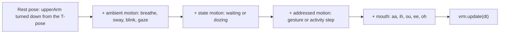
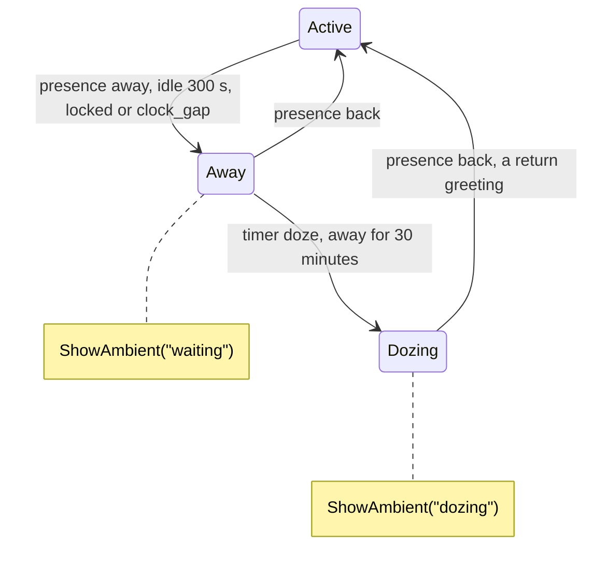
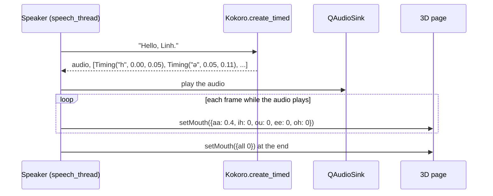

# Motion of the companion

| | |
|---|---|
| **Document** | Each motion that the 3D companion does: what starts it, which bones and expressions move, and for how long |
| **Date** | 2026-11-08. The author decided the choices in section 1 on this day |
| **Related** | [`ARCHITECTURE.md`](architecture/ARCHITECTURE.md) sections 6.7.2 and 10.65 (D-64), 10.69 (D-68), 10.77 (D-76); [ADR 0010](architecture/adr/0010-voice-input-and-output.md); [`RESOURCES.md`](RESOURCES.md) |

**Status today.** The four VRM files and the vendored three.js and three-vrm are in
`desktop/src/resources/companion/`. The 3D page does not exist yet. The placeholder
`CompanionWindow` writes the face, the gesture and the step as text. No motion in this
document has code yet.

**About the figures.** Each angle and each time below is a start value. Nobody has
seen it on a character. Tune it on the page, then write the new value here.

## 1. Decisions

| Question | Decision | Rejected |
|---|---|---|
| Where do the motions come from? | Code only. Each motion is a function of time on the bones and expressions of the VRM. No `.vrma` file | `.vrma` clips that the author makes in Blender; code first and a clip when the file exists |
| What does the companion do while it waits? | It looks to the left and to the right | A `wait` clip |
| What does it do when it dozes? | It closes its eyes and lowers its head. At intervals its head drops a little and comes back up | A `doze` clip; a still pose |
| What does it do while a tool runs (`think`)? | Its gaze moves up to one side, then the other, and its head tilts with the gaze. When the tool ends, it nods once | A hand on the chin; a slow sway |
| How does the mouth move? | From the phonemes. Kokoro gives the time of each phoneme, and each vowel selects a mouth shape | The loudness only; the loudness with a shape that changes at random |
| Where does espeak-ng come from? | The `espeakng-loader` package, which `kokoro-onnx` uses. `desktop/models/espeak-ng/` is removed | The files of the espeak-ng 1.52.0 installer in `desktop/models/` |

**Why code only.** Each motion turns a small number of bones, as breathing and sway
already do. Code needs no Blender time and has no licence question. It works on all
four characters, because they have the same humanoid bones. The cost: a motion made
in code can look stiff. Careful easing reduces this.

## 2. How a motion is made

Each motion is a function `f(t)` that gives an offset for each bone it moves and a
weight for each expression it uses. The page adds the offset to the rest pose and to
the ambient motion. Thus the companion continues to breathe and blink during a
gesture.

Rules for every motion:

- A motion starts and ends with an ease (smoothstep) of 0.2 to 0.3 s. It never jumps.
- A motion ends in the rest pose.
- Bones only from the humanoid set (`head`, `neck`, `chest`, `spine`, `hips`,
  `shoulder`, `upperArm`, `lowerArm`, `hand`). Hair and clothes stay with the spring
  bones of the VRM file.
- An angle is from the rest pose, not from the T-pose. The rest pose turns
  `leftUpperArm` on Z to the negative side.
- The sign of each axis is not checked yet. Check it with `nod` first (section 9).

## 3. Ambient motion, always on

The page runs these by itself. Nothing in Python starts them.

| Motion | Bones or expression | Values |
|---|---|---|
| Blink | `blink` | Each 2 to 6 s. A double blink about 1 time in 10. About 150 ms |
| Breathe | `spine`, `chest` on X | A sine of 0.2 to 0.3 Hz, 1 to 2° |
| Sway | `hips`, `neck` | Slow noise. A new posture each 10 to 30 s |
| Gaze | `vrm.lookAt.target` | Small jumps each 1 to 3 s. It follows the pointer only while the pointer is inside the companion window (C-05) |
| Hair and clothes | Spring bones of the VRM | — |

## 4. State motion (`ShowAmbient`)

The state machine of `ARCHITECTURE.md` section 6.7.2 sends the state. The motion
loops until the state changes.

| State | Motion | Values |
|---|---|---|
| `active` | Ambient motion only | — |
| `waiting` | It looks to the left, to the centre, and to the right | `lookAt.target` about 25° to one side, `neck` on Y about 10° with it. Hold 3 to 6 s to the side and 2 to 4 s at the centre. The side and the hold times are random. The ambient gaze stops during this state |
| `dozing` | Eyes closed, head down, slow breath | `blink` goes to 1 in 1.5 s. `head` down about 20°, `neck` down about 5°. Breath slows to 0.15 Hz with twice the amplitude. Each 20 to 40 s the head drops 5° more in 0.3 s and comes back up in 1.0 s |

From `dozing` to `active`, the eyes open in 0.5 s and the head comes up in 0.8 s,
before the `wave` of the return greeting.

## 5. Faces (`ShowExpression`)

`desktop/src/domain/emotion/rules.py` gives the face. Each face is a VRM preset, so it
needs no motion code. A change of face takes 300 ms.

| Face | VRM preset | Weight from the edge of calm to full strength |
|---|---|---|
| `calm` | `neutral` | 1.0 |
| `pleased` | `relaxed` | 0.5 to 1.0 |
| `lively` | `happy` | 0.5 to 1.0 |
| `restless` | `surprised` | 0.2 to 0.4 |
| `low` | `sad` | 0.3 to 0.7 |

There is no angry face, because an angry face is a reproach.

## 6. Gestures (`ShowGesture`)

A gesture plays once and ends in the rest pose. `think` is the one exception: it
loops while a tool runs.

| Gesture | Starts when | Bones or expression | Values | Time |
|---|---|---|---|---|
| `nod` | A shared worry; good news with the feeling `low` | `head` on X | Down about 15°, two times | 1.2 s |
| `bow` | Praise | `spine` about 15°, `chest` about 10°, `head` about 10°, gaze down | Down in 0.6 s, hold 0.5 s, up in 0.7 s | 1.8 s |
| `sheepish` | A complaint | `head` tilt (Z) about 10° and down about 8°, gaze down, `relaxed` 0.3 | Into the pose in 0.4 s, hold 0.7 s, back in 0.4 s | 1.5 s |
| `comfort` | Bad news | `head` tilt about 8°, one slow nod of about 10°, `blink` 0.3, gaze to the user | — | 2.0 s |
| `cheer` | Good news | Both `upperArm` up about 60°, both `lowerArm` bent about 30°, `hips` up and down 2 times, `happy` | Up in 0.3 s, down in 0.5 s | 1.5 s |
| `wave` | The return greeting (UC-16) | One arm: `upperArm` up about 70°, `lowerArm` bent about 90°, `hand` ±20° 3 times, `happy` 0.5 | Up in 0.4 s, wave for 1.2 s, down in 0.5 s | 2.1 s |
| `think` | A tool runs (`application.py`) | Gaze up and to one side about 15°, `head` tilt about 8° to the same side | Hold 1.5 to 2.5 s, then the other side. A slow blink at intervals. When the tool ends: one `nod` of about 8°, then the rest pose | While the tool runs |

Small talk and a crisis message have no gesture.

`cheer` and `wave` move the arms. They are the most likely to look stiff, so they are
the last to build.

## 7. Exercises done together (`playActivity`)

`desktop/src/domain/tools/rules.py` gives the steps. The motion follows the step that
the companion shows and counts down. When the user ends the exercise early (double
click, hide, pause), the companion goes to the rest pose in 0.5 s.

**`breathing`**, 5 times:

| Step | Time | Motion |
|---|---|---|
| `breathe in` | 4 s | `chest` back about 4°, both `upperArm` open about 5° |
| `hold` | 4 s | Hold. The ambient breath stops |
| `breathe out` | 6 s | Back to the rest pose with ease-out. Eyes half closed (`blink` 0.5) at the end |

**`stretch`**, once:

| Step | Time | Motion |
|---|---|---|
| `reach up` | 20 s | Both arms up above the head, about 150° from the rest pose. Up in 3 s, hold 4 s, down in 3 s, 2 times |
| `roll your shoulders` | 20 s | Both `shoulder` turn in a circle: ±8° on Z and ±8° on X, 90° out of phase, a cycle of 4 s, 5 times |
| `turn your head slowly` | 20 s | `head` and `neck` on Y: about 35° to the left, hold, about 35° to the right, hold. A cycle of 10 s, 2 times |
| `stretch your wrists` | 20 s | Both `upperArm` forward about 80°, `lowerArm` straight, `hand` up about 40° and down about 40°. A cycle of 5 s, 4 times |

## 8. Mouth while the companion speaks

The mouth uses the five VRM presets `aa`, `ih`, `ou`, `ee` and `oh`.

**Phoneme times.** `kokoro-onnx` 0.6.1 has `Kokoro.create_timed()`. It returns the
audio and a list of `Timing(phoneme, start, end)`, in seconds from the start of the
audio. The list is empty when the model has no `duration` output. The file
`desktop/models/voice.onnx` has the outputs `waveform` and `duration` (read with
`onnxruntime` on 2026-11-08), so the times are available.

**Phoneme to shape.** The phonemes are the IPA characters of espeak-ng (`en-us`). A
diphthong is two characters, each with its own time, so `oʊ` gives `oh` and then `ou`.

| Phonemes | Shape | Weight |
|---|---|---|
| `ɑ`, `a`, `æ`, `ʌ`, `ɐ` | `aa` | 0.8 |
| `ə`, `ɚ`, `ɜ` | `aa` | 0.4 |
| `i`, `ɪ` | `ih` | 0.7 |
| `e`, `ɛ` | `ee` | 0.7 |
| `u`, `ʊ`, `w` | `ou` | 0.7 |
| `o`, `ɔ` | `oh` | 0.8 |
| `m`, `b`, `p` | All shapes 0: the lips close | 0 |
| `f`, `v` | `ih` | 0.2 |
| Other consonants | The shape of the phoneme before, at half its weight | — |
| `ˈ`, `ˌ`, `ː`, space, punctuation | No change | — |

Example: "Hello" gives `həlˈoʊ` (read from `Tokenizer.phonemize(text, "en-us")` of
`kokoro-onnx` with the espeak-ng of `espeakng-loader` on 2026-11-08; "Hello, Linh."
gives `həlˈoʊ, lˈɪn.`, so a name is said, not spelled).

| Phoneme | `h` | `ə` | `l` | `ˈ` | `o` | `ʊ` |
|---|---|---|---|---|---|---|
| Shape | 0 | `aa` 0.4 | `aa` 0.2 | no change | `oh` 0.8 | `ou` 0.7 |

**Smooth change.** Each shape moves toward its target in about 60 ms, so the mouth
does not snap from one shape to the next. The loudness of the audio in the span of the
phoneme scales the weight, so a quiet word opens the mouth less.

**Speed.** The mood changes the speed of the speech (`speech_speed`). The times come
from the audio that Kokoro makes at that speed, so the mouth stays in time.

## 9. Order of work

| Step | Motions | Why first |
|---|---|---|
| 1 | `nod`, `dozing`, `waiting`, `think` | Head and eyes only. `nod` fixes the sign of each axis |
| 2 | `bow`, `sheepish`, `comfort` | Head and body, no arms |
| 3 | The mouth | Needs the speech of ADR 0010 |
| 4 | `breathing`, the four steps of `stretch` | The steps and the count already exist |
| 5 | `cheer`, `wave` | Arms. The most likely to look stiff |

## 10. Open items

1. **The licence of the espeak-ng in `espeakng-loader`.** Version 0.2.4 holds
   `espeak-ng.dll` and `espeak-ng-data/`, but no licence file, and its metadata does
   not state which version of espeak-ng it holds. espeak-ng is GPL-3.0, so the
   installer must still ship the licence text and an offer of the source
   (`ARCHITECTURE.md` section 12, item 28).
2. **Overlap.** Which motion wins when a gesture arrives during an exercise, or the
   reply gesture arrives before the `nod` at the end of `think`, is not decided.
3. **Documents that still state the old design.** D-64 and section 6.15 of
   `ARCHITECTURE.md` (`.vrma` clips), ADR 0010 (the mouth from the loudness only),
   and `RESOURCES.md` sections 1.2, 3 and 5 (motion clips, espeak-ng in
   `desktop/models/`).
