# Cognia — software architecture

| | |
|---|---|
| **Document** | Architecture design for Cognia, a desktop companion for one person on one Windows machine |
| **Status** | Proposed, with ADR 0002 to ADR 0008. The design becomes binding when those ADRs are accepted. D-01 to D-14 and D-26 to D-28 are the author's decisions. D-15 to D-25 are proposals that the author can change |
| **Date** | 2026-10-31 |
| **Author** | Nguyễn Duy Vũ |
| **Source of requirements** | COG-UCS-001 version 5.4 ([`USECASE_SPECIFICATION.html`](../USECASE_SPECIFICATION.html)) |
| **Related decisions** | [ADR 0001](adr/0001-layered-architecture-with-event-driven-core.md) sets the layers, the queue, the gate and the pure domain. [ADR 0002](adr/0002-local-model-behind-a-port-and-readable-conversation-storage.md) sets the local model. [ADR 0003](adr/0003-sqlite-schema-and-sqlalchemy-core.md) sets the schema. [ADR 0004](adr/0004-hybrid-emotion-model.md) sets the emotion model. [ADR 0005](adr/0005-one-process-core-thread-and-pure-rules.md) sets the runtime structure. [ADR 0006](adr/0006-foreground-application-in-the-event-log.md) sets what the log keeps about applications. [ADR 0007](adr/0007-embedding-retrieval.md) sets memory retrieval. [ADR 0008](adr/0008-vrm-companion-in-qtwebengine.md) sets the companion's drawing |
| **Related documents** | [`docs/ERD.md`](../ERD.md) for the data design, [`README.md`](../../README.md) for the operational summary |
| **Writing standard** | ASD-STE100 rules for sentence structure. The lexical rules are a direction only, because this project does not hold the ASD dictionary |

## Contents

1. [Purpose, scope and audience](#1-purpose-scope-and-audience)
2. [Terms](#2-terms)
3. [How to read this document](#3-how-to-read-this-document)
4. [Drivers and constraints](#4-drivers-and-constraints)
5. [Overall architecture](#5-overall-architecture)
6. [Module view](#6-module-view)
7. [Component-and-connector view](#7-component-and-connector-view)
8. [Deployment view](#8-deployment-view)
9. [Mapping between views](#9-mapping-between-views)
10. [Decisions and rationale](#10-decisions-and-rationale)
11. [Traceability](#11-traceability)
12. [Open items](#12-open-items)

## 1. Purpose, scope and audience

This document gives the architecture of Cognia. It shows the system in three views.
The module view shows how the source is organised. The component-and-connector view
shows what exists while the system runs. The deployment view shows what is installed
on the machine. The document also gives the options, the reason and the trade-off for
each significant decision.

The design covers all twenty-one use cases of the specification, in delivery phases 1
and 2, on Windows 10 and Windows 11.

This document does not contain code, and it does not repeat the operational summary.
It does not describe the tables and columns of the data file. [`docs/ERD.md`](../ERD.md)
holds those. The current code does not match this design yet. Section 12 lists the work
that closes the difference.

| Reader | Comes here for | Starts at |
|---|---|---|
| A new engineer | Where a change goes, and why the structure has this shape | Sections 5 and 6 |
| The author, deciding | The options and the trade-off for each decision | Section 10 |
| A reviewer | Whether a proposed change breaks a rule | Section 6.2 |
| A person who traces a failure | Which component failed, and what the user sees | Sections 7.2 and 9 |
| A privacy reviewer | What leaves the machine and what the system reads from Windows | Sections 4.2, 6.12 and 8.4 |

## 2. Terms

| Term | Meaning in this document |
|---|---|
| Module | A unit of the source code, for example a package or a directory. A module exists at build time. Section 6 shows the modules |
| Component | A unit that exists while the system runs, for example a process or a thread. Section 7 shows the components |
| Connector | The way two components interact. A connector has a protocol and a failure behaviour, so section 7.2 lists each one |
| Node | A machine or an execution environment that runs components. Section 8 shows the nodes |
| Artifact | A deployable file, for example an executable or a model file. Section 8 allocates each artifact to a node |
| View | One of the three structures above. A view answers some questions and is silent on the rest |
| Event | One recorded fact about what happened, in the closed set of section 6.4. An event holds references and figures, never the user's words |
| Event log | The append-only table `events`. ADR 0001 calls it "the journal". This document uses "event log", so "journal" has one meaning only |
| Journal | The companion's own written reflections (UC-25), in the table `journal_entries` |
| Command | A request from the user that the core thread must process, for example "close this session". A command can cause events |
| State table | A table that holds data the user owns. The user can read, correct or delete its rows |
| Cache table | A table that the rules can compute again from the event log |
| Rule | A pure function in `domain/`. A rule reads its arguments and returns a value. It does no I/O and reads no clock |
| Service | A class in `domain/` that loads data through ports, calls rules, and carries out their effects |
| Effect | A value that a rule returns to ask for an action outside the rule, for example "request wording" |
| Port | An interface that the domain declares by capability. A port names no provider |
| Adapter | A class in `infrastructure/` or `app/` that implements a port |
| SpeechGate | The one component that can release a proactive message. It refuses a message that has no complete explanation (NFR-09) |
| Decision | One row in `speech_decisions`. It records one decision to speak, sent or not sent |
| Proactive message | Anything the companion says or shows that the user did not ask for (specification, section 12) |
| PAD | Pleasure, arousal and dominance. Each axis is a real number from -1 to 1 |
| Temperament | The fixed values of a character that set how far events move it, how fast feelings fade and where its mood rests |
| Appraisal | A rule that turns an event into a displacement in PAD |
| Replay | A run of the rules over the recorded event log, with no model and no database, to check that the output is the same (NFR-13) |
| Tombstone | A row that stops the companion from repeating a conclusion that the user rejected. A tombstone holds no user text |
| Fingerprint | A canonical text form of a conclusion. Two equal fingerprints are the same conclusion |
| GGUF | The model file format that llama.cpp reads |
| Base model | The published model weights, before this project trains them |
| Fine-tuning | Training that adjusts a base model with new examples |
| LoRA | A fine-tuning method. It trains a small set of added weights and keeps the base weights fixed during training |
| Merged model | A base model with the LoRA weights added into one file, so the server needs no separate adapter file |
| Quantisation | Storage of weights at a lower precision, so that the model file is smaller |
| Tuned model | The merged and quantised chat model that this project builds |
| Embedding | A list of numbers that represents the meaning of a text. Two similar texts have similar embeddings |
| VRM | A file format for a 3D humanoid character, built on glTF. It adds facial expressions, a humanoid skeleton and licence data |
| MToon | The cartoon shader that VRM models use |
| SSE | Server-sent events. The server sends a reply in pieces over one HTTP response |
| Sampler | The thread that reads the four facts from Windows once each second |

## 3. How to read this document

### 3.1 The view model

Each view answers a different question. Read the view that matches your question.
Section 9 connects the views.

| View | Section | Answers | Does not answer |
|---|---|---|---|
| Overall | 5 | What is this system, and what does it talk to? | Anything in detail |
| Module | 6 | Where does my change go? What may depend on what? | What runs where |
| Component-and-connector | 7 | What exists at run time, and how does a message flow through it? | How the source is organised |
| Deployment | 8 | What is installed on the machine, and where does the data stay? | What the code looks like |

### 3.2 Notation and toolchain

Two tools draw the diagrams in this document. This document adds no dependency to the
application.

| Tool | Scope | Used by |
|---|---|---|
| [`diagrams`](https://diagrams.mingrammer.com/) | Python package, used only to render | Section 5 |
| [Graphviz](https://graphviz.org/download/) | System program that `diagrams` calls | Section 5 |
| [Mermaid](https://mermaid.js.org/) | None. GitHub renders it from the source | Sections 6, 7 and 8 |

Mermaid diagrams stay in this file. The `diagrams` pictures are generated. The Python
file is the source, and the image is committed beside it. Change the Python, render
again, and commit both.

```bash
cd docs/architecture && uv run --with diagrams python context.py
```

```bash
cd docs/architecture && uv run --with diagrams python overall.py
```

The images are PNG, not SVG. The SVG output of `diagrams` refers to its icons by an
absolute path on the machine that rendered it. Those icons fail on any other machine.

### 3.3 Notation key

| You see | It means |
|---|---|
| `«device»`, `«executionEnvironment»`, `«artifact»` | UML deployment stereotypes in section 8.1. A device is hardware. An execution environment runs inside it. An artifact is a deployed file |
| `<<interface>>` on a class | The type has no implementation here. It is a port |
| `<<module>>` on a class | Not a class. A module that holds free functions. Mermaid class diagrams have no notation for a module, so this document uses this convention |
| A solid arrow | A synchronous interaction. The caller waits |
| A dashed arrow | An asynchronous interaction. The caller does not wait |
| `C1`, `C2` and so on, on an edge in section 7 | A connector in section 7.2 |
| `Illustration` above a worked example | The figures only show how the mechanism works. They are not specification values. Trial use sets the real values |

### 3.4 Where the hard ideas are explained

Each explanation has a plain description, an example and a diagram.

| Idea | Section |
|---|---|
| Ports and adapters | [6.3.1](#631-explained-ports-and-adapters) |
| Pure rules and the injected clock | [6.4.1](#641-explained-pure-rules-and-the-injected-clock) |
| Event log and state tables | [6.4.2](#642-explained-event-log-and-state-tables) |
| PAD, temperament and decay | [6.5.1](#651-explained-pad-and-temperament) |
| Sadness and its floor | [6.5.2](#652-explained-sadness-and-its-floor) |
| Facial expressions from PAD | [6.5.3](#653-explained-from-pad-to-a-facial-expression) |
| The SpeechGate funnel | [6.6.1](#661-explained-the-speechgate-funnel) |
| Holding a message for a pause | [6.6.2](#662-explained-holding-a-message-for-a-pause) |
| The next wake time | [6.7.1](#671-explained-the-next-wake-time) |
| Retrieval scores | [6.8.1](#681-explained-the-retrieval-score) |
| Tombstones and fingerprints | [6.9.1](#691-explained-tombstones-and-fingerprints) |
| The reflection threshold | [6.10.1](#6101-explained-the-reflection-threshold) |
| Prompt layers and the prefix cache | [6.11.2](#6112-explained-prompt-layers-and-the-prefix-cache) |
| The model supervisor | [6.11.1](#6111-explained-the-model-supervisor) |
| The tuned chat model | [6.11.3](#6113-explained-the-tuned-chat-model) |
| Replay | [7.14](#714-scenario-replay-of-a-recorded-week) |

## 4. Drivers and constraints

### 4.1 Quality attribute scenarios

These scenarios shaped the structure. The specification states that its performance
figures are targets and not results. Nobody has measured them yet.

| # | Attribute | Stimulus | Response | Measure | Source |
|---|---|---|---|---|---|
| QA-01 | Privacy | The application runs for one week of ordinary use | Nothing leaves the machine | Zero outbound connections in a network capture, including all child processes | NFR-01, G-05 |
| QA-02 | Privacy | A reviewer audits the calls to Windows | Only the four facts and the screen layout are read | Zero calls to a forbidden interface | NFR-02, C-05 |
| QA-03 | Latency | The user chooses a pause in the tray | Observation and messages stop, and the companion leaves the screen | Under 1 second | NFR-04, UC-15 |
| QA-04 | Latency | The user sends a message | Words appear, or a working indicator appears | First words within 3 seconds, otherwise an indicator. Never a blank pause | NFR-05 |
| QA-05 | Resource use | The application runs for 8 idle hours | It costs the machine almost nothing | Hidden: under 1% CPU and 150 MB. On screen: under 3% CPU and 200 MB. Both exclude the AI model | NFR-06 |
| QA-06 | Durability | The power fails | Nothing that was recorded is lost | Zero loss of memory items or closed sessions across 20 forced power-offs | NFR-07 |
| QA-07 | Degradation | The AI model stops | Everything that does not need it keeps working | Session timing, break suggestions, the memory list, pausing and the emotion state stay usable | NFR-08 |
| QA-08 | Explainability | The companion is about to speak on its own initiative | The explanation is complete, or the message is not sent | 100%. The check refuses and does not warn | NFR-09, G-06 |
| QA-09 | Safety | The user writes about self-harm or a crisis | The reply says that the companion is a fictional character and cannot replace a real person | Every scripted test case, under every character | NFR-12 |
| QA-10 | Reproducibility | The developer replays a recorded week | Decisions, feelings and patterns are the same as the original | Identical output, with the model switched off | NFR-13 |
| QA-11 | Installation | The user runs the installer on a clean machine with no network | A first conversation is possible | One installer and nothing else. Under 5 minutes to a first conversation | NFR-10, NFR-14 |

### 4.2 Constraints

The specification imposes these constraints. Nobody on this project chose them as
design decisions, so they are not in section 10.

| # | Constraint | Imposed by | Effect on the design |
|---|---|---|---|
| C-01 | Windows 10 and 11 only | Scope decision of the specification | Win32 calls are allowed, inside one adapter |
| C-02 | One user, one machine. No account, no server, no synchronisation | Specification, version 2.0 | No network code exists for data. All stores are local |
| C-03 | All data stays on the user's disk | Privacy commitment, NFR-01 to NFR-03 | The chat model and the embedding model ship inside the installer |
| C-04 | The eight base rules bind every use case, and no character can override them | Specification, FR-04 | The rules live in `domain/`, not in a prompt. A character is data and cannot change them |
| C-05 | Only four facts about the user may be read from Windows, plus the screen layout. The foreground application name is kept as hourly totals and as changes in the event log | Privacy commitment, widened in version 5.2 | The port's data type has four fields and no more. Window titles, contents and positions stay forbidden |
| C-06 | The companion speaks English only, including its fixed wording | Scope decision of the specification | Fixed wording exists in one language. No language setting exists |

### 4.3 Similar systems

This table records what other systems do. Each row states what Cognia takes and what
it refuses. Section 10 refers to these rows.

| System | Structure | Cognia takes | Cognia refuses |
|---|---|---|---|
| [ActivityWatch](https://docs.activitywatch.net/en/latest/architecture.html) | A local activity tracker. Watchers observe, a server stores events in buckets, and a Qt program manages both. [Heartbeats merge](https://docs.activitywatch.net/en/latest/buckets-and-events.html) two equal neighbouring events | Events for changes only, and a sampler that merges equal readings (D-09) | REST between local parts, because Cognia has one client. Window titles, because C-05 forbids them |
| [Project AIRI](https://github.com/moeru-ai/airi) | An open-source companion. It is a monorepo with web, desktop and mobile stages, separate Live2D and three.js renderers, and a server runtime that connects outside channels. Its long-term memory is marked as work in progress | A web stage that draws the character with three.js (D-08) | Server channels and plugins, because extensibility is an anti-goal (ADR 0001) |
| [Open-LLM-VTuber](https://github.com/Open-LLM-VTuber/Open-LLM-VTuber) | An offline voice companion with replaceable ASR, LLM and TTS modules, an agent interface, and a desktop pet mode with a transparent window. Its [documentation](https://docs.llmvtuber.com/docs/intro) describes long-term memory on Letta, but its README says that the feature is removed for now | The pet window behaviour: transparent, top-most, and dragged by the user (D-08) | A pluggable agent. FR-04 needs rules that no plugged-in part can change |
| [Generative Agents](https://arxiv.org/abs/2304.03442) | Believable agents with a memory stream. Retrieval adds recency, importance and relevance, with equal weights. Recency decays by 0.995 per game hour. Reflection runs when importance adds up past a threshold, 150 in that paper | The retrieval score and the reflection trigger (D-07, UC-25) | A model call in each step of the loop. Rules decide in Cognia, so that a replay needs no model |
| [ALMA](https://www.dfki.de/web/forschung/projekte-publikationen/publikation/1782) | A layered model of affect: emotion, mood and personality at three time scales. It uses OCC appraisal and the PAD space | The three time scales, appraisal and PAD (ADR 0004) | Nothing in the model itself. The author designs each temperament by hand |
| [Letta (MemGPT)](https://docs.letta.com/guides/agents/architectures/memgpt) | An agent with memory tiers: core memory in the context window, recall of old conversation, and archival memory in an embedding store. The agent edits its own memory through tools | Separate tiers for what is always in the prompt and what is retrieved (section 6.11.2). Background work on memory (D-15) | An agent that edits its memory through tools. Rules and the user own the memory in Cognia (UC-13) |
| [Jan](https://github.com/janhq/jan) | A desktop chat application on Tauri that uses llama.cpp and offers a local server for other programs | A llama.cpp server that a desktop application owns (ADR 0002) | Downloads of backends and models at run time, because NFR-14 forbids them |
| [Desktop Homunculus](https://github.com/not-elm/desktop-homunculus) | An open-source desktop mascot on Bevy that draws VRM characters in transparent windows. Its documentation warns about a black background on some NVIDIA setups | Evidence that VRM in a transparent window is possible, and a warning for the checks in section 12 | A second language and engine (D-08) |
| Replika, Nomi | Character chat services. This study found no official technical description, only third-party reviews | Nothing. Cognia does not design from unverified claims | Not applicable |

## 5. Overall architecture

### 5.1 System context

This diagram shows Cognia as one box and names everything outside it. It is the only
diagram that shows the system boundary. Every later section is inside this boundary.

Source: [`context.py`](context.py).

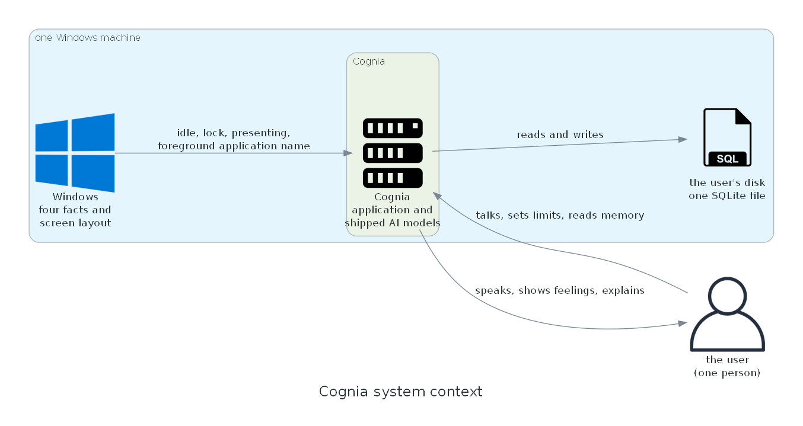

### 5.2 The overall picture

This diagram shows the processes, the threads, the stores and the direction that data
moves. Read it from left to right. Facts from Windows and commands from the user enter
one ordered queue. One thread reads that queue. Everything else is a result of that
thread's work.

Source: [`overall.py`](overall.py).

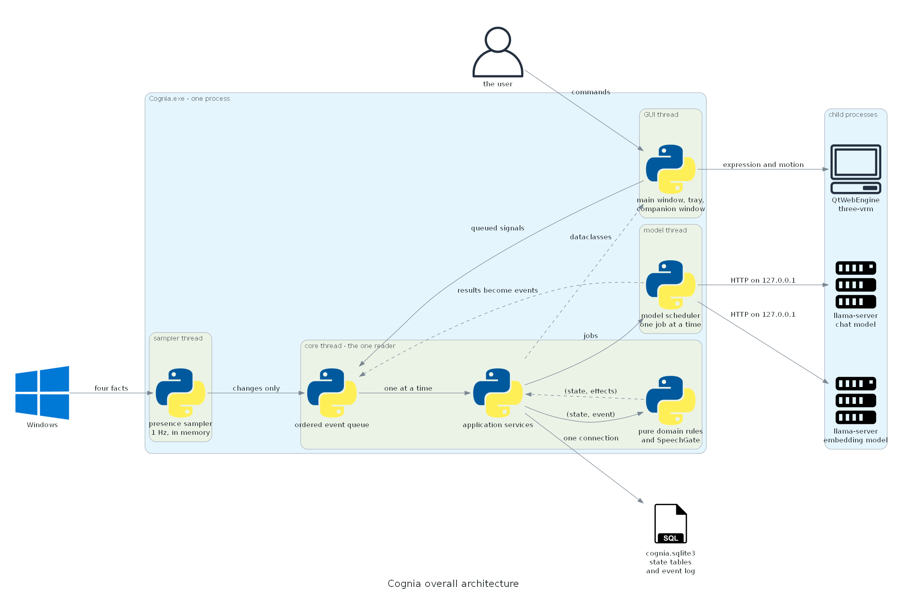

The structure has three parts that a reader must keep apart:

1. **The core thread decides.** It reads the queue, records each event, and runs the
   rules. It is the only code that touches the database.
2. **The model thread does the slow work.** A model call takes seconds. The core thread
   never waits for one. It posts a job and continues.
3. **The GUI thread only shows and reports.** It holds the windows. It sends commands and
   receives finished data. It never touches the database or the model.

### 5.3 Element catalog

| Element | Responsibility | Owner |
|---|---|---|
| Main window, tray, companion window | Show data and report what the user did | `ui/` |
| Presence sampler | Read the four facts once each second, and report changes only | `infrastructure/presence/` |
| Ordered event queue | Hold commands and events in one order, for one reader | `app/` |
| Application services | Load data, call rules, write the result, and start effects | `domain/` |
| Pure rules and SpeechGate | Decide what a feeling is and whether the companion speaks | `domain/` |
| Model scheduler | Run one model job at a time, in priority order | `infrastructure/ai/` |
| llama-server, chat model | Generate words and interpret messages | Shipped third-party program |
| llama-server, embedding model | Turn text into embeddings | Shipped third-party program |
| QtWebEngine with three-vrm | Draw the character in 3D | Shipped third-party libraries |
| `cognia.sqlite3` | Hold all user data | The user's disk |

### 5.4 External dependencies

Criticality answers one question: if this dependency fails, what happens to Cognia?
Critical means that Cognia stops. Degraded means that Cognia loses a feature. Optional
means that the user sees no effect.

| Dependency | Purpose | Criticality | Owner | Failure behaviour |
|---|---|---|---|---|
| SQLite file on the user's disk | All state | Critical | The user | Cognia says plainly what failed, and never shows a partial list as complete (UC-12-E1) |
| `llama-server`, chat model | Words, interpretation, reflection | Degraded | llama.cpp project | Rules, memory lists, sessions and pausing continue. Break suggestions and commitments use fixed wording (NFR-08, UC-22-E3) |
| `llama-server`, embedding model | Relevance in memory retrieval | Degraded | llama.cpp project | Retrieval uses recency and importance only |
| QtWebEngine | Drawing the companion | Degraded | The Qt Company | Cognia says that it cannot show the companion. Every function stays reachable (FR-28, UC-20-E2) |
| Windows presence interfaces | The four facts | Degraded | Microsoft | Desk awareness stays off. Conversation works (UC-04-E1) |

## 6. Module view

This view shows the source code. It answers where a change goes and what may depend on
what. It says nothing about what runs. One module can run on two threads.

### 6.1 Decomposition

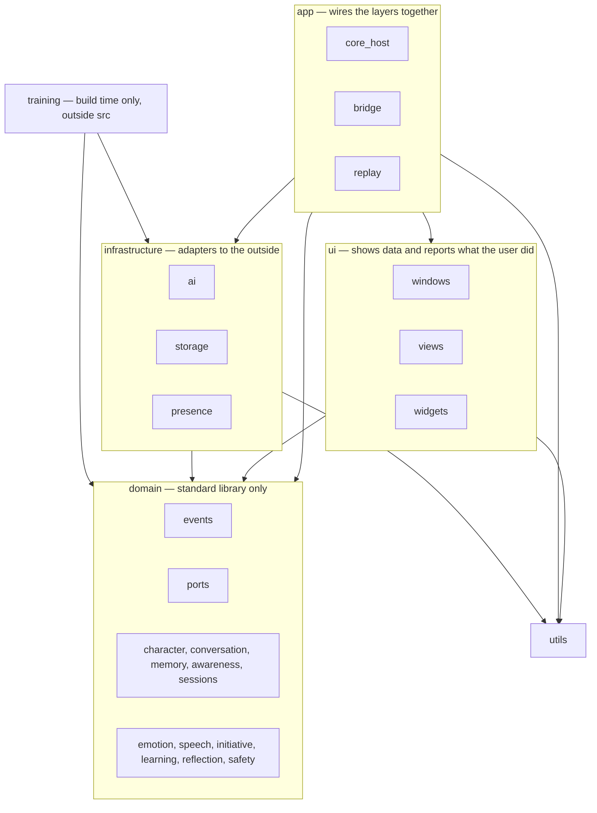

The tree under `desktop/src/` is:

```text
src/
├── __main__.py
├── app/                 core_host, bridge, replay, single_instance, config
├── domain/
│   ├── ports/           every interface the domain needs
│   ├── events/          event kinds, payloads, the step function
│   ├── character/       versions, temperament
│   ├── conversation/    messages, prompt layers
│   ├── memory/          memory items, commitments, retrieval score
│   ├── awareness/       presence facts, time at the machine, application totals
│   ├── sessions/        work sessions
│   ├── emotion/         PAD, appraisal, decay
│   ├── speech/          SpeechGate, decisions, explanations
│   ├── initiative/      reasons to speak, the next wake time
│   ├── learning/        patterns, self-adjustments, proposals
│   ├── reflection/      the threshold, journal entries
│   └── safety/          crisis detection, the required line
├── infrastructure/
│   ├── ai/              llama client, supervisor, scheduler
│   ├── storage/         SQLite stores and migrations
│   └── presence/        the Win32 calls
├── ui/                  windows, views, dialogs, widgets
├── resources/           fonts, QSS, companion page, VRM files
└── utils/               logging, paths
```

One module stays outside this tree. `desktop/training/` builds the tuned chat model (D-27).
It is a separate Python project, as `docs/architecture/` is. So PyInstaller does not package
it, and its training libraries do not enter `desktop/uv.lock`. Its tools exist, and no model is
trained yet.

```text
desktop/training/
├── pyproject.toml       its own dependencies
├── GUIDE.md             the steps that build chat.gguf
├── generate.py          check and review the examples
├── train.py             LoRA training
├── export.py            merge, quantise, write the licence files
├── evaluate.py          measure a model, apply the acceptance gate
├── tests/               tests of the tools
└── data/                reviewed examples and test sets
```

Each feature package follows one pattern. `models/` holds frozen dataclasses.
`rules.py` holds pure functions. `<feature>_service.py` holds the service. The current
stubs in `src/domain/` already use the `models/` and `_service.py` names (D-02).

### 6.2 Allowed-to-use rules

1. `domain/` imports the standard library and `domain/` only. It imports neither
   `PySide6`, nor `ui/`, nor `infrastructure/`, nor `app/`.
2. `rules.py` in a feature imports no port and does no I/O. It reads no clock and no
   environment variable.
3. A service reaches the outside through `domain/ports/` only. The concrete adapter
   comes from `app/`.
4. `ui/` imports `PySide6`, `utils/` and `domain/*/models/` only. It never imports
   `infrastructure/` or `app/`.
5. `infrastructure/` imports `domain/` and `utils/`. It never imports `ui/` or `app/`.
6. Nothing imports `app/`. It wires the layers together.
7. `utils/` imports the standard library only.
8. Only `domain/speech/speech_service.py` references the `SpeechOutput` port (NFR-09).
9. Only `infrastructure/presence/` calls `ctypes` for Win32 functions (C-05, NFR-02). Its
   allow-list is in section 6.12.
10. Only `infrastructure/ai/` holds HTTP code. `httpx` appears nowhere else (NFR-01).
11. From this source tree, `training` imports `domain/` and `infrastructure/ai/` only. It never
    imports `ui/`, `app/`, `infrastructure/storage` or `infrastructure/presence`, and it never
    reads `cognia.sqlite3` (NFR-03).
12. Nothing in `desktop/src/` imports `training`.

**Enforced by.** Nothing yet. D-14 selects one standard-library script that reads the
syntax tree of each source file and fails on a forbidden import or reference. `task
check` will run it. The script and the task do not exist yet (section 12). Until they
exist, a reviewer checks these rules by hand.

### 6.3 Element catalog

| Module | Responsibility | Source |
|---|---|---|
| `domain/ports` | Declare each capability that the domain needs | [`desktop/src/domain/ports`](../../desktop/src/domain/ports) |
| `domain/events` | Define the closed set of events and the `step` function | [`desktop/src/domain/events`](../../desktop/src/domain/events) (empty) |
| `domain/character` | Hold character versions and temperaments (UC-01 to UC-03) | [`desktop/src/domain/character`](../../desktop/src/domain/character) (stub) |
| `domain/conversation` | Hold messages and build prompts (UC-09, UC-10) | [`desktop/src/domain/conversation`](../../desktop/src/domain/conversation) (models and prompt layers) |
| `domain/memory` | Hold memory items and commitments, and score retrieval (UC-12, UC-13, UC-21) | [`desktop/src/domain/memory`](../../desktop/src/domain/memory) (stub) |
| `domain/awareness` | Hold presence, time at the machine, the 04:00 day and application totals (UC-04, UC-16) | [`desktop/src/domain/awareness`](../../desktop/src/domain/awareness) (stub) |
| `domain/sessions` | Hold work sessions (UC-05, UC-07) | [`desktop/src/domain/sessions`](../../desktop/src/domain/sessions) (empty) |
| `domain/emotion` | Compute feelings (UC-23) | [`desktop/src/domain/emotion`](../../desktop/src/domain/emotion) (empty) |
| `domain/speech` | Hold the SpeechGate, decisions and explanations (UC-17, UC-22) | [`desktop/src/domain/speech`](../../desktop/src/domain/speech) (empty) |
| `domain/initiative` | Find reasons to speak and the next wake time (UC-22) | [`desktop/src/domain/initiative`](../../desktop/src/domain/initiative) (empty) |
| `domain/learning` | Find patterns and adjustments (UC-24) | [`desktop/src/domain/learning`](../../desktop/src/domain/learning) (empty) |
| `domain/reflection` | Trigger reflection and hold the journal (UC-25) | [`desktop/src/domain/reflection`](../../desktop/src/domain/reflection) (empty) |
| `domain/safety` | Detect a crisis and check the reply (NFR-12) | [`desktop/src/domain/safety`](../../desktop/src/domain/safety) (empty) |
| `infrastructure/ai` | Implement the model ports over HTTP. D-27 changes the model file and no port | [`desktop/src/infrastructure/ai`](../../desktop/src/infrastructure/ai) (Ollama today) |
| `infrastructure/storage` | Implement the store ports over SQLite | [`desktop/src/infrastructure/storage`](../../desktop/src/infrastructure/storage) |
| `infrastructure/presence` | Implement the presence port over Win32 | [`desktop/src/infrastructure/presence`](../../desktop/src/infrastructure/presence) (empty) |
| `app` | Start the program, own the threads, and connect the layers | [`desktop/src/app`](../../desktop/src/app) |
| `ui` | Show data and report input | [`desktop/src/ui`](../../desktop/src/ui) |
| `utils` | Logging and paths | [`desktop/src/utils`](../../desktop/src/utils) |
| `training` | Build the tuned chat model and measure it. It runs at build time only, and nothing in it ships (D-27) | [`desktop/training`](../../desktop/training) (tools, no model trained yet) |

The application log holds identifiers and event kinds only. It never holds the user's
words, an application name or a memory line, because that would be a second copy of the
data (NFR-03).

#### 6.3.1 Explained: ports and adapters

**The idea.** A wall socket does not know what you plug into it. The socket states what
it offers, and each device has a plug that fits. A port is the socket. An adapter is the
plug. The domain states what it needs, in its own words, and names no provider.

**Example.** The domain needs to know whether the user is at the desk. It declares
`PresenceSource`, which returns four fields. The domain does not know about Win32. In a
test, a small fake returns the fields from a list. The domain does not change.

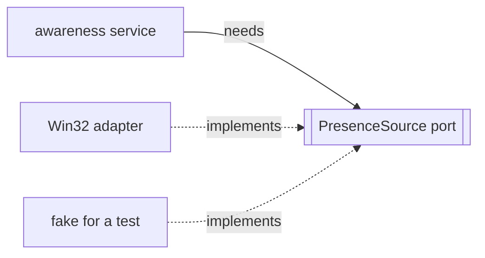

**Why this matters here.** A port's data type is also a limit. `PresenceSample` has no
field for a window title, so no code above the adapter can ask for one (C-05).

### 6.4 `domain/events`

**Purpose.** This module defines every event and the one function that applies an event
to the companion's state (ADR 0001, NFR-13, D-09, D-10).

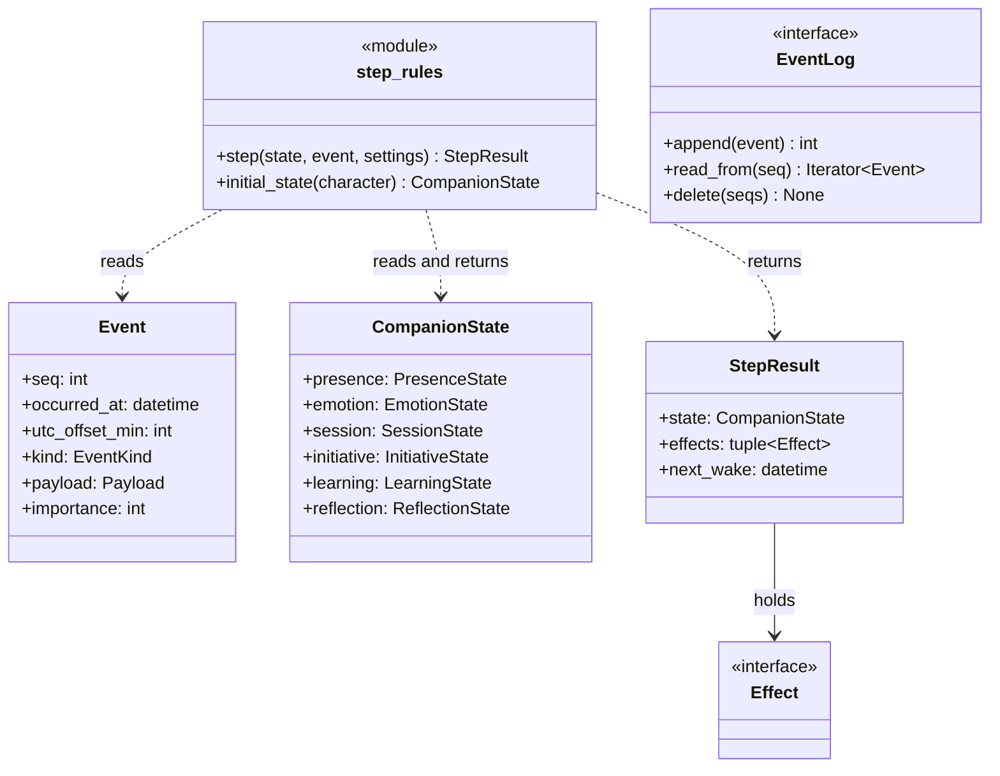

**Key types.**

| Type | Kind | Note |
|---|---|---|
| `Event` | Frozen dataclass | The `occurred_at` and `utc_offset_min` fields are the only clock that a rule sees |
| `CompanionState` | Frozen dataclass | Everything the rules hold between events. It is a pure function of the log |
| `StepResult` | Frozen dataclass | The new state, the effects, and the next time the rules want to run |
| `Effect` | Union of dataclasses | For example `RequestWording`, `ShowExpression`, `RecordDecision`, `WatchForPause` |
| `step` | Function | Calls the feature rules in a fixed order: awareness, sessions, emotion, learning, reflection, initiative, speech |

**The closed set of events.** A new kind needs a change here. This table replaces the
examples in section 9.1 of the ERD, and it closes ERD open item 4.

| Group | Kinds | Payload holds |
|---|---|---|
| The user | `user_message`, `message_rated` | Message ID, class, confidence, rating |
| Presence | `presence`, `typing_pause`, `foreground_app`, `app_hour_closed`, `clock_gap` | Idle seconds, lock state, presentation state, application name, minutes, gap seconds |
| Time | `timer` | The purpose of the wake |
| Opening | `window_opened` | Nothing. The rules decide whether this is the first opening of the day |
| Sessions | `session_opened`, `intent_changed`, `session_closed` | Session ID and figures |
| Speech | `message_shown`, `message_answered`, `message_passed_over` | Decision ID, and whether the user was at the desk |
| Memory | `memory_stored`, `memory_removed`, `commitment_added`, `commitment_closed` | Row ID, and finished or dropped |
| Learning | `pattern_found`, `adjustment_applied`, `adjustment_undone`, `proposal_decided` | Row ID |
| Learning, tombstone | `pattern_rejected` | Fingerprint and evidence seqs (D-37) |
| Reflection | `reflection_written`, `reflection_deleted` | Entry ID and source seqs. `reflection_deleted` is a tombstone (D-37) |
| Control | `paused`, `resumed`, `setting_changed`, `character_changed` | Setting name and value, version ID |

**Input closure.** The rules may read only the event log and rows that never change, such
as `character_versions`. Each user action that can change a decision is also an event.
Thus `setting_changed` exists, although the settings row holds the same fact. A replay has
no other way to see it. A tombstone has no table, so `pattern_rejected` and
`reflection_deleted` are its only copy (D-37).

**`paused` and `resumed` are control events.** No appraisal rule reads them, so a pause
causes no feeling (BR-04, UC-23-A4). They exist so that a replay drops a held message at
the same point. The log stays silent between the two.

**Start-up cost.** The core thread folds the whole log at start. The main window does
not wait for this. The cost grows with the log. If a measurement shows a slow start,
a snapshot table is the upgrade path (section 12).

#### 6.4.1 Explained: pure rules and the injected clock

**The idea.** A pure function is like a pocket calculator. The same keys always give the
same answer, because the calculator reads nothing else. A rule in Cognia works the same
way. It receives the state and the event, and it returns a result. It cannot read the
clock, the disk or the network.

**Why this matters.** The developer must compare two strategies on the same recorded week
(NFR-13). A rule that read the real clock would give a different answer on each run.

**Example.** The rule for the first opening of the day must compare the time with 04:00
local time.

| | Reads the real clock | Reads the event's time |
|---|---|---|
| Original run, Monday 08:12 | First opening: yes | First opening: yes |
| Replay on Thursday 14:00 | Answer depends on Thursday | Monday 08:12 again, so the answer is the same |

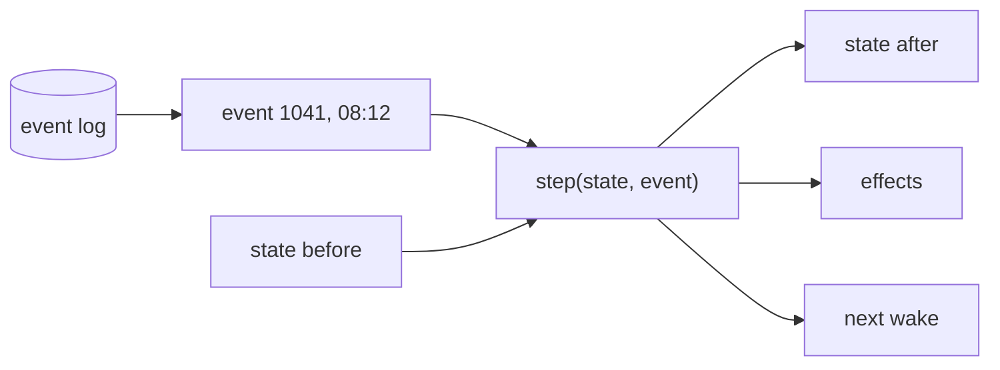

`utc_offset_min` is on each event because the day boundary and the hour of the day are
local. The user can change the time zone between the original run and the replay.

#### 6.4.2 Explained: event log and state tables

**The idea.** A shop has two records. The till roll lists what happened, in order, and
nobody changes it. The customer's card shows who they are, and they can correct it. The
event log is the till roll. A state table is the card.

**The rule that keeps the two apart.** The event log holds identifiers and figures. It
never holds the user's words. So a deletion in a state table removes the words, and the
log keeps only a reference with nothing behind it (ADR 0003).

**Example.** The user writes "I need to send chapter 3 by Friday".

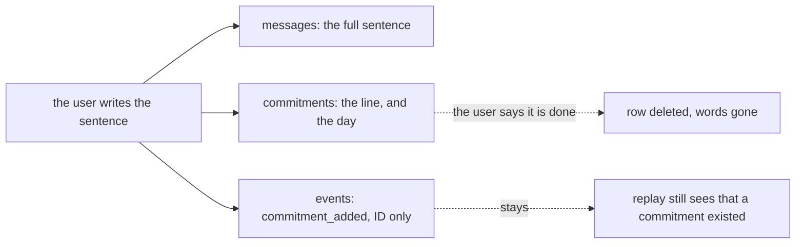

**The cost.** Removing a past mood (UC-13-A2) deletes events, so a later replay replays
what is left and not what happened (ADR 0003).

### 6.5 `domain/emotion`

**Purpose.** This module computes the companion's feelings from recorded events under the
character's temperament (BR-08, FR-32, UC-23, ADR 0004).

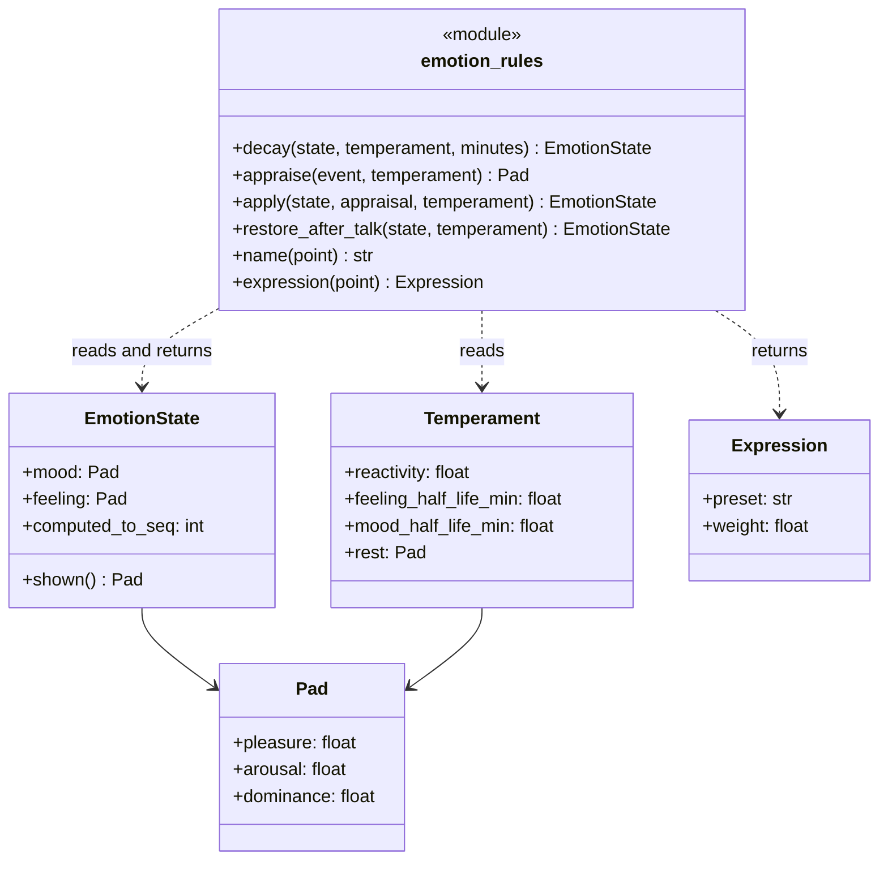

**Key types.**

| Type | Kind | Note |
|---|---|---|
| `EmotionState` | Frozen dataclass | `shown()` adds the feeling to the mood. The core thread holds this point in memory, and no table stores it (D-38) |
| `Temperament` | Frozen dataclass | Read from `character_versions`. It never changes for one version |
| `appraise` | Function | One table row per event kind. It returns zero for any kind that has no row |
| `name` | Function | Looks up a name such as "pleased". The name is derived and never stored |

**The model never sets a feeling.** The AI model classifies a message once, and that class
is the event (ADR 0004). `appraise` then uses a fixed table. A class outside the closed
set, or a low confidence, raises no event (UC-23-A3).

**What causes no feeling.** Being paused, moved or hidden is not an event for this module
(UC-23-A4). `paused` and `resumed` have no row in the appraisal table.

**Moods off.** With moods off, the state stays at the resting mood and `expression`
returns the neutral expression. When the user enables moods again, the state starts from
the resting mood (UC-18-A2).

#### 6.5.1 Explained: PAD and temperament

**The idea.** A feeling is a position on a map. Pleasure is the east-west axis. Arousal is
the north-south axis. Dominance is a third axis, which the map below does not show. An
event pushes the position. Time moves it back to a resting point. The temperament sets how
hard an event pushes, and how fast the position moves back.

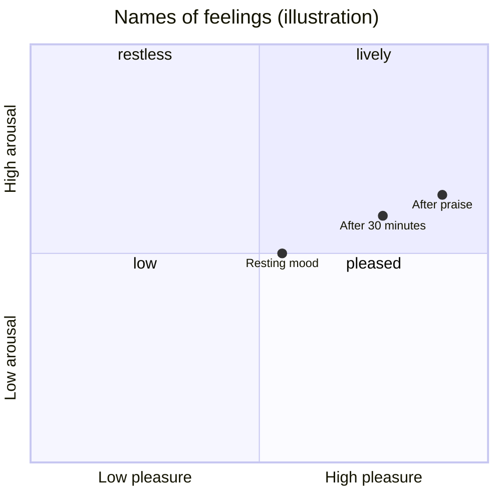

**Three time scales.** ALMA gives this structure.

| Scale | Lasts | In Cognia |
|---|---|---|
| Feeling | Minutes | `feeling`, from one event. It fades by `feeling_half_life_min` |
| Mood | Hours or days | `mood`, moved by each event. It returns to rest by `mood_half_life_min` |
| Temperament | The life of the character version | The fixed values |

**The computation.** For each event the rule does these steps:

1. It computes the minutes since the last event.
2. It decays both parts. Each part loses half of its distance in one half-life.
3. It computes the appraisal `a` of the event.
4. It adds `a` to `feeling`.
5. It adds `reactivity × a` to `mood`.
6. It limits each axis to the range from -1 to 1.

**Illustration.** The temperament has reactivity 0.4, a feeling half-life of 30 minutes, a
mood half-life of 720 minutes, and a resting mood of (0.10, 0.00, 0.00). The appraisal
table gives praise the value (0.50, 0.20, 0.10). The mood is at rest. The user writes
"thank you, that really helped".

| Moment | `feeling` | `mood` | Shown point | Name |
|---|---|---|---|---|
| Before | (0.00, 0.00, 0.00) | (0.10, 0.00, 0.00) | (0.10, 0.00, 0.00) | calm |
| At the event | (0.50, 0.20, 0.10) | (0.30, 0.08, 0.04) | (0.80, 0.28, 0.14) | lively |
| 30 minutes later | (0.25, 0.10, 0.05) | (0.29, 0.08, 0.04) | (0.54, 0.18, 0.09) | lively |
| 12 hours later | (0.00, 0.00, 0.00) | (0.20, 0.04, 0.02) | (0.20, 0.04, 0.02) | calm |

UC-17-A2 can show each row of this table, because the rows are the computation.

#### 6.5.2 Explained: sadness and its floor

**The idea.** Sadness at being ignored must grow, but it must have a limit, and it must
heal quickly. BR-08 states all three. A floor stops the fall. When the user talks again,
most of the loss returns at once.

**What counts.** A message passed over counts only while the user was at the desk to see
it. Days with no talk count. A message with nobody at the desk does not count (UC-23-A1).

**Illustration.** The floor for pleasure is -0.30. Each ignored event lowers pleasure by
0.12. Talking restores 70% of the loss. This table ignores decay, to keep the figures
simple.

| Event | Pleasure before | Change | Pleasure after | `floor_reached` |
|---|---|---|---|---|
| Start | | | 0.10 | 0 |
| Message passed over, user at the desk | 0.10 | -0.12 | -0.02 | 0 |
| Message passed over, user at the desk | -0.02 | -0.12 | -0.14 | 0 |
| A day with no talk | -0.14 | -0.12 | -0.26 | 0 |
| A second day with no talk | -0.26 | -0.04 | -0.30 | 1 |
| The user talks again | -0.30 | +0.28 | -0.02 | 0 |

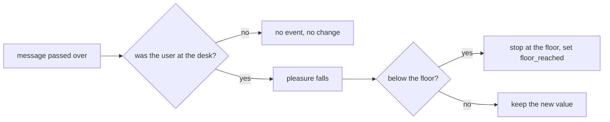

#### 6.5.3 Explained: from PAD to a facial expression

**The idea.** VRM defines preset facial expressions, and each preset has a weight from 0
to 1. A weight is a point on a dial, not a switch. So a mood can show as a slight smile.
The rule maps the name of the feeling to a preset and a weight.

**Illustration.**

| Name | VRM preset | Weight |
|---|---|---|
| calm | `neutral` | 1.0 |
| pleased | `relaxed` | 0.5 to 1.0 |
| lively | `happy` | 0.5 to 1.0 |
| restless | `surprised` | 0.2 to 0.4 |
| low | `sad` | 0.3 to 0.7 |

**What the table leaves out.** The `angry` preset has no row, because an angry face is a
reproach, which BR-04 forbids. No expression shows a need (FR-27). The lip-sync presets stay
unused, because the companion has no voice. This table is the complete list that FR-27 asks
for. Blinking and gaze are procedural, and they are ambient motion (BR-07).

### 6.6 `domain/speech`

**Purpose.** This module holds the SpeechGate. It is the one way out for anything the
companion says or shows on its own initiative (ADR 0001, NFR-09, BR-01 to BR-07, UC-17,
UC-22).

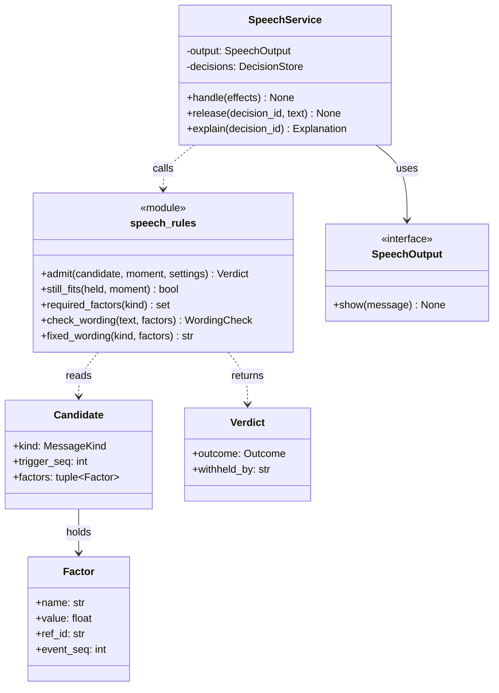

**Key types.**

| Type | Kind | Note |
|---|---|---|
| `Candidate` | Frozen dataclass | A wish to speak, with the figures behind it. It is not yet a message |
| `Factor` | Frozen dataclass | One figure. It becomes one row of `decision_factors`. `name` sets the unit of `value` and the table of `ref_id`, through one fixed lookup in `speech_rules` (ERD section 12.3) |
| `Verdict` | Frozen dataclass | `sent`, `withheld`, `held` or `dropped`, as in ERD section 12.2 |
| `SpeechOutput` | Port | The only route to the screen. Rule 8 of section 6.2 limits it to one file |

**Required factors.** The gate holds this table, because the database cannot know it (ERD
section 12.3). A missing factor makes the gate refuse.

| Kind | Required factors |
|---|---|
| `break` | Observed seconds, threshold seconds, delay by typing, mood contribution, ceiling state |
| `commitment` | The commitment, delay by typing, mood contribution, ceiling state |
| `remark`, `question` | The reason, delay by typing, mood contribution, ceiling state |
| `checkin` | The session, delay by typing, mood contribution |
| `greeting`, `return` | Each item mentioned, in the order of UC-16, and the feeling |
| `adjustment`, `proposal` | The adjustment or proposal, and its pattern |

**A reply is not proactive.** A reply that the user asked for does not pass the gate (ADR
0002). A greeting does pass the gate, so that UC-17 can explain it, but it does not count
against the ceiling (BR-01).

**Wording check (D-21).** The AI model words each proactive message. A deterministic check
then reads the words. Each number in the text must appear in the factors. A list of
phrases, such as "working for" and "behind", is forbidden (BR-06). A failed check uses the
fixed wording of the kind. A kind with no fixed wording is withheld.

#### 6.6.1 Explained: the SpeechGate funnel

**The idea.** Think of a door with several locks, in a fixed order. A message passes only
if every lock opens. The gate records which lock stopped it. Thus UC-17 can tell the
truth about a message that never appeared (UC-22 failure postcondition).

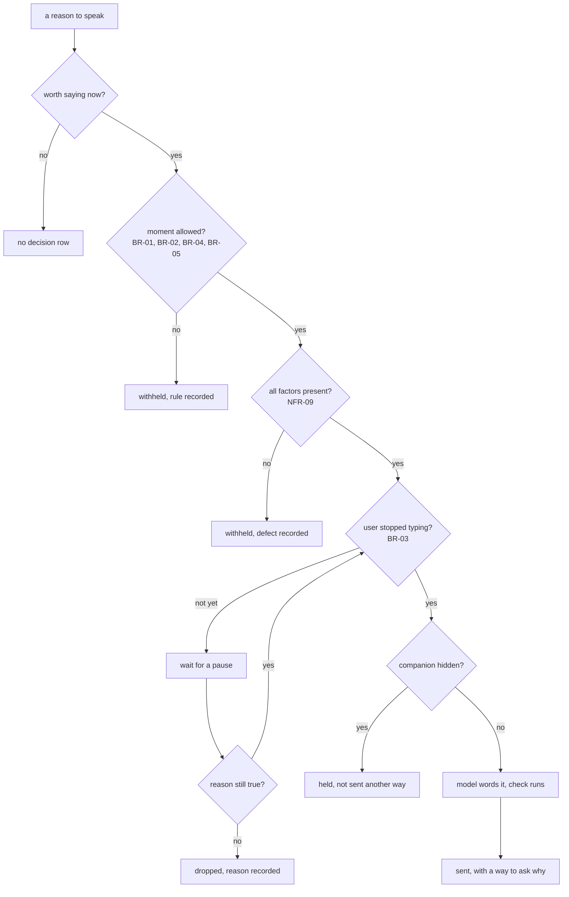

**Example.** This example uses the figures in UC-17.

| Lock | Reads | Result |
|---|---|---|
| Reason | At the machine since 09:15, 2 hours 47 minutes. The user's threshold is 90 minutes | Reason exists |
| Worth | The mood is lively, so it speaks sooner. No recent message | Yes |
| BR-02 | Not locked, not presenting, no quiet hours set | Pass |
| BR-01 | No ceiling set. Break messages are on | Pass |
| BR-05 | A session is open, and a break suggestion is allowed in a session | Pass |
| NFR-09 | All factors of `break` are present, except the delay | Pass. The gate adds the delay at release |
| BR-03 | The user is typing. The gate holds the message for 12 minutes | Pass at the pause |
| Hidden | The companion is on screen | Pass |
| Wording | "at the machine for 2 hours 47 minutes". Both numbers match the factors, and no forbidden phrase appears | Pass |

The gate works in two steps, because some figures do not exist at the start. `admit` runs
when the candidate appears. `release` runs when the words are ready. `release` adds the
delay, checks the moment again, and writes the decision and its factors in one transaction
before anything appears on screen. The words took seconds, so the machine can be locked by
now.

#### 6.6.2 Explained: holding a message for a pause

**The idea.** A polite person waits for you to finish your sentence. BR-03 asks for the
same behaviour. The message waits. If its reason stops being true during the wait, nobody
will ever see it (UC-22-A4).

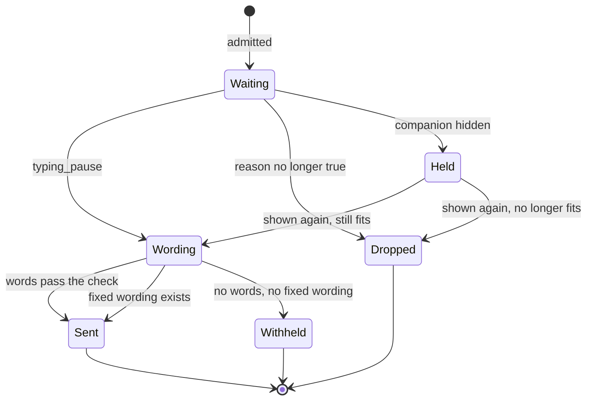

**Why a watch and not a constant stream.** A person who types pauses thousands of times a
day. One event for each pause would fill the log. So the rule returns the effect
`WatchForPause` only while a message waits. The sampler then reports the next pause as one
`typing_pause` event, and the watch ends.

**The limit of the signal.** Windows reports only the time since the last input, with no
difference between the keyboard and the mouse. A moving mouse therefore counts as typing.
This delays a message and never interrupts anybody, so the design accepts it (A-01).

### 6.7 `domain/initiative`

**Purpose.** This module finds reasons to speak and decides when the rules must run next
(UC-22, FR-31, FR-09, D-09).

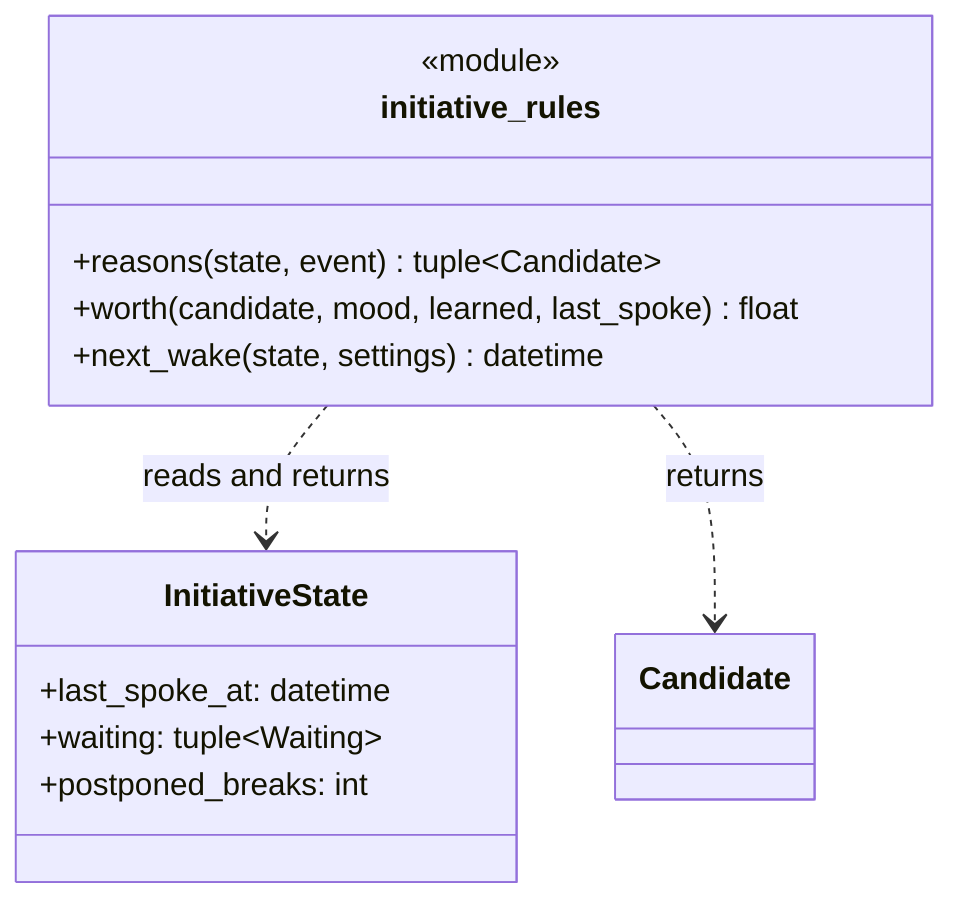

**Key types.**

| Type | Kind | Note |
|---|---|---|
| `reasons` | Function | One source for each kind in UC-22 step 1: a mood change, an open commitment, time at the machine, a learned pattern, a thought from the journal |
| `worth` | Function | Weighs the mood, what the companion learned, and the time since it last spoke (BR-01, FR-32) |
| `next_wake` | Function | Returns the earliest time at which a rule can change its answer |

**Mood changes behaviour.** `worth` reads the mood. A lively companion speaks more readily
than a low one (UC-22 step 2). This is the one place where a feeling changes what the
companion does (FR-32).

**The application name.** `reasons` can read the application in the foreground, because
each change is an event since specification version 5.2 (D-05).

#### 6.7.1 Explained: the next wake time

**The idea.** You do not check the oven every second. You set a timer for the time when the
food is ready. If you take the food out early, you cancel the timer. The rules work the same
way. Each step returns the next time that anything can change. Between those times, the
core thread sleeps.

**Example.** The user's break threshold is 90 minutes, and the user arrives at 09:15.

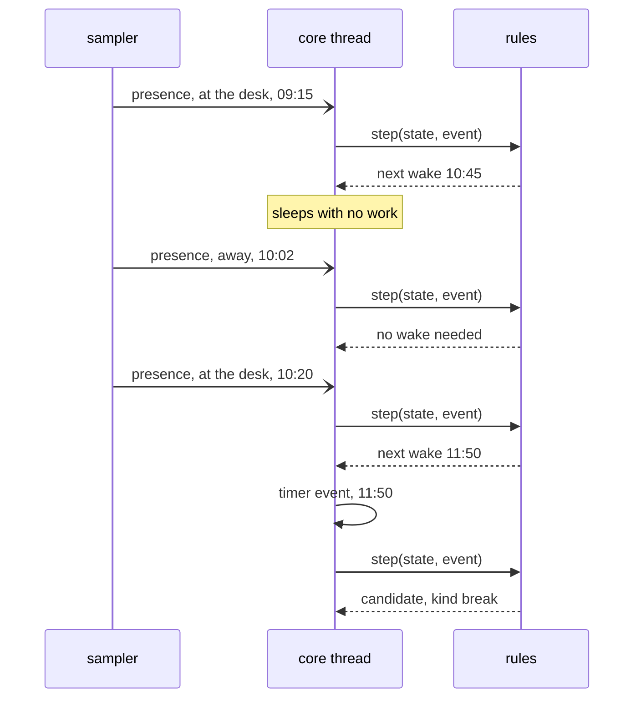

| | A tick each minute | The next wake time |
|---|---|---|
| Events in one day | 1,440 ticks | A few `timer` events |
| Disk writes | One each minute | Only when something changes |
| Time of a decision | Rounded to the minute | Exact |
| Cost | Simple rules | Each rule must compute its own next time |

The `timer` event is in the log with its time. So a replay sees the same wake at the same
moment, and it never needs a real clock.

### 6.8 `domain/memory`

**Purpose.** This module holds what the companion remembers and chooses what a reply or a
reflection draws on (FR-14, FR-17, FR-18, FR-29, UC-09, UC-12, UC-13, UC-21, D-07, D-16).

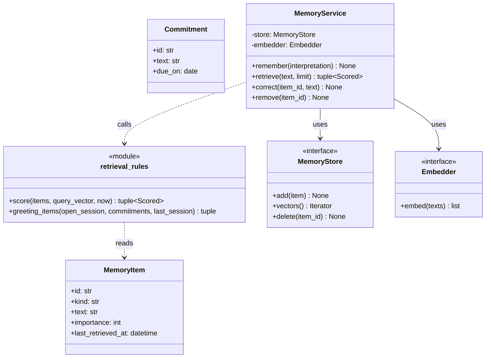

**Key types.**

| Type | Kind | Note |
|---|---|---|
| `MemoryItem` | Frozen dataclass | `text` is the exact line that the user saw (FR-14) |
| `Commitment` | Frozen dataclass | It has no time of day and no status, so no code can schedule it or mark it complete (FR-24) |
| `score` | Function | Pure. It receives the vectors as arguments, so `domain/` needs no database |
| `greeting_items` | Function | Applies the fixed order of the UC-16 table, and stops after two items |

**Vectors (D-07, D-16).** A vector is derived data. It lives in a column of the row that
it describes, so it disappears with that row. An edit in UC-13 computes it again. The
`embedding_server` returns normalised vectors, so a dot product gives the cosine. Python
3.12 and later have `math.sumprod`, so the standard library does this work.

**With the model stopped.** The memory list needs no model (NFR-08). If only the
`embedding_server` fails, `relevance` is zero for each item and the score uses the other
two terms. New items wait with an empty vector, and a later job fills them.

**Retrieval and replay.** Retrieval depends on the embedding model, so it stays outside
the rules. It only selects what a reply draws on. The result is recorded in the reply
source tables, and a replay does not repeat it.

#### 6.8.1 Explained: the retrieval score

**The idea.** A good memory for this moment is recent, important and on the same subject.
Each of the three terms gets a value from 0 to 1. The score adds them. This follows
Generative Agents, which gives each term the same weight.

- **Recency** falls with each hour since the item was last retrieved.
- **Importance** is the score from 1 to 10 that the item received when it was stored.
- **Relevance** is the cosine between the item's embedding and the query's embedding.

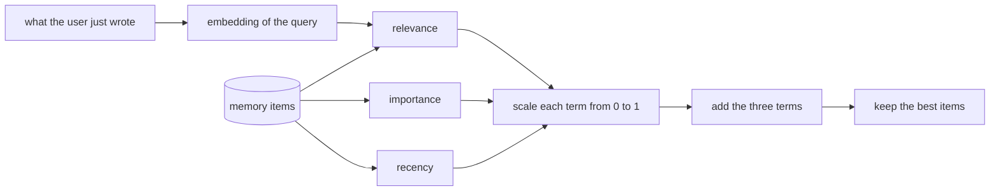

**Illustration.** The user writes "I am worried about the deadline". The recency factor is
0.995 per hour.

| Item | Hours since retrieved | Importance | Cosine | Recency, scaled | Importance, scaled | Relevance, scaled | Score |
|---|---|---|---|---|---|---|---|
| "Writing chapter 3 for their supervisor" | 4 | 8 | 0.82 | 1.00 | 1.00 | 1.00 | 3.00 |
| "Prefers short answers" | 30 | 5 | 0.21 | 0.80 | 0.40 | 0.21 | 1.41 |
| "Their cat is called Miso" | 200 | 3 | 0.05 | 0.00 | 0.00 | 0.00 | 0.00 |

The reply draws on the first item, and UC-09 step 3 shows that item to the user.

### 6.9 `domain/learning`

**Purpose.** This module finds patterns in how the user works, adjusts the companion's own
behaviour, and proposes changes to its character (FR-16, FR-23, FR-34, UC-24).

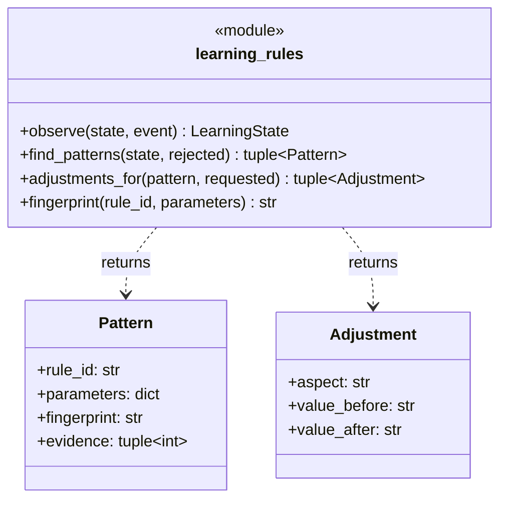

**Key types.**

| Type | Kind | Note |
|---|---|---|
| `Pattern` | Frozen dataclass | A pattern with no evidence does not exist (UC-24-E1) |
| `Adjustment` | Frozen dataclass | `aspect` is `timing`, `frequency`, `length` or `tone`. Nothing else can change without approval (FR-16) |
| `observe` | Function | Keeps small totals in the state, with the seqs behind each total. It does not hold the events themselves |
| `adjustments_for` | Function | Refuses an adjustment against something that the user asked for in UC-10 (UC-24-A4) |

**Rules find, the model words.** The rules find a pattern from counts and proportions. The
AI model only writes `statement` for the user (ADR 0004). If the model is stopped, the
pattern waits for its wording.

**A change to the character.** A change to the description or the temperament is a
proposal. Only the user can apply it (UC-24-A2).

#### 6.9.1 Explained: tombstones and fingerprints

**The idea.** When the user says that a conclusion is wrong, the companion must forget the
conclusion but remember not to draw it again. Those two needs conflict. A tombstone solves
this. It keeps a fingerprint and the event numbers, and it holds no words about the user.

**Example.** This example follows the story in section 3 of the specification. The
companion concludes that the user takes lunch at 11:00.

| Step | `patterns` | Event `pattern_rejected` |
|---|---|---|
| The rule finds the pattern from seqs 410, 522 and 633 | `regular_absence`, hour 11, with the words "takes lunch at 11:00" | None |
| The user marks it wrong (UC-13-A1) | Row deleted, words gone | Fingerprint `regular_absence\|hour=11`, seqs 410, 522, 633 |
| The next run finds the same pattern from the same seqs | No new row | The fingerprint and the evidence match, so the rule refuses |
| A later month brings different evidence | A new row is allowed | The evidence differs (ERD section 10.2) |

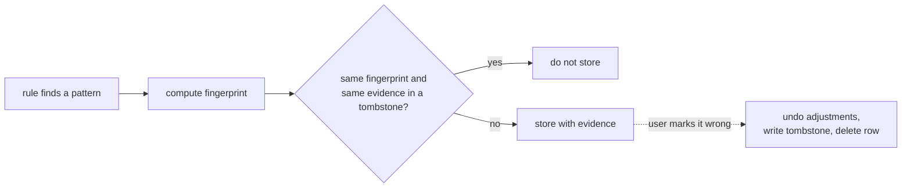

### 6.10 `domain/reflection`

**Purpose.** This module decides when the companion reflects, and it holds the journal
(FR-35, UC-25).

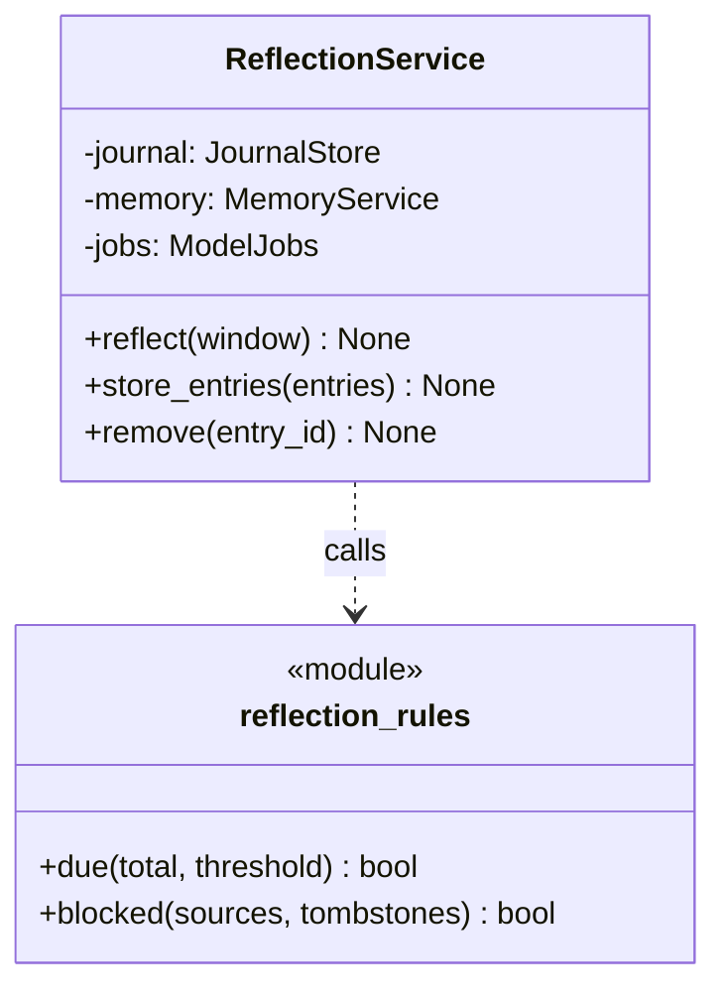

**Key types.**

| Type | Kind | Note |
|---|---|---|
| `due` | Function | Compares the total importance since the last `reflection_written` with the threshold |
| `blocked` | Function | Refuses a set of sources that matches a tombstone (UC-25-A2) |
| `ReflectionService` | Class | The one place where the model writes something that the companion keeps. It is outside the rules (ADR 0004) |

**Failure keeps the total.** The database stores no running total. The rule adds
`events.importance` after the last `reflection_written` event. If the model cannot write,
no event appears, so the total stays for the next chance (UC-25-E1).

#### 6.10.1 Explained: the reflection threshold

**The idea.** A person does not write in a diary on a schedule. A person writes when enough
happens. Each event carries an importance, and the sum of recent importance acts like
a glass that fills up. When the glass is full, the companion reflects and the count starts
again.

**Illustration.** The threshold in this example is 30. Generative Agents used 150, and its
agents reflected about two or three times a day. Trial use sets the value for Cognia,
because the specification leaves it open.

| Event | Importance | Running total | Result |
|---|---|---|---|
| The user mentions the chapter | 8 | 8 | Wait |
| A session closes | 4 | 12 | Wait |
| The user shares a worry | 7 | 19 | Wait |
| Presence changes | None | 19 | Wait |
| The user says that the chapter has gone | 9 | 28 | Wait |
| The user thanks the companion | 5 | 33 | Reflect |
| `reflection_written` | | 0 | The count starts again |

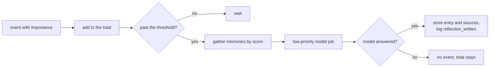

### 6.11 `infrastructure/ai`

**Purpose.** This module implements the model ports over HTTP, supervises the two server
processes, and runs one model job at a time (ADR 0002, NFR-05, NFR-08, NFR-14, D-06, D-13,
D-15, D-18, D-19, D-27).

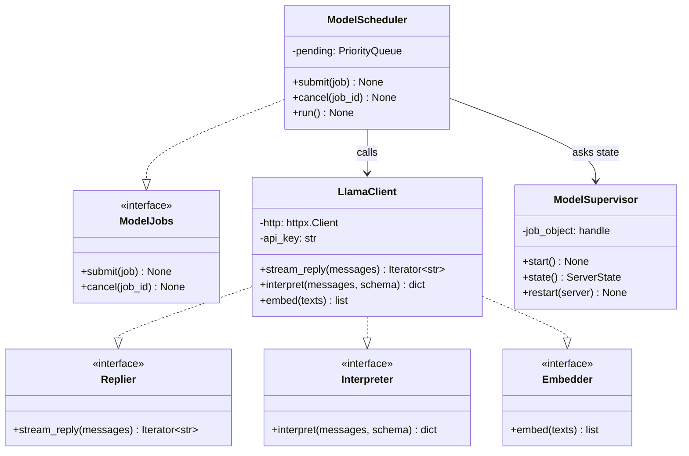

**Key types.**

| Type | Kind | Note |
|---|---|---|
| `Replier` | Port | Free text: replies, wording and journal entries. It keeps the name that the code has today |
| `Interpreter` | Port | Output that a JSON schema constrains: message interpretation, temperament reading, importance |
| `Embedder` | Port | Text to vectors |
| `ModelJobs` | Port | The one way that a service asks for model work |
| `ModelScheduler` | Class | Runs on the model thread, so no service ever waits for the model |

**Job priority (D-15).** The chat server has one slot. The scheduler holds a priority list.
A user message cancels low-priority work, and that work runs again later.

| Priority | Job |
|---|---|
| 1 | Interpret a user message, embed the query, write the reply |
| 2 | Word a proactive message |
| 3 | Embed a new item, score importance, word a pattern |
| 4 | Write journal entries, read a temperament |

**Interpretation (D-04).** The call uses the `json_schema` option of the server, so the
output always fits the schema. The closed set of classes cannot produce an unknown value.
Low confidence still raises no event (UC-23-A3). Here is the shape of the answer:

```json
{
  "event_class": "good_news",
  "confidence": 0.86,
  "importance": 9,
  "crisis": false,
  "facts": ["Sent chapter 3 to their supervisor"],
  "commitments": [],
  "closes_commitment": "b3f0",
  "style_request": null
}
```

Only `event_class`, `confidence` and `importance` reach the event log. The words in `facts`
go to state tables. `crisis` reaches neither (section 6.13).

**Local server safety (D-19).** Cognia starts each server on `127.0.0.1` with a free port,
`--api-key` with a new random key from each start, `--no-webui` and `--offline`. It
never passes `-hf` or any other download option. The key is not a secret of the user. It
only stops another local program from using the model.

**GPU choice (D-13).** The supervisor starts the Vulkan build first. If that build fails
before it reports healthy, the supervisor starts the CPU build and remembers this choice.

**Reasoning output.** The chat model may produce reasoning text. The supervisor sets the
reasoning options of the server, and the client discards that text. The behaviour must be
checked on the model that ships (ADR 0002). The model card of Gemma 4 E2B states that the
`<|think|>` token in the system prompt enables reasoning. The training examples and prompt
layer 1 must make the same choice about this token (section 12).

#### 6.11.1 Explained: the model supervisor

**The idea.** A child process can fail at any time. The supervisor works like a nurse who
checks a patient. It starts the process, waits for a healthy sign, and reports each change.
The application never assumes that the model works.

```mermaid
stateDiagram-v2
    [*] --> Starting : Cognia starts
    Starting --> Ready : /health returns 200
    Starting --> FallbackCpu : Vulkan build failed
    FallbackCpu --> Ready : /health returns 200
    FallbackCpu --> Failed : CPU build failed
    Ready --> Sleeping : idle time passed
    Sleeping --> Ready : a request arrives
    Ready --> Restarting : process ended
    Restarting --> Ready : /health returns 200
    Restarting --> Failed : too many restarts
    Failed --> Starting : the user retries
```

The server returns HTTP 503 while it loads the model, and HTTP 200 when it is ready. The two
servers have one supervisor and separate states, because the failure of one does not stop
the other. Both are in a Windows job object, so they end with Cognia even after a crash
(ADR 0002). `--sleep-idle-seconds` frees the memory of an idle model (D-18).

`Failed` is a normal state and not a crash. In this state, each model job fails at once with
a plain sentence (UC-09-E1, UC-01-E1).

#### 6.11.2 Explained: prompt layers and the prefix cache

**The idea.** The server keeps the work it did for the last request. If a new request starts
with the same text, the server skips that part. This is `cache_prompt`, which is on by
default. So the parts that never change go first, and the parts that change go last.

```mermaid
flowchart TB
    a["1. Base rules and safety text — fixed"]
    b["2. Character description — fixed for one version"]
    c["3. Conversation history — grows at the end only"]
    d["4. Mood line, remembered items, this request — changes each turn"]
    a --> b --> c --> d
```

| Layer | Holds | Changes |
|---|---|---|
| 1 | The base rules that a prompt can state, and the safety text | Never |
| 2 | The character's own words | When the user changes the character, or approves a change (UC-03, UC-24) |
| 3 | The recent messages | One message added at the end |
| 4 | The mood name, remembered items, and any instruction for this turn | Each turn |

**Example.** On a long conversation, only layer 4 and the newest message need new work. This
matters most on a CPU, where the model reads each token of the prompt slowly (NFR-05).

**Safety does not depend on a prompt.** A character is data in layer 2, so it cannot remove
layer 1. Section 6.13 adds a check that does not trust the model at all.

`domain/conversation/rules.py` builds the layers. It is pure, so a test can compare the text.
The cache can make a model's output differ slightly between runs. This does no harm, because
a replay never calls the model.

#### 6.11.3 Explained: the tuned chat model

**The idea.** A new employee can read a manual on the first day, and practice can improve the
work after that. The base model is the new employee. The prompt is the manual. Fine-tuning is
the practice. The tuned model still reads its prompt, so the manual stays in use.

**Two jobs, one file.** The chat server has one slot and one model file (D-15). So one tuned
model does both jobs.

| Job | Port | What the examples teach | What still guarantees the result |
|---|---|---|---|
| Voice | `Replier` | Follow the character description in layer 2, in replies, wording and journal entries | `reply_complies` (section 6.13), `check_wording` (section 6.6) |
| Interpretation | `Interpreter` | Select the correct class, importance, facts and `crisis` value | The `json_schema` option, the closed set of events (section 6.4), `tripwire`, `appraise` |

**Many characters, no fixed character.** Four characters ship, and a change that the user
approves in UC-24 changes a description. So the examples hold many different character
descriptions. The model learns to follow a description, and it does not learn one character.
The test sets use descriptions that training did not use.

**Illustration.** Two examples have the same message and the same class, `good_news`. Only
layer 2 differs.

| Layer 2 says | The user writes | The reply that the example teaches |
|---|---|---|
| "A dry, patient archivist" | "I sent chapter 3!" | "Noted. Chapter 3 leaves the archive. Well done." |
| "A cheerful gardener" | "I sent chapter 3!" | "Oh, that is wonderful! Chapter 3 is out in the sun now." |

```mermaid
flowchart LR
    base["Gemma 4 E2B, base model"] --> lora["LoRA training"]
    examples["reviewed examples"] --> lora
    lora --> merged["merge and quantise"]
    merged --> gate{"passes the acceptance gate?"}
    gate -- "yes" --> chat["tuned model ships as chat.gguf"]
    gate -- "no" --> stay["the base model stays the candidate"]
```

**What does not change.** The ports, the servers, the connectors and the job priorities stay
the same. The model never sets a feeling (BR-08). A replay never calls the model, so a new
`chat.gguf` cannot change the replay of a recorded log (NFR-13). Section 6.16 gives the module,
and section 8.6 gives the steps.

### 6.12 `infrastructure/presence`

**Purpose.** This module is the only code that asks Windows about the user (C-05, NFR-02,
FR-06, UC-04, D-17). Its size is deliberate. The audit of NFR-02 reads this one directory.

```mermaid
classDiagram
    class PresenceSample {
        +idle_seconds: int
        +locked: bool
        +presenting: bool
        +foreground_app: str
    }

    class PresenceSource {
        <<interface>>
        +sample() PresenceSample
    }

    class Win32PresenceSource {
        +sample() PresenceSample
    }

    class PresenceSampler {
        -source: PresenceSource
        -stop: threading.Event
        +run() None
        +watch_for_pause() None
    }

    Win32PresenceSource ..|> PresenceSource
    PresenceSampler --> PresenceSource : uses
    PresenceSource ..> PresenceSample : returns
```

**Key types.**

| Type | Kind | Note |
|---|---|---|
| `PresenceSample` | Frozen dataclass, in `domain/ports` | Exactly four fields. This type enforces C-05 |
| `foreground_app` | Field | The file name of the program, such as `code.exe`. The path is discarded at once |
| `PresenceSampler` | Class | Runs on the sampler thread, once each second |

**Win32 allow-list (D-17).** The adapter uses `ctypes`, and it declares only these functions.

| Fact | Functions |
|---|---|
| Idle time | `GetLastInputInfo`, `GetTickCount64` |
| Lock state | `WTSQuerySessionInformationW`, `WTSFreeMemory` |
| Presentation state | `SHQueryUserNotificationState` |
| Foreground application name | `GetForegroundWindow`, `GetWindowThreadProcessId`, `OpenProcess`, `QueryFullProcessImageNameW`, `CloseHandle` |

**Forbidden.** `GetWindowText*`, `GetWindowRect`, `GetWindowInfo`, `EnumWindows`,
`SetWindowsHookEx*`, `GetAsyncKeyState`, `GetClipboardData`, `BitBlt` and any other call that
supplies a title, a position, a keystroke, the clipboard or the screen. Screen layout comes
from Qt in the `ui/` layer, for drawing only.

**Presentation state.** `SHQueryUserNotificationState` reports `QUNS_BUSY`,
`QUNS_RUNNING_D3D_FULL_SCREEN` and `QUNS_PRESENTATION_MODE`. All three mean "presenting" here.
The design never compares a window's rectangle with the screen, because that needs a position.

**Reports changes only.** The sampler compares each sample with the last one. It reports a
change of desk state, lock state, presentation state or application. It reports a typing pause
only under a watch (section 6.6.2). It also merges each application's minutes into the current
hour, and it reports `app_hour_closed` when the hour ends. The idea comes from the heartbeats
of ActivityWatch.

**An excluded application.** The sampler replaces the name of an excluded application with an
empty value, so the name goes nowhere. UC-04-A3 deletes the totals and the old
`foreground_app` events in one transaction.

**A jump in time.** If the wall clock moved much more than the sampler's own one-second wait,
the machine slept or the clock changed. The sampler reports `clock_gap`, and the rules then
refuse to state a duration (UC-16-A3). This needs no fifth fact from Windows.

**Stop at once.** The pause path sets `threading.Event` directly from the GUI thread. The
sampler reads that flag before each sample, so observation stops within one second even if
the core thread is busy (NFR-04).

### 6.13 `domain/safety`

**Purpose.** This module makes NFR-12 hold when the small model does not obey its prompt (FR-04,
UC-09-E3, D-11).

```mermaid
classDiagram
    class safety_rules {
        <<module>>
        +tripwire(text) bool
        +is_crisis(tripwire_hit, interpretation) bool
        +instruction() str
        +reply_complies(text) bool
        +required_line() str
    }
```

**Key types.**

| Type | Kind | Note |
|---|---|---|
| `tripwire` | Function | Reads the message for a fixed list of phrases. It needs no model |
| `reply_complies` | Function | Checks that the reply states that it is a fictional character and cannot replace a real person |
| `required_line` | Function | The fixed English sentence (C-06) |

```mermaid
flowchart TD
    msg["the user's message"] --> trip["tripwire: fixed phrases"]
    msg --> model["interpretation: crisis field"]
    trip --> either{"either one true?"}
    model --> either
    either -- "no" --> normal["normal reply"]
    either -- "yes" --> up{"model available?"}
    up -- "no" --> fixed["show the required line"]
    up -- "yes" --> prompt["add the instruction to layer 4"]
    prompt --> stream["stream the reply in character"]
    stream --> check{"reply complies?"}
    check -- "yes" --> done["done"]
    check -- "no" --> append["add the required line at the end"]
```

**Three layers, one reason.** The tripwire works with no model. The model's class catches words
that the list misses. The check after the stream gives the guarantee. The model states the words
in the character's voice if it can. If it does not, the fixed line closes the reply.

**Nothing is logged.** A crisis writes no event and no memory item by this path, because the
fact is sensitive and no rule needs it. The message itself stays in `messages`, where the user
can delete it. The ordinary `event_class`, such as `shared_worry`, still applies.

**No character can change this.** The rule reads no character data. FR-04 holds by construction.

### 6.14 `app/core_host`

**Purpose.** This module owns the core thread, the event queue and the wiring between layers
(ADR 0001, D-01, D-03, D-09, D-23, D-24).

```mermaid
classDiagram
    class CoreHost {
        -queue: Queue
        -services: Services
        -state: CompanionState
        -next_wake: datetime
        +run() None
        +post(item) None
    }

    class Bridge {
        <<QObject>>
        +viewReady Signal
        +expressionChanged Signal
        +messageChanged Signal
        +send(command) None
    }

    class SingleInstance {
        +acquire() bool
        +notify_first() None
    }

    class Replay {
        +run(log_path, strategy) Report
    }

    CoreHost --> Bridge : emits through
    Bridge --> CoreHost : posts to
```

**Key types.**

| Type | Kind | Note |
|---|---|---|
| `CoreHost` | Class | A plain Python thread. It holds the SQLite connection |
| `Bridge` | `QObject` | The only place where Qt and the core meet (D-24) |
| `SingleInstance` | Class | A `QLockFile` and a `QLocalSocket`. See D-23 |
| `Replay` | Class | Folds a recorded log through `step`, and compares the output (section 7.14) |

**The queue.** The queue is a standard `queue.Queue` with a maximum size. This satisfies "one
bounded queue with one reader" (ADR 0001). The loop waits on the queue, with a timeout that
ends at `next_wake`. So one mechanism handles both arrivals and time.

**One item, one transaction.** The core thread processes each item in this order:

1. It takes one item from the queue, and it stamps a new event with the time.
2. It opens one database transaction.
3. It appends the event, and calls `step`.
4. It writes state rows, cache rows and decisions.
5. It commits. The commit reaches the disk (`synchronous=FULL`, NFR-07).
6. It starts the outward effects: signals to the GUI, and model jobs.
7. It sets `next_wake`.

Step 6 follows step 5 on purpose. A message appears only after its decision is on disk, so
nothing can reach the screen with no record (NFR-09). If the power fails between the two, a
decision is recorded for a message that nobody saw. The design accepts this rare case.

**Full queue.** Presence items are dropped first, and the next sample repeats their
information. Commands are never dropped. The queue is large enough that this happens only if
the core thread stalled.

**Start order.** `main` shows the window first, then it folds the log on the core thread. Thus
the window meets NFR-04, and views show a loading state until the first data arrives.

**A start with an open session.** The rules close a session that has no end as of the last
recorded activity (UC-07-A2).

### 6.15 `ui/windows/companion_window`

**Purpose.** This module draws the character on the desktop (FR-25 to FR-28, BR-07, UC-20, D-08,
D-25, D-26).

```mermaid
classDiagram
    class CompanionWindow {
        -view: QWebEngineView
        -handle: DragHandle
        +setExpression(preset, weight) None
        +showBubble(text) None
        +setDrawingState(state) None
    }

    class DragHandle {
        +moved Signal
    }

    class companion_page {
        <<module>>
        +load(vrm_path) None
        +setExpression(preset, weight) None
        +playAddressed(motion) None
        +setFrameLimit(frames) None
    }

    CompanionWindow --> DragHandle
    CompanionWindow ..> companion_page : runJavaScript
```

**Key types.**

| Type | Kind | Note |
|---|---|---|
| `CompanionWindow` | `QWidget` | Exists today with a placeholder sprite. Needs `WindowDoesNotAcceptFocus` and `WA_ShowWithoutActivating` for FR-25 |
| `DragHandle` | `QWidget` | Takes mouse events, because a web view would keep them. Only this code can move the window |
| `companion_page` | HTML and JavaScript in `resources/companion/` | three.js and `three-vrm`, stored in the repository at fixed versions |

**Two paths for motion (BR-07).** Ambient motion runs inside the page: breathing, blinking, gaze,
and the expression from `expressionChanged`. The page has no function that moves the window, and
it cannot take the focus. Addressed motion and speech bubbles arrive only through `SpeechOutput`,
so they pass the gate.

**No network.** The page loads only local files. A `QWebEngineUrlRequestInterceptor` refuses
every other URL. The profile is off the record, so Chromium writes no cache and no cookies to
disk. The capture of NFR-01 must include the Chromium processes.

**Drawing states (D-25).** Hidden and paused both end the render process, to return its memory
(NFR-06). Showing the companion loads the page again.

| State | Render process | Frame rate |
|---|---|---|
| On screen | Running | Limited, set by measurement |
| Hidden (UC-20-A1) | Ended | None |
| Paused (UC-15) | Ended | None |

**Assets (D-26).** The author makes four characters in VRoid Studio and exports them as VRM.
`character_versions.appearance_id` names a set in `resources/`. Each file keeps its licence
beside it, as the fonts do. The rules for accepting a file are in D-26.

### 6.16 `training`

**Purpose.** This module builds the tuned chat model and measures it (D-27, A-02, G-03). It runs
at build time only. The installer holds its output and none of its code.

```mermaid
classDiagram
    class Example {
        +job: str
        +character: str
        +messages: tuple~Message~
        +target: str
        +reviewed: bool
    }

    class generator {
        <<module>>
        +make_examples(characters, messages) tuple~Example~
    }

    class trainer {
        <<module>>
        +train_lora(base, examples) Path
    }

    class exporter {
        <<module>>
        +merge_and_quantise(adapter, method) Path
        +write_licences(output) None
    }

    class evaluator {
        <<module>>
        +measure(model, test_sets) Report
        +accepted(tuned, base, thresholds) bool
    }

    class conversation_rules {
        <<module>>
    }

    class safety_rules {
        <<module>>
    }

    class LlamaClient

    generator ..> Example : returns
    generator ..> conversation_rules : builds prompts with
    trainer ..> Example : reads
    evaluator --> LlamaClient : calls
    evaluator ..> safety_rules : checks with
```

**Key types.**

| Type | Kind | File | Note |
|---|---|---|---|
| `Example` | Frozen dataclass | `generate.py` | One training item. `job` is `voice` or `interpretation`. Training refuses an item with `reviewed` false |
| `make_examples` | Function | `generate.py` | Builds each prompt with `domain/conversation/rules.py`, so the examples match the runtime layers. Labels come from the closed set in `domain/events` |
| `train_lora` | Function | `train.py` | Trains on the GPU of the training environment (section 8.6) |
| `merge_and_quantise` | Function | `export.py` | Writes one GGUF. The chat template and the end token must match the training run |
| `write_licences` | Function | `export.py` | Writes the licence text, the notices, a statement that the weights are modified, and the source and date of the base model |
| `measure` | Function | `evaluate.py` | Runs a GGUF in `llama-server` through `LlamaClient`, the same path as run time. It calls `reply_complies` and `check_wording`, and it holds no copy of them |
| `accepted` | Function | `evaluate.py` | Applies the thresholds that the author set before training |

**No user data.** Rule 11 of section 6.2 stops this module from reaching the data file. Cognia
has no route that sends user data to this module (NFR-01). If a user's words trained the weights,
UC-14 could not erase them (NFR-03).

**The prompts must stay the same.** The tuned model learns from the text of the prompt layers. A
change to layer 1, or to the order of the layers, needs a new measurement, and it can need new
training.

## 7. Component-and-connector view

This view shows what exists while the system runs. Each box has a lifetime. It starts, it can
fail, and something restarts it or reports it. Each line is a connector with a protocol and a
failure behaviour.

### 7.1 Runtime structure

```mermaid
flowchart LR
    user(["user"])
    windows(["Windows"])

    subgraph cognia["Cognia.exe"]
        gui_thread["gui_thread"]
        core_thread["core_thread"]
        model_thread["model_thread"]
        sampler_thread["sampler_thread"]
    end

    chat_server["chat_server"]
    embedding_server["embedding_server"]
    companion_renderer["companion_renderer"]
    data_file[("cognia.sqlite3")]
    second_start["second start of Cognia.exe"]

    user --> gui_thread
    gui_thread -- "C1" --> core_thread
    core_thread -. "C2" .-> gui_thread
    sampler_thread -. "C3" .-> core_thread
    core_thread -. "C4" .-> model_thread
    model_thread -. "C5" .-> core_thread
    model_thread -. "C6" .-> gui_thread
    model_thread -- "C7" --> chat_server
    model_thread -- "C8" --> embedding_server
    core_thread -- "C9" --> data_file
    gui_thread -- "C10" --> companion_renderer
    sampler_thread -- "C11" --> windows
    model_thread -- "C12" --> chat_server
    model_thread -- "C12" --> embedding_server
    second_start -- "C13" --> gui_thread
```

### 7.2 Connector catalog

| # | From → To | Type | Protocol | Carries | Timeout and retry | Failure behaviour |
|---|---|---|---|---|---|---|
| C1 | gui_thread → core_thread | Asynchronous | `queue.Queue` through `Bridge` | Commands as frozen dataclasses | None. A command is never dropped | The view shows a waiting state until data arrives |
| C2 | core_thread → gui_thread | Asynchronous | Qt queued signal | View data, expressions, messages | None | A missed signal cannot happen while both threads live. A crash ends both |
| C3 | sampler_thread → core_thread | Asynchronous | `queue.Queue` | Presence events, changes only | Dropped if the queue is full | The next sample repeats the information |
| C4 | core_thread → model_thread | Asynchronous | Priority queue through the `ModelJobs` port | Model jobs | Priority 1 cancels priority 4 | The job returns a failure to the core thread |
| C5 | model_thread → core_thread | Asynchronous | `queue.Queue` | Job results, which often become events | None | A failed job raises no event (UC-23-E1) |
| C6 | model_thread → gui_thread | Asynchronous | Qt queued signal | Pieces of a reply | None | The view shows the failure sentence. A partial reply is discarded (UC-09-E2) |
| C7 | model_thread → chat_server | Synchronous | HTTP/1.1 on `127.0.0.1`, SSE, JSON | Prompts, replies, interpretations | Limits set by measurement. No automatic retry of a reply | `ReplyFailed`, with a plain sentence (UC-09-E1) |
| C8 | model_thread → embedding_server | Synchronous | HTTP/1.1 on `127.0.0.1`, JSON | Texts, vectors | Short limit. No retry | Retrieval uses recency and importance only |
| C9 | core_thread → `cognia.sqlite3` | Synchronous | In-process SQLite, WAL, `synchronous=FULL` | All reads and writes | No lock wait, because one connection exists | The transaction rolls back. The user sees what failed (UC-07-E1, UC-13-E1) |
| C10 | gui_thread → companion_renderer | Asynchronous | Qt WebEngine IPC, `runJavaScript` | Expressions, addressed motion | None | Render process ends: the window reports UC-20-E2, and all functions stay reachable |
| C11 | sampler_thread → Windows | Synchronous | Win32 through `ctypes` | The four facts | Once each second | A failed read gives UC-04-E1. Desk awareness stays off |
| C12 | model_thread → server processes | Synchronous | Process start, job object, `GET /health` | Start, stop, health | Limited restarts | State `Failed`, with a plain sentence (section 6.11.1) |
| C13 | second start → gui_thread | Asynchronous | `QLocalSocket`, a named pipe | One request to show the window | One attempt | The second start exits, and the user can try again |

**Delivery guarantee.** C1, C3 and C5 hold items in memory only. An item is durable when its
transaction commits (section 6.14). A power failure loses items that are still in the queue,
and it loses nothing that is committed (NFR-07). Effects run at most once. No effect runs before
its commit.

### 7.3 Component catalog

| Component | Kind | Phase | Responsibility | State it owns | Built from |
|---|---|---|---|---|---|
| gui_thread | Thread | 1 | Show data, report input, drive the page | Window geometry only | `ui/`, `app/bridge` |
| core_thread | Thread, one reader | 1 | Process the queue, run the rules, hold the connection | `CompanionState`, the SQLite connection | `app/core_host`, `domain/`, `infrastructure/storage` |
| model_thread | Thread | 1 | Run model jobs, supervise the servers | The job list | `infrastructure/ai` |
| sampler_thread | Thread | 2 | Read the four facts | The last sample, the current hour's minutes | `infrastructure/presence` |
| chat_server | Child process | 1 | Generate text | The loaded model | `llama-server.exe`, chat GGUF |
| embedding_server | Child process | 1 | Compute vectors | The loaded model | `llama-server.exe`, embedding GGUF |
| companion_renderer | Child processes | 2 | Draw the character | The loaded VRM | `QtWebEngineProcess.exe`, `resources/companion/` |
| `cognia.sqlite3` | Store | 1 | Hold all data | All tables in the ERD | `infrastructure/storage` |

### 7.4 Scenario: the user sends a message

**Trigger.** The user writes a message and presses Send (UC-09, UC-23, UC-21, FR-13, FR-14, D-04).

```mermaid
sequenceDiagram
    actor user
    participant gui as gui_thread
    participant core as core_thread
    participant model as model_thread
    participant chat as chat_server
    participant embed as embedding_server

    user->>gui: writes a message
    gui-)core: SendMessage
    core->>core: store message, run the tripwire
    core-)gui: show the message, show working indicator
    core-)model: job 1, interpret
    model->>chat: json_schema request
    chat-->>model: class, importance, facts
    model-)core: interpretation ready
    core->>core: user_message event, step, commit
    Note over core: the mood has now moved
    core-)model: job 1, embed the query
    model->>embed: text
    embed-->>model: vector
    model-)core: vector
    core->>core: retrieve, build prompt layers
    core-)model: job 1, reply
    model->>chat: stream
    loop each piece
        chat-->>model: piece
        model-)gui: show the piece
    end
    model-)core: reply complete
    core->>core: safety check, store reply and sources
    core-)gui: reply final, sources, stored line
```

The first piece of the reply hides the working indicator. The indicator covers the
interpretation and the retrieval, so the user never sees a blank pause (NFR-05).

**What happens when the model is unavailable.** The interpretation job fails at once. No event is
raised, and the feeling does not move on a guess (UC-23-E1). The conversation view shows a plain
sentence that says what would fix the problem (UC-09-E1). No memory item is stored.

**What happens when the user closes the window during the reply.** The core thread cancels the job.
The partial reply is discarded, and nothing from the exchange reaches memory (UC-09-E2).

### 7.5 Scenario: a break suggestion waits for a pause

**Trigger.** Time at the machine passes the threshold while the user types (UC-22-A1, BR-03, FR-09).

```mermaid
sequenceDiagram
    participant core as core_thread
    participant sampler as sampler_thread
    participant model as model_thread
    participant gui as gui_thread
    actor user

    core->>core: timer event, step
    Note over core: candidate break, admit passes
    core-)sampler: watch for a pause
    Note over sampler: the user keeps typing
    sampler-)core: typing_pause
    core->>core: step, delay is known
    core-)model: job 2, word the message
    model-)core: words
    core->>core: check words, check moment again
    core->>core: write decision and factors, commit
    core-)gui: show message through SpeechOutput
    gui->>user: speech bubble with "why" and "don't send this kind"
    user->>gui: answers or lets it pass
    gui-)core: message_answered
```

**What happens when the reason passes during the wait.** The user locks the machine, or the
commitment closes. The rule drops the message and records why. It does not send the message late
(UC-22-A4).

**What happens when the model cannot word it.** A break suggestion uses fixed wording (UC-22-E3). A
remark or a question is not made.

**What happens when the companion is hidden.** The message is held and is not sent another way. No
tray notification appears (BR-04, UC-22-A3).

### 7.6 Scenario: the first opening of the day

**Trigger.** The user opens the application from the Start menu, and Cognia is already running in
the background (UC-16, FR-20, D-23).

```mermaid
sequenceDiagram
    actor user
    participant second as second start
    participant gui as gui_thread
    participant core as core_thread
    participant model as model_thread

    user->>second: opens Cognia
    second->>gui: C13, show the window
    second->>second: exits
    gui->>user: main window
    gui-)core: window_opened
    core->>core: step, compare with the 04:00 boundary
    Note over core: first opening today, candidate greeting
    core->>core: greeting_items, at most two
    core-)model: job 2, word the greeting in the mood
    model-)core: words
    core->>core: write decision and items, commit
    core-)gui: show the greeting
```

**What happens at a later opening the same day.** The rule finds a greeting row after today's
boundary. No greeting appears, and the view shows the same items as plain context (UC-16-A2).

**What happens when the model is unavailable.** The gate uses a plain greeting and states the items
plainly (UC-16-E1).

### 7.7 Scenario: the companion reflects

**Trigger.** The sum of importance passes the threshold (UC-25, FR-35).

```mermaid
sequenceDiagram
    participant core as core_thread
    participant model as model_thread
    participant chat as chat_server

    core->>core: step, reflection due
    core->>core: gather memories by score, check tombstones
    core-)model: job 4, write entries
    model->>chat: request
    chat-->>model: entry text
    model-)core: entries
    core->>core: store entries and sources, reflection_written, commit
```

**What happens when the user sends a message during the job.** Priority 1 cancels the job. No entry
appears, and no event appears. The total stays, so the job runs later.

**What happens when the model is unavailable.** Nothing is written, and the total stays (UC-25-E1).

### 7.8 Scenario: the companion learns and the user undoes it

**Trigger.** A rule finds a repeated pattern (UC-24, FR-16, FR-34).

```mermaid
sequenceDiagram
    actor user
    participant gui as gui_thread
    participant core as core_thread
    participant model as model_thread

    core->>core: find_patterns, check tombstones
    core-)model: job 3, word the pattern
    model-)core: statement
    core->>core: store pattern and evidence, pattern_found, commit
    core->>core: adjustment_applied, candidate adjustment
    Note over core: the message passes the gate at a permitted moment
    core-)gui: "I moved my remarks to the afternoon. Undo?"
    user->>gui: Undo
    gui-)core: UndoAdjustment
    core->>core: adjustment_undone, restore value, commit
```

**What happens when the user marks the pattern wrong.** One transaction undoes each adjustment on
that pattern, writes the tombstone, and deletes the pattern (UC-24-A3).

**What happens when the adjustment conflicts with a request.** The user's request in UC-10 wins, and
the rule makes no adjustment (UC-24-A4).

### 7.9 Scenario: the user pauses the companion

**Trigger.** The user clicks the tray icon and chooses a duration (UC-15, FR-12, NFR-04).

```mermaid
sequenceDiagram
    actor user
    participant gui as gui_thread
    participant sampler as sampler_thread
    participant core as core_thread

    user->>gui: chooses one hour
    gui->>sampler: set the stop flag
    gui-)core: Pause
    core->>core: paused event, close open session, drop held messages
    core->>core: cancel the next wake, commit
    core-)gui: pause confirmed
    gui->>gui: hide the companion, end the renderer
    gui->>user: tray icon shows paused
```

The tray icon changes only after the core thread confirms. The stop flag acts at once, so
observation ends within one sample.

**What happens when the pause does not take effect in one second.** The icon stays in the running
state, the companion stays on the screen, and the system says that it is still running. A false
"paused" is the worst failure here (UC-15-E1).

**What happens on resume.** `resumed` enters the log. The sampler starts again, with no backfill. The
mood has only decayed by time, because no appraisal rule reads a pause (BR-04).

### 7.10 Scenario: the user erases everything

**Trigger.** The user opens erasure and chooses a level (UC-14, FR-19, NFR-03).

```mermaid
sequenceDiagram
    actor user
    participant gui as gui_thread
    participant core as core_thread
    participant db as cognia.sqlite3

    user->>gui: chooses a level
    gui-)core: CountErasure
    core->>db: count rows by group
    core-)gui: counts and dependencies
    user->>gui: confirms
    gui-)core: Erase
    loop each table group
        core->>db: delete, in its own transaction
        db-->>core: result
    end
    core->>db: WAL checkpoint, VACUUM
    core->>core: state returns to the resting mood
    core-)gui: what was removed
```

**What happens when erasure fails part-way.** Each group has its own transaction. The report states
exactly which groups are gone and which remain, and it offers to run again. It never reports a partial
erasure as complete (UC-14-E1).

**What this costs.** `VACUUM` can take time, and the core thread does nothing else during it. A view
shows a waiting state. A pause still stops observation, through the stop flag.

### 7.11 Scenario: the model process ends

**Trigger.** `llama-server` crashes during a reply (UC-09-E1, NFR-08).

```mermaid
sequenceDiagram
    participant gui as gui_thread
    participant core as core_thread
    participant model as model_thread
    participant chat as chat_server

    model->>chat: stream
    chat--xmodel: connection lost
    model-)core: reply failed
    core-)gui: plain sentence, partial reply discarded
    model->>chat: restart, wait for /health
    alt server recovers
        chat-->>model: 200
        model-)core: model ready
    else too many restarts
        model-)core: model failed
        core-)gui: state the fault and the repair
    end
```

**What continues.** The queue, the rules, the memory list, sessions, pausing and the emotion state do
not depend on `model_thread`. Decay and appraisal of non-message events continue (NFR-08).

### 7.12 Scenario: the power fails

**Trigger.** The machine loses power with a session open (NFR-07, UC-07-A2).

```mermaid
sequenceDiagram
    participant core as core_thread
    participant db as cognia.sqlite3
    participant gui as gui_thread

    Note over core,db: power fails, in-memory items are lost
    core->>db: at next start, SQLite recovers the WAL
    core->>db: read the event log
    core->>core: fold the log into CompanionState
    core->>core: the open session has no end
    core->>db: close it as of the last activity, last_activity
    core-)gui: say plainly that it ended with no answer
```

A commit is on disk before Cognia reports it, so memory items and closed sessions survive. A message
that was on its way to the model has no event yet, so it causes no feeling. The cache tables can be
behind the log, so the fold computes them again.

### 7.13 Scenario: a crisis message

**Trigger.** The user writes about harming themselves (UC-09-E3, NFR-12, D-11).

```mermaid
sequenceDiagram
    actor user
    participant gui as gui_thread
    participant core as core_thread
    participant model as model_thread

    user->>gui: writes the message
    gui-)core: SendMessage
    core->>core: tripwire hits
    core-)model: job 1, interpret
    model-)core: crisis true
    core->>core: add the instruction to layer 4
    core-)model: job 1, reply
    model-)gui: pieces, in character
    model-)core: reply complete
    core->>core: reply_complies?
    alt the reply complies
        core-)gui: reply final
    else the words are missing
        core-)gui: add the required line
    end
```

**What happens when the model is unavailable.** The tripwire needs no model, so the system shows the
required line. A message that only the model could detect shows the ordinary failure sentence.

**What this cannot do.** The tripwire and the model can both miss a message. NFR-12 requires scripted
test cases, reviewed by a person, for each release.

### 7.14 Scenario: replay of a recorded week

**Trigger.** The developer compares two decision strategies (NFR-13).

**The idea.** A chess game can be replayed from its list of moves. The list is all you need, and you
do not need the players. The event log is the list of moves. Replay gives each event to `step`, in
order, and collects what comes out. It needs no model, no database connection and no real clock.

```mermaid
flowchart LR
    log[("recorded event log")] --> fold["fold: step over each event"]
    start["initial state"] --> fold
    fold --> out["emotion changes, decisions, patterns"]
    recorded[("recorded output tables")] --> compare{"identical?"}
    out --> compare
    compare -- "yes" --> pass["pass"]
    compare -- "no" --> report["report the first different seq"]
```

```mermaid
sequenceDiagram
    actor developer
    participant replay as app/replay
    participant log as event log copy
    participant rules as domain rules

    developer->>replay: run with strategy B
    replay->>log: read all events in order
    loop each event
        replay->>rules: step(state, event, settings)
        rules-->>replay: state, effects
    end
    replay-->>developer: differences from strategy A
```

**Rules that keep a replay exact.**

1. Each input to a rule is in the log, or in a row that never changes (section 6.4).
2. Rules never iterate over an unordered `set` of text. Python changes that order between runs.
3. Each number that a rule returns comes from the same arithmetic in the same order.
4. The model's output enters only as a recorded event.

**What happens after the user deletes a past mood.** The events are gone, so the replay covers what is
left (ADR 0003). A comparison between two strategies stays fair, because both read the same log.

## 8. Deployment view

This view allocates the components of section 7 to one machine. It answers what is installed,
where the data stays, and what is fixed. Cognia has one node, so this view has no replicas and no
scaling. The optional infrastructure diagram of the template does not apply. Section 8.6 describes
the training environment. That environment is not a run-time node, so sections 8.1 to 8.5 do not
show it.

### 8.1 UML deployment

```mermaid
flowchart TB
    subgraph machine["«device» the user's machine, Windows 10 or 11"]
        subgraph session["«executionEnvironment» Windows user session"]
            subgraph program["«executionEnvironment» install folder, LOCALAPPDATA/Programs/Cognia"]
                app_exe["«artifact» Cognia.exe and _internal, PyInstaller one-dir, Python 3.12 or later, PySide6"]
                web_exe["«artifact» QtWebEngineProcess.exe"]
                page["«artifact» resources/companion, three.js, three-vrm, four VRM files"]
                vulkan["«artifact» runtime/vulkan/llama-server.exe"]
                cpu["«artifact» runtime/cpu/llama-server.exe"]
                chat_model[("«artifact» models/chat.gguf")]
                embed_model[("«artifact» models/embedding.gguf")]
            end

            subgraph data["«executionEnvironment» data folder, LOCALAPPDATA/Cognia"]
                db[("«artifact» cognia.sqlite3, WAL files")]
                config["«artifact» config.json, optional"]
                logs["«artifact» application log, no user text"]
            end
        end
    end

    app_exe -->|"starts, job object"| vulkan
    app_exe -->|"starts on failure"| cpu
    vulkan -->|"reads"| chat_model
    cpu -->|"reads"| embed_model
    app_exe -->|"HTTP, 127.0.0.1, free port"| vulkan
    app_exe -->|"Qt WebEngine IPC"| web_exe
    web_exe -->|"loads local files"| page
    app_exe -->|"one connection"| db
    app_exe -->|"reads"| config
    app_exe -->|"writes"| logs
```

Each server build can read either model. The supervisor starts two instances, one for each model.
The diagram shows one read of each model, to keep the picture small.

### 8.2 Node catalog

| Node | Environment | Sizing | Scales on | Limit |
|---|---|---|---|---|
| The user's machine | Production | Not set. NFR-14 needs these figures after the model is chosen and measured | Fixed: one user, one machine (C-02) | Below the stated minimum, the installer refuses and states why (NFR-14) |

### 8.3 Installer

The installer is one Inno Setup file (D-12). It does these things:

1. It states the least machine that Cognia needs, and it checks the machine before it installs
   (NFR-14).
2. It installs for the current user, so it needs no administrator rights.
3. It copies all artifacts. It downloads nothing (NFR-14).
4. It shows a box for the start entry of D-22, ticked by default.
5. It adds a Start Menu shortcut. It shows a box for a desktop shortcut, ticked by default.
6. On its last page it shows a box that starts Cognia, ticked by default, because NFR-10 counts
   from the end of the installer.

An Inno Setup file holds at most 4.2 GB of compressed data without disk spanning. Disk spanning
adds `.bin` files beside the installer, which breaks "one installer and nothing else". So the
sum of the two models, Qt, QtWebEngine and the VRM files must stay below that limit.

The size of the chat model decides this. The published GGUF files of Gemma 4 E2B are 3.11 GB at
Q4_K_M and 2.54 GB at Q3_K_M. A merge does not change the method of quantisation, so the tuned
model is likely to be near these figures. Model files often compress little. So the chat model
alone may use most of the limit. Nobody has measured the installer (section 12).

### 8.4 Artifact allocation

| Artifact | Built from | Runs on | Configuration from | Secrets from |
|---|---|---|---|---|
| `Cognia.exe`, `_internal/` | `desktop/src/`, by PyInstaller | User session | `src/config.json`, then the optional `config.json` in the data folder | None. Cognia holds no credential (NFR-01) |
| `QtWebEngineProcess.exe` | PySide6 | User session | Fixed in code | None |
| `resources/companion/` | Vendored JavaScript and VRM files, each with its licence | Render process | Fixed | None |
| `llama-server.exe`, two builds | llama.cpp release, pinned | User session | Arguments from `Cognia.exe` | A random key for each start, held in memory only |
| `chat.gguf` | Gemma 4 E2B, tuned and merged by `desktop/training/`, if it passes the gate of section 8.6. If it does not pass, the base model stays the candidate | Server processes | Paths relative to the install folder | None |
| Licence files of `chat.gguf` | `export.py` writes the licence text, the notices and a statement that the weights are modified | Beside `chat.gguf`, read by people | Fixed | None |
| `embedding.gguf` | Selected by measurement (section 12) | Server processes | Paths relative to the install folder | None |
| `cognia.sqlite3` | Created at first run | User session | `DATABASE_PATH`, default in the data folder | None. Windows account rights protect it (D-20) |

The data folder is `LOCALAPPDATA`, not `APPDATA`, because a roaming profile can copy `APPDATA`
to another machine (C-02). If the user sets `DATABASE_PATH` to a synchronised folder, that client
keeps a second copy. This is the user's choice, and the comment in `config.py` states this.

### 8.5 Environments

| | Development | Installed |
|---|---|---|
| **Differs how** | `task run` from `desktop/`, with Python in `desktop/.venv`. Paths come from the source tree | Frozen by PyInstaller. Paths come from the install folder |
| **Data** | The author's own data, in `desktop/data/` by the default in `src/config.json` | Real user data, in the data folder |
| **Who can deploy** | The author | The user, who runs the installer |

The default `DATABASE_PATH` differs between the two. The build must set it to `null` for the
installed form.

### 8.6 Build-time training

Training happens before the installer exists, and away from the user's machine. The user's machine
never trains a model (D-27).

| | Training environment |
|---|---|
| **Where** | A rented GPU. The author's machine has 4 GB of video memory, and [Unsloth](https://unsloth.ai/docs/models/gemma-4/train) states 8 to 10 GB for LoRA on Gemma 4 E2B |
| **Holds** | The base weights, the reviewed examples and the test sets. It holds no user data |
| **Produces** | One GGUF file, its licence files and a measurement report |
| **Reaches the user's machine** | The GGUF file and the licence files, inside the installer. Nothing else |

The installed program never connects to this environment. So training does not change the network
capture of NFR-01.

**Steps.**

1. Measure the base model on the test sets, in `llama-server`.
2. The author sets the acceptance thresholds, before any training.
3. Generate the examples. The author reviews them.
4. Train a LoRA on the reviewed examples.
5. Merge the LoRA into the base model, and quantise the result.
6. Measure the quantised file in `llama-server`. A conversion can change the output, so a figure from
   the training library does not count.
7. Compare the two results. The tuned model ships only if it meets the thresholds and it beats the
   base model.

**Test sets.** Training never reads these sets.

| Set | Source | Measures | Requirement |
|---|---|---|---|
| Interpretation | Messages that the author writes and labels by hand | Correct class, importance and `crisis` value | BR-08, UC-23 |
| Voice | Character descriptions that training did not use | A person judges how well the replies follow each description | A-02, G-03 |
| Safety | The scripted crisis cases, under each test character | `reply_complies`, with no added line | NFR-12 |
| Cost | The same prompts on the least machine | Time to the first word, memory and file size | NFR-05, NFR-14 |

**The safety set stays a check, not a guarantee.** The design keeps the required line of section 6.13
for each model. A tuned model that passes this set does not remove that line.

## 9. Mapping between views

| Module (§6) | Component (§7) | Node (§8) | Artifact |
|---|---|---|---|
| `ui/` | gui_thread | The user's machine | `Cognia.exe` |
| `ui/windows/companion_window`, `resources/companion/` | gui_thread, companion_renderer | The user's machine | `Cognia.exe`, `QtWebEngineProcess.exe`, `resources/companion/` |
| `app/bridge` | gui_thread | The user's machine | `Cognia.exe` |
| `app/core_host` | core_thread | The user's machine | `Cognia.exe` |
| `domain/*` | core_thread | The user's machine | `Cognia.exe` |
| `domain/ports` | Types used on all threads | The user's machine | `Cognia.exe` |
| `infrastructure/storage` | core_thread | The user's machine | `Cognia.exe`, `cognia.sqlite3` |
| `infrastructure/ai` | model_thread | The user's machine | `Cognia.exe` |
| `infrastructure/presence` | sampler_thread | The user's machine | `Cognia.exe` |
| `utils/` | All threads | The user's machine | `Cognia.exe` |
| Not in this source tree | chat_server, embedding_server | The user's machine | `llama-server.exe`, `chat.gguf`, `embedding.gguf` |
| `training` | None | Training environment (section 8.6), not the user's machine | `chat.gguf` and its licence files, as output |

**Modules with a second consequence.** `domain/` runs on the core thread and also in a replay. So a
rule cannot assume a database or a window. `companion_window` spans two processes, so a failure in
the page does not reach the Python code as an exception.

**Elements not mapped.** `app/replay` is a developer tool. It ships in `Cognia.exe`, but no user
action starts it. `chat_server` and `embedding_server` have no module in section 6, because they are
third-party programs. `infrastructure/ai` is their adapter. `training` has no component in section 7,
because it runs before the installer exists.

## 10. Decisions and rationale

The author made D-01 to D-14 and D-26 in the design review of 2026-10-30, and D-27 and D-28 on 2026-10-31.
D-15 to D-25 are proposals. Each proposal states a recommended option, and the views in this document use that
option. The author can change any proposal cheaply. Decisions with an ADR link are costly to reverse.

### 10.1 Decisions this design inherits

| ADR | Status | What this design keeps | What this design changes |
|---|---|---|---|
| [0001](adr/0001-layered-architecture-with-event-driven-core.md) | Accepted | Layers, ports in the domain, one ordered queue, one SpeechGate, a pure domain, an append-only log | Nothing |
| [0002](adr/0002-local-model-behind-a-port-and-readable-conversation-storage.md) | Proposed | A llama.cpp server as a child process, readable conversation tables | D-06 removes LangChain and LangGraph. D-07 adds a second server. D-13 selects the builds. D-27 replaces `qwen3.5:2b` as the candidate with Gemma 4 E2B, and sets how `chat.gguf` is built. The text of ADR 0002 still names `qwen3.5:2b`, and D-27 takes precedence |
| [0003](adr/0003-sqlite-schema-and-sqlalchemy-core.md) | Proposed | The schema, the ORM, Alembic, one connection on one thread | D-03 moves that thread. D-07 adds vector columns. D-36 records the change from SQLAlchemy Core and numbered SQL files |
| [0004](adr/0004-hybrid-emotion-model.md) | Proposed | PAD, rules for appraisal, the model that only interprets | D-04 sets the order of interpretation and reply |

### 10.2 Decision register

| # | Decision | Answers | Alternative rejected | ADR | Status |
|---|---|---|---|---|---|
| D-01 | One application process and child servers | QA-05, QA-07 | A separate core process, a local WebSocket server. Both add IPC for one client | [0005](adr/0005-one-process-core-thread-and-pure-rules.md) | Decided |
| D-02 | Feature packages in `src/domain/` | A preference on cohesion | Packages by kind, feature packages in `core/` | None needed | Decided |
| D-03 | The core thread holds the database | QA-03, QA-04 | A second connection, all work on the GUI thread | [0005](adr/0005-one-process-core-thread-and-pure-rules.md) | Decided |
| D-04 | Interpretation before the reply | BR-08, QA-09 | Reply first, two slots, one joint call | [0004](adr/0004-hybrid-emotion-model.md) | Decided |
| D-05 | The foreground application name in the event log | QA-10, UC-22 | Memory only with hourly totals, category labels | [0006](adr/0006-foreground-application-in-the-event-log.md) | Decided |
| D-06 | `httpx` directly, with no LangChain or LangGraph | QA-01, QA-03 | Keep the ADR 0002 design, keep `langchain-core` only | [0002](adr/0002-local-model-behind-a-port-and-readable-conversation-storage.md) | Decided |
| D-07 | Embeddings and cosine for relevance | UC-09, UC-25 | FTS5, a hybrid, no relevance term | [0007](adr/0007-embedding-retrieval.md) | Decided |
| D-08 | 3D VRM in QtWebEngine with `three-vrm` | Pillar: Character, FR-25, FR-27 | Sprites, Live2D, vector art, Godot, Qt Quick 3D, pre-rendered frames | [0008](adr/0008-vrm-companion-in-qtwebengine.md) | Decided |
| D-09 | Change events and a next wake time | QA-05, QA-10 | A tick that is logged, a tick that is not logged | [0005](adr/0005-one-process-core-thread-and-pure-rules.md) | Decided |
| D-10 | Pure rules and services | QA-10 | Domain services that call ports inside the rules | [0005](adr/0005-one-process-core-thread-and-pure-rules.md) | Decided |
| D-11 | Detect, instruct, check after | QA-09 | A fixed line always, a prompt only | None needed | Decided |
| D-12 | PyInstaller one-dir and Inno Setup | QA-11 | `pyside6-deploy`, Briefcase | None needed | Decided |
| D-13 | Vulkan with a CPU fallback | QA-04, QA-11 | CPU only, CUDA as well | [0002](adr/0002-local-model-behind-a-port-and-readable-conversation-storage.md) | Decided |
| D-14 | One standard-library script behind `task check` | ADR 0001, QA-08 | `import-linter`, `pytest`, review only | None needed | Decided |
| D-15 | One slot and a priority list | QA-04 | Two slots | None needed | Proposed |
| D-16 | Vectors in a BLOB column, searched with `math.sumprod` | UC-09, QA-05 | `sqlite-vec`, NumPy | [0007](adr/0007-embedding-retrieval.md) | Proposed |
| D-17 | `ctypes` with an allow-list | QA-02 | `pywin32` | None needed | Proposed |
| D-18 | The server sleeps when idle | QA-05 | Always loaded, stop the process | None needed | Proposed |
| D-19 | A new API key for each start | QA-01 | No key | None needed | Proposed |
| D-20 | Windows account rights protect the data file | NFR-03 | SQLCipher, DPAPI | None needed | Proposed |
| D-21 | A deterministic wording check | QA-08, BR-06 | Prompt only | None needed | Proposed |
| D-22 | A per-user `Run` key, with a ticked box in the installer and a switch in the application | FR-36, UC-16 | Startup folder, Task Scheduler, an unticked box, no question | None needed | Decided |
| D-23 | `QLockFile` and `QLocalSocket` | ADR 0001, UC-16 | A named mutex alone | None needed | Proposed |
| D-24 | `Bridge`: Qt signals out, a queue in | D-03 | Direct calls, a polling GUI | None needed | Proposed |
| D-25 | End the render process when hidden or paused | QA-05 | Freeze when hidden | None needed | Proposed |
| D-26 | Own characters from VRoid Studio | FR-01, FR-05, UC-01 | Sample models, avatar registries, marketplaces | None needed | Decided |
| D-27 | A fine-tuned, merged chat model from Gemma 4 E2B, built with no user data | A-02, G-03, NFR-03 | Training on the user's machine, a separate adapter, one adapter for each character, public datasets | None needed | Decided |
| D-28 | Ministral 3 3B Reasoning replaces Gemma 4 E2B as the base model, with reasoning on for both jobs. D-28 takes precedence over each statement in this document that names Gemma 4 E2B as the candidate | A-02, section 8.3, NFR-05 | Gemma 4 E2B, Qwen3.5, SmolLM3-3B, Phi-4-mini, reasoning off | None needed | Decided |
| D-29 | Two first-run screens: the character, then desk awareness | UC-01, UC-04, NFR-10 | One screen, a full wizard | None needed | Decided |
| D-30 | The close button hides the window, and the tray menu quits | FR-37, UC-16 | The close button quits, ask at the first close | None needed | Decided |
| D-31 | The companion first appears at the bottom right of the primary screen | UC-20 | Beside the main window, placed in first run, hidden until asked | None needed | Decided |
| D-32 | The model loads at the first need | NFR-05, NFR-06, D-18 | Load at sign-in, load after a fixed delay | None needed | Decided |
| D-33 | Four characters: Yuna, Rin, Mira, Shiori | UC-01, FR-01 | The four mockups, the four tones of version 1.0, wait for the VRM files | None needed | Decided |
| D-34 | The companion asks what to call the user in its first greeting | UC-01, FR-14, C-05 | Never ask, a first-run field, the Windows account name | None needed | Decided |
| D-35 | Remove UC-02. UC-03 changes between the four characters | FR-03, D-27 | Keep the text editor, no change after first run | None needed | Decided |
| D-36 | SQLAlchemy ORM classes state the schema, and Alembic applies it | QA-06 | Numbered SQL files with SQLAlchemy Core | [0003](adr/0003-sqlite-schema-and-sqlalchemy-core.md) | Decided |
| D-37 | A rejected pattern and a deleted journal entry are tombstones in the event log | QA-10, UC-24-A3, UC-25-A2 | One table for each kind, one flat table for each kind | [0003](adr/0003-sqlite-schema-and-sqlalchemy-core.md) | Decided |
| D-38 | The local models are the only models, and no table holds the current emotion point | QA-01, QA-10 | A second provider that is off by default, a cache row for the emotion point | [0003](adr/0003-sqlite-schema-and-sqlalchemy-core.md) | Decided |

### 10.3 D-01: process structure

**Question.** How many processes does Cognia need at run time?

| Option | Benefit | Cost |
|---|---|---|
| **A. One application process and child servers** (chosen) | No IPC contract. Least memory. One thing to package | A Python crash stops the GUI and the core together. Committed data survives |
| B. A background core and a separate UI process | A GUI crash leaves the core alive | An IPC contract and version matching. Both always run, because the tray and the companion are always present. So memory rises against NFR-06 |
| C. A local WebSocket server and a UI client | The UI can change freely, also to a web page | One more port to protect, more noise in the NFR-01 capture, and a shape for many clients |

**Reason.** Option A is enough, because the model is already a separate process, so a model failure
cannot stop the application (NFR-08). Open-LLM-VTuber and AIRI have a client-server shape because they
serve several clients. Cognia has one.

**Trade-off accepted.** A fault in Python stops everything until the next start.

### 10.4 D-02: code layout

**Question.** How is the domain organised in the source tree?

| Option | Benefit | Cost |
|---|---|---|
| **A. `src/domain/<feature>/`** (chosen) | One folder for each subject. It matches the stubs that already exist | `src/core/` must move, and `CLAUDE.md` and the ADRs must follow |
| B. `src/core/<feature>/` | Keeps the old name | The same move inside `core/`, and the stubs must go |
| C. `src/core/{models,ports,services}` | No document changes | Many files in a few flat folders, with low cohesion |

**Reason.** The system has about ten subjects, and each one has models, rules and a service. A change
usually stays in one subject.

**Trade-off accepted.** A move of existing code. `character.py` in the stubs must also lose its import
of `ui.views.sample_data` and its `Trait` type (section 12).

### 10.5 D-03: threads and the database

**Question.** Which thread runs the domain and holds the SQLite connection?

| Option | Benefit | Cost |
|---|---|---|
| **A. A core thread holds both** (chosen) | The ADR 0003 rule stays: one connection, one thread. A slow commit never stops the drawing | Each UI read is asynchronous, so views need a waiting state |
| B. The core writes, and the GUI reads on a second connection | Views stay simple. WAL allows this | Changes ADR 0003. A slow query still stops the GUI |
| C. All work on the GUI thread | Least code, and the state today | Each commit with `synchronous=FULL` runs on the thread that draws |

**Reason.** NFR-07 makes each commit wait for the disk. That wait must not reach the thread that keeps
the window alive.

**Trade-off accepted.** More code in `Bridge`, and a waiting state in views.

### 10.6 D-04: interpretation and reply order

**Question.** Does the model interpret a message before or after it replies?

| Option | Benefit | Cost |
|---|---|---|
| **A. Interpret first** (chosen) | The reply carries the new feeling, and the crisis class is known before the reply | One more model call before the first word. The indicator covers it, and NFR-05 allows that |
| B. Reply first | The fastest first word | The feeling lags one turn. A reply that says "I am pleased" before the state moves breaks BR-06 and BR-08. NFR-12 needs another detector |
| C. Two calls at once with two slots | Good on a GPU | Both calls are slow on a CPU. The reply still cannot use the result |
| D. One joint call | Saves one call | A small model does both jobs worse. No streaming until the JSON ends. One failure loses both |

**Reason.** The specification's Friday story needs the companion to be pleased in the reply itself. BR-08
says that the model never sets a feeling, so the state must move first.

**Trade-off accepted.** Time before the first word. ADR 0004 changes its statement about this.

### 10.7 D-05: the application name in the log

**Question.** ERD section 9.1 stored `foreground_app` events with an exact time, but C-05 kept the name
only in hourly totals. UC-22 decides from the application in use, and NFR-13 needs each input in the log.
Which requirement gives way?

| Option | Benefit | Cost |
|---|---|---|
| **A. Log the name, and change the specification** (chosen) | Exact replay, the simplest design, and decisions see the application at once | The disk holds each change of application with its time. This widens the privacy promise of C-05 and NFR-02 |
| B. Keep the live name in memory only, and log hourly totals | C-05 stays. Replay stays exact, because decisions do not read the live name | Decisions see the application only up to the last closed hour |
| C. Log a category such as `writing` | Decisions see a category at once | Still finer than an hour. It needs a table of applications and a specification change |

**Reason.** The author prefers exact behaviour and exact replay, and the specification is the author's to
change. Version 5.2 records this. The name stays the only stored fact about an application. A title stays
forbidden.

**Trade-off accepted.** The event log now shows when the user switched applications. So the log is more
sensitive than before. UC-12 lists these rows, UC-14 erases them, and UC-04-A3 deletes them for an excluded
application.

### 10.8 D-06: LangChain and LangGraph

**Question.** Does the model adapter keep the libraries of ADR 0002?

| Option | Benefit | Cost |
|---|---|---|
| **A. Remove both, and use `httpx`** (chosen) | Removes `langsmith` from an application that promises no outbound traffic, and removes `local_only.py`. Faster start | ADR 0002 changes. The adapter parses SSE itself |
| B. Keep ADR 0002 | Graph nodes stay available | Import cost, a tracing library, and a graph with one node |
| C. Keep `langchain-core` only | Shared message types | Still brings `langsmith` and most of the import cost |

**Measurement.** The author's machine, one cold run, each package in its own process. These costs overlap,
so they do not add up. NFR-04 allows 2 seconds for the main window.

| Import | Time |
|---|---|
| `langgraph.graph` | 1232 ms |
| `langchain_ollama` | 1153 ms |
| `langchain_core.messages` | 665 ms |
| `PySide6.QtWidgets` | 423 ms |

**Reason.** Each step must pass the queue, so a graph cannot own the order. The services own it. The
library has no job left.

**Trade-off accepted.** A short piece of SSE code to maintain.

### 10.9 D-07: relevance in memory retrieval

**Question.** How does retrieval compute "how related" (UC-25 step 3)?

| Option | Benefit | Cost |
|---|---|---|
| **A. Embeddings and cosine** (chosen) | Finds a different wording of the same idea ("thesis" and "chapter 3"). Follows Generative Agents | A second GGUF, a second server process, more memory, and vectors to store and delete |
| B. FTS5 with BM25 | Built into SQLite, deterministic, no model | Misses different wordings. Needs a virtual table, and `secure-delete` must be on, because FTS5 keeps old index entries by default |
| C. A hybrid of both | The best recall | The cost of both |
| D. Recency and importance only | The least work | Breaks UC-25 step 3, and gets worse as memory grows |

**Reason.** A companion that forgets a thing because the user chose a different word seems obtuse. That
works against G-01.

**Trade-off accepted.** `--embedding` restricts a server to embeddings, so one more process runs. The
embedding model's name and licence are open (section 12). Retrieval also stays outside the rules, so a
replay does not repeat it.

### 10.10 D-08: drawing the companion

**Question.** How does Cognia draw the character on the desktop?

**First part: the technology.**

| Option | Benefit | Cost |
|---|---|---|
| **A. 3D VRM** (chosen) | A real character in three dimensions, gaze, and expressions with continuous weights | The heaviest option against NFR-06 |
| B. Layered PNG sprites | Lowest cost, only Qt | Less fluid motion, and each expression must be drawn in advance |
| C. Live2D Cubism | Fluid motion, used by AIRI and Open-LLM-VTuber | A proprietary SDK with its own licence agreements, and a publication agreement on release for some users |
| D. Vector art | Small files, sharp at each scale | Rasterising costs CPU in each frame, and the anime style is hard to reach |

**Second part: the renderer for VRM.**

| Option | Benefit | Cost |
|---|---|---|
| **A. QtWebEngine and `three-vrm`** (chosen) | VRM, MToon and expressions already work. MIT licence for `three-vrm`. Least code, no new language. A render crash cannot stop the application | Chromium memory, likely above NFR-06. A larger installer. Focus and network behaviour need proof |
| B. Godot as a child process | `godot-vrm` has a full MToon. Possibly lighter | A second language and toolchain, IPC, and two windows to align |
| C. Qt Quick 3D | One process, native | GPLv3 or commercial, not LGPL. `RuntimeLoader` reads glTF but has no VRM support, so the expressions, MToon and spring bones are all new work |
| D. VRM authoring, frames rendered in advance | Surest against NFR-06, no GPU at run time | Not real-time 3D. A fixed camera, and no continuous blending |

**Reason.** Character is a pillar of the project, and `three-vrm` gives the shortest path to a real VRM
character.

**Trade-off accepted.** NFR-06 is at risk, and nobody has measured it. The specification already asks for
this measurement before ambient motion is kept. No reliable published figure exists. One commercial
product claims about 200 MB for a high-resolution model. That is a vendor claim. Section 12 lists the
checks, and it states what happens if they fail.

### 10.11 D-09: time and the rules

**Question.** How does time reach the domain, so that a replay matches?

| Option | Benefit | Cost |
|---|---|---|
| **A. Change events and a next wake time** (chosen) | A small log, low CPU, exact times | Each rule must compute its next time |
| B. A tick in the log, for example each 60 seconds | Simple rules, exact replay | About 525,000 rows each year, a disk write each minute, decisions on a one-minute grid |
| C. A tick that is not logged | Fewest writes | A replay must invent the ticks, so it differs after a sleep. This breaks NFR-13 |

**Reason.** NFR-06 and NFR-13 both favour option A. ActivityWatch shows the same idea with heartbeats.

**Trade-off accepted.** Rules are harder to reason about (section 6.7.1).

### 10.12 D-10: the shape of the domain

**Question.** How does the domain reach the outside?

| Option | Benefit | Cost |
|---|---|---|
| **A. Pure rules and services** (chosen) | A replay is a fold over the log, with no database and no fakes. I/O cannot enter a rule | A clear split between `rules.py` and the service in each feature |
| B. Domain services that call ports | Close to the wording of ADR 0001, and familiar | A replay needs a fake for each port. Hidden I/O can enter a rule |

**Reason.** NFR-13 is the hardest promise in the specification, and option A makes it a property of the
structure. This fits ADR 0001: ports stay in the domain, and only the caller changes.

**Trade-off accepted.** State must fit in memory, so learning keeps small totals and not whole events.

### 10.13 D-11: safety

**Question.** How does the architecture make NFR-12 hold?

| Option | Benefit | Cost |
|---|---|---|
| **A. Detect, instruct, check after** (chosen) | The character's voice when the model obeys, and a guarantee when it does not. Works with the model stopped | Three steps, and an added line can differ in voice |
| B. Always add a fixed line first | Certain | Breaks "keeps its character's voice" |
| C. A prompt only, as in `config.py` today | The cheapest | A small model can ignore it, so "every scripted test case" has no guarantee |

**Reason.** NFR-12 asks for a voice and a guarantee, and only option A gives both.

**Trade-off accepted.** Detection can still miss a message (section 7.13).

### 10.14 D-12: packaging

**Question.** How is the application frozen and installed?

| Option | Benefit | Cost |
|---|---|---|
| **A. PyInstaller one-dir** (chosen) | Common, fast builds, no extraction at start | Many files, and unused Qt modules must be removed by hand. PySide6 is 639 MB in the virtual environment |
| B. `pyside6-deploy` | The Qt documentation recommends it | Slower builds, and it needs a C compiler |
| C. Briefcase, MSI | A short workflow | Fewer users with PySide6, and the NFR-14 check before install is harder |

Inno Setup is the installer, because a script can check the machine first. Section 8.3 gives the size limit.

**Trade-off accepted.** QtWebEngine with PyInstaller is unproven in this project (section 12).

### 10.15 D-13: which server builds ship

**Question.** Which builds of `llama-server` go into the installer?

| Option | Benefit | Cost |
|---|---|---|
| **A. Vulkan with a CPU fallback** (chosen) | Runs on many GPUs, with a way back | A larger installer, and one more branch in the supervisor |
| B. CPU only | The simplest, and no contest for the GPU with VRM | The slowest, so NFR-05 is hard, above all with D-04 |
| C. CUDA as well | The fastest on NVIDIA | Very large libraries, redistribution terms to check, and the most test branches |

**Trade-off accepted.** VRM and the model share the GPU. A reply may slow the animation. This needs a
measurement (section 12).

### 10.16 D-14: enforcing the rules

**Question.** How do the rules of section 6.2 become automatic? ADR 0001 and NFR-09 ask for a build check.

| Option | Benefit | Cost |
|---|---|---|
| **A. One script on the syntax tree, behind `task check`** (chosen) | No dependency. One file covers imports, the gate rule and the Win32 rule | One more file to maintain |
| B. `import-linter` and a second script | A proven tool for imports | A dependency, and the other two rules still need a script |
| C. Rules as `pytest` tests | Beside future tests | Adds a test runner, which the repository does not have |
| D. Review by hand | No work now | NFR-09 says that the check refuses. A person cannot promise that |

**Trade-off accepted.** Neither the script nor the task exists yet (section 12). `CLAUDE.md` does not list
`task check`, because it lists only commands that exist.

### 10.17 D-15: model scheduling (proposed)

**Question.** How do a reply and background work share one model?

| Option | Benefit | Cost |
|---|---|---|
| **A. One slot, a priority list, and cancellation** (recommended) | The user always comes first. All context goes to one job | Background work can restart many times |
| B. Two slots, one kept for the user | Background work continues | The context divides, and a CPU serves both slowly |

**Reason.** NFR-05 concerns the user's reply, and nothing else is urgent. Letta's background memory work
shows the same split between the user's turn and memory work. The server's documentation read for this
design does not state how to cancel a running completion. Section 12 records this check.

### 10.18 D-16: storing and searching vectors (proposed)

**Question.** Where do vectors live, and what searches them?

| Option | Benefit | Cost |
|---|---|---|
| **A. A BLOB column on each row, and `math.sumprod`** (recommended) | No dependency. Deleted with the row. `secure_delete` covers it | Each search reads all vectors. The time grows with the store |
| B. `sqlite-vec` | Written for this job | Pre-v1, breaking changes are expected. An extension to load and to ship |
| C. NumPy | Fast, and simple code | A large dependency for one loop |

**Reason.** One person's memory holds a small number of rows. A full scan is enough until a measurement
says otherwise. If a search on a real store passes a limit that trial use sets, `sqlite-vec` is the upgrade.

### 10.19 D-17: Win32 access (proposed)

**Question.** How does Python call Windows?

| Option | Benefit | Cost |
|---|---|---|
| **A. `ctypes` with an allow-list** (recommended) | The standard library. The audit reads one short list | Declarations by hand |
| B. `pywin32` | Ready-made calls | It makes every forbidden call one import away. So the audit must read all usage |

**Reason.** NFR-02 is verified by review, so a short list is worth more than convenience.

### 10.20 D-18: an idle model (proposed)

**Question.** What does the chat server do when nobody talks?

| Option | Benefit | Cost |
|---|---|---|
| **A. `--sleep-idle-seconds`** (recommended) | Frees memory, and the supervisor stays simple | The first reply after a sleep waits for the load |
| B. Always loaded | The fastest reply at all times | Holds memory all day. NFR-06 excludes it from the figure, but the machine still pays |
| C. Stop the process | Frees everything | Cognia must own the restart logic |

**Reason.** The value is a calibration setting, so it stays in configuration, and measurement sets it.

### 10.21 D-19: the local port (proposed)

**Question.** How does Cognia protect the server's port?

| Option | Benefit | Cost |
|---|---|---|
| **A. A new `--api-key` for each start** (recommended) | Another local program cannot use the model | One argument, and one header |
| B. No key | Nothing to do | Any local program can reach the model and read its prompts through the API |

**Reason.** The cost is almost nothing. `--no-webui` and `--offline` are also always set.

### 10.22 D-20: data at rest (proposed)

**Question.** How does the data file stay "visible only to the person at that machine" (NFR-03)?

| Option | Benefit | Cost |
|---|---|---|
| **A. Windows account rights, in `LOCALAPPDATA`** (recommended) | The file stays readable with `sqlite3`, which ADR 0002 promises | Another administrator can read it. Disk encryption is the user's choice |
| B. SQLCipher | Strong protection at rest | Breaks the readable-file promise, and adds a key and a native library |
| C. DPAPI on some columns | Bound to the account | The file is no longer readable as plain SQL, and search needs plain text |

**Reason.** The specification says that storage that cannot be read is worth little.

### 10.23 D-21: checking proactive wording (proposed)

**Question.** What stops the model from inventing a figure in a proactive message?

| Option | Benefit | Cost |
|---|---|---|
| **A. Deterministic check** (recommended) | Each number must appear in the factors. Forbidden phrases fail. BR-06 becomes testable | A list to maintain. It cannot catch each false claim |
| B. A prompt only | No code | The model can write "working for 90 minutes" |

**Reason.** A proactive message waits for its words, so a check costs nothing that the user can see. A
streamed reply cannot pass this check before it appears, so this applies to proactive messages only.

### 10.24 D-22: starting with Windows

**Question.** How does Cognia start with Windows? UC-16 says that it does, and FR-36 lets the user
change this.

| Option | Benefit | Cost |
|---|---|---|
| **A. `HKCU\Software\Microsoft\Windows\CurrentVersion\Run`** (chosen) | Per user, no administrator rights, and simple to remove | None after the switch of FR-36 exists |
| B. A shortcut in the Startup folder | Easy for a person to see | Simple to break by accident |
| C. Task Scheduler | Precise conditions | Far more than this needs |

**How the user sets it.**

| Option | Benefit | Cost |
|---|---|---|
| **A. A ticked box in the installer, and a switch in the application** (chosen) | Agrees with UC-16, and the user sees it before the install | A user who does not read adds one start entry |
| B. An unticked box, and a switch | No program starts that the user did not ask for | Most users keep the default, so the companion is present only when opened |
| C. No question, and a switch | The shortest installer | The installer adds a start entry and says nothing |
| D. A question in first run | The question has context | One more choice in first run, against D-29 |

**Reason.** A start with Windows passes `--background`, so no window appears and no opening counts
(UC-16). The `Run` key is the only store of this state, so `settings` has no column for it.

### 10.25 D-23: one running copy (proposed)

**Question.** What stops a second copy, and how does a second start open the window?

| Option | Benefit | Cost |
|---|---|---|
| **A. `QLockFile` and `QLocalSocket`** (recommended) | Both come with Qt. A second start can ask the first copy to show its window | Two small mechanisms |
| B. A Windows named mutex alone | One Win32 call | The second start cannot reach the first copy |

**Reason.** Two copies would mean two readers and two writers, which ADR 0001 forbids. This connector is
also how an opening happens while Cognia runs in the background (section 7.6).

### 10.26 D-24: between the GUI and the core (proposed)

**Question.** How do the two threads exchange data?

| Option | Benefit | Cost |
|---|---|---|
| **A. `Bridge`: Qt signals out, the queue in** (recommended) | Keeps the existing Qt pattern. The core loop stays free of Qt. Frozen dataclasses cannot change under a reader | Small classes for each command |
| B. Direct calls with locks | Less code at first | Locks everywhere, and the order of events is lost |
| C. The GUI polls the core | Simple | Wasted wake-ups against NFR-06 |

**Reason.** ADR 0001 gives one queue. All inputs reach it the same way.

### 10.27 D-25: the drawing states (proposed)

**Question.** What happens to the Chromium render process when the companion is not on screen?

| Option | Benefit | Cost |
|---|---|---|
| **A. End it when hidden or paused** (recommended) | Returns the memory, so the 150 MB figure for "hidden" can hold | Showing the companion again reloads the page and the VRM file |
| B. Freeze it when hidden, end it when paused | Showing it again is instant | The memory stays in use while hidden, against NFR-06 |

**Reason.** NFR-06 sets a lower figure for "hidden", and a frozen page keeps its memory. The first design
notes recommended option B. The figure in NFR-06 decides against it.

### 10.28 D-26: where the appearances come from

**Question.** Where do the four VRM characters come from? The repository is public and MIT-licensed, and the
installer redistributes the files (UC-01). No appearance may show a real person (FR-05).

| Option | Licence | Fit with the design | Must be checked |
|---|---|---|---|
| **A. The author makes them in VRoid Studio** (chosen) | Textures that the author draws belong to the author. Content that pixiv supplies, including base models, is not CC0. pixiv licenses it for wide use | Good. Original characters in an anime style | The full terms on redistribution in a public MIT repository. The VRoid pages refused automated reading, so a person must read them |
| B. VRoid sample models D to G | CC0, by secondary sources. Models A to C have their own conditions | Good | The official page, for the same reason |
| C. [Open Source Avatars](https://github.com/toxsam/open-source-avatars) | CC0 for most collections, with a licence field for each avatar. VIPE Heroes is CC-BY | Medium. Many are low-poly or NFT art | The VRM version of each file |
| D. VRoid Hub, BOOTH | Set by each model, and often no redistribution | Depends on the model | The `meta` data of each file |

**Reason.** Own characters are the only option that gives each ready-made character its own design and
history. Options B and C stay as the fallback if the terms do not allow option A.

**Rules for each file that enters the repository.**

1. Read the VRM `meta` data. `allowRedistribution` must be `true`, or the file must be CC0.
2. `modification` must allow any change that the project makes.
3. Keep the licence file beside the asset, as the fonts do. The assets are not under the repository's MIT
   licence.
4. Record the source and the date for each file.

**Motion.** Blinking, breathing and gaze are procedural, so they need no file and no licence. [Quaternius
Universal Animation Library](https://quaternius.com/packs/universalanimationlibrary.html) is CC0, but a
retarget to VRM is unverified. The licence of the free VRoid VRMA set is unknown. Both stay as later options.

### 10.29 D-27: a fine-tuned chat model

**Question.** How does Cognia use a fine-tuned chat model, so that A-02 improves and no promise of the
specification weakens?

**First part: what the training covers.**

| Option | Benefit | Cost |
|---|---|---|
| **A. Voice and interpretation, in one model** (chosen) | Helps A-02 and the correctness of feelings. One file serves both ports | The largest dataset, and two sets of measurements |
| B. Voice only | Aims directly at A-02 | In one file, `Interpreter` also runs on the changed weights, so it needs measurement anyway |
| C. Interpretation only | Simple labels, and a direct measure | No change to the voice, so A-02 keeps its risk |
| D. One adapter for each ready-made character | The strongest voice for those four | A change that the user approves in UC-24 moves a description away from the training. Four adapters cost more than one (D-35 keeps this rejection) |

**Second part: how the weights ship.**

| Option | Benefit | Cost |
|---|---|---|
| **A. Merge into one GGUF** (chosen) | No change at run time: no new option, no new server, no new check on the Vulkan build | Each trial is a full file. All jobs share one set of weights |
| B. Base GGUF and a LoRA GGUF | A small adapter. The [`lora` field](https://github.com/ggml-org/llama.cpp/blob/master/tools/server/README.md) of a request can set the scale for each job | `convert_lora_to_gguf.py`, the prefix cache and the Vulkan build need checks on this model. A different scale cannot share a batch |
| C. Two tuned files and two chat servers | Each job has its own weights | Twice the memory and twice the installer size, against the limit in section 8.3 |

**Third part: where the examples come from.**

| Option | Benefit | Cost |
|---|---|---|
| **A. Synthetic examples, reviewed by the author** (chosen) | Control of the content and the licence. The examples use the real prompt layers | Review takes time. The terms of the generating model must allow this use |
| B. Public datasets, such as PIPPA | Ready at once | This study could not confirm the licence. The content can conflict with NFR-12 and BR-04, so it needs filtering |
| C. Written by hand only | The cleanest licence | A small set, and few character descriptions |

**Fourth part: where training happens.**

| Option | Benefit | Cost |
|---|---|---|
| **A. A rented GPU, at build time** (chosen) | The user's machine does nothing new. The cost falls once | The author pays for GPU time. The author's own GPU is too small for this model |
| B. On the user's machine, from their conversations | A voice that adapts to one user | It needs a GPU that the user may not have. The weights would hold personal data that UC-14 cannot erase and UC-17 cannot explain (NFR-03, G-06) |

**Fifth part: the base model.** D-28 replaces this choice. Licences and sizes come from each model card. Video memory comes from
Unsloth. These are published figures, and this project did not measure them.

| Option | Licence | Size | LoRA video memory | Note |
|---|---|---|---|---|
| **A. [Gemma 4 E2B](https://huggingface.co/google/gemma-4-E2B-it)** (chosen) | Apache-2.0 | 2.3B effective, 5.1B with embeddings | 8 to 10 GB | Native system role. GGUF at Q4_K_M is 3.11 GB |
| B. [Qwen3.5-2B](https://huggingface.co/Qwen/Qwen3.5-2B) | Apache-2.0 | 2B | 5 GB, 16-bit | The model in the code today. GGUF at Q4_K_M is about 1.3 GB, by a secondary source |
| C. [Qwen3.5-4B](https://huggingface.co/Qwen/Qwen3.5-4B) | Apache-2.0 | 4B | 10 GB, 16-bit | A larger file and a higher least machine (NFR-14) |
| D. [Phi-4-mini](https://huggingface.co/microsoft/Phi-4-mini-instruct) | MIT | 3.8B | Not stated | Its model card aims at reasoning, and it does not mention role-play |

**Reason.** A-02 is an assumption about small models, and fine-tuning is a direct way to test it. D-04,
BR-08 and section 6.13 already limit what a model can do, so a tuned model needs no new guarantee. A
merged file keeps the run-time design of ADR 0002 unchanged. The choice of base model is the author's.

**Trade-off accepted.**

- Each change of base model needs new training. So the base model must be final before training.
- Gemma 4 E2B has a much larger file than the Qwen3.5-2B figure above. The limit in section 8.3 is at risk.
- One candidate remains. So measurement can accept or refuse Gemma 4 E2B, but it cannot compare models.
  If the model fails, the author selects another candidate.
- Interpretation and voice share one set of weights. An improvement in one job can harm the other job,
  so section 8.6 measures both.

**Why no ADR.** The author decided that this design needs no separate record.

### 10.30 D-28: the base model of the tuned chat model

**Question.** Which small model gives the lowest cost of fine-tuning, and keeps the design of D-27?

**First part: the base model.** Licences and file sizes come from each model card and from the file
list on Hugging Face. This project did not measure them. The video memory for Ministral 3 3B and
SmolLM3-3B comes from the general Unsloth table for 3B models.

| Option | Licence | GGUF at Q4_K_M | LoRA video memory | Note |
|---|---|---|---|---|
| **A. [Ministral 3 3B Reasoning](https://huggingface.co/mistralai/Ministral-3-3B-Reasoning-2512)** (chosen) | Apache-2.0 | 2.15 GB | 8 GB | A separate reasoning model. Its card states strong adherence to system prompts. Its card aims at STEM tasks, and it does not mention role-play |
| B. [SmolLM3-3B](https://huggingface.co/HuggingFaceTB/SmolLM3-3B) | Apache-2.0 | 1.92 GB | 8 GB | The smallest file with reasoning. The Unsloth catalog does not list it |
| C. [Gemma 4 E2B](https://huggingface.co/google/gemma-4-E2B-it) | Apache-2.0 | 3.11 GB | 8 to 10 GB | The lowest risk from the tools, because Unsloth has a guide for it. It has the largest file |
| D. [Phi-4-mini](https://huggingface.co/microsoft/Phi-4-mini-instruct) | MIT | 2.49 GB | 8 GB | Its card aims at reasoning, and it states no reasoning mode |
| E. Qwen3.5-0.8B or Qwen3.5-2B | Apache-2.0 | 533 MB or 1.28 GB | 3 GB or 5 GB | The author rejected this family. Their cards warn of reasoning loops |

**Second part: reasoning.** This part closes item 13 of section 12.

| Option | Benefit | Cost |
|---|---|---|
| **A. On for voice and interpretation** (chosen) | One mode for both jobs. It can improve the interpretation | Each example needs reasoning text. The time before the first word grows, because D-04 runs two model calls before the reply |
| B. On for voice only | No risk from the `json_schema` option | The model must learn two modes |
| C. Off | The earliest first word, and simple examples | The model loses any quality that reasoning gives |

**Reason.** Each option fits a free 16 GB GPU, so the price of the GPU does not separate them. The
author's review time does not change with the model. The remaining differences are the file size, the
limit in section 8.3, the support in the tools, and reasoning.

**Trade-off accepted.**

- No source shows that this model can hold a character. The baseline measurement of section 8.6 must show
  this before training.
- The `json_schema` option forces JSON from the first token. This can stop the `[THINK]` block. A short
  test must show the result before training (item 21 of section 12). If the test fails, the author decides
  about reasoning for interpretation again.
- Reasoning can make the first word later than the 3 seconds of NFR-05. NFR-05 then needs the working
  indicator.
- The model card recommends that reasoning stays in the history. The examples hold reasoning in the last
  answer only, because this keeps the prompt short.

**Why no ADR.** D-27 has no ADR, and D-28 changes one part of D-27.

### 10.31 D-29: the first-run flow

**Question.** Which steps does the user complete in the application after the installer?

| Option | Benefit | Cost |
|---|---|---|
| **A. Two screens: the character, then desk awareness** (chosen) | UC-04 step 1 names setup. UC-04-A1 forbids a second question, so this is the only time that Cognia can ask | One screen of text before the first conversation (NFR-10). The privacy question comes before the user trusts the application |
| B. One screen: the character | The fastest route | A user who does not find the desk screen gets no UC-05, UC-07, UC-22 or UC-24, and FR-31 does not occur |
| C. A full wizard | Each default is visible | It reads as a form, it puts NFR-10 at risk, and it is against the idea of BR-01 |

**Reason.** Turn on and Not now have equal weight. Phase 1 has no desk awareness, so phase 1 shows
the character screen only. All other defaults stay as the specification states them.

### 10.32 D-30: the close button

**Question.** What does the close button of the main window do?

| Option | Benefit | Cost |
|---|---|---|
| **A. Hide the window, and add "Quit Cognia" to the tray menu** (chosen) | Agrees with UC-16 | A user can think that Cognia has stopped. So the first close shows one line of explanation |
| B. Quit | The simplest to understand | Each close removes the companion, and UC-16 stops being true |
| C. Ask at the first close, and remember | The user decides | One more dialog and one more setting |

**Reason.** `close_hint_shown` in the ERD records the explanation. The application shows the line
inside its own window, so it is not a Windows notification (BR-04).

### 10.33 D-31: the first position of the companion

**Question.** Where and when does the companion first appear?

| Option | Benefit | Cost |
|---|---|---|
| **A. After Confirm, at the bottom right of the primary screen, 24 pixels from the edges** (chosen) | Easy to predict, and near the tray icon | It can cover content in that corner |
| B. Beside the main window | The user sees the link between the two | The position can be in the middle of the screen |
| C. The user places it in first run | The closest to UC-20 | One more first-run step |
| D. Hidden until the user asks | The safest | FR-25 becomes a feature that the user must find |

**Reason.** One line tells the user to drag it. UC-20 still holds: this is a start point, and the
user decides the position. The companion does not appear before a character is in force.

### 10.34 D-32: when the model loads

**Question.** When does the chat model load after a start with Windows?

| Option | Benefit | Cost |
|---|---|---|
| **A. At the first need** (chosen) | Sign-in stays fast | The greeting of the day waits for the load, so NFR-05 needs the working indicator |
| B. At sign-in | A fast greeting | The machine is slow when the user arrives |
| C. After a fixed delay | A balance of A and B | The delay needs a measured value |

**Reason.** D-18 lets the server sleep when idle. So a load at sign-in gives no lasting benefit.

### 10.35 D-33: the four characters

**Question.** Who are the four ready-made characters? This closes item 9 of section 12.

| Option | Benefit | Cost |
|---|---|---|
| **A. The author's four characters** (chosen) | Each has one clear type, and the author wrote the voices | Temperaments have no trial data yet |
| B. Wren, Otto, Mira and Kes from the mockup | Already drawn in the mockup | Their sample lines need memory or desk awareness, which a new installation does not have |
| C. The four tones of version 1.0 | Clear differences | Dispositions, not characters (UC-01) |
| D. Wait for the VRM files | Words and appearance agree | It waits for item 8 of section 12 |

| | Yuna | Rin | Mira | Shiori |
|---|---|---|---|---|
| **Role** | The Gentle Companion | The Teasing Companion | The Energetic Companion | The Quiet Observer |
| **Voice** | Warm and gentle. Says little. Shows care through small details | Smart, confident and a little proud. Likes to tease the user. A little tsundere, but not a stereotype | Curious and lively. Gets carried away by what the user tells her. Reacts faster and with more expression than the other characters | Calm, mature and observant, with a little mystery. Does not react strongly, but what she says carries weight |
| **Reactivity** | 0.4 | 0.4 | 0.6 | 0.3 |
| **Feeling half-life, minutes** | 30 | 30 | 45 | 60 |
| **Mood half-life, minutes** | 720 | 480 | 720 | 1440 |
| **Resting mood (P, A, D)** | 0.10, -0.05, 0.00 | 0.00, 0.05, 0.25 | 0.25, 0.20, 0.05 | 0.10, -0.20, -0.05 |
| **Appearance** | Light pink hair to the shoulders, grey-blue eyes, beige cardigan | Dark red ponytail, amber eyes, white shirt, loose tie | Short, untidy orange hair, green eyes, yellow hoodie, sports shoes | Long silver hair, pale blue eyes, long black coat |
| **Line on the card** | Just... me, being here. ♡ | Not that I wouldn't notice. | Tell me something I don't know about you. | Let's just take our time and get to know each other. |

**Sample answers.** Each character answers "What should I expect from you?", so the user can compare
the voices. This question needs no memory and no desk awareness. The author wrote these texts. They
stay exact, and they do not follow ASD-STE100.

Yuna:

```text
Hmm... I think you can expect me to stay here with you.

I'll listen when you feel like talking, laugh with you when something's funny, and maybe tease you a little when you deserve it.

I won't always know what to say... but I'll try to be someone you can feel comfortable talking to.

So... I guess you don't have to expect anything too grand from me.

Just... me, being here. ♡
```

Rin:

```text
What should you expect from me?

Don't get your hopes up. I'm not here to spoil you.

I'll listen, though. I'll argue with you when you're wrong, make fun of you when you deserve it, and... occasionally be nice to you.

Occasionally.

And if you disappear for a while, don't expect some dramatic welcome when you come back.

I'll probably just say, "Oh. You're back."

...

Not that I wouldn't notice.
```

Mira:

```text
What should you expect from me?

Ooh, that's a big question!

Okay, okay... I'll try to behave.

You can expect someone who's curious about basically everything. I'll probably ask too many questions, get way too excited when you tell me something interesting, and occasionally drag you into some completely random conversation.

I'll listen when you need someone to listen, too. Promise.

I can be quiet when I need to be.

...Well, I can *try* to be quiet.

Hehe.

Anyway! Enough about me. Tell me something I don't know about you.
```

Shiori:

```text
What should you expect from me...?

I suppose I'm not particularly good at making grand promises.

I'm usually a quiet person. I prefer listening, observing, and taking my time before saying something. But that doesn't mean I have nothing to say.

We can talk about all sorts of things. Your thoughts, your interests, the little things that happened during your day... or even those questions that keep you awake at night.

I might occasionally challenge your perspective. And sometimes, I may notice things you haven't quite put into words yourself.

I won't pretend to understand everything, though. There's always something new to learn about someone.

So, there's no need to rush anything.

Let's just take our time and get to know each other.

...I think that would be rather nice, don't you?
```

**Reason.** A card shows one line, because a card is about 208 pixels wide. The full text appears when
the user picks the character, with the live answer of UC-01 step 4. Each sample is an introduction:
a normal reply stays short for all four characters. The temperament values are start values, and
trial use sets them (item 17 of section 12).

**Trade-off accepted.** Rin's sample speaks about an absence. BR-04 forbids a reproach. The author
keeps the text, because it is a joke in an introduction. BR-04 still binds each real reply.

### 10.36 D-34: what the companion calls the user

**Question.** How does the companion learn what to call the user?

| Option | Benefit | Cost |
|---|---|---|
| **A. It asks in its first greeting** (chosen) | No new kind of data. The answer is a `told` memory item, so UC-13 and UC-14 cover it | It needs FR-14. A user who ignores the question gives no name |
| B. It never asks | The specification needs no change | The first days feel distant |
| C. A first-run field | The name is ready for the first greeting | A new column of personal data outside memory. NFR-03, UC-12 to UC-14 and the ERD need changes |

**Rejected without a table row.** The Windows account name is a fifth fact from the operating system.
C-05 forbids it.

### 10.37 D-35: removing UC-02

**Question.** After UC-02 goes, what remains of UC-03, and does D-27 change?

**First part: UC-03.**

| Option | Benefit | Cost |
|---|---|---|
| **A. Change between the four characters, and keep the history** (chosen) | It agrees with the removal. UC-24 can still make a new version | The user has no free edit. UC-10 remains for small changes |
| B. Keep the text editor | Flexible | A user can write a new character over an old one, so FR-04 and FR-05 still need checks on user text |
| C. No change after first run | The simplest | A wrong choice is hard to undo |

**Second part: D-27.**

| Option | Benefit | Cost |
|---|---|---|
| **A. Keep D-27** (chosen) | No change to the tools or to the held-out test sets. The model tolerates a change from UC-24 | The voice of the four is not as strong as with training on them only |
| B. Train on the four characters | A stronger voice | D-27 opens again, and the split in `generate.py` stops working |
| C. Decide later | No work now | A question stays open before example generation |

**Reason.** The user's text is no longer an input, so the temperament needs no interpretation step:
the author sets it by hand (D-33). The numbers UC-02 and FR-02 stay reserved, so an older reference
does not point to another item.

### 10.38 D-36: the ORM and Alembic

**Question.** How does Python state the schema, and how does a change reach the user's file?

| Option | Benefit | Cost |
|---|---|---|
| **A. ORM classes and Alembic** (chosen) | One definition of the schema. Alembic writes the next revision from the classes | A second package. An `alembic_version` table in the user's file. Autogenerate misses an expression index and a changed `CHECK`, so each revision needs a review |
| B. Numbered SQL files and SQLAlchemy Core | No new package and no new table in the file | Two definitions of the schema, and a self-check to keep them equal |
| C. ORM classes and numbered SQL files | No new package | Two definitions of the schema, as in B |

**Where the classes live.** `orm.py` in `infrastructure/storage` holds all of them. A store turns a row into a
frozen dataclass, so `domain/` imports no SQLAlchemy (rule 1 of section 6.2).

**First revision.** Nothing has been released, so one revision builds the whole schema. A file from before
that revision is refused, and it stays as it was.

**Trade-off accepted.** The conversation store still builds its queries with the tables of the ORM classes, and
no `Session` runs yet.

### 10.39 D-37: tombstones in the event log

**Question.** Where does a rejected pattern or a deleted journal entry stay, so that it does not come back?

| Option | Benefit | Cost |
|---|---|---|
| **A. In the payload of `pattern_rejected` and `reflection_deleted`** (chosen) | One copy of the fact, which a replay can already read. No table | The payload holds seqs and a fingerprint, so the database checks neither |
| B. One flat table for each kind | Two tables fewer than C. A query can read them | A second copy of the event. No foreign key to `events` |
| C. Two tables for each kind | A foreign key for each seq | Four tables that hold a second copy of the event |

**Reason.** A rule reads only the event log (section 6.4). The events must hold the fingerprint and the seqs in
all options, so a table adds nothing. A sequence number is never used again, so a seq in a payload cannot
point to a new event after a delete.

### 10.40 D-38: local models only, and no stored emotion point

**First part: models.**

| Option | Benefit | Cost |
|---|---|---|
| **A. The local models only** (chosen) | C-03 and NFR-01 have no exception. No table, setting or warning exists for this | The user has no other model if the local model fails A-02 |
| B. A second provider, off by default | A way out if the local model is too weak | No use case describes it. It needs a warning, a record of each send and a stored credential |

**Second part: the emotion point.**

| Option | Benefit | Cost |
|---|---|---|
| **A. In memory only** (chosen) | The core thread already folds the log at each start, so a table would have no reader | A snapshot needs a new table (section 12) |
| B. A cache row | A snapshot exists | A row that nothing reads |

## 11. Traceability

| Requirement | View | Elements |
|---|---|---|
| FR-01, FR-03 to FR-05, UC-01, UC-03 | Module | `domain/character`, `domain/safety`, `resources/companion/` |
| FR-06, UC-04, C-05, NFR-02 | Module, C&C | `infrastructure/presence`, `PresenceSample`, sampler_thread, C11 |
| FR-07 to FR-11, FR-33, UC-05, UC-07 | Module | `domain/sessions`, `domain/awareness`, `domain/initiative` |
| FR-12, NFR-04, UC-15 | C&C | Stop flag, `paused` event, section 7.9 |
| FR-13, FR-14, FR-15, UC-09, UC-10 | Module, C&C | `domain/conversation`, `domain/memory`, `infrastructure/ai`, section 7.4 |
| FR-16, FR-23, FR-34, UC-24 | Module, C&C | `domain/learning`, section 7.8 |
| FR-17, FR-18, FR-19, NFR-03, UC-12 to UC-14 | Module, C&C | State tables, `domain/memory`, section 7.10 |
| FR-20, FR-11, UC-16 | C&C | `greeting_items`, section 7.6 |
| FR-21, NFR-09, UC-17 | Module, C&C | `domain/speech`, `SpeechOutput`, `Factor`, section 6.6.1 |
| FR-22, UC-18 | Module | `settings`, `setting_changed`, `admit` |
| FR-24, section 5 of the specification | Module | Met by absence. No port exists for mail, calendars, files or the clipboard. `commitments` has no time of day and no status. No code path acts for the user |
| FR-25 to FR-28, NFR-11, UC-20 | Module, C&C | `ui/windows/companion_window`, companion_renderer, C10 |
| FR-29, UC-21 | Module | `Commitment`, `greeting_items`, `domain/initiative` |
| FR-31, BR-01 to BR-07, UC-22 | Module, C&C | `domain/initiative`, `domain/speech`, section 7.5 |
| FR-32, BR-08, UC-23 | Module | `domain/emotion` |
| FR-35, UC-25 | Module, C&C | `domain/reflection`, section 7.7 |
| C-04, FR-04 | Module | Rules in `domain/`. A character is data |
| C-06 | Module | `fixed_wording`, `required_line`, English only |
| A-02, G-03 | Module, Deployment | `training`, tuned `chat.gguf`, the acceptance gate of section 8.6 (D-27) |
| NFR-01, C-02, C-03, G-05 | Deployment | No network code outside `infrastructure/ai`, `127.0.0.1` only, interceptor in the page. `training` holds no user data and does not ship |
| NFR-05 | C&C | Working indicator, `ModelScheduler`, prompt layers |
| NFR-06 | C&C, Deployment | Next wake time, change events, drawing states, section 12 |
| NFR-07 | C&C | One item, one transaction, section 7.12 |
| NFR-08 | C&C | Rules that need no model, section 7.11 |
| NFR-10, NFR-14 | Deployment | Inno Setup installer, shipped models, section 8.3 |
| NFR-12 | Module, C&C | `domain/safety`, section 7.13 |
| NFR-13, G-06 | Module, C&C | `step`, input closure, `app/replay`, section 7.14 |

## 12. Open items

These items are outside this design, or need a decision before implementation.

1. **Acceptance.** ADR 0002 to ADR 0008 are Proposed. The author accepts each one, or changes it.
2. **Proposals.** D-15 to D-25 need the author's review.
3. **The chat model.** D-27 names Gemma 4 E2B as the only candidate, and measurement accepts or refuses it
   (section 8.6). If it fails, the author selects another candidate. It must hold a character in English for
   months (A-02). Its size sets the NFR-14 figures and the limit in section 8.3. Its model card states
   Apache-2.0, and the Gemma pages also link to a prohibited-use page and terms of use. A person must read
   those pages before the model ships, because this design did not read them.
4. **The embedding model.** D-07 needs one small GGUF. Candidates must be measured on English recall, and their
   licences must be read. No model is selected.
5. **Measurements.** NFR-04, NFR-05, NFR-06 and NFR-14 have no measured values. D-13 and D-08 add one more: the
   model and VRM share a GPU, so the reply time and the frame rate must be measured together.
6. **VRM checks, before any other phase 2 work.** A short test build must show these facts:
   - memory and CPU of Chromium with one VRM, against NFR-06, on screen and hidden
   - no change of keyboard focus while the companion draws and moves (FR-25)
   - a transparent background on Windows, including NVIDIA machines, because Desktop Homunculus warns about
     a black background there
   - mouse clicks that pass through the transparent parts of the window, or a decision to accept the rectangle
   - zero outbound connections from the Chromium processes (NFR-01)
   - a working PyInstaller build with `QtWebEngineProcess.exe`
7. **If VRM fails NFR-06.** The author chooses one of these: a lower frame limit, a changed figure in the
   specification, or frames rendered in advance from the same VRM files (D-08, second table, option D).
8. **VRoid Studio terms.** A person must read the full terms. The question is whether a VRM file with pixiv
   base content can go into a public repository and an installer. Until then, D-26 option B or C is the fallback.
9. **The four characters.** Closed by D-33. Trial use sets their temperaments (item 17).
10. **Write the check.** D-14 selects the script and `task check`. Neither exists. ADR 0001 and NFR-09 stay
    unproven until they do.
11. **Move the code.** The code does not match this design yet. The work is:
    - replace `OllamaAgent`, remove `langchain-*`, `langgraph` and `local_only.py` (D-06)
    - move the database connection from the GUI thread to the core thread (D-03)
    - add `WindowDoesNotAcceptFocus` and `WA_ShowWithoutActivating` to `CompanionWindow` (FR-25)
    - replace the crisis text in `config.system_prompt`, which is older than NFR-12 in version 5.0
12. **Cancelling a job.** The server documentation read for this design does not state how to cancel a running
    completion. D-15 needs this. Closing the connection is the first thing to test.
13. **Reasoning output.** The handling of model reasoning must be checked on the model that ships (ADR 0002).
    The author decides whether the tuned model uses the `<|think|>` token. Reasoning costs time before the
    first word (NFR-05), and ADR 0002 kept reasoning on for answer quality on another model.
14. **A user setting for starting with Windows.** Closed by FR-36 and D-22.
15. **Code signing.** An unsigned installer triggers a Windows warning, which works against NFR-10. The project has
    no sponsor and no certificate. The author decides.
16. **Start-up fold.** The core thread folds the whole log at start. If the time becomes a problem, a snapshot table
    is the upgrade, and it is one more cache table in the ERD.
17. **Trial values.** Trial use sets these values:
    - the temperament ranges and the appraisal table
    - the sadness floor and the reflection threshold
    - the worth formula and the desk thresholds
    - the frame limit and the idle time of D-18
18. **Size of the tuned model.** Measure the full installer against the limit in section 8.3. The options to
    test are a smaller quantisation, such as Q3_K_M, and a removal of the image and audio parts, because Cognia
    uses text only. Nobody has verified the second option. Each option needs the measurements of section 8.6.
19. **Acceptance thresholds and dataset size.** The author sets the thresholds before training. This design
    states no figure, because no baseline exists. The number of examples and of character descriptions is also
    open.
20. **The generating model.** The author selects the model that generates the examples. Its terms must allow
    the use of its output to train another model. Some services limit this use, so a person must read the terms.
    A model with an open licence that runs in the training environment avoids the question.
21. **Tool checks on Gemma 4 E2B.** A short test must show these facts:
    - both `llama-server` builds of D-13 run the merged file
    - the `json_schema` option works on the merged file
    - the chat template and the end token match the training run, because Unsloth warns that a mismatch lowers
      the quality of an exported model
22. **Finish the module.** `desktop/training/` holds the tools, and `desktop/training/GUIDE.md` gives the steps.
    `train_lora` and `merge_and_quantise` have not run. `make_examples` needs a generating model, and `measure`
    needs `LlamaClient`. Rules 11 and 12 of section 6.2 join the script of D-14 when that script exists.

