# Cognia — software architecture

| | |
|---|---|
| **Document** | Architecture design for Cognia, a desktop companion for one person on one Windows machine |
| **Status** | Proposed, with ADR 0002 to ADR 0010. The design becomes binding when those ADRs are accepted. D-01 to D-14 and D-26 to D-80 are the author's decisions, D-66 withdraws D-27, D-80 replaces D-66, and D-73 removes the journal. D-15 to D-25 are proposals that the author can change |
| **Date** | 2026-11-06 |
| **Author** | Nguyễn Duy Vũ |
| **Source of requirements** | COG-UCS-001 version 6.1 ([`USECASE_SPECIFICATION.html`](../USECASE_SPECIFICATION.html)) |
| **Related decisions** | [ADR 0001](adr/0001-layered-architecture-with-event-driven-core.md) sets the layers, the queue, the gate and the pure domain. [ADR 0002](adr/0002-local-model-behind-a-port-and-readable-conversation-storage.md) sets the local model. [ADR 0003](adr/0003-sqlite-schema-and-sqlalchemy-core.md) sets the schema. [ADR 0004](adr/0004-hybrid-emotion-model.md) sets the emotion model. [ADR 0005](adr/0005-one-process-core-thread-and-pure-rules.md) sets the runtime structure. [ADR 0006](adr/0006-foreground-application-in-the-event-log.md) sets what the log keeps about applications. [ADR 0007](adr/0007-embedding-retrieval.md) sets memory retrieval. [ADR 0008](adr/0008-vrm-companion-in-qtwebengine.md) sets the companion's drawing. [ADR 0009](adr/0009-runtime-tools-through-mcp-servers.md) lets the user add tool servers outside the process. [ADR 0010](adr/0010-voice-input-and-output.md) sets speech in and out |
| **Related documents** | [`docs/ERD.md`](../ERD.md) for the data design, [`README.md`](../../README.md) for the operational summary |
| **Writing standard** | ASD-STE100 rules for sentence structure. The lexical rules are a direction only, because this project does not hold the ASD dictionary |

## Contents

1. [Purpose, scope and audience](#1-purpose-scope-and-audience)
2. [Terms](#2-terms)
3. [How to read this document](#3-how-to-read-this-document)
4. [Drivers and constraints](#4-drivers-and-constraints)
5. [Overall architecture](#5-overall-architecture)
6. [Module view](#6-module-view)
7. [Component-and-connector view](#7-component-and-connector-view)
8. [Deployment view](#8-deployment-view)
9. [Mapping between views](#9-mapping-between-views)
10. [Decisions and rationale](#10-decisions-and-rationale)
11. [Traceability](#11-traceability)
12. [Open items](#12-open-items)

## 1. Purpose, scope and audience

This document gives the architecture of Cognia. It shows the system in three views.
The module view shows how the source is organised. The component-and-connector view
shows what exists while the system runs. The deployment view shows what is installed
on the machine. The document also gives the options, the reason and the trade-off for
each significant decision.

The design covers all nineteen use cases of the specification, in delivery phases 1
and 2, on Windows 10 and Windows 11.

This document does not contain code, and it does not repeat the operational summary.
It does not describe the tables and columns of the data file. [`docs/ERD.md`](../ERD.md)
holds those. The current code does not match this design yet. Section 12 lists the work
that closes the difference.

| Reader | Comes here for | Starts at |
|---|---|---|
| A new engineer | Where a change goes, and why the structure has this shape | Sections 5 and 6 |
| The author, deciding | The options and the trade-off for each decision | Section 10 |
| A reviewer | Whether a proposed change breaks a rule | Section 6.2 |
| A person who traces a failure | Which component failed, and what the user sees | Sections 7.2 and 9 |
| A privacy reviewer | What leaves the machine and what the system reads from Windows | Sections 4.2, 6.12 and 8.4 |

## 2. Terms

| Term | Meaning in this document |
|---|---|
| Module | A unit of the source code, for example a package or a directory. A module exists at build time. Section 6 shows the modules |
| Component | A unit that exists while the system runs, for example a process or a thread. Section 7 shows the components |
| Connector | The way two components interact. A connector has a protocol and a failure behaviour, so section 7.2 lists each one |
| Node | A machine or an execution environment that runs components. Section 8 shows the nodes |
| Artifact | A deployable file, for example an executable or a model file. Section 8 allocates each artifact to a node |
| View | One of the three structures above. A view answers some questions and is silent on the rest |
| Event | One recorded fact about what happened, in the closed set of section 6.4. An event holds references and figures, never the user's words |
| Event log | The append-only table `events`. ADR 0001 calls it "the journal". This document uses "event log", so "journal" has one meaning only |
| Journal | The companion's written reflections of UC-25. D-73 removes them, so the word names nothing that Cognia keeps |
| Command | A request from the user that the core thread must process, for example "erase memory". A command can cause events |
| State table | A table that holds data the user owns. The user can read, correct or delete its rows |
| Cache table | A table that the rules can compute again from the event log |
| Rule | A pure function in `domain/`. A rule reads its arguments and returns a value. It does no I/O and reads no clock |
| Service | A class in `domain/` that loads data through ports, calls rules, and carries out their effects |
| Effect | A value that a rule returns to ask for an action outside the rule, for example "request wording" |
| Port | An interface that the domain declares by capability. A port names no provider |
| Adapter | A class in `infrastructure/` or `app/` that implements a port |
| SpeechGate | The one component that can release a proactive message. It refuses a message that has no complete explanation (NFR-09) |
| Decision | One row in `speech_decisions`. It records one decision to speak, sent or not sent |
| Proactive message | Anything the companion says or shows that the user did not ask for (specification, section 12) |
| PAD | Pleasure, arousal and dominance. Each axis is a real number from -1 to 1 |
| Temperament | The fixed values of a character that set how far events move it, how fast feelings fade and where its mood rests |
| Appraisal | A rule that turns an event into a displacement in PAD |
| Replay | A run of the rules over the recorded event log, with no model and no database, to check that the output is the same (NFR-13) |
| Tombstone | A row that stops the companion from repeating a conclusion that the user rejected. A tombstone holds no user text |
| Fingerprint | A canonical text form of a conclusion. Two equal fingerprints are the same conclusion |
| GGUF | The model file format that llama.cpp reads |
| Base model | The published model weights, before this project trains them |
| Fine-tuning | Training that adjusts a base model with new examples |
| LoRA | A fine-tuning method. It trains a small set of added weights and keeps the base weights fixed during training |
| Merged model | A base model with the LoRA weights added into one file, so the server needs no separate adapter file |
| Quantisation | Storage of weights at a lower precision, so that the model file is smaller |
| Tuned model | The merged and quantised chat model that `desktop/finetuning/` builds (D-80). It ships only if it passes the gates of section 8.6 |
| Embedding | A list of numbers that represents the meaning of a text. Two similar texts have similar embeddings |
| VRM | A file format for a 3D humanoid character, built on glTF. It adds facial expressions, a humanoid skeleton and licence data |
| MToon | The cartoon shader that VRM models use |
| SSE | Server-sent events. The server sends a reply in pieces over one HTTP response |
| Sampler | The thread that reads the four facts from Windows once each second |
| Tool | A function from a closed set that the chat model can call in a reply, for example `calculate` (D-59) |
| Tool server | A program outside Cognia that the user adds. It offers more tools through the Model Context Protocol, MCP (D-60, ADR 0009) |

## 3. How to read this document

### 3.1 The view model

Each view answers a different question. Read the view that matches your question.
Section 9 connects the views.

| View | Section | Answers | Does not answer |
|---|---|---|---|
| Overall | 5 | What is this system, and what does it talk to? | Anything in detail |
| Module | 6 | Where does my change go? What may depend on what? | What runs where |
| Component-and-connector | 7 | What exists at run time, and how does a message flow through it? | How the source is organised |
| Deployment | 8 | What is installed on the machine, and where does the data stay? | What the code looks like |

### 3.2 Notation and toolchain

Two tools draw the diagrams in this document. This document adds no dependency to the
application.

| Tool | Scope | Used by |
|---|---|---|
| [`diagrams`](https://diagrams.mingrammer.com/) | Python package, used only to render | Section 5 |
| [Graphviz](https://graphviz.org/download/) | System program that `diagrams` calls | Section 5 |
| [Mermaid](https://mermaid.js.org/) | None. GitHub renders it from the source | Sections 6, 7 and 8 |

Mermaid diagrams stay in this file. The `diagrams` pictures are generated. The Python
file is the source, and the image is committed beside it. Change the Python, render
again, and commit both.

```bash
cd docs/architecture && uv run --with diagrams python context.py
```

```bash
cd docs/architecture && uv run --with diagrams python overall.py
```

The images are PNG, not SVG. The SVG output of `diagrams` refers to its icons by an
absolute path on the machine that rendered it. Those icons fail on any other machine.

### 3.3 Notation key

| You see | It means |
|---|---|
| `«device»`, `«executionEnvironment»`, `«artifact»` | UML deployment stereotypes in section 8.1. A device is hardware. An execution environment runs inside it. An artifact is a deployed file |
| `<<interface>>` on a class | The type has no implementation here. It is a port |
| `<<module>>` on a class | Not a class. A module that holds free functions. Mermaid class diagrams have no notation for a module, so this document uses this convention |
| A solid arrow | A synchronous interaction. The caller waits |
| A dashed arrow | An asynchronous interaction. The caller does not wait |
| `C1`, `C2` and so on, on an edge in section 7 | A connector in section 7.2 |
| `Illustration` above a worked example | The figures only show how the mechanism works. They are not specification values. Trial use sets the real values |

### 3.4 Where the hard ideas are explained

Each explanation has a plain description, an example and a diagram.

| Idea | Section |
|---|---|
| Ports and adapters | [6.3.1](#631-explained-ports-and-adapters) |
| Pure rules and the injected clock | [6.4.1](#641-explained-pure-rules-and-the-injected-clock) |
| Event log and state tables | [6.4.2](#642-explained-event-log-and-state-tables) |
| PAD, temperament and decay | [6.5.1](#651-explained-pad-and-temperament) |
| Sadness and its floor | [6.5.2](#652-explained-sadness-and-its-floor) |
| Facial expressions from PAD | [6.5.3](#653-explained-from-pad-to-a-facial-expression) |
| From mood to a reply | [6.5.4](#654-explained-from-mood-to-a-reply) |
| The SpeechGate funnel | [6.6.1](#661-explained-the-speechgate-funnel) |
| Holding a message for a pause | [6.6.2](#662-explained-holding-a-message-for-a-pause) |
| The next wake time | [6.7.1](#671-explained-the-next-wake-time) |
| Away, quiet and break | [6.7.2](#672-explained-away-quiet-and-break) |
| Retrieval scores | [6.8.1](#681-explained-the-retrieval-score) |
| Tombstones and fingerprints | [6.9.1](#691-explained-tombstones-and-fingerprints) |
| Prompt layers and the prefix cache | [6.11.2](#6112-explained-prompt-layers-and-the-prefix-cache) |
| The model supervisor | [6.11.1](#6111-explained-the-model-supervisor) |
| The turn and the tool loop | [6.11.3](#6113-explained-the-turn-and-the-tool-loop) |
| Character versions and restore | [6.17.1](#6171-explained-character-versions-and-restore) |
| Replay | [7.14](#714-scenario-replay-of-a-recorded-week) |

## 4. Drivers and constraints

### 4.1 Quality attribute scenarios

These scenarios shaped the structure. The specification states that its performance
figures are targets and not results. Nobody has measured them yet.

| # | Attribute | Stimulus | Response | Measure | Source |
|---|---|---|---|---|---|
| QA-01 | Privacy | The application runs for one week of ordinary use, with no tool server added | Nothing leaves the machine through Cognia | Zero outbound connections in a network capture of Cognia and all its child processes. A tool server that the user adds is outside this measure (D-60) | NFR-01, G-05 |
| QA-02 | Privacy | A reviewer audits the calls to Windows | Only the four facts and the screen layout are read | Zero calls to a forbidden interface | NFR-02, C-05 |
| QA-03 | Latency | The user chooses a pause in the tray | Observation and messages stop, and the companion leaves the screen | Under 1 second | NFR-04, UC-15 |
| QA-04 | Latency | The user sends a message | Words appear, or a working indicator appears | First words within 3 seconds, otherwise an indicator. Never a blank pause | NFR-05 |
| QA-05 | Resource use | The application runs for 8 idle hours | It costs the machine almost nothing | Hidden: under 1% CPU and 150 MB. On screen: under 3% CPU and 200 MB. Both exclude the AI model | NFR-06 |
| QA-06 | Durability | The power fails | Nothing that was recorded is lost | Zero loss of memory items or messages across 20 forced power-offs | NFR-07 |
| QA-07 | Degradation | The AI model stops | Everything that does not need it keeps working | Time at the machine, break suggestions, the memory list, pausing and the emotion state stay usable | NFR-08 |
| QA-08 | Explainability | The companion is about to speak on its own initiative | The explanation is complete, or the message is not sent | 100%. The check refuses and does not warn | NFR-09, G-06 |
| QA-09 | Safety | The user writes about self-harm or a crisis | The reply says that the companion is a fictional character and cannot replace a real person | Every scripted test case, under every character | NFR-12 |
| QA-10 | Reproducibility | The developer replays a recorded week | Decisions, feelings and patterns are the same as the original | Identical output, with the model switched off | NFR-13 |
| QA-11 | Installation | The user runs the installer on a clean machine with no network | A first conversation is possible | One installer and nothing else. Under 5 minutes to a first conversation | NFR-10, NFR-14 |

### 4.2 Constraints

The specification imposes these constraints. Nobody on this project chose them as
design decisions, so they are not in section 10.

| # | Constraint | Imposed by | Effect on the design |
|---|---|---|---|
| C-01 | Windows 10 and 11 only | Scope decision of the specification | Win32 calls are allowed, inside one adapter |
| C-02 | One user, one machine. No account, no server, no synchronisation | Specification, version 2.0 | No network code exists for data. All stores are local |
| C-03 | All data stays on the user's disk, except what the user sends to a tool server that they added | Privacy commitment, NFR-01 to NFR-03 | The chat model, the embedding model and the speech models ship inside the installer |
| C-04 | The eight base rules bind every use case, and no character can override them | Specification, FR-04 | The rules live in `domain/`, not in a prompt. A character is data and cannot change them |
| C-05 | Only four facts about the user may be read from Windows, plus the screen layout. The foreground application name is kept as hourly totals and as changes in the event log. The microphone is open only while the user talks, and one key combination for talking arrives as one signal | Privacy commitment, widened in versions 5.2 and 6.0 | The port's data type has four fields and no more. Window titles, contents and positions stay forbidden. Audio stays in memory until it becomes text (D-65) |
| C-06 | The companion speaks English only, including its fixed wording | Scope decision of the specification | Fixed wording exists in one language. No language setting exists |

### 4.3 Similar systems

This table records what other systems do. Each row states what Cognia takes and what
it refuses. Section 10 refers to these rows.

| System | Structure | Cognia takes | Cognia refuses |
|---|---|---|---|
| [ActivityWatch](https://docs.activitywatch.net/en/latest/architecture.html) | A local activity tracker. Watchers observe, a server stores events in buckets, and a Qt program manages both. [Heartbeats merge](https://docs.activitywatch.net/en/latest/buckets-and-events.html) two equal neighbouring events | Events for changes only, and a sampler that merges equal readings (D-09) | REST between local parts, because Cognia has one client. Window titles, because C-05 forbids them |
| [Project AIRI](https://github.com/moeru-ai/airi) | An open-source companion. It is a monorepo with web, desktop and mobile stages, separate Live2D and three.js renderers, and a server runtime that connects outside channels. Its long-term memory is marked as work in progress | A web stage that draws the character with three.js (D-08) | Server channels and plug-ins inside the process. ADR 0009 allows only tool servers outside the process |
| [Open-LLM-VTuber](https://github.com/Open-LLM-VTuber/Open-LLM-VTuber) | An offline voice companion with replaceable ASR, LLM and TTS modules, an agent interface, and a desktop pet mode with a transparent window. Its [documentation](https://docs.llmvtuber.com/docs/intro) describes long-term memory on Letta, but its README says that the feature is removed for now | The pet window behaviour: transparent, top-most, and dragged by the user (D-08). Speech in and out on the machine (D-65). Tools through MCP (D-60) | A pluggable agent inside the process. FR-04 needs rules that no plugged-in part can change, so a tool server stays outside the process (ADR 0009) |
| [Generative Agents](https://arxiv.org/abs/2304.03442) | Believable agents with a memory stream. Retrieval adds recency, importance and relevance, with equal weights. Recency decays by 0.995 per game hour. Reflection runs when importance adds up past a threshold, 150 in that paper | The retrieval score and the reflection trigger (D-07, UC-25) | A model call in each step of the loop. Rules decide in Cognia, so that a replay needs no model |
| [ALMA](https://www.dfki.de/web/forschung/projekte-publikationen/publikation/1782) | A layered model of affect: emotion, mood and personality at three time scales. It uses OCC appraisal and the PAD space | The three time scales, appraisal and PAD (ADR 0004) | Nothing in the model itself. The author designs each temperament by hand |
| [Letta (MemGPT)](https://docs.letta.com/guides/agents/architectures/memgpt) | An agent with memory tiers: core memory in the context window, recall of old conversation, and archival memory in an embedding store. The agent edits its own memory through tools | Separate tiers for what is always in the prompt and what is retrieved (section 6.11.2). Background work on memory (D-15) | An agent that edits its memory through tools. Rules and the user own the memory in Cognia (UC-13) |
| [Jan](https://github.com/janhq/jan) | A desktop chat application on Tauri that uses llama.cpp and offers a local server for other programs | A llama.cpp server that a desktop application owns (ADR 0002) | Downloads of backends and models at run time, because NFR-14 forbids them |
| [Desktop Homunculus](https://github.com/not-elm/desktop-homunculus) | An open-source desktop mascot on Bevy that draws VRM characters in transparent windows. Its documentation warns about a black background on some NVIDIA setups | Evidence that VRM in a transparent window is possible, and a warning for the checks in section 12 | A second language and engine (D-08) |
| Replika, Nomi | Character chat services. This study found no official technical description, only third-party reviews | Nothing. Cognia does not design from unverified claims | Not applicable |

## 5. Overall architecture

### 5.1 System context

This diagram shows Cognia as one box and names everything outside it. It is the only
diagram that shows the system boundary. Every later section is inside this boundary.

Source: [`context.py`](context.py).

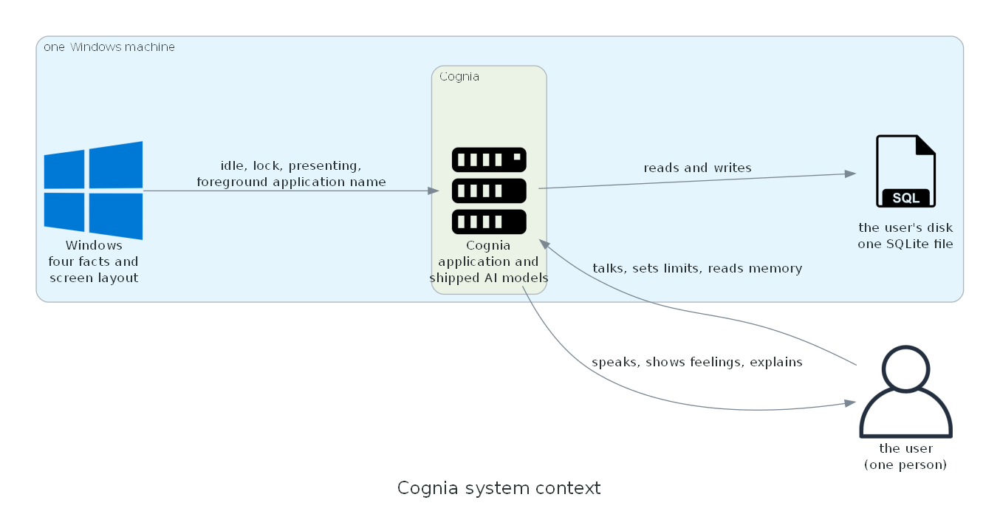

### 5.2 The overall picture

This diagram shows the processes, the threads, the stores and the direction that data
moves. Read it from left to right. Facts from Windows and commands from the user enter
one ordered queue. One thread reads that queue. Everything else is a result of that
thread's work.

Source: [`overall.py`](overall.py).

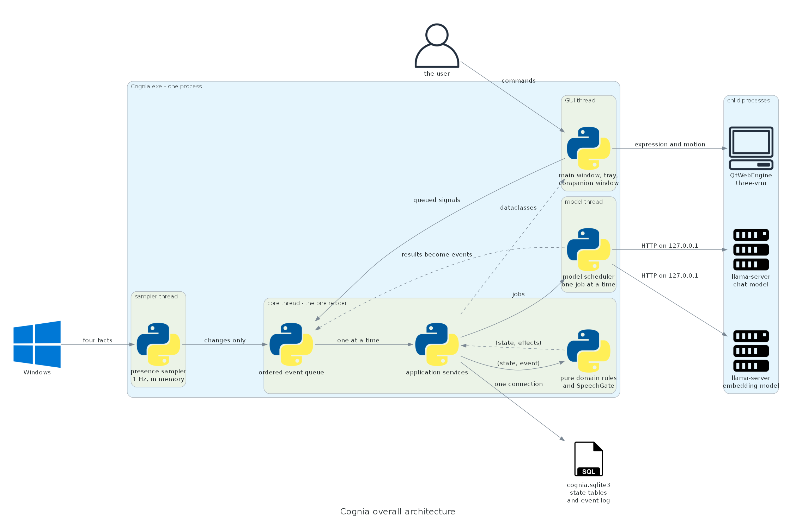

The structure has three parts that a reader must keep apart:

1. **The core thread decides.** It reads the queue, records each event, and runs the
   rules. It is the only code that touches the database.
2. **The model thread does the slow work.** A model call takes seconds. The core thread
   never waits for one. It posts a job and continues.
3. **The GUI thread only shows and reports.** It holds the windows. It sends commands and
   receives finished data. It never touches the database or the model.

### 5.3 Element catalog

| Element | Responsibility | Owner |
|---|---|---|
| Main window, tray, companion window | Show data and report what the user did | `ui/` |
| Presence sampler | Read the four facts once each second, and report changes only | `infrastructure/presence/` |
| Ordered event queue | Hold commands and events in one order, for one reader | `app/` |
| Application services | Load data, call rules, write the result, and start effects | `domain/` |
| Pure rules and SpeechGate | Decide what a feeling is and whether the companion speaks | `domain/` |
| Model scheduler | Run one model job at a time, in priority order | `infrastructure/ai/` |
| llama-server, chat model | Generate words and interpret messages | Shipped third-party program |
| llama-server, embedding model | Turn text into embeddings | Shipped third-party program |
| QtWebEngine with three-vrm | Draw the character in 3D | Shipped third-party libraries |
| whisper-server, speech model | Turn speech into text | Shipped third-party program |
| Kokoro and espeak-ng | Turn the companion's words into its voice | Shipped third-party libraries (`kokoro-onnx`, `espeakng-loader`) |
| Tool servers | Give more tools, when the user adds them | The user |
| `cognia.sqlite3` | Hold all user data | The user's disk |

### 5.4 External dependencies

Criticality answers one question: if this dependency fails, what happens to Cognia?
Critical means that Cognia stops. Degraded means that Cognia loses a feature. Optional
means that the user sees no effect.

| Dependency | Purpose | Criticality | Owner | Failure behaviour |
|---|---|---|---|---|
| SQLite file on the user's disk | All state | Critical | The user | Cognia says plainly what failed, and never shows a partial list as complete (UC-12-E1) |
| `llama-server`, chat model | Words, interpretation, summaries of long conversations | Degraded | llama.cpp project | Rules, memory lists and pausing continue. Break suggestions use fixed wording (NFR-08, UC-22-E3) |
| `llama-server`, embedding model | Relevance in memory retrieval | Degraded | llama.cpp project | Retrieval uses recency and importance only |
| `whisper-server`, speech model | Speech to text (UC-26) | Degraded | whisper.cpp project | The user types. Cognia says that it cannot hear (UC-26-E3) |
| Kokoro, espeak-ng | Speech (UC-26) | Degraded | Kokoro and espeak-ng projects | The reply stays as text (UC-26-E3) |
| A tool server | More tools (FR-41) | Optional | The user | The reply says that the tool failed (UC-27-E1) |
| QtWebEngine | Drawing the companion | Degraded | The Qt Company | Cognia says that it cannot show the companion. Every function stays reachable (FR-28, UC-20-E2) |
| Windows presence interfaces | The four facts | Degraded | Microsoft | Desk awareness stays off. Conversation works (UC-04-E1) |

## 6. Module view

This view shows the source code. It answers where a change goes and what may depend on
what. It says nothing about what runs. One module can run on two threads.

### 6.1 Decomposition

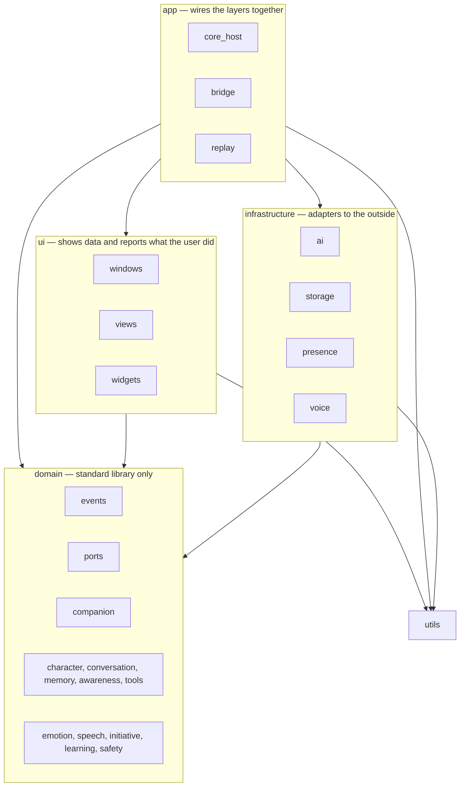

The tree under `desktop/src/` is:

```text
src/
├── __main__.py
├── app/                 core_host and its handlers in core/, bridge, chat_worker, wiring, tray,
│                        single_instance, config
├── domain/
│   ├── ports/           every interface the domain needs
│   ├── events/          event kinds, payloads
│   ├── companion/       the companion's state, the step function
│   ├── character/       versions, temperament
│   ├── conversation/    messages, prompt layers, the summary of a long conversation
│   ├── memory/          memory items, retrieval score
│   ├── erasure/         the two levels of erasure, groups, report (D-51)
│   ├── awareness/       presence facts, time at the machine, application totals
│   ├── tools/           the closed set of tools and their pure rules (D-59)
│   ├── emotion/         PAD, appraisal, decay
│   ├── speech/          SpeechGate, decisions, explanations
│   ├── initiative/      reasons to speak, the next wake time
│   ├── learning/        patterns and self-adjustments
│   └── safety/          crisis detection, the required line
├── infrastructure/
│   ├── ai/              llama client, supervisor, job object, GPU memory, tool loop, MCP client
│   ├── storage/         SQLite stores and migrations
│   ├── presence/        the Win32 calls of the four facts
│   ├── desktop/         the native window frame, the start entry (D-82, D-89)
│   └── voice/           whisper supervisor, Kokoro, microphone, hot key (D-65, D-84)
├── ui/                  windows, views, dialogs, widgets
├── resources/           fonts, QSS, companion page, VRM files, dictionary, questions
└── utils/               paths
```

One module stays outside this tree. `desktop/finetuning/` builds and measures the tuned chat model (D-80). It runs at build time, and the installer holds none of its code.

Each feature package follows one pattern. `models/` holds frozen dataclasses.
`rules.py` holds pure functions. `<feature>_service.py` holds the service. The current
stubs in `src/domain/` already use the `models/` and `_service.py` names (D-02).

### 6.2 Allowed-to-use rules

1. `domain/` imports the standard library and `domain/` only. It imports neither
   `PySide6`, nor `ui/`, nor `infrastructure/`, nor `app/`.
2. `rules.py` in a feature imports no port and does no I/O. It reads no clock and no
   environment variable.
3. A service reaches the outside through `domain/ports/` only. The concrete adapter
   comes from `app/`.
4. `ui/` imports `PySide6`, `utils/` and `domain/*/models/` only. It never imports
   `infrastructure/` or `app/`.
5. `infrastructure/` imports `domain/` and `utils/`. It never imports `ui/` or `app/`.
6. Nothing imports `app/`. It wires the layers together.
7. `utils/` imports the standard library only.
8. Only `domain/speech/speech_service.py` references the `SpeechOutput` port (NFR-09).
9. (Removed by D-48.) `infrastructure/presence/`, `infrastructure/ai/`, `infrastructure/desktop/`
   and `infrastructure/voice/hotkey.py` call `ctypes` (D-82, D-84). Each module states its Win32
   functions in its docstring. The data type of `PresenceSample` keeps
   the limit of C-05 (section 6.12).
10. Only `infrastructure/ai/` and `infrastructure/voice/` hold HTTP code, LangChain, LangGraph and
    the MCP client. They appear nowhere else (NFR-01, D-58).
11. From this source tree, `finetuning` imports `domain/`, `infrastructure/ai/`, the readers of
    shipped files in `infrastructure/storage` (the characters and the dictionary), and the
    configuration of `app/`. It never imports `ui/`, and it never reads `cognia.sqlite3` (NFR-03).
12. Nothing in `desktop/src/` imports `finetuning`.
13. No code loads a module from outside the install folder. A tool server runs as its own process,
    and Cognia reaches it only through the MCP client (ADR 0009).

**Enforced by.** Nothing yet. D-14 selects one standard-library script that reads the
syntax tree of each source file and fails on a forbidden import or reference. `task
check` will run it. The script and the task do not exist yet (section 12). Until they
exist, a reviewer checks these rules by hand.

### 6.3 Element catalog

| Module | Responsibility | Source |
|---|---|---|
| `domain/ports` | Declare each capability that the domain needs | [`desktop/src/domain/ports`](../../desktop/src/domain/ports) |
| `domain/events` | Define the closed set of events | [`desktop/src/domain/events`](../../desktop/src/domain/events) (the event model) |
| `domain/companion` | Hold the companion's state, and apply each event to it with the `step` function | [`desktop/src/domain/companion`](../../desktop/src/domain/companion) (models, rules and service: the emotion state, gestures and the causes of a feeling; wired in `app/`) |
| `domain/character` | Hold character versions and temperaments (UC-01 to UC-03) | [`desktop/src/domain/character`](../../desktop/src/domain/character) (models, rules and service, no caller yet) |
| `domain/conversation` | Hold messages and build prompts (UC-09, UC-10) | [`desktop/src/domain/conversation`](../../desktop/src/domain/conversation) (models, prompt layers, mood lines, the budget and the summary) |
| `domain/memory` | Hold memory items, choose new lines, and score retrieval (UC-09, UC-12, UC-13) | [`desktop/src/domain/memory`](../../desktop/src/domain/memory) (models, rules and service, wired in `app/`) |
| `domain/erasure` | Erase at the two levels of UC-14, group by group, and report the result | [`desktop/src/domain/erasure`](../../desktop/src/domain/erasure) (models, rules and service, wired in `app/`) |
| `domain/awareness` | Hold presence, time at the machine, the 04:00 day and application totals (UC-04, UC-16) | [`desktop/src/domain/awareness`](../../desktop/src/domain/awareness) (rules and service: time at the machine and minutes per application, D-77) |
| `domain/tools` | Hold the closed set of tools and their pure rules (UC-27, D-59) | [`desktop/src/domain/tools`](../../desktop/src/domain/tools) (catalog and pure rules, D-71) |
| `domain/emotion` | Compute feelings (UC-23) | [`desktop/src/domain/emotion`](../../desktop/src/domain/emotion) (models, rules and service, wired through `domain/companion`) |
| `domain/speech` | Hold the SpeechGate, decisions and explanations (UC-17, UC-22) | [`desktop/src/domain/speech`](../../desktop/src/domain/speech) (models, rules and service, wired in `app/core/proactive.py`, D-85) |
| `domain/initiative` | Find reasons to speak and the next wake time (UC-22) | [`desktop/src/domain/initiative`](../../desktop/src/domain/initiative) (models and rules, wired in `app/core/proactive.py`, D-85) |
| `domain/learning` | Find patterns and adjustments (UC-24) | [`desktop/src/domain/learning`](../../desktop/src/domain/learning) (models and rules, wired in `app/core/learning.py`, D-86) |
| `domain/reflection` | Removed by D-73 | — |
| `domain/safety` | Detect a crisis and check the reply (NFR-12) | [`desktop/src/domain/safety`](../../desktop/src/domain/safety) (rules, wired in `app/`, D-68) |
| `infrastructure/ai` | Implement the model ports over HTTP, run the tool loop with LangGraph, and reach tool servers (D-58, D-60) | [`desktop/src/infrastructure/ai`](../../desktop/src/infrastructure/ai) (`LlamaClient`, `tool_loop`, `McpTools`, `ModelSupervisor`, `JobObject`, GPU memory; no `ModelScheduler` yet) |
| `infrastructure/storage` | Implement the store ports over SQLite, and read the ready-made characters from `characters.toml` | [`desktop/src/infrastructure/storage`](../../desktop/src/infrastructure/storage) |
| `infrastructure/presence` | Implement the presence port over Win32 | [`desktop/src/infrastructure/presence`](../../desktop/src/infrastructure/presence) (Win32 source and sampler, D-77) |
| `infrastructure/voice` | Supervise `whisper-server`, run Kokoro, open the microphone, and receive the hot key (UC-26, D-65) | [`desktop/src/infrastructure/voice`](../../desktop/src/infrastructure/voice) (D-84) |
| `infrastructure/desktop` | Give frameless windows the Windows shadow, and write the start entry (D-82, D-89) | [`desktop/src/infrastructure/desktop`](../../desktop/src/infrastructure/desktop) |
| `app` | Start the program, own the threads, and connect the layers | [`desktop/src/app`](../../desktop/src/app) |
| `ui` | Show data and report input | [`desktop/src/ui`](../../desktop/src/ui) |
| `utils` | Paths. Logging does not exist yet | [`desktop/src/utils`](../../desktop/src/utils) |

The application log holds identifiers and event kinds only. It never holds the user's
words, an application name or a memory line, because that would be a second copy of the
data (NFR-03).

#### 6.3.1 Explained: ports and adapters

**The idea.** A wall socket does not know what you plug into it. The socket states what
it offers, and each device has a plug that fits. A port is the socket. An adapter is the
plug. The domain states what it needs, in its own words, and names no provider.

**Example.** The domain needs to know whether the user is at the desk. It declares
`PresenceSource`, which returns four fields. The domain does not know about Win32. In a
test, a small fake returns the fields from a list. The domain does not change.

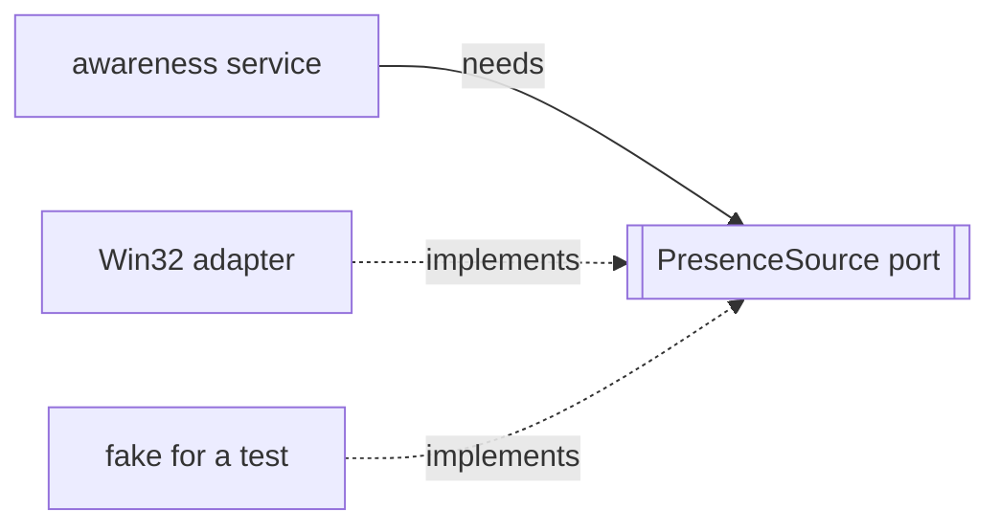

**Why this matters here.** A port's data type is also a limit. `PresenceSample` has no
field for a window title, so no code above the adapter can ask for one (C-05).

### 6.4 `domain/events`

**Purpose.** This module defines every event (ADR 0001, NFR-13, D-09). It imports nothing
from another package of `domain/`, so each feature can read an event (D-40). The `step`
function that applies an event to the companion's state is in `domain/companion` (section
6.18).

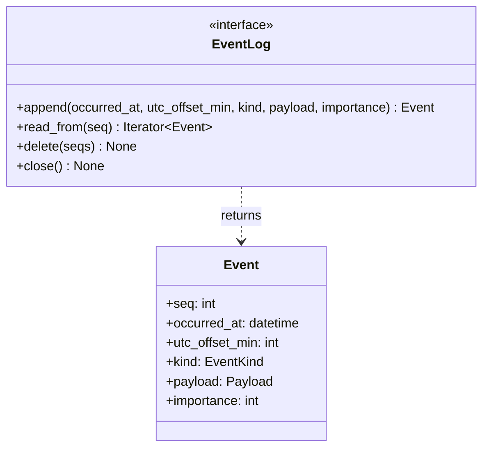

**Key types.**

| Type | Kind | Note |
|---|---|---|
| `Event` | Frozen dataclass | The `occurred_at` and `utc_offset_min` fields are the only clock that a rule sees. Its docstring lists each payload key that a rule reads. A payload value is a string, a number, a boolean or a tuple of seqs (D-42) |
| `EventLog` | Port | In `domain/ports`. `append` receives the fields and returns the stored event with its seq, because the log gives the seq. Each method raises `EventLogFailed` with a sentence for the user. No adapter exists yet |

**The closed set of events.** A new kind needs a change here. This table replaces the
examples in section 9.1 of the ERD, and it closes ERD open item 4.

| Group | Kinds | Payload holds |
|---|---|---|
| The user | `user_message`, `message_rated` | Message ID, class, confidence, rating |
| Presence | `presence`, `typing_pause`, `foreground_app`, `app_hour_closed`, `clock_gap` | Idle seconds, lock state, presentation state, application name, minutes, gap seconds |
| Time | `timer` | The purpose of the wake, for example `talk`, `break` or `doze` (section 6.7.2) |
| Opening | `window_opened` | Nothing. The rules decide whether this is the first opening of the day |
| Speech | `message_shown`, `message_answered`, `message_passed_over` | Decision ID, and whether the user was at the desk |
| Memory | `memory_stored`, `memory_removed` | `memory_item_id`. The importance is `NULL`, because the message event will carry it |
| Activity | `activity_started`, `activity_ended` | The activity, and on the end the seconds it ran. Only a tool done together, such as `breathing`, raises them (D-59, D-76) |
| Learning | `pattern_found`, `adjustment_applied`, `adjustment_undone`, `proposal_decided` | Row ID |
| Learning, tombstone | `pattern_rejected` | Fingerprint and evidence seqs (D-37) |
| Control | `paused`, `resumed`, `setting_changed`, `character_changed` | Setting name and value, version ID |

**Input closure.** The rules may read only the event log and rows that never change, such
as `character_versions`. Each user action that can change a decision is also an event.
Thus `setting_changed` exists, although the settings row holds the same fact. A replay has
no other way to see it. A tombstone has no table, so `pattern_rejected` is its only copy (D-37).
D-73 removes `reflection_deleted` with the journal.

**`paused` and `resumed` are control events.** No appraisal rule reads them, so a pause
causes no feeling (BR-04, UC-23-A4). They exist so that a replay drops a held message at
the same point. The log stays silent between the two.

**Start-up cost.** The core thread folds the whole log at start. The main window does
not wait for this. The cost grows with the log. If a measurement shows a slow start,
a snapshot table is the upgrade path (section 12).

#### 6.4.1 Explained: pure rules and the injected clock

**The idea.** A pure function is like a pocket calculator. The same keys always give the
same answer, because the calculator reads nothing else. A rule in Cognia works the same
way. It receives the state and the event, and it returns a result. It cannot read the
clock, the disk or the network.

**Why this matters.** The developer must compare two strategies on the same recorded week
(NFR-13). A rule that read the real clock would give a different answer on each run.

**Example.** The rule for the first opening of the day must compare the time with 04:00
local time.

| | Reads the real clock | Reads the event's time |
|---|---|---|
| Original run, Monday 08:12 | First opening: yes | First opening: yes |
| Replay on Thursday 14:00 | Answer depends on Thursday | Monday 08:12 again, so the answer is the same |

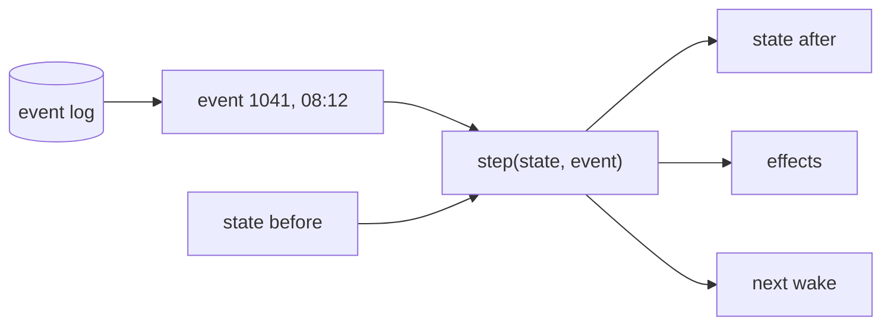

`utc_offset_min` is on each event because the day boundary and the hour of the day are
local. The user can change the time zone between the original run and the replay.

#### 6.4.2 Explained: event log and state tables

**The idea.** A shop has two records. The till roll lists what happened, in order, and
nobody changes it. The customer's card shows who they are, and they can correct it. The
event log is the till roll. A state table is the card.

**The rule that keeps the two apart.** The event log holds identifiers and figures. It
never holds the user's words. So a deletion in a state table removes the words, and the
log keeps only a reference with nothing behind it (ADR 0003).

**Example.** The user writes "I have a cat called Miso".

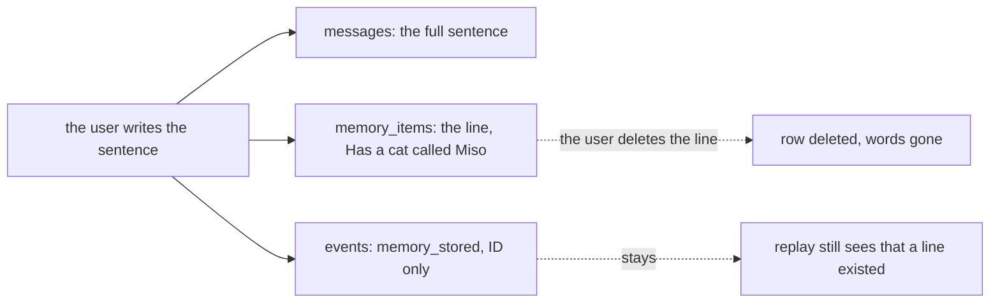

**The cost.** Removing a past mood (UC-13-A2) deletes events, so a later replay replays
what is left and not what happened (ADR 0003).

### 6.5 `domain/emotion`

**Purpose.** This module computes the companion's feelings from recorded events under the
character's temperament (BR-08, FR-32, UC-23, ADR 0004).

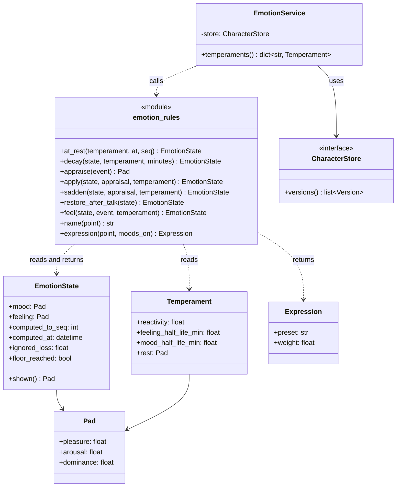

**Key types.**

| Type | Kind | Note |
|---|---|---|
| `EmotionState` | Frozen dataclass | `shown()` adds the feeling to the mood. `computed_at` is the time of the last event, for decay. `ignored_loss` is the pleasure that being ignored took, and that talk can give back. `floor_reached` shows that the floor stopped the last event. The core thread holds this point in memory, and no table stores it (D-38) |
| `Temperament` | Frozen dataclass | Defined in `domain/emotion` (D-39). Read from `character_versions`. It never changes for one version |
| `Pad` | Frozen dataclass | Defined in `domain/emotion`. `domain/character` imports `Pad` and `Temperament` from `domain/emotion`. `domain/emotion` reads a `Version` through the `CharacterStore` port only (D-39) |
| `appraise` | Function | Reads an `Event` from `domain/events`. One table row per event kind, and one row per message class for `user_message`. It returns zero for any kind that has no row. It does not read the temperament, because `apply` applies `reactivity` |
| `sadden` | Function | Applies a message that the user passed over at the desk. It moves the mood only, and it stops pleasure at the floor (section 6.5.2) |
| `feel` | Function | Applies one event: decay since `computed_at`, then the restore after talk, then `sadden` or `apply`. The `step` function calls it (section 6.18) |
| `name` | Function | Looks up a name such as "pleased". The name is derived and never stored |
| `EmotionService` | Class | Reads the temperament of each version through `CharacterStore`, by version ID, for the `step` function (D-41). It calls no rule and holds no state |

**The model never sets a feeling.** The AI model classifies a message once, and that class
is the event (ADR 0004). `appraise` then uses a fixed table. A class outside the closed
set, or a low confidence, raises no event (UC-23-A3).

**What causes no feeling.** Being paused, moved or hidden is not an event for this module
(UC-23-A4). `paused` and `resumed` have no row in the appraisal table.

**Moods off.** With moods off, the state stays at the resting mood and `expression`
returns the neutral expression. When the user enables moods again, the state starts from
the resting mood (UC-18-A2).

**Being ignored.** A message passed over while the user was at the desk moves the mood
only. Thus no passing feeling takes the shown point below the floor. The floor stops only
this sadness, so bad news can take pleasure lower. `ignored_loss` decays at the rate of the
mood. A `user_message` or a `message_answered` gives back 70% of the loss that remains
(section 6.5.2).

**A change of character.** `character_changed` does not reset the state. The mood moves
towards the resting mood of the new version.

#### 6.5.1 Explained: PAD and temperament

**The idea.** A feeling is a position on a map. Pleasure is the east-west axis. Arousal is
the north-south axis. Dominance is a third axis, which the map below does not show. An
event pushes the position. Time moves it back to a resting point. The temperament sets how
hard an event pushes, and how fast the position moves back.

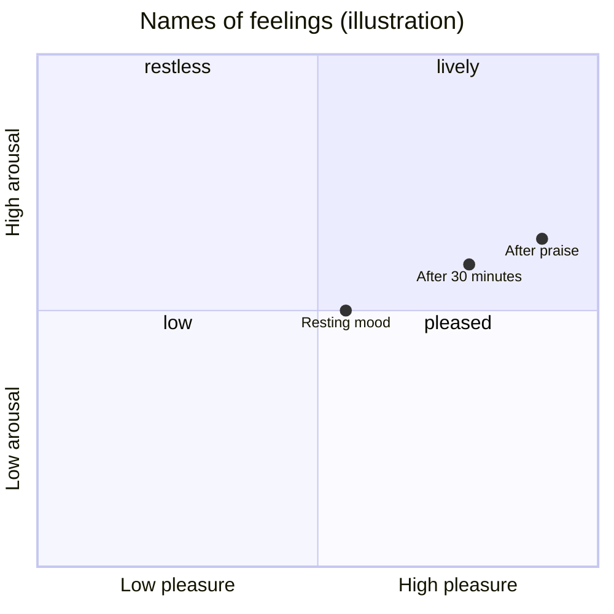

**Three time scales.** ALMA gives this structure.

| Scale | Lasts | In Cognia |
|---|---|---|
| Feeling | Minutes | `feeling`, from one event. It fades by `feeling_half_life_min` |
| Mood | Hours or days | `mood`, moved by each event. It returns to rest by `mood_half_life_min` |
| Temperament | The life of the character version | The fixed values |

**The computation.** For each event the rule does these steps:

1. It computes the minutes since the last event.
2. It decays both parts. Each part loses half of its distance in one half-life.
3. It computes the appraisal `a` of the event.
4. It adds `a` to `feeling`.
5. It adds `reactivity × a` to `mood`.
6. It limits each axis to the range from -1 to 1.

**Illustration.** The temperament has reactivity 0.4, a feeling half-life of 30 minutes, a
mood half-life of 720 minutes, and a resting mood of (0.10, 0.00, 0.00). The appraisal
table gives praise the value (0.50, 0.20, 0.10). The mood is at rest. The user writes
"thank you, that really helped".

| Moment | `feeling` | `mood` | Shown point | Name |
|---|---|---|---|---|
| Before | (0.00, 0.00, 0.00) | (0.10, 0.00, 0.00) | (0.10, 0.00, 0.00) | calm |
| At the event | (0.50, 0.20, 0.10) | (0.30, 0.08, 0.04) | (0.80, 0.28, 0.14) | lively |
| 30 minutes later | (0.25, 0.10, 0.05) | (0.29, 0.08, 0.04) | (0.54, 0.18, 0.09) | lively |
| 12 hours later | (0.00, 0.00, 0.00) | (0.20, 0.04, 0.02) | (0.20, 0.04, 0.02) | calm |

UC-17-A2 can show each row of this table, because the rows are the computation.

#### 6.5.2 Explained: sadness and its floor

**The idea.** Sadness at being ignored must grow, but it must have a limit, and it must
heal quickly. BR-08 states all three. A floor stops the fall. When the user talks again,
most of the loss returns at once.

**What counts.** A message passed over counts only while the user was at the desk to see
it. Days with no talk count. A message with nobody at the desk does not count (UC-23-A1).

**Illustration.** The floor for pleasure is -0.30. Each ignored event lowers pleasure by
0.12. Talking restores 70% of the loss. This table ignores decay, to keep the figures
simple.

| Event | Pleasure before | Change | Pleasure after | `floor_reached` |
|---|---|---|---|---|
| Start | | | 0.10 | 0 |
| Message passed over, user at the desk | 0.10 | -0.12 | -0.02 | 0 |
| Message passed over, user at the desk | -0.02 | -0.12 | -0.14 | 0 |
| A day with no talk | -0.14 | -0.12 | -0.26 | 0 |
| A second day with no talk | -0.26 | -0.04 | -0.30 | 1 |
| The user talks again | -0.30 | +0.28 | -0.02 | 0 |

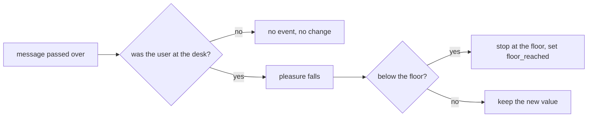

#### 6.5.3 Explained: from PAD to a facial expression

**The idea.** VRM defines preset facial expressions, and each preset has a weight from 0
to 1. A weight is a point on a dial, not a switch. So a mood can show as a slight smile.
The rule maps the name of the feeling to a preset and a weight.

**Illustration.**

| Name | VRM preset | Weight |
|---|---|---|
| calm | `neutral` | 1.0 |
| pleased | `relaxed` | 0.5 to 1.0 |
| lively | `happy` | 0.5 to 1.0 |
| restless | `surprised` | 0.2 to 0.4 |
| low | `sad` | 0.3 to 0.7 |

**What the table leaves out.** The `angry` preset has no row, because an angry face is a
reproach, which BR-04 forbids. No expression shows a need (FR-27). The lip-sync presets
`aa`, `ih`, `ou`, `ee` and `oh` move the mouth while the companion speaks (D-64), so they are
not a feeling and have no row. This table is the complete list that FR-27 asks
for. Blinking and gaze are procedural, and they are ambient motion (BR-07).

#### 6.5.4 Explained: from mood to a reply

**The idea.** A person in a good mood talks faster and jokes more. The model never sets a feeling
(BR-08), but the rules can tell the model which feeling to show. The rules compute the feeling
before the reply (D-04). The name of that feeling then changes four things: one line in layer 4,
the speed of the voice, the face, and a gesture (D-57).

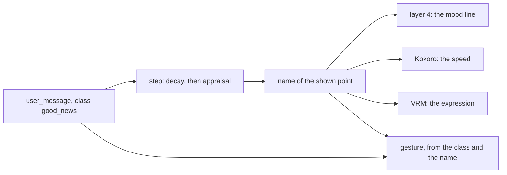

| Name | Line in layer 4 | Speed of the voice | Face (section 6.5.3) |
|---|---|---|---|
| calm | "Your mood: calm." | 1.0 | `neutral` |
| (every mood) | Then "Let it show in how you speak; do not talk about your mood unless asked." (D-80) | — | — |
| pleased | "Your mood: pleased. Let some warmth show." | 1.0 + 0.15 × arousal | `relaxed` |
| lively | "Your mood: lively. You may be quicker and more playful than usual." | 1.0 + 0.15 × arousal | `happy` |
| restless | "Your mood: restless. You may be a little short or distracted, never rude." | 1.0 + 0.15 × arousal | `surprised`, low weight |
| low | "Your mood: low. Be quieter and shorter. Never blame the user." | 1.0 + 0.15 × arousal | `sad` |

The author approved these five lines on 2026-11-06 (D-68). Kokoro has a speed
setting and no pitch setting, so the voice carries the mood through its speed only.

- Layer 2 sets how the character shows a mood. The mood line sets which mood. With "low", Rin is
  short and teases a little, and Yuna says little.
- The line is in layer 4, so the prefix cache stays valid (section 6.11.2).
- With moods off (UC-18), no line is sent. On a crisis turn no line is sent, because no feeling
  overrides NFR-12.
- If the user asks why the companion feels so, the model calls `why_i_feel` and gets the recorded
  events, so it names no event that did not occur (BR-06).
- `core_host` records `user_message` after the interpretation, and then sends the line for the
  feeling at that moment, after the decay since the last event (D-68).

**Illustration.** The figures only show the mechanism. The user writes "I finished chapter 3!" to
Yuna.

| Before the message | After the appraisal of `good_news` | Layer 4 | The reply that the line asks for |
|---|---|---|---|
| calm | lively | "...lively. You may be quicker and more playful..." | "Wait, really? The whole thing? ...I'm so happy for you." |
| low, after two days with no talk | pleased | "...pleased. Let some warmth show." | "...You finished it. That's good. I'm glad you told me." |

### 6.6 `domain/speech`

**Purpose.** This module holds the SpeechGate. It is the one way out for anything the
companion says or shows on its own initiative (ADR 0001, NFR-09, BR-01 to BR-07, UC-17,
UC-22).

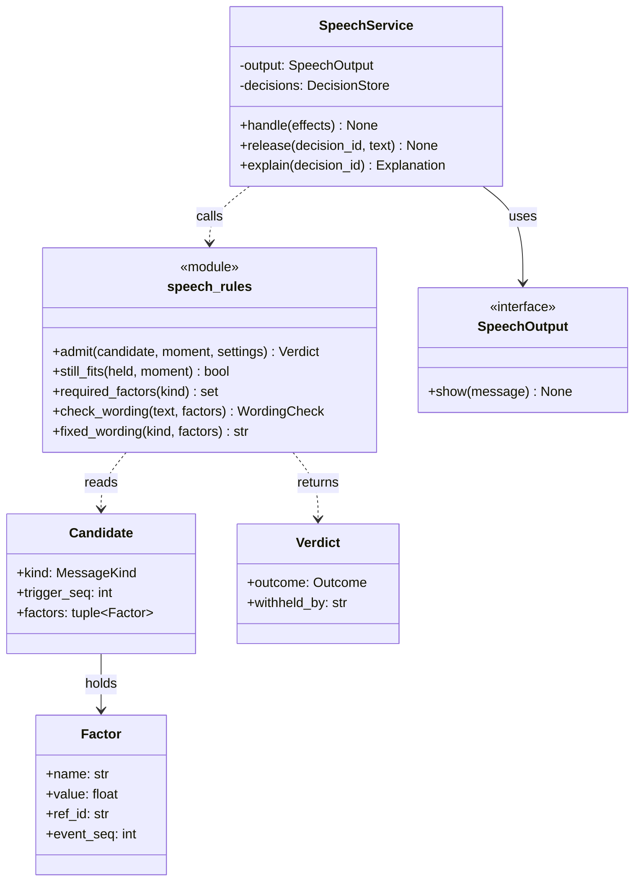

**Key types.**

| Type | Kind | Note |
|---|---|---|
| `Candidate` | Frozen dataclass | A wish to speak, with the figures behind it. It is not yet a message |
| `Factor` | Frozen dataclass | One figure. It becomes one row of `decision_factors`. `name` sets the unit of `value` and the table of `ref_id`, through one fixed lookup in `speech_rules` (ERD section 12.3) |
| `Verdict` | Frozen dataclass | `sent`, `withheld`, `held` or `dropped`, as in ERD section 12.2 |
| `SpeechOutput` | Port | The only route to the screen. Rule 8 of section 6.2 limits it to one file |

**Required factors.** The gate holds this table, because the database cannot know it (ERD
section 12.3). A missing factor makes the gate refuse.

| Kind | Required factors |
|---|---|
| `break` | Observed seconds, threshold seconds, delay by typing, mood contribution, ceiling state |
| `remark`, `question` | The reason, delay by typing, mood contribution, ceiling state |
| `greeting`, `return` | Each item mentioned, in the order of UC-16, and the feeling. For `return`, also the minutes away, unless a `clock_gap` makes them untrusted |
| `adjustment`, `proposal` | The adjustment or proposal, and its pattern |

**A reply is not proactive.** A reply that the user asked for does not pass the gate (ADR
0002). A greeting does pass the gate, so that UC-17 can explain it, but it does not count
against the ceiling (BR-01).

**Wording check (D-21).** The AI model words each proactive message. A deterministic check
then reads the words. Each number in the text must appear in the factors. A list of
phrases, such as "working for" and "behind", is forbidden (BR-06). A failed check uses the
fixed wording of the kind. A kind with no fixed wording is withheld.

#### 6.6.1 Explained: the SpeechGate funnel

**The idea.** Think of a door with several locks, in a fixed order. A message passes only
if every lock opens. The gate records which lock stopped it. Thus UC-17 can tell the
truth about a message that never appeared (UC-22 failure postcondition).

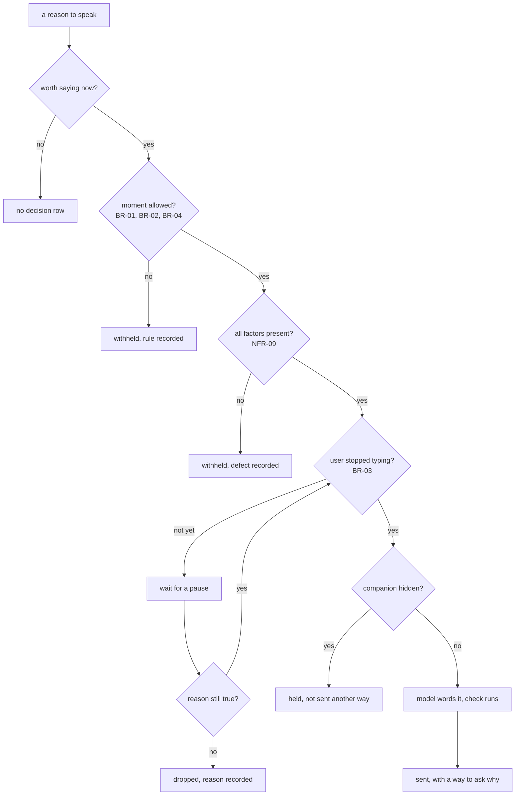

**Example.** This example uses the figures in UC-17.

| Lock | Reads | Result |
|---|---|---|
| Reason | At the machine since 09:15, 2 hours 47 minutes. The user's threshold is 90 minutes | Reason exists |
| Worth | The mood is lively, so it speaks sooner. No recent message | Yes |
| BR-02 | Not locked, not presenting, no quiet hours set | Pass |
| BR-01 | No ceiling set. Break messages are on | Pass |
| BR-04 | The user is at the desk | Pass |
| NFR-09 | All factors of `break` are present, except the delay | Pass. The gate adds the delay at release |
| BR-03 | The user is typing. The gate holds the message for 12 minutes | Pass at the pause |
| Hidden | The companion is on screen | Pass |
| Wording | "at the machine for 2 hours 47 minutes". Both numbers match the factors, and no forbidden phrase appears | Pass |

The gate works in two steps, because some figures do not exist at the start. `admit` runs
when the candidate appears. `release` runs when the words are ready. `release` adds the
delay, checks the moment again, and writes the decision and its factors in one transaction
before anything appears on screen. The words took seconds, so the machine can be locked by
now.

#### 6.6.2 Explained: holding a message for a pause

**The idea.** A polite person waits for you to finish your sentence. BR-03 asks for the
same behaviour. The message waits. If its reason stops being true during the wait, nobody
will ever see it (UC-22-A4).

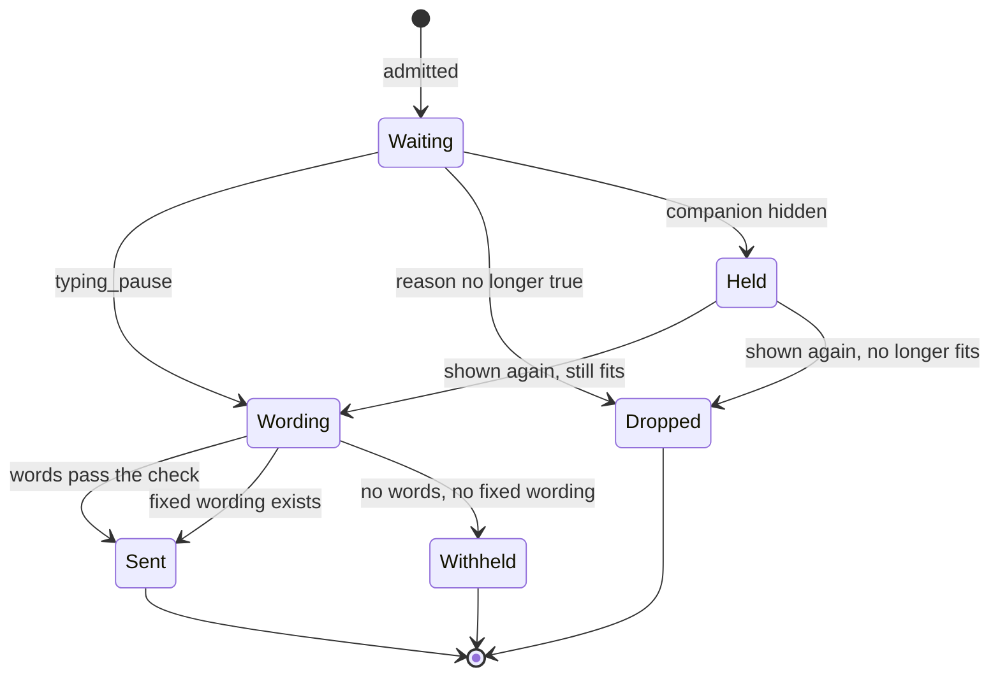

**Why a watch and not a constant stream.** A person who types pauses thousands of times a
day. One event for each pause would fill the log. So the rule returns the effect
`WatchForPause` only while a message waits. The sampler then reports the next pause as one
`typing_pause` event, and the watch ends.

**The limit of the signal.** Windows reports only the time since the last input, with no
difference between the keyboard and the mouse. A moving mouse therefore counts as typing.
This delays a message and never interrupts anybody, so the design accepts it (A-01).

### 6.7 `domain/initiative`

**Purpose.** This module finds reasons to speak and decides when the rules must run next
(UC-22, FR-31, FR-09, D-09).

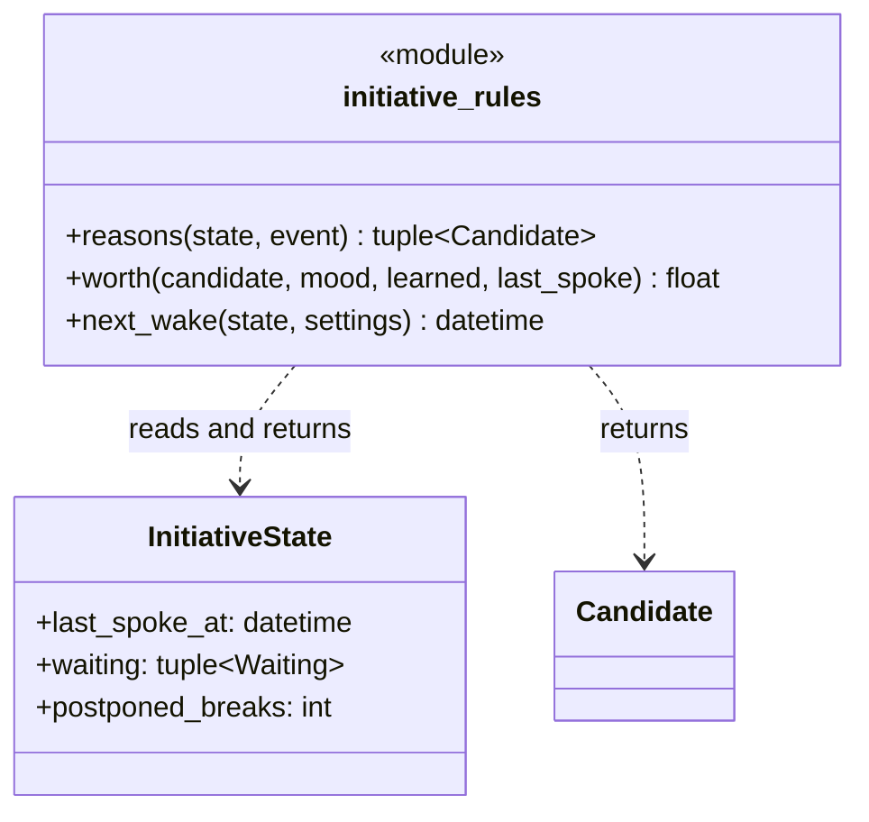

**Key types.**

| Type | Kind | Note |
|---|---|---|
| `reasons` | Function | One source for each kind in UC-22 step 1: a mood change, time at the machine, a long quiet at the desk, an unasked question, a learned pattern |
| `worth` | Function | Weighs the mood, what the companion learned, and the time since it last spoke (BR-01, FR-32) |
| `next_wake` | Function | Returns the earliest time at which a rule can change its answer |

**Mood changes behaviour.** `worth` reads the mood. A lively companion speaks more readily
than a low one (UC-22 step 2). This is the one place where a feeling changes what the
companion does (FR-32).

**The application name.** `reasons` can read the application in the foreground, because
each change is an event since specification version 5.2 (D-05).

#### 6.7.1 Explained: the next wake time

**The idea.** You do not check the oven every second. You set a timer for the time when the
food is ready. If you take the food out early, you cancel the timer. The rules work the same
way. Each step returns the next time that anything can change. Between those times, the
core thread sleeps.

**Example.** The user's break threshold is 90 minutes, and the user arrives at 09:15.

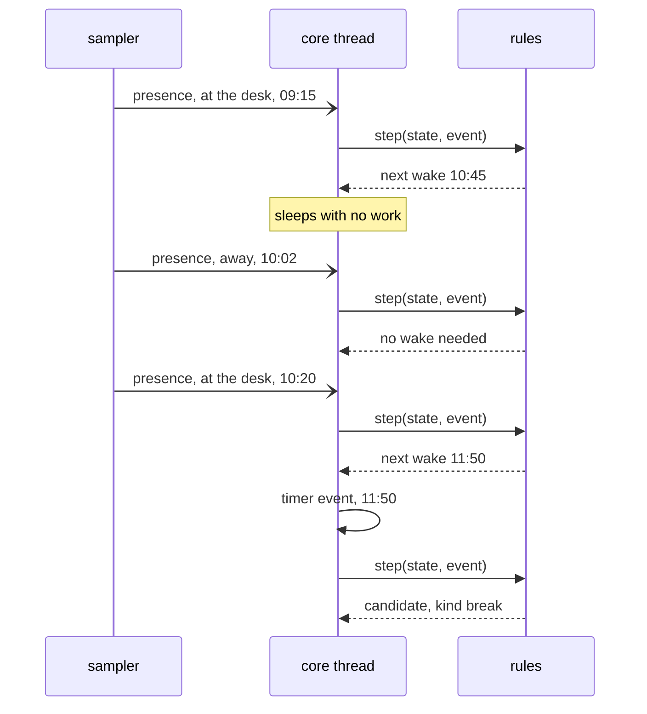

| | A tick each minute | The next wake time |
|---|---|---|
| Events in one day | 1,440 ticks | A few `timer` events |
| Disk writes | One each minute | Only when something changes |
| Time of a decision | Rounded to the minute | Exact |
| Cost | Simple rules | Each rule must compute its own next time |

The `timer` event is in the log with its time. So a replay sees the same wake at the same
moment, and it never needs a real clock.

#### 6.7.2 Explained: away, quiet and break

**The idea.** The companion behaves like a person at the next desk. When you leave, it waits. When
you come back, it says hello. When you work for a long time without a word to it, it speaks first.
When you work too long, it suggests a break. Each of these comes from events in the log, so a
replay gives the same result (NFR-13) (D-63).

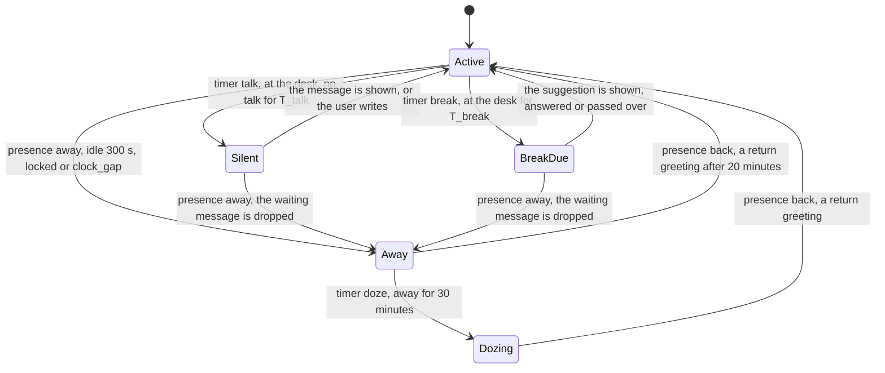

The states belong to the user, as the rules see them through events. What the companion does is a
result.

| State | Meaning | What the companion does | Example |
|---|---|---|---|
| Active | The user is at the desk: input in the last 300 s, and the machine is not locked. No message waits | Ambient motion | 09:15, the user writes code |
| Silent | The user is at the desk, and has not talked to the companion for `T_talk` minutes. A `remark` or a `question` waits at the gate | It waits for a pause in the typing (BR-03), then shows the message | Last talk at 09:20, `T_talk` is 120 minutes. The timer fires at 11:20. The user stops typing at 11:23: "It's been two hours since we talked." |
| BreakDue | The user is at the desk for `T_break` minutes, with no break of 5 minutes or more. A `break` waits at the gate | It waits for a pause, then suggests a break and offers to breathe or stretch together | At the desk since 09:15, `T_break` is 95 minutes. At 10:50: "You've been at the machine for 1 hour 35 minutes. Stretch with me?" |
| Away | No input for 300 s, or the machine is locked, or a `clock_gap` arrived. Nothing is sent (BR-04), and a waiting message is dropped | It sits and waits. No bubble and no sound | At 12:00 the user leaves for lunch. At 12:05 the companion sits down |
| Dozing | Away for 30 minutes or more | It dozes | At 12:30 it dozes. At 12:40 the user is back after 40 minutes: "There you are. I waited about 40 minutes." |

Silent and BreakDue use two timers that do not depend on each other. If both fire, the gate shows
the first message, and the second message waits for the next pause.

**The signals.** The sampler reads `PresenceSample` once each second and reports changes only
(section 6.12). Time reaches the rules as `timer` events at the `next_wake` that the rules return
(section 6.7.1).

| Change | Event | Condition in the rules | Effect |
|---|---|---|---|
| Active, Silent or BreakDue → Away | `presence`, not at the desk | Idle for `AWAY_AFTER` (300 s) or more, locked, or `clock_gap` | A waiting message is dropped (UC-22-A4). A `timer` for `doze` at the start of the absence + `DOZE_AFTER`. `ShowAmbient("waiting")` |
| Away → Dozing | `timer`, purpose `doze` | Still away after `DOZE_AFTER` (30 minutes) | `ShowAmbient("dozing")` |
| Away or Dozing → Active | `presence`, at the desk | Idle under `AWAY_AFTER`, not locked | An absence of `ABSENCE_MIN` (20 minutes) or more gives a `return` candidate with the real minutes away. After a `clock_gap`, no minutes are stated (UC-16-A3). An absence of `BREAK_RESET` (5 minutes) or more starts a new run at the desk |
| Active → Silent | `timer`, purpose `talk`, at the last `user_message` + `T_talk` | At the desk, not presenting | A `remark` or a `question` candidate, with the minutes since the last talk and the mood |
| Silent → Active | `user_message`, or the answer to the message | — | A new `talk` timer |
| Active → BreakDue | `timer`, purpose `break`, at the start of the run + `T_break` | Still at the desk | A `break` candidate, with the observed seconds and the threshold |
| BreakDue → Active | `message_answered` or `message_passed_over` | Passed over: a new `break` timer in 20 minutes, and `postponed_breaks` + 1 (FR-23) | A real break of `BREAK_RESET` starts a new run |
| Any state | `paused` | — | Everything stops, and held messages are dropped. `resumed` starts at Active, with no backfill |

**Randomness that replays.** `T_talk` and `T_break` are not fixed, because a fixed interval feels
like a clock. The rule makes each one with `random.Random(seq)`. `seq` is the event that starts the
wait: the last `user_message` for `T_talk`, and the `presence` event that starts the run for
`T_break`. So the same log gives the same numbers. A threshold that the user set (FR-09) replaces
`T_break`. `worth` makes `T_talk` shorter when the mood is lively.

| Wait | Range | Example |
|---|---|---|
| `T_talk` | 90 to 180 minutes | `Random(1041)` gives 120 minutes after the message with seq 1041 |
| `T_break` | 75 to 110 minutes | `Random(1302)` gives 95 minutes after the `presence` event with seq 1302 |

**Questions to get to know the user.** `resources/` holds a fixed set of questions that the author
writes. At a `talk` timer, `worth` can choose a `question` and not a `remark`: one question a day at
most, and never a question that the user answered or passed over (UC-22-A5). The answer becomes a
memory item through the usual interpretation (section 6.8).

**The companion while the user is away.** Waiting and dozing are ambient motion (BR-07). They go
through the `ShowAmbient` effect to the page, not through `SpeechOutput`. So the gate does not see
them, and they need no explanation.

**The greeting (UC-16).** `greeting_items` takes the latest line that the user told the companion on
the last day they talked before today. With none, the greeting says that nothing needs attention.
D-73 removes the journal entry that D-63 also chose.

The figures in this section are start values (section 12, item 17).

### 6.8 `domain/memory`

**Purpose.** This module holds what the companion remembers, chooses which new lines it keeps, and
chooses what a reply draws on (FR-14, FR-17, FR-18, UC-09, UC-12, UC-13, D-07, D-16,
D-44 to D-47).

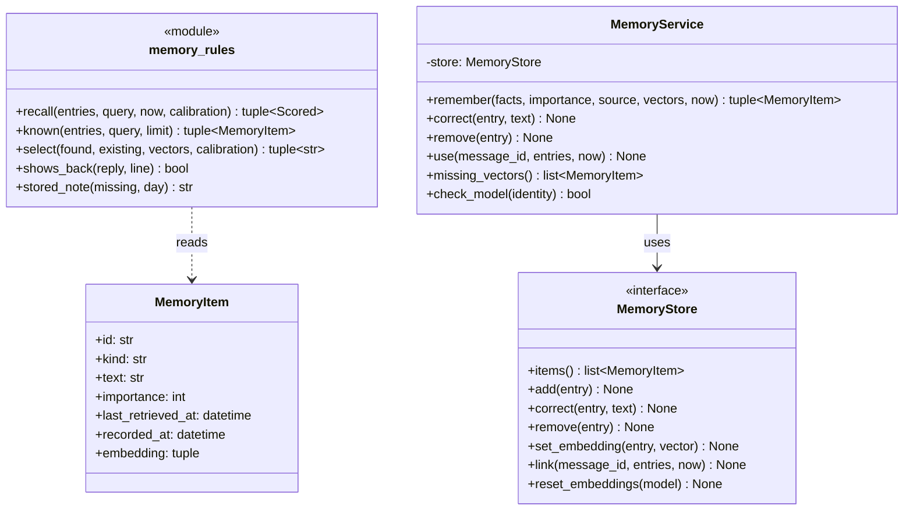

**Key types.**

| Type | Kind | Note |
|---|---|---|
| `MemoryItem` | Frozen dataclass | `text` is the exact line that the user saw (FR-14). Refuses a value that the stored row refuses |
| `Calibration` | Frozen dataclass | The two figures that belong to the embedding model: the cosine of unrelated lines and the near-duplicate cosine |
| `recall` | Function | Pure. The lines a reply draws on (section 6.8.1) |
| `known` | Function | Pure. The stored lines closest to the message, by cosine only, for the interpretation prompt |
| `select` | Function | Pure. The new lines worth keeping |
| `MemoryStore` | Port | Raises `MemoryStoreFailed` with a sentence for the user |

**Three layers of choice (D-46).**

1. **The model.** The interpretation asks for lines that stay true after today, and lists up to five
   stored lines that are close to the message, so that the model does not extract them again.
2. **The rules.** `select` drops a line that is blank, longer than 200 characters, the same as a
   stored line apart from case and edge punctuation, or at least `near_duplicate` similar to one. It
   keeps at most three facts from one message.
3. **The user.** The chip shows each stored line, and the memory page edits or deletes it.

Two lines that disagree are both kept. Each line in the reply prompt carries the day it was told,
and layer 4 says that the newer line is true. The model never changes a stored line. Example: with
"Lives in Saigon (told 2 August 2026)" stored, the user writes "I moved to Hanoi". The new line
"Lives in Hanoi" is kept, because the cosine of the two lines is 0.880, under 0.95.

**When a line is stored (D-44).** The interpretation runs before the reply (D-04), so the rules
choose the lines before the reply, and layer 4 asks the reply to quote them. The rows, their events
and the reply source links commit in the one transaction that stores the reply. A reply that fails
or that the user cancels stores nothing (UC-09-E2).

**Showing the line back (D-47).** After the stream ends, `shows_back` checks that the reply quotes
each stored line, apart from case and spacing. The chip under the reply says "Stored — you told me
· 5 Nov". It also holds each line that the reply did not quote, so the user always sees the exact
words (FR-14).

**Vectors (D-07, D-16).** A vector is derived data. It lives in a column of the row that it
describes, so it disappears with that row. An edit in UC-13 clears it, and the model thread computes
it again. `settings.embedding_model` holds the file name and the size in bytes of the embedding
model. A different value clears every vector at start. A text longer than 1 200 characters is cut
before it is embedded, because the model reads 512 tokens (D-54).

**With the model stopped.** The memory list needs no model (NFR-08). If only the `embedding_server`
fails, the relevance factor is left out of the score. New items wait with an empty vector, and the
model thread fills them later.

**Retrieval and replay.** Retrieval depends on the embedding model, so it stays outside the rules
of `step`. It only selects what a reply draws on. The result is recorded in the reply source tables,
and a replay does not repeat it.

#### 6.8.1 Explained: the retrieval score

**The idea.** A good memory for this moment is recent, important and on the same subject. Each of
the three factors is a value from 0 to 1, and the score is their product (D-45). So a line that is
off the subject scores zero, however important or recent it is.

- **Recency** is 0.995 to the power of the hours since the line was last used, or since it was told.
- **Importance** is the score from 1 to 10 that the line received, divided by 10.
- **Relevance** is the cosine above what two unrelated lines reach, scaled to 0 to 1:
  `max(0, (cosine − 0.45) / (1 − 0.45))`. The figure 0.45 belongs to bge-small-en-v1.5, which
  gives unrelated lines a cosine of 0.38 to 0.45.

A line with a score of 0.05 or more enters the reply prompt, at most three lines.

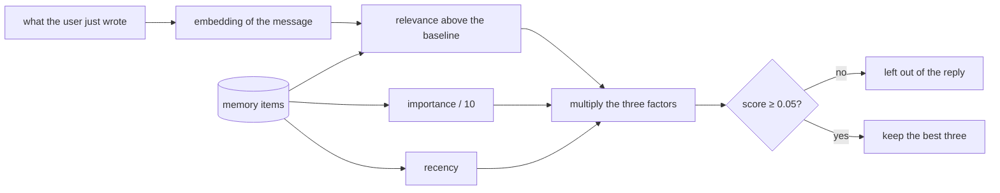

**Illustration.** The cosines are measured with bge-small-en-v1.5. The user writes "Ugh, the
deadline is stressing me".

| Line | Hours since used | Importance | Cosine | Recency | Importance factor | Relevance | Score | In the reply |
|---|---|---|---|---|---|---|---|---|
| "Send chapter 3 to their supervisor" | 4 | 8 | 0.616 | 0.980 | 0.8 | 0.302 | 0.237 | Yes |
| "Is writing a thesis on indoor positioning" | 1 | 8 | 0.543 | 0.995 | 0.8 | 0.169 | 0.135 | Yes |
| "Has a cat called Miso" | 200 | 3 | 0.448 | 0.367 | 0.3 | 0 | 0 | No |

**Trade-off accepted: forgetting.** "Is vegetarian" with importance 6 and a cosine of 0.71 to "What
should I cook tonight?" scores 0.158 when it was used 200 hours ago. After 1 000 hours unused it
scores 0.002, so the reply forgets it. The line stays on the memory page.

**Without the embedding server**, the score is recency × importance, and the best three lines over
the floor enter.

### 6.9 `domain/learning`

**Purpose.** This module finds patterns in how the user works, adjusts the companion's own
behaviour, and proposes changes to its character (FR-16, FR-23, FR-34, UC-24).

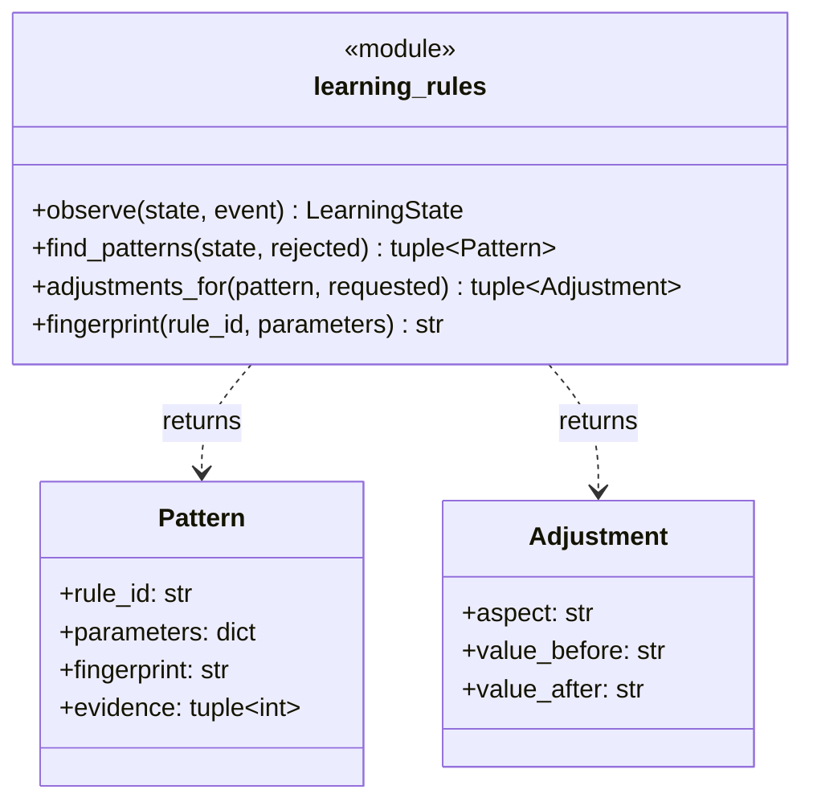

**Key types.**

| Type | Kind | Note |
|---|---|---|
| `Pattern` | Frozen dataclass | A pattern with no evidence does not exist (UC-24-E1) |
| `Adjustment` | Frozen dataclass | `aspect` is `timing`, `frequency`, `length` or `tone`. Nothing else can change without approval (FR-16) |
| `observe` | Function | Keeps small totals in the state, with the seqs behind each total. It does not hold the events themselves |
| `adjustments_for` | Function | Refuses an adjustment against something that the user asked for in UC-10 (UC-24-A4) |

**Rules find, the model words.** The rules find a pattern from counts and proportions. The
AI model only writes `statement` for the user (ADR 0004). If the model is stopped, the
pattern waits for its wording.

**A change to the character.** A change to the description or the temperament is a
proposal. Only the user can apply it (UC-24-A2).

#### 6.9.1 Explained: tombstones and fingerprints

**The idea.** When the user says that a conclusion is wrong, the companion must forget the
conclusion but remember not to draw it again. Those two needs conflict. A tombstone solves
this. It keeps a fingerprint and the event numbers, and it holds no words about the user.

**Example.** This example follows the story in section 3 of the specification. The
companion concludes that the user takes lunch at 11:00.

| Step | `patterns` | Event `pattern_rejected` |
|---|---|---|
| The rule finds the pattern from seqs 410, 522 and 633 | `regular_absence`, hour 11, with the words "takes lunch at 11:00" | None |
| The user marks it wrong (UC-13-A1) | Row deleted, words gone | Fingerprint `regular_absence\|hour=11`, seqs 410, 522, 633 |
| The next run finds the same pattern from the same seqs | No new row | The fingerprint and the evidence match, so the rule refuses |
| A later month brings different evidence | A new row is allowed | The evidence differs (ERD section 10.2) |

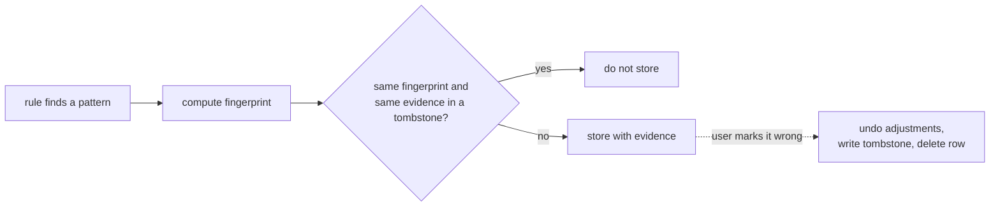

### 6.10 `domain/reflection` (removed)

D-73 removes the journal of UC-25, so this module, its tables and its events are deleted. The number
stays, so that sections 6.11 to 6.18 keep their numbers.

### 6.11 `infrastructure/ai`

**Purpose.** This module implements the model ports over HTTP, supervises the two server
processes, and runs one model job at a time (ADR 0002, NFR-05, NFR-08, NFR-14, D-13,
D-15, D-18, D-19, D-57, D-58, D-60, D-66).

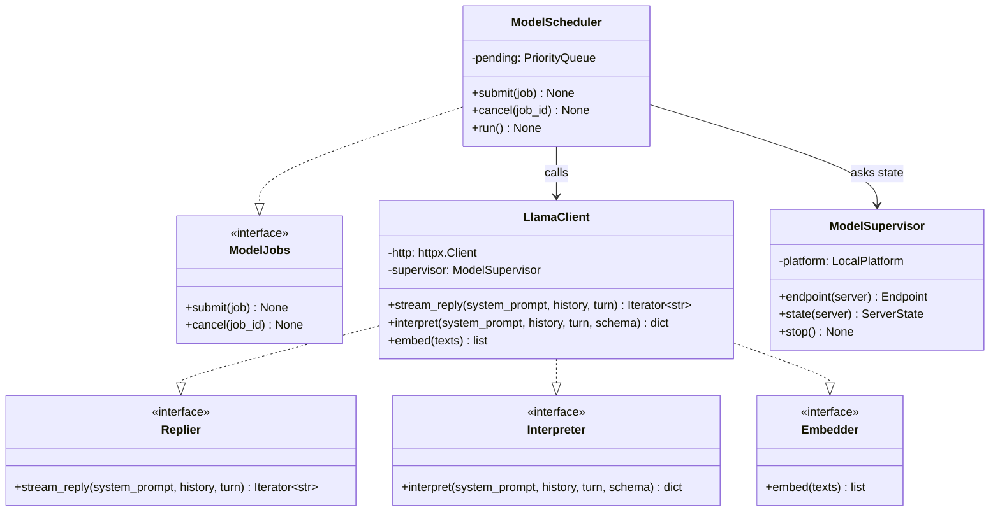

**Key types.**

| Type | Kind | Note |
|---|---|---|
| `Replier` | Port | Free text: replies, wording, and the summary of a long conversation through `stream_text`. It keeps the name that the code has today. A reply can call tools (section 6.11.3) |
| `Interpreter` | Port | Output that a JSON schema constrains: message interpretation, temperament reading, importance |
| `Embedder` | Port | Text to vectors |
| `ModelJobs` | Port | The one way that a service asks for model work. Not built yet |
| `ModelScheduler` | Class | Runs on the model thread, so no service ever waits for the model. Not built yet: today `app/chat_worker.py` runs one request at a time, in the order that it receives them |
| `ModelSupervisor` | Class | Starts the two servers at the first need, chooses the GPU, and starts a server again at the next need after it ends (section 6.11.1) |
| `JobObject` | Class | A Windows job object that ends both servers when Cognia ends, after a crash too (D-48) |
| `dedicated_memory` | Function | The dedicated video memory of each adapter, from DXGI (D-53) |

**Job priority (D-15).** The chat server has one slot. The scheduler holds a priority list.
A user message cancels low-priority work, and that work runs again later.

| Priority | Job |
|---|---|
| 1 | Interpret a user message, embed the query, write the reply |
| 2 | Word a proactive message |
| 3 | Embed a new item, score importance, word a pattern |
| 4 | Read a temperament, write a title, shorten a long history (D-57, D-72) |

**Interpretation (D-04, D-44).** The call sends `response_format` in the OpenAI form,
`{"type": "json_schema", "json_schema": {"name": ..., "schema": ...}}`, so the output fits the
schema. The build of D-13 ignores the shorter form that its README shows (Step 0, 2026-11-05).
The schema does not stop the reasoning of the model. The closed set of classes cannot produce an
unknown value. Low confidence still raises no event (UC-23-A3). Here is the shape of the answer:

```json
{
  "facts": ["Is writing a thesis on indoor positioning"],
  "importance": 8,
  "crisis": false,
  "event_class": "good_news",
  "confidence": 0.86,
  "style_request": null
}
```

Layer 4 of this request states the date of today. Only `event_class`, `confidence` and
`importance` reach the event log. The words in `facts` go to state tables (section 6.8). `crisis`
reaches neither (section 6.13). `importance`, `facts`, `event_class`, `confidence` and `crisis` are read (D-68, D-75). Only
`style_request` has no reader yet (UC-10). The request sends temperature 0, so the same message
gives the same reading (D-75). It also sends `max_tokens` from `INTERPRET_MAX_TOKENS` (256). A
model that does not close its reasoning never reaches the schema. Without the cap it writes
until the context is full, and the single slot is busy for minutes.

**Local server safety (D-19).** Cognia starts each server on `127.0.0.1` with a free port,
`--api-key` with a new random key from each start, `--no-webui` and `--offline`. It
never passes `-hf` or any other download option. The key is not a secret of the user. It
only stops another local program from using the model. `/health` answers with no key. The
process has no window, and its log goes nowhere, because the log can hold the user's words.

**GPU choice (D-13, D-53).** The embedding server always runs the CPU build. For the chat
server, the supervisor lists the GPUs of the Vulkan build and drops each GPU whose dedicated
memory, from DXGI, is less than the model file plus 512 MiB. A GPU built into the processor
reports shared memory to Vulkan (8 044 MiB on the author's laptop) but 128 MiB of dedicated
memory to DXGI, so this check drops it. The supervisor then measures each remaining GPU once: one
short request that is not timed, then a prompt of about 400 tokens and 32 generated tokens. It
keeps the fastest and stores its name in `settings.chat_device`, so later runs do not measure
again. If no GPU starts, the CPU build runs the chat model for the rest of the run (D-49).

Each start of the Vulkan build gets `-ngl auto`. The server then keeps 1 024 MiB of each GPU
free (its `--fit` default) and puts the layers that do not fit on the CPU. On the author's laptop
(RTX 3050 Ti, tuned model, 2026-11-07), this gave 30 tokens/s and used 475 ms of CPU time for each
token. With `-ngl all`, every layer was on the GPU, and the server gave 47 to 51 tokens/s and used
14 ms of CPU time for each token.

The chat server also gets `--cache-ram` from `CHAT_CACHE_RAM_MIB` (1 024 MiB). The server keeps old
prompts in RAM up to this limit. Its own default is 8 192 MiB. In the measurement of 2026-11-07,
each prompt that filled the 8 192-token context kept about 740 MiB. The server then grew to
11.4 GB, and the free RAM of the laptop went down to 55 MB.

| Device on the author's laptop | First word | Generation |
|---|---|---|
| Vulkan, both GPUs (the default of the server) | 13.1 s | 24 tokens/s |
| NVIDIA RTX 3050 Ti only | 0.4 s | 33 tokens/s |
| Intel Iris Xe only | 3.2 s | 8 tokens/s |
| CPU build | 4.0 s | 13 tokens/s |

**Reasoning output.** The system prompt ends with `REASONING_RULE`. The server returns reasoning in `reasoning_content`, apart from the answer,
and the client drops it. In Step 0 the model reasoned for an interpretation, but did not always
reason before a reply.

#### 6.11.1 Explained: the model supervisor

**The idea.** A child process can fail at any time. The supervisor works like a nurse who
checks a patient. It starts the process, waits for a healthy sign, and reports each change.
The application never assumes that the model works.

```mermaid
stateDiagram-v2
    [*] --> Stopped : Cognia starts
    Stopped --> Starting : the first request that needs the server
    Starting --> Ready : /health returns 200
    Starting --> FallbackCpu : no GPU became healthy
    FallbackCpu --> Ready : /health returns 200
    FallbackCpu --> Failed : CPU build failed
    Ready --> Restarting : the next request finds the process ended
    Restarting --> Ready : /health returns 200
    Restarting --> Failed : more than three starts again in this run
    Failed --> [*] : Cognia ends
```

The server returns HTTP 503 while it loads the model, and HTTP 200 when it is ready. The two
servers have one supervisor and separate states, because the failure of one does not stop
the other. Both are in a Windows job object, so they end with Cognia even after a crash
(ADR 0002). `--sleep-idle-seconds` frees the memory of an idle model (D-18). The server loads
the model again itself at the next request, so the supervisor has no sleeping state.
`MODEL_IDLE_SECONDS` is 300, so both servers free their model, and the chat server its GPU
memory, after 5 minutes with no request. The time to wake has not been measured.

**Start again at the next need.** No thread watches the processes. The next request finds a
process that ended, and the supervisor starts it again with a new port and a new key. The request
that was running when the process ended fails with a plain sentence (section 7.11).

`Failed` is a normal state and not a crash. In this state, each model job fails at once with
a plain sentence (UC-09-E1, UC-01-E1). Only a new start of Cognia leaves it.

#### 6.11.2 Explained: prompt layers and the prefix cache

**The idea.** The server keeps the work it did for the last request. If a new request starts
with the same text, the server skips that part. This is `cache_prompt`, which is on by
default. So the parts that never change go first, and the parts that change go last.

```mermaid
flowchart TB
    a["1. Base rules and safety text — fixed"]
    b["2. Character description — fixed for one version"]
    c["3. Conversation history — grows at the end only"]
    d["4. Mood line, remembered items, this request — changes each turn"]
    a --> b --> c --> d
```

| Layer | Holds | Changes |
|---|---|---|
| 1 | The base rules that a prompt can state, and the safety text | Never |
| 2 | The character's own words | When the user changes the character, or approves a change (UC-03, UC-24) |
| 3 | The recent messages | One message added at the end |
| 4 | The mood name, remembered items, and any instruction for this turn | Each turn |

Layer 4 goes at the end of the last user message, after a blank line. Each remembered line
carries the day it was told, for example "Is writing a thesis on indoor positioning (told 5
November 2026)", and a line after the list
says that the newer of two lines that disagree is true (D-46). When the turn stores lines, layer
4 also asks the reply to quote each one exactly (D-47).

**Example.** On a long conversation, only layer 4 and the newest message need new work. This
matters most on a CPU, where the model reads each token of the prompt slowly (NFR-05). The
interpretation request and the reply request share the prefix up to the last user message, so
the second request reads only its own layer 4 again.

**Safety does not depend on a prompt.** A character is data in layer 2, so it cannot remove
layer 1. Section 6.13 adds a check that does not trust the model at all.

`domain/conversation/rules.py` builds the layers. It is pure, so a test can compare the text.
The cache can make a model's output differ slightly between runs. This does no harm, because
a replay never calls the model.

#### 6.11.3 Explained: the turn and the tool loop

**The idea.** A careful person says "let me check", and then checks. A small model guesses. The tool
loop lets the model check: it asks for a tool, the code runs the tool, and the model answers from the
result (D-57, D-58, D-59).

```mermaid
sequenceDiagram
    actor user
    participant gui as gui_thread
    participant core as core_thread
    participant model as model_thread
    participant chat as chat_server

    user->>gui: writes, or speaks (whisper fills the composer)
    gui-)core: SendMessage
    core->>core: store the message, tripwire, read the stored lines
    core-)model: prepare
    model->>chat: interpret, json_schema: facts, importance, crisis, event_class
    model-)core: prepared
    core->>core: step(user_message), the feeling moves before the reply
    core-)gui: expression, and a gesture that the rules choose
    core-)model: reply
    loop LangGraph, at most three tool rounds
        model->>chat: stream, with the tool list
        chat-->>model: tool_call
        model-)core: ToolRequested, for data or an effect
        core-)model: ToolAnswered
    end
    model-)gui: pieces of the reply, Kokoro, mouth
    model-)core: reply complete
    core->>core: one transaction; reply_complies, shows_back
```

**The order of one turn.**

1. The core thread stores the message and runs the tripwire (section 6.13).
2. The model thread embeds the message and runs the interpretation with `json_schema`. This is the
   only model call before the reply.
3. The core thread records `user_message`, so `step` moves the feeling before the reply (D-04). It
   chooses the lines to keep, and builds layer 4 with the mood line (section 6.5.4).
4. The model thread runs the reply with the tool list. LangGraph runs the loop. The model can call at
   most three tools, and then it must answer (D-58).
5. A tool that needs data or causes an effect sends a command to the core queue, and the node waits
   for the answer (ADR 0001). A pure tool, such as `calculate`, runs in place.
6. The reply streams. The core thread stores the reply in one transaction, and then runs
   `reply_complies` and `shows_back`.
7. At priority 4, the core thread asks for a title after the first reply, and for a shorter history
   when the history passes its budget (section 12, item 25). The title starts as `title_from`, the
   first line of the first message. The shorter history only replaces old messages in layer 3. It is
   not a memory, so no line comes from it.

**What the first proposal was, and why it changed.**

| Step of the first proposal | Why it changed |
|---|---|
| A model call that names the conversation | `title_from` names it from the first line with no model call. A title from the model can come later, at priority 4 |
| A router call: "is reasoning needed?" | The interpretation already runs before the reply, and the model always reasons (D-28). The real question is "is a tool needed?", and the model answers it with a tool call |
| The character in one branch only | Two system prompts lose the prefix cache and change the voice |
| A plan, then one model call for each step | Each call takes 2.3 to 9.8 s on the GPU and 13 to 17 s on the CPU. Each tool has one action |
| A second call that rewrites the reply in character | The reply cannot stream. A small model can drop the quoted memory line (D-47) and the safety line (section 6.13) |
| A summary after the first reply | 39 messages of 1 200 characters are 4 488 tokens, under the context of 8 192. A summary is new personal data, and the base model invented lines in 4 of 10 messages |

**Time to the first word.** These are estimates from the measurements of 2026-11-05 on the author's
laptop. Nobody has measured the new design.

| Turn | GPU | CPU |
|---|---|---|
| Today: interpretation, then reply | 4.6 s, median, measured | 14.3 s, median, measured |
| The first proposal, with feelings and memory | about 9 to 23 s | about 42 to 50 s |
| This design, with no tool | the same as today | the same as today |
| This design, with one tool round | about 2 to 10 s more | about 13 to 17 s more |

**The tools (D-59).** The set is closed, and the code holds it.

| Tool | Gives | Runs on |
|---|---|---|
| `calculate` | The value of an arithmetic expression, read with a parser and never with `eval` | The model thread, pure |
| `date` | Today, a weekday, the days between two dates, from the time of the event | The model thread, pure |
| `convert_units` | A length, a weight or a temperature, from a fixed table | The model thread, pure |
| `define_word` | The meaning of an English word, from a dictionary that ships | The model thread |
| `desk_time` | Minutes at the machine today, and since the last break | The core thread |
| `app_usage` | Minutes for each application today | The core thread |
| `why_i_feel` | The events that moved the feeling, with the figures of UC-17 | The core thread |
| `recall_memory` | The stored lines closest in meaning, each with the day it was told. It reads and never changes | The model thread, by vectors (D-71) |
| `search_conversations` | Earlier messages that match | The core thread |
| `read_journal` | Removed by D-73 | — |
| `open_in_browser` | Opens a page or a search in the default browser, with `QDesktopServices` | The GUI thread |
| `breathing`, `stretch` | An exercise together, with motion, and the events `activity_started` and `activity_ended` | The core thread, then the GUI thread |

**Built (2026-11-06).** The turn runs as the steps above, with these additions:

- Before the interpretation, a history over its budget is summarized first (D-72). After a reply, a
  history past three quarters of its budget is summarized in the background.
- Every reply goes through LangGraph; a crisis turn binds no tools (D-71). Each tool that starts
  shows its working label and the gesture "think".
- A tool on the core thread answers into a `Future` that the model thread waits on for 10 s (D-71).
- `define_word` reads the dictionary of D-69, `search_conversations` the index of D-70, and
  `desk_time` and `app_usage` the presence events of D-77.

**Saying "I do not know" (D-67).** Four layers, as in D-11 and D-47:

1. Layer 1 already says "If you do not know or remember something, say so." One more sentence tells
   the model to take each figure, date, sum, time at the machine, feeling and remembered line from a
   tool or from layer 4.
2. A tool never returns an empty result. It returns a sentence. For example, `recall_memory("cat")`
   returns "No stored line matches 'cat'."
3. A question about the world outside the machine, such as news or prices, gets "I can't know that
   from here". The model can offer `open_in_browser`.
4. After a turn that called a data tool, a check reads each number in the reply. A number that is
   in no tool result and not in the user's message goes to the chip, with the real figure.

**Risks.** Thirteen tools are many for a 3B model. If trial use shows wrong calls, related tools
join, for example one `date` tool with an `op` argument. A tool server that the user adds can make
this worse (section 12).

#### 6.11.4 Step 0, 2026-11-06

These figures were measured on the author's laptop (RTX 3050 Ti, build `b12121`, `-c 8192 -np 1`)
before the code of D-68 to D-79. They are measurements, not targets.

| # | Measured | Result | Used for |
|---|---|---|---|
| M1 | Characters per token, 40 chat messages | Mean 4.06, median 4.02, 10th percentile 2.6 (short messages such as "ok"). The template adds 1.52 tokens to each message | `HISTORY_MAX_CHARS` (D-72) |
| M2 | A prompt over the context | HTTP 400 with `"type": "exceed_context_size_error"`, streamed or not. Generation that fills the context ends with `finish_reason: "length"`, and the server stays alive. No silent context shift | `TOO_LONG` (D-72) |
| M3 | Tool calls | They work with the server's default flags (Jinja is on in `b12121`), through `httpx`, `ChatOpenAI` and LangGraph. 12 tool schemas add 977 prompt tokens | D-71 |
| M4 | Role order | A system message that ends with a summary works. A history that starts with the companion, or that holds two user messages in a row, gets HTTP 500 from the template | D-72, D-79 |
| M5 | Temperature 0 on the interpretation | 5 of 5 answers identical, against 0 of 5; median 2.02 s against 2.23 s | D-75 |
| M6 | Closing a stream | The next request starts in 0.09 to 0.11 s, so the single slot is free | D-72 |
| M7 | Reasoning before a reply | About 1 token on each of 10 turns | D-72 |
| M8 | Import of LangGraph and `langchain-openai` | 7.9 s warm, 10.4 s cold | D-71 |
| M10 | Outbound connections during M3 | None other than `127.0.0.1` | NFR-01 |

The budget for the history: 8 192 tokens, less 914 for the system text and a summary, 1 100 for the
tool schemas, 500 for layer 4, 256 for reasoning, 750 for tool results and 512 for the reply, gives
4 160 tokens. At 2.6 characters a token with a margin of 10 %, that is 9 700 characters.

### 6.12 `infrastructure/presence`

**Purpose.** This module is the only code that asks Windows about the user (C-05, NFR-02,
FR-06, UC-04, D-17). Its size is deliberate. The audit of NFR-02 reads this one directory.

```mermaid
classDiagram
    class PresenceSample {
        +idle_seconds: int
        +locked: bool
        +presenting: bool
        +foreground_app: str
    }

    class PresenceSource {
        <<interface>>
        +sample() PresenceSample
    }

    class Win32PresenceSource {
        +sample() PresenceSample
    }

    class PresenceSampler {
        -source: PresenceSource
        -stop: threading.Event
        +run() None
        +watch_for_pause() None
    }

    Win32PresenceSource ..|> PresenceSource
    PresenceSampler --> PresenceSource : uses
    PresenceSource ..> PresenceSample : returns
```

**Key types.**

| Type | Kind | Note |
|---|---|---|
| `PresenceSample` | Frozen dataclass, in `domain/ports` | Exactly four fields. This type enforces C-05 |
| `foreground_app` | Field | The file name of the program, such as `code.exe`. The path is discarded at once |
| `PresenceSampler` | Class | Runs on the sampler thread, once each second |

**Win32 allow-list (D-17).** The adapter uses `ctypes`, and it declares only these functions.

| Fact | Functions |
|---|---|
| Idle time | `GetLastInputInfo`, `GetTickCount64` |
| Lock state | `WTSQuerySessionInformationW`, `WTSFreeMemory` |
| Presentation state | `SHQueryUserNotificationState` |
| Foreground application name | `GetForegroundWindow`, `GetWindowThreadProcessId`, `OpenProcess`, `QueryFullProcessImageNameW`, `CloseHandle` |

**Forbidden.** `GetWindowText*`, `GetWindowRect`, `GetWindowInfo`, `EnumWindows`,
`SetWindowsHookEx*`, `GetAsyncKeyState`, `GetClipboardData`, `BitBlt` and any other call that
supplies a title, a position, a keystroke, the clipboard or the screen. Screen layout comes
from Qt in the `ui/` layer, for drawing only.

**Not presence.** `infrastructure/voice` declares `RegisterHotKey` and `UnregisterHotKey` for the
key combination of talking (D-65). Windows reports only that combination, and no other key, so it
is not a fifth fact.

**Presentation state.** `SHQueryUserNotificationState` reports `QUNS_BUSY`,
`QUNS_RUNNING_D3D_FULL_SCREEN` and `QUNS_PRESENTATION_MODE`. All three mean "presenting" here.
The design never compares a window's rectangle with the screen, because that needs a position.

**Reports changes only.** The sampler compares each sample with the last one. It reports a
change of desk state, lock state, presentation state or application. It reports a typing pause
only under a watch (section 6.6.2). It also merges each application's minutes into the current
hour, and it reports `app_hour_closed` when the hour ends. The idea comes from the heartbeats
of ActivityWatch.

**An excluded application.** The sampler replaces the name of an excluded application with an
empty value, so the name goes nowhere. UC-04-A3 deletes the totals and the old
`foreground_app` events in one transaction.

**A jump in time.** If the wall clock moved much more than the sampler's own one-second wait,
the machine slept or the clock changed. The sampler reports `clock_gap`, and the rules then
refuse to state a duration (UC-16-A3). This needs no fifth fact from Windows.

**Stop at once.** The pause path sets `threading.Event` directly from the GUI thread. The
sampler reads that flag before each sample, so observation stops within one second even if
the core thread is busy (NFR-04).

### 6.13 `domain/safety`

**Purpose.** This module makes NFR-12 hold when the small model does not obey its prompt (FR-04,
UC-09-E3, D-11).

```mermaid
classDiagram
    class safety_rules {
        <<module>>
        +tripwire(text) bool
        +is_crisis(tripwire_hit, interpretation) bool
        +instruction() str
        +reply_complies(text) bool
        +required_line() str
    }
```

**Key types.**

| Type | Kind | Note |
|---|---|---|
| `tripwire` | Function | Reads the message for a fixed list of phrases. It needs no model |
| `reply_complies` | Function | Checks that the reply states that it is a fictional character and cannot replace a real person |
| `required_line` | Function | The fixed English sentence (C-06) |

```mermaid
flowchart TD
    msg["the user's message"] --> trip["tripwire: fixed phrases"]
    msg --> model["interpretation: crisis field"]
    trip --> either{"either one true?"}
    model --> either
    either -- "no" --> normal["normal reply"]
    either -- "yes" --> up{"model available?"}
    up -- "no" --> fixed["show the required line"]
    up -- "yes" --> prompt["add the instruction to layer 4"]
    prompt --> stream["stream the reply in character"]
    stream --> check{"reply complies?"}
    check -- "yes" --> done["done"]
    check -- "no" --> append["add the required line at the end"]
```

**Three layers, one reason.** The tripwire works with no model. The model's class catches words
that the list misses. The check after the stream gives the guarantee. The model states the words
in the character's voice if it can. If it does not, the fixed line closes the reply.

**Nothing is logged.** A crisis writes no event and no memory item by this path, because the
fact is sensitive and no rule needs it. The message itself stays in `messages`, where the user
can delete it. The ordinary `event_class`, such as `shared_worry`, still applies.

**No character can change this.** The rule reads no character data. FR-04 holds by construction.

**Built (2026-11-06).** A message that trips the tripwire is not interpreted, so it records no event
and keeps no line. A message that only the model finds a crisis is interpreted: its class still moves
the feeling, and no line is kept. On either crisis turn, layer 4 carries `instruction()`, no mood
line, no tools and no gesture. After the reply, a reply that fails `reply_complies` gets
`required_line()` at its end before it is stored. If the reply fails on a tripwire turn, the failure
sentence carries the required line (D-68).

### 6.14 `app/core_host`

**Purpose.** This module owns the core thread, the event queue and the wiring between layers
(ADR 0001, D-01, D-03, D-09, D-23, D-24).

```mermaid
classDiagram
    class CoreHost {
        -services: Services
        -state: CompanionState
        -next_wake: datetime
        +run() None
    }

    class Bridge {
        <<QObject>>
        +commands: Queue
        +viewReady Signal
        +expressionChanged Signal
        +messageChanged Signal
        +send(command) None
    }

    class SingleInstance {
        +acquire() bool
        +notify_first() None
    }

    class Replay {
        +run(log_path, strategy) Report
    }

    CoreHost --> Bridge : emits through, reads commands from
```

**Key types.**

| Type | Kind | Note |
|---|---|---|
| `CoreHost` | Class | A plain Python thread. It holds the SQLite connection |
| `Bridge` | `QObject` | The only place where Qt and the core meet (D-24) |
| `SingleInstance` | Class | A `QLockFile` and a `QLocalSocket`. See D-23 |
| `Replay` | Class | Folds a recorded log through `step`, and compares the output (section 7.14) |

**The queue.** The queue is a standard `queue.Queue` with a maximum size. This satisfies "one
bounded queue with one reader" (ADR 0001). The loop waits on the queue, with a timeout that
ends at `next_wake`. So one mechanism handles both arrivals and time.

**One item, one transaction.** The core thread processes each item in this order:

1. It takes one item from the queue, and it stamps a new event with the time.
2. It opens one database transaction.
3. It appends the event, and calls `step`.
4. It writes state rows, cache rows and decisions.
5. It commits. The commit reaches the disk (`synchronous=FULL`, NFR-07).
6. It starts the outward effects: signals to the GUI, and model jobs.
7. It sets `next_wake`.

Step 6 follows step 5 on purpose. A message appears only after its decision is on disk, so
nothing can reach the screen with no record (NFR-09). If the power fails between the two, a
decision is recorded for a message that nobody saw. The design accepts this rare case.

**Full queue.** Presence items are dropped first, and the next sample repeats their
information. Commands are never dropped. The queue is large enough that this happens only if
the core thread stalled.

**Start order.** `main` shows the window first, then it folds the log on the core thread. Thus
the window meets NFR-04, and a turning spinner shows in the middle of the window until the first
data arrives (`Bridge.ready`).

**Built (2026-11-05).** `app/core_host.py` holds the thread, `app/bridge.py` the signals out and
the queue in (D-24), and `app/commands.py` the commands as frozen dataclasses. The model thread
puts its results into the same queue, so the core reads one ordered stream. No rule returns a
next wake yet, so the loop waits on the queue with no timeout. A command that fails in a way
nobody expected rolls back its transaction. `Bridge.coreFailed` carries one sentence and that
command, so the window shows the sentence where the user asked for the step: an erasure in its
dialog, the count before an erasure on the memory page, and anything else in the chat. The core
then handles the next command as usual.

### 6.15 `ui/windows/companion_window`

**Purpose.** This module draws the character on the desktop (FR-25 to FR-28, BR-07, UC-20, D-08,
D-25, D-26, D-64, D-65).

```mermaid
classDiagram
    class CompanionWindow {
        -stage: CompanionStage
        -surface: _DragSurface
        +setExpression(preset, weight) None
        +playGesture(name) None
        +setMouth(weights) None
        +showBubble(message) None
        +setDrawingState(state) None
        +place(position) bool
    }

    class _DragSurface {
        +dropped Signal
    }

    class _TalkButton {
        +pressed Signal
        +released Signal
    }

    class CompanionStage {
        <<QWebEngineView>>
        +call(function, args) None
        +failed Signal
    }

    class companion_page {
        <<module>>
        +setExpression(preset, weight)
        +setAmbient(state)
        +playGesture(name)
        +startThink() / endThink()
        +activityStep(name, label) / stopActivity()
        +setMouth(weights)
        +lookAt(x, y)
        +setFrameLimit(frames)
    }

    CompanionWindow --> _DragSurface
    CompanionWindow --> _TalkButton
    CompanionWindow --> CompanionStage
    CompanionStage ..> companion_page : runJavaScript
```

**Key types.**

| Type | Kind | Note |
|---|---|---|
| `CompanionWindow` | `QWidget` | 300 × 460 pixels, frameless, always on top, `WindowDoesNotAcceptFocus` and `WA_ShowWithoutActivating` (FR-25). It also shows the count of an exercise and the speech bubble |
| `_DragSurface` | `QWidget` | Covers the whole window and takes the mouse events, because a web view would keep them. The user drags the character from any point. A double click stops an exercise. The pointer position inside the window goes to `lookAt` |
| `_TalkButton` | `IconButton` | Shows while the pointer is over the window. Held down, it keeps the microphone open (UC-26-A1) |
| `CompanionStage` | `QWebEngineView` | An off-the-record profile, a transparent page, `LocalOnlyInterceptor`, and a `QWebChannel` that reports ready or failed |
| `companion_page` | `resources/companion/page/` | three.js 0.180.0 and `@pixiv/three-vrm` 3.5.5, stored in `resources/companion/vendor/` at fixed versions. All motion is code (D-83) |

**Two paths for motion (BR-07).** Ambient motion runs inside the page: breathing, blinking, gaze,
and the expression from `expressionChanged`. The page has no function that moves the window, and
it cannot take the focus. Addressed motion and speech bubbles arrive only through `SpeechOutput`,
so they pass the gate. Waiting and dozing are ambient, and arrive through `setAmbient` (section
6.7.2). The mouth and a gesture with a reply belong to a reply that the user asked for, so they do
not pass the gate (D-64).

**No network.** The page loads only local files. A `QWebEngineUrlRequestInterceptor` refuses
every other URL. The profile is off the record, so Chromium writes no cache and no cookies to
disk. The capture of NFR-01 must include the Chromium processes.

**Drawing states (D-25).** Hidden and paused both delete the `CompanionStage`, to return its memory
(NFR-06). Showing the companion loads the page again. A measurement on 2026-11-08 found the Chromium
processes still near 480 MB while the companion was hidden (section 12, item 37).

| State | Render process | Frame rate |
|---|---|---|
| On screen | Running | 30 frames a second |
| Hidden (UC-20-A1) | Ended | None |
| Paused (UC-15) | Ended | None |

**Assets (D-26).** The author makes four characters in VRoid Studio and exports them as VRM.
`character_versions.appearance_id` names a set in `resources/`. Each file keeps its licence
beside it, as the fonts do. The rules for accepting a file are in D-26. No motion file ships: the
page makes every motion in code (D-83).

### 6.16 `finetuning`

**Purpose.** This module builds the tuned chat model and measures it (D-80, A-02, G-03). It runs
at build time only. The installer holds its output and none of its code. The steps are in
`desktop/finetuning/README.md`.

```mermaid
flowchart LR
    examples["examples.py: Example"] --> render["render.py: request, answer"]
    render --> rules["domain/conversation/rules.py, domain/safety/rules.py, domain/tools"]
    examples --> checks["checks.py: warnings"]
    review["review.py: the review page"] --> examples
    review --> checks
    build["build.py: out/train.jsonl"] --> render
    train["train.py, export.py: GPU only"] --> build
    evaluate["evaluate.py"] --> client["ModelSupervisor, LlamaClient"]
    evaluate --> checks
```

**Key types.**

| Type | Kind | File | Note |
|---|---|---|---|
| `Example` | Frozen dataclass | `examples.py` | The parts of one turn of one job: `voice`, `interpretation`, `tools` or `summary`. It holds no prompt text |
| `request`, `answer` | Functions | `render.py` | Build the prompt with the rules of `domain/`, as `core_host` and `chat_worker` do. A tool result comes from the rule that the application uses |
| `warnings` | Function | `checks.py` | The faults of the base model: mood talk, "no feelings", the day of a line read aloud, parroting, stage directions, false facts, a summary heading. The review page and the measurement use the same rules |
| `Review`, `Rating` | Classes | `review.py` | A page on `127.0.0.1`. Decisions go to `data/review.jsonl`; the example files never change |
| `build` | Function | `build.py` | Writes the accepted training examples as chat messages and tool lists. The GPU machine needs only this file |
| `train_lora` | Function | `train.py` | Trains on the GPU of the training environment (section 8.6). The loss counts the answers only |
| `merge_and_quantise`, `write_licences` | Functions | `export.py` | One GGUF, the licence text, and a notice that the weights are modified |
| `run`, `gates` | Functions | `evaluate.py` | `run` measures a GGUF through `ModelSupervisor` and `LlamaClient`, the same path as run time. `gates` applies the thresholds that the author set before training |

**No user data.** Rule 11 of section 6.2 stops this module from reaching the data file. Cognia
has no route that sends user data to this module (NFR-01). If a user's words trained the weights,
UC-14 could not erase them (NFR-03).

**The prompts must stay the same.** The examples hold no prompt text, so a change of wording needs
a new build, not new examples. But the tuned model learns from the text of the prompt layers. A
change to layer 1, to the mood lines, or to the order of the layers needs a new measurement, and
it can need new training.

### 6.17 `domain/character`

**Purpose.** This module holds the ready-made characters and each version of the character (FR-01,
FR-03, FR-04, UC-01, UC-03, D-33, D-35). This subsection comes last only to keep the numbers of
sections 6.4 to 6.16.

```mermaid
classDiagram
    class Template {
        +id: str
        +name: str
        +role: str
        +description: str
        +appearance_id: str
        +temperament: Temperament
        +card_line: str
        +sample_answer: str
    }

    class Version {
        +id: str
        +number: int
        +template_id: str
        +name: str
        +role: str
        +description: str
        +appearance_id: str
        +temperament: Temperament
        +origin: str
        +created_at: datetime
    }

    class Temperament {
        +reactivity: float
        +feeling_half_life_min: float
        +mood_half_life_min: float
        +rest: Pad
    }

    class character_rules {
        <<module>>
        +next_number(history) int
        +from_template(template, history, version_id, now) Version
        +restored(earlier, history, version_id, now) Version
        +in_force_until(version, history) datetime
    }

    class CharacterService {
        -store: CharacterStore
        -catalog: CharacterCatalog
        +templates() list~Template~
        +current() Version
        +history() list~Version~
        +choose(template_id, now) Version
        +restore(version_id, now) Version
    }

    class CharacterStore {
        <<interface>>
        +current() Version
        +versions() list~Version~
        +add(version) Version
        +close() None
    }

    class CharacterCatalog {
        <<interface>>
        +templates() list~Template~
    }

    Template --> Temperament
    Version --> Temperament
    CharacterService --> CharacterStore : uses
    CharacterService --> CharacterCatalog : uses
    CharacterService ..> character_rules : calls
    character_rules ..> Template : reads
    character_rules ..> Version : returns
```

**Key types.**

| Type | Kind | Note |
|---|---|---|
| `Template` | Frozen dataclass | One ready-made character from `resources/characters.toml`. Only the picker uses `card_line` and `sample_answer` (UC-01) |
| `Version` | Frozen dataclass | One row of `character_versions`. Nothing changes a version after the store adds it |
| `Temperament` | Frozen dataclass | Defined in `domain/emotion` (section 6.5, D-39). Refuses a value outside the `CHECK` ranges of `character_versions` with `ValueError` |
| `from_template` | Function | Pure. Copies a template into a new version. Refuses the template of the version in force |
| `restored` | Function | Pure. Copies an earlier version into a new version. Refuses the version in force |
| `in_force_until` | Function | Gives the end of the period of each version, for the list of UC-03-A1. It gives nothing for the version in force |
| `CharacterService.current` | Method | Gives nothing before the first choice (UC-01-E2) |
| `CharacterStore` | Port | Adds a version and puts it in force in one transaction. Raises `CharacterStoreFailed` with a sentence for the user |
| `CharacterCatalog` | Port | Reads the ready-made characters. Raises `CharacterCatalogUnavailable` with a sentence for the user |

**The version in force.** Each choice, change or restore adds one version. Nothing changes a
version after that (ERD section 5.1). The version with the highest `number` is in force.
`settings.character_version_id` holds the same fact in the data file. `CharacterStore.add` writes
the version and that column in one transaction, so the two facts always agree.

**A full copy.** A version copies the name, role, description, appearance and temperament of its
template. A later release can change `characters.toml`, but an old version must stay as it was. A
restore copies an earlier version in the same way. So a version needs no link to its source.

**Rules and time.** The rules read no clock and make no ID. The service receives `now` from its
caller, and it makes a new ID for each version. So the same input to a rule always gives the same
version (NFR-13).

**Refusals.** `choose` refuses the template of the version in force, because UC-03 offers the other
three characters. `restore` refuses the version in force, because that restore changes nothing.
Both refusals raise `ValueError`. The views offer neither choice, so this error shows a fault in the
code and not a user action.

**Failures.**

- The history cannot be read (UC-03-E1). The store raises `CharacterStoreFailed`. The view shows its
  sentence and not an empty list. The version in force does not change.
- A version cannot be saved. The transaction does not commit, so the version in force and the
  history do not change (UC-03).
- The ready-made characters cannot be read. The catalog raises `CharacterCatalogUnavailable`. The
  file ships with Cognia, so its sentence tells the user that a new installation repairs this.

**Events and proposals.** A change of character is also the event `character_changed`, with the
version ID. The rules read this event and then use the temperament of that version (section 6.18).
An approved proposal also adds a version, with `origin` set to `proposal` (section 6.9). Only the
user can apply a proposal (FR-16).

**A character is data.** No field of a version can change the base rules or the safety behaviour
(C-04, FR-04). Section 6.13 reads no character data.

#### 6.17.1 Explained: character versions and restore

**The idea.** A version is a page in a notebook that is written in ink. Nobody erases a page. To
change the character, the user writes a new page. To go back, the user copies an old page onto a new
page. The newest page is the character in force.

**Example.** The user chooses Yuna on Monday. On Tuesday the user changes to Rin. On Wednesday the
user prefers Yuna again, and restores version 1.

| Moment | Call | New version | `template_id` | `origin` | In force until |
|---|---|---|---|---|---|
| Monday 08:00 | `choose("yuna", now)` | 1 | `yuna` | `chosen` | Tuesday 08:00 |
| Tuesday 08:00 | `choose("rin", now)` | 2 | `rin` | `chosen` | Wednesday 08:00 |
| Wednesday 08:00 | `restore(<ID of version 1>, now)` | 3 | `yuna` | `restored` | Nothing: it is in force |

After Wednesday the history holds three versions. Version 2 stays, so the user can restore Rin
again. A call of `choose("yuna", now)` on Wednesday raises `ValueError`, because Yuna is in force.

```mermaid
flowchart LR
    pick["user picks a ready-made character"] --> same{"its template in force?"}
    same -- "yes" --> refuse["refuse with ValueError"]
    same -- "no" --> copyt["copy the template into a new version"]
    earlier["user picks an earlier version"] --> inforce{"that version in force?"}
    inforce -- "yes" --> refuse
    inforce -- "no" --> copyv["copy that version into a new version"]
    copyt --> add["add it with the next number, in force"]
    copyv --> add
    add --> keep["every earlier version stays"]
```

### 6.18 `domain/companion`

**Purpose.** This module holds everything that the rules keep between events, and the `step`
function that applies one event to it (ADR 0001, NFR-13, D-09, D-10, D-40). This subsection comes
last only to keep the numbers of sections 6.4 to 6.17.

```mermaid
classDiagram
    class CompanionState {
        +version_id: str
        +moods_on: bool
        +emotion: EmotionState
    }

    class StepResult {
        +state: CompanionState
        +effects: tuple~Effect~
        +next_wake: datetime
    }

    class ShowExpression {
        +expression: Expression
    }

    class companion_rules {
        <<module>>
        +initial_state() CompanionState
        +step(state, event, temperaments) StepResult
        +fold(state, events, temperaments) CompanionState
    }

    class CompanionService {
        -log: EventLog
        -emotion: EmotionService
        +start() CompanionState
        +record(state, occurred_at, utc_offset_min, kind, payload, importance) StepResult
    }

    class EventLog {
        <<interface>>
    }

    StepResult --> CompanionState
    StepResult --> ShowExpression : holds
    CompanionService --> EventLog : uses
    CompanionService --> EmotionService : uses
    CompanionService ..> companion_rules : calls
    companion_rules ..> emotion_rules : calls
```

**Key types.**

| Type | Kind | Note |
|---|---|---|
| `CompanionState` | Frozen dataclass | `version_id` is the character version in force. `version_id` and `emotion` are `None` until the first `character_changed`. Today the state holds the emotion state only. Each other feature adds its state when its rules exist |
| `StepResult` | Frozen dataclass | The new state, the effects, and the next time that the rules want to run. `next_wake` is `None` when no rule needs a wake. No rule needs one yet |
| `Effect` | Union of dataclasses | `ShowExpression` and `ShowGesture` (D-68). `RequestWording`, `RecordDecision`, `WatchForPause` and `ShowAmbient` join it with their features |
| `ShowGesture` | Frozen dataclass | `step` returns it for a `user_message` with moods on, from the class and the name of the feeling after it (D-68) |
| `shown_at` | Function | The shown point at a time, after the decay since the last event. The mood line reads it |
| `explain_feeling` | Function | The feeling now and the last five events in seven days that moved it, with their figures. `why_i_feel` returns it (D-71) |
| `ShowExpression` | Frozen dataclass | `step` returns it only when the face changes |
| `initial_state` | Function | No character, and moods on, as in a new installation |
| `step` | Function | Pure. Reads the event and the temperament of each version by its ID. Raises `ValueError` for a version that is not in the temperaments |
| `fold` | Function | Applies `step` to each event in order. The start-up fold and a replay use it. It drops the effects, because they ran when the events happened |
| `CompanionService` | Class | `start` folds the whole log. `record` reads the temperaments, appends one event through `EventLog`, then calls `step`. Thus a failed read appends nothing. It holds no state |

**The order in `step`.** The final order is awareness, emotion, learning, initiative, speech. Today only emotion has rules, so `step` does these steps:

1. `character_changed`, with the payload `{"version_id": ...}`. The event is felt under the old
   temperament, so the time before the change decays at the old rates. Then the new version is in
   force. The mood is not reset: it moves towards the resting mood of the new version (section
   6.5). With no feeling yet, or with moods off, the state starts at the new resting mood.
2. `setting_changed`, with the payload `{"name": "moods_on", "value": ...}`. The value changes
   `moods_on`. Another name does not change the state yet.
3. Each event. With no character, nothing changes. With moods on, `feel` of section 6.5 applies
   the event. With moods off, the state stays at the resting mood (UC-18-A2).

**Settings come from the log.** `step` takes no settings argument. A setting that a rule reads
comes from `setting_changed`, because a replay has no other way to see it (section 6.4).

**Example.** Version v1 has reactivity 0.4, a feeling half-life of 30 minutes, a mood half-life of
720 minutes, and a resting mood of (0.10, 0.00, 0.00). The figures agree with section 6.5.1.

| Seq, time | Event | What `step` does | Shown point, name | Effect |
|---|---|---|---|---|
| 1, 08:00 | `character_changed`, v1 | No feeling yet, so the state starts at rest | (0.10, 0.00, 0.00), calm | `neutral`, 1.0 |
| 2, 08:10 | `user_message`, praise | `feel`: decay, then the appraisal of praise | (0.80, 0.28, 0.14), lively | `happy`, 0.87 |
| 3, 08:40 | `presence` | `feel`: decay only, because the kind has no appraisal row | (0.54, 0.18, 0.09), lively | `happy`, 0.70 |
| 4, 09:00 | `setting_changed`, moods off | The state goes back to rest | (0.10, 0.00, 0.00), calm | `neutral`, 1.0 |

**Limits.** The face changes only at an event. Decay between two events does not reach the window
until a rule returns a `next_wake` for it. `app/` writes `character_changed` with each new
version, so a fold finds the character in force.

## 7. Component-and-connector view

This view shows what exists while the system runs. Each box has a lifetime. It starts, it can
fail, and something restarts it or reports it. Each line is a connector with a protocol and a
failure behaviour.

### 7.1 Runtime structure

```mermaid
flowchart LR
    user(["user"])
    windows(["Windows"])

    subgraph cognia["Cognia.exe"]
        gui_thread["gui_thread"]
        core_thread["core_thread"]
        model_thread["model_thread"]
        sampler_thread["sampler_thread"]
        speech_thread["speech_thread"]
    end

    chat_server["chat_server"]
    embedding_server["embedding_server"]
    companion_renderer["companion_renderer"]
    data_file[("cognia.sqlite3")]
    second_start["second start of Cognia.exe"]
    transcription_server["transcription_server"]
    tool_server["tool_server, added by the user"]

    user --> gui_thread
    gui_thread -- "C1" --> core_thread
    core_thread -. "C2" .-> gui_thread
    sampler_thread -. "C3" .-> core_thread
    core_thread -. "C4" .-> model_thread
    model_thread -. "C5" .-> core_thread
    model_thread -. "C6" .-> gui_thread
    model_thread -- "C7" --> chat_server
    model_thread -- "C8" --> embedding_server
    core_thread -- "C9" --> data_file
    gui_thread -- "C10" --> companion_renderer
    sampler_thread -- "C11" --> windows
    model_thread -- "C12" --> chat_server
    model_thread -- "C12" --> embedding_server
    second_start -- "C13" --> gui_thread
    model_thread -- "C14" --> transcription_server
    model_thread -- "C15" --> tool_server
    gui_thread -. "C16" .-> speech_thread
    speech_thread -. "C17" .-> gui_thread
    windows -. "C18" .-> gui_thread
```

### 7.2 Connector catalog

| # | From → To | Type | Protocol | Carries | Timeout and retry | Failure behaviour |
|---|---|---|---|---|---|---|
| C1 | gui_thread → core_thread | Asynchronous | `queue.Queue` through `Bridge` | Commands as frozen dataclasses | None. A command is never dropped | The view shows a waiting state until data arrives |
| C2 | core_thread → gui_thread | Asynchronous | Qt queued signal | View data, expressions, messages | None | A missed signal cannot happen while both threads live. A crash ends both |
| C3 | sampler_thread → core_thread | Asynchronous | `queue.Queue` | Presence events, changes only | Dropped if the queue is full | The next sample repeats the information |
| C4 | core_thread → model_thread | Asynchronous | Priority queue through the `ModelJobs` port | Model jobs | Priority 1 cancels priority 4 | The job returns a failure to the core thread |
| C5 | model_thread → core_thread | Asynchronous | `queue.Queue` | Job results, which often become events | None | A failed job raises no event (UC-23-E1) |
| C6 | model_thread → gui_thread | Asynchronous | Qt queued signal | Pieces of a reply | None | The view shows the failure sentence. A partial reply is discarded (UC-09-E2) |
| C7 | model_thread → chat_server | Synchronous | HTTP/1.1 on `127.0.0.1`, SSE, JSON | Prompts, replies, interpretations | Limits set by measurement. No automatic retry of a reply | `ReplyFailed`, with a plain sentence (UC-09-E1) |
| C8 | model_thread → embedding_server | Synchronous | HTTP/1.1 on `127.0.0.1`, JSON | Texts, vectors | Short limit. No retry | Retrieval uses recency and importance only |
| C9 | core_thread → `cognia.sqlite3` | Synchronous | In-process SQLite, WAL, `synchronous=FULL` | All reads and writes | No lock wait, because one connection exists | The transaction rolls back. The user sees what failed (UC-07-E1, UC-13-E1) |
| C10 | gui_thread → companion_renderer | Asynchronous | Qt WebEngine IPC, `runJavaScript` | Expressions, addressed motion | None | Render process ends: the window reports UC-20-E2, and all functions stay reachable |
| C11 | sampler_thread → Windows | Synchronous | Win32 through `ctypes` | The four facts | Once each second | A failed read gives UC-04-E1. Desk awareness stays off |
| C12 | model_thread → server processes | Synchronous | Process start, job object, `GET /health` | Start, stop, health | Limited restarts | State `Failed`, with a plain sentence (section 6.11.1) |
| C13 | second start → gui_thread | Asynchronous | `QLocalSocket`, a named pipe | One request to show the window | One attempt | The second start exits, and the user can try again |
| C14 | model_thread → transcription_server | Synchronous | HTTP/1.1 on `127.0.0.1`, audio in the body | Recorded speech, text | Short limit. No retry | The user types. Cognia says that it cannot hear (UC-26-E3) |
| C15 | model_thread → tool_server | Synchronous | MCP over standard input and output, or HTTP | Tool calls, results | Limit set by measurement. No retry | The reply says that the tool failed (UC-27-E1) |
| C16 | gui_thread → speech_thread | Asynchronous | `queue.Queue` | Sentences of the reply, the mood | None | The reply stays as text |
| C17 | speech_thread → gui_thread | Asynchronous | Qt queued signal | Mouth weights, the end of speech | None | The mouth closes |
| C18 | Windows → gui_thread | Asynchronous | `WM_HOTKEY` message | One press of the key combination | None | The user clicks a talk button instead |

**Delivery guarantee.** C1, C3 and C5 hold items in memory only. An item is durable when its
transaction commits (section 6.14). A power failure loses items that are still in the queue,
and it loses nothing that is committed (NFR-07). Effects run at most once. No effect runs before
its commit.

### 7.3 Component catalog

| Component | Kind | Phase | Responsibility | State it owns | Built from |
|---|---|---|---|---|---|
| gui_thread | Thread | 1 | Show data, report input, drive the page | Window geometry only | `ui/`, `app/bridge` |
| core_thread | Thread, one reader | 1 | Process the queue, run the rules, hold the connection | `CompanionState`, the SQLite connection | `app/core_host`, `domain/`, `infrastructure/storage` |
| model_thread | Thread | 1 | Run model jobs, supervise the servers | The job list | `infrastructure/ai` |
| sampler_thread | Thread | 2 | Read the four facts | The last sample, the current hour's minutes | `infrastructure/presence` |
| chat_server | Child process | 1 | Generate text | The loaded model | `llama-server.exe`, chat GGUF |
| embedding_server | Child process | 1 | Compute vectors | The loaded model | `llama-server.exe`, embedding GGUF |
| companion_renderer | Child processes | 2 | Draw the character | The loaded VRM | `QtWebEngineProcess.exe`, `resources/companion/` |
| `cognia.sqlite3` | Store | 1 | Hold all data | All tables in the ERD | `infrastructure/storage` |
| speech_thread | Thread | 2 | Run Kokoro and play the audio | The sentences that wait | `infrastructure/voice` |
| transcription_server | Child process | 2 | Turn speech into text | The loaded speech model | `whisper-server.exe`, `speech.bin` |
| tool_server | Process of the user | 1 | Give more tools | Its own | Added by the user (ADR 0009) |

### 7.4 Scenario: the user sends a message

**Trigger.** The user writes or speaks a message and sends it (UC-09, UC-23, UC-26, UC-27, FR-13,
FR-14, D-04, D-44 to D-47, D-57).

Section 6.11.3 shows the turn with its tool loop. This diagram shows the memory part.

```mermaid
sequenceDiagram
    actor user
    participant gui as gui_thread
    participant core as core_thread
    participant model as model_thread
    participant chat as chat_server
    participant embed as embedding_server

    user->>gui: writes a message
    gui-)core: SendMessage
    core->>core: store message, run the tripwire, read the stored lines
    core-)gui: show the message, show working indicator
    core-)model: prepare the turn
    model->>embed: embed the message
    embed-->>model: vector
    model->>model: recall, and the lines closest to the message
    model->>chat: interpret, json_schema, closest lines in layer 4
    chat-->>model: class, importance, facts
    model->>embed: embed the new lines
    embed-->>model: vectors
    model-)core: prepared
    core->>core: select the lines to keep, build layer 4
    core-)model: reply
    model->>chat: stream
    loop each piece
        chat-->>model: piece
        model-)gui: show the piece
    end
    model-)core: reply complete
    core->>core: one transaction: reply, lines, their events, reply sources
    core-)gui: reply final, chip with the stored lines
```

The first piece of the reply hides the working indicator. The indicator covers the
interpretation and the retrieval, so the user never sees a blank pause (NFR-05).

**What happens when the reply calls a tool.** The model thread runs the tool loop of section 6.11.3.
The working indicator names the tool, for example "checking the date". A tool that fails gives a
plain sentence, and the reply says that it could not find out (UC-27-E1).

**What happens when a message trips the tripwire.** The model thread does not interpret it, so
nothing from it is kept (section 6.13).

**What happens when the embedding server is unavailable.** Retrieval uses recency and importance
only, the interpretation lists the newest lines, and new lines are stored with no vector. The
model thread computes their vectors later.

**What happens when the chat model is unavailable.** The interpretation fails, and the reply then
fails with a plain sentence that says what would fix the problem (UC-09-E1). No memory item is
stored, and no `user_message` event is recorded, so the feeling does not move (UC-23-E1).

**What happens when the user closes the window during the reply.** The model thread stops reading
the stream. The partial reply is discarded, and nothing from the exchange reaches memory, because
the lines commit only with the reply (UC-09-E2).

**A message that is too long or that holds emoji.** The composer counts the characters from 960
of 1 200, and it stops Send over 1 200 or when the message holds an emoji or an invisible
character. It cuts nothing (D-56).

### 7.5 Scenario: a break suggestion waits for a pause

**Trigger.** Time at the machine passes the threshold while the user types (UC-22-A1, BR-03, FR-09).

```mermaid
sequenceDiagram
    participant core as core_thread
    participant sampler as sampler_thread
    participant model as model_thread
    participant gui as gui_thread
    actor user

    core->>core: timer event, step
    Note over core: candidate break, admit passes
    core-)sampler: watch for a pause
    Note over sampler: the user keeps typing
    sampler-)core: typing_pause
    core->>core: step, delay is known
    core-)model: job 2, word the message
    model-)core: words
    core->>core: check words, check moment again
    core->>core: write decision and factors, commit
    core-)gui: show message through SpeechOutput
    gui->>user: speech bubble with "why" and "don't send this kind"
    user->>gui: answers or lets it pass
    gui-)core: message_answered
```

**What happens when the reason passes during the wait.** The user locks the machine, or goes
away. The rule drops the message and records why. It does not send the message late
(UC-22-A4).

**What happens when the model cannot word it.** A break suggestion uses fixed wording (UC-22-E3). A
remark or a question is not made.

**What happens when the companion is hidden.** The message is held and is not sent another way. No
tray notification appears (BR-04, UC-22-A3).

### 7.6 Scenario: the first opening of the day

**Trigger.** The user opens the application from the Start menu, and Cognia is already running in
the background (UC-16, FR-20, D-23).

```mermaid
sequenceDiagram
    actor user
    participant second as second start
    participant gui as gui_thread
    participant core as core_thread
    participant model as model_thread

    user->>second: opens Cognia
    second->>gui: C13, show the window
    second->>second: exits
    gui->>user: main window
    gui-)core: window_opened
    core->>core: step, compare with the 04:00 boundary
    Note over core: first opening today, candidate greeting
    core->>core: greeting_items, at most two
    core-)model: job 2, word the greeting in the mood
    model-)core: words
    core->>core: write decision and items, commit
    core-)gui: show the greeting
```

**What happens at a later opening the same day.** The rule finds a greeting row after today's
boundary. No greeting appears, and the view shows the same items as plain context (UC-16-A2).

**What happens when the model is unavailable.** The gate uses a plain greeting and states the items
plainly (UC-16-E1).

### 7.7 Scenario: the companion reflects (removed)

D-73 removes the journal of UC-25. The number stays.

### 7.8 Scenario: the companion learns and the user undoes it

**Trigger.** A rule finds a repeated pattern (UC-24, FR-16, FR-34).

```mermaid
sequenceDiagram
    actor user
    participant gui as gui_thread
    participant core as core_thread
    participant model as model_thread

    core->>core: find_patterns, check tombstones
    core-)model: job 3, word the pattern
    model-)core: statement
    core->>core: store pattern and evidence, pattern_found, commit
    core->>core: adjustment_applied, candidate adjustment
    Note over core: the message passes the gate at a permitted moment
    core-)gui: "I moved my remarks to the afternoon. Undo?"
    user->>gui: Undo
    gui-)core: UndoAdjustment
    core->>core: adjustment_undone, restore value, commit
```

**What happens when the user marks the pattern wrong.** One transaction undoes each adjustment on
that pattern, writes the tombstone, and deletes the pattern (UC-24-A3).

**What happens when the adjustment conflicts with a request.** The user's request in UC-10 wins, and
the rule makes no adjustment (UC-24-A4).

### 7.9 Scenario: the user pauses the companion

**Trigger.** The user clicks the tray icon and chooses a duration (UC-15, FR-12, NFR-04).

```mermaid
sequenceDiagram
    actor user
    participant gui as gui_thread
    participant sampler as sampler_thread
    participant core as core_thread

    user->>gui: chooses one hour
    gui->>sampler: set the stop flag
    gui-)core: Pause
    core->>core: paused event, drop held messages
    core->>core: cancel the next wake, commit
    core-)gui: pause confirmed
    gui->>gui: hide the companion, end the renderer
    gui->>user: tray icon shows paused
```

The tray icon changes only after the core thread confirms. The stop flag acts at once, so
observation ends within one sample.

**What happens when the pause does not take effect in one second.** The icon stays in the running
state, the companion stays on the screen, and the system says that it is still running. A false
"paused" is the worst failure here (UC-15-E1).

**What happens on resume.** `resumed` enters the log. The sampler starts again, with no backfill. The
mood has only decayed by time, because no appraisal rule reads a pause (BR-04).

### 7.10 Scenario: the user erases everything

**Trigger.** The user opens erasure and chooses a level (UC-14, FR-19, NFR-03).

```mermaid
sequenceDiagram
    actor user
    participant gui as gui_thread
    participant core as core_thread
    participant db as cognia.sqlite3

    user->>gui: chooses a level
    gui-)core: CountErasure
    core->>db: count rows by group
    core-)gui: counts and dependencies
    user->>gui: confirms
    gui-)core: Erase
    loop each table group
        core->>db: delete, in its own transaction
        db-->>core: result
    end
    core->>db: WAL checkpoint, VACUUM
    core->>core: state returns to the resting mood
    core-)gui: what was removed
```

**What happens when erasure fails part-way.** Each group has its own transaction. A group that fails
does not stop the groups after it, so as much as possible goes. The report states exactly which groups
are gone and which remain, and it offers to run again. It never reports a partial erasure as complete
(UC-14-E1, D-51). If the erasure stops in a way nobody expected, so no report exists, the dialog says
that some of it may still be on the disk, and it offers to run again.

**What the user sees.** The two buttons of the erase strip on the memory page open a dialog. It lists
the rows of each group that holds any, and it says that erasure cannot be undone. After the erasure
it shows the report. After "Erase memory", Cognia records `character_changed` for the character that
stays, so the feeling starts again at its resting mood. After "Erase everything", Cognia stays on the
memory page, and Chat and Character open the choice of a character (D-52).

**Who knows the tables.** `infrastructure/storage/erasure_store.py` lists the tables of each group. A
test fails if a table of `orm.py` is in no group or in two. When learning and speech
have their own stores, each store can erase its own tables (section 12).


**What this costs.** `VACUUM` can take time, and the core thread does nothing else during it. A view
shows a waiting state. A pause still stops observation, through the stop flag.

### 7.11 Scenario: the model process ends

**Trigger.** `llama-server` crashes during a reply (UC-09-E1, NFR-08).

```mermaid
sequenceDiagram
    participant gui as gui_thread
    participant core as core_thread
    participant model as model_thread
    participant chat as chat_server

    model->>chat: stream
    chat--xmodel: connection lost
    model-)core: reply failed
    core-)gui: plain sentence, partial reply discarded
    Note over model: the user sends the next message
    model->>chat: start again, new port and key, wait for /health
    alt server recovers
        chat-->>model: 200
        model->>chat: the new request
    else more than three starts again in this run
        model-)core: model failed
        core-)gui: state the fault and the repair
    end
```

The supervisor starts the process again at the next request, not at once (section 6.11.1).

**What continues.** The queue, the rules, the memory list, pausing and the emotion state do
not depend on `model_thread`. Decay and appraisal of non-message events continue (NFR-08).

### 7.12 Scenario: the power fails

**Trigger.** The machine loses power while a reply streams (NFR-07, UC-09-E2).

```mermaid
sequenceDiagram
    participant core as core_thread
    participant db as cognia.sqlite3
    participant gui as gui_thread

    Note over core,db: power fails, in-memory items are lost
    core->>db: at next start, SQLite recovers the WAL
    core->>db: read the event log
    core->>core: fold the log into CompanionState
    core-)gui: show the conversation, with no partial reply
```

A commit is on disk before Cognia reports it, so memory items and messages survive.
The reply that was streaming has no row, so it is gone, and no line from that turn is stored. A message
that was on its way to the model has no event yet, so it causes no feeling. The cache tables can be
behind the log, so the fold computes them again.

### 7.13 Scenario: a crisis message

**Trigger.** The user writes about harming themselves (UC-09-E3, NFR-12, D-11).

```mermaid
sequenceDiagram
    actor user
    participant gui as gui_thread
    participant core as core_thread
    participant model as model_thread

    user->>gui: writes the message
    gui-)core: SendMessage
    core->>core: tripwire hits
    core-)model: prepare, no interpretation
    model-)core: prepared, nothing found
    core->>core: instruction in layer 4, no mood line, no tools
    core-)model: reply
    model-)gui: pieces, in character
    model-)core: reply complete
    core->>core: reply_complies?
    alt the reply complies
        core-)gui: reply final
    else the words are missing
        core-)gui: add the required line
    end
```

**What happens when the model is unavailable.** The tripwire needs no model, so the system shows the
required line. A message that only the model could detect shows the ordinary failure sentence.

**What this cannot do.** The tripwire and the model can both miss a message. NFR-12 requires scripted
test cases, reviewed by a person, for each release.

### 7.14 Scenario: replay of a recorded week

**Trigger.** The developer compares two decision strategies (NFR-13).

**The idea.** A chess game can be replayed from its list of moves. The list is all you need, and you
do not need the players. The event log is the list of moves. Replay gives each event to `step`, in
order, and collects what comes out. It needs no model, no database connection and no real clock.

```mermaid
flowchart LR
    log[("recorded event log")] --> fold["fold: step over each event"]
    start["initial state"] --> fold
    fold --> out["emotion changes, decisions, patterns"]
    recorded[("recorded output tables")] --> compare{"identical?"}
    out --> compare
    compare -- "yes" --> pass["pass"]
    compare -- "no" --> report["report the first different seq"]
```

```mermaid
sequenceDiagram
    actor developer
    participant replay as app/replay
    participant log as event log copy
    participant rules as domain rules

    developer->>replay: run with strategy B
    replay->>log: read all events in order
    loop each event
        replay->>rules: step(state, event, temperaments)
        rules-->>replay: state, effects
    end
    replay-->>developer: differences from strategy A
```

**Rules that keep a replay exact.**

1. Each input to a rule is in the log, or in a row that never changes (section 6.4).
2. Rules never iterate over an unordered `set` of text. Python changes that order between runs.
3. Each number that a rule returns comes from the same arithmetic in the same order.
4. The model's output enters only as a recorded event.

**What happens after the user deletes a past mood.** The events are gone, so the replay covers what is
left (ADR 0003). A comparison between two strategies stays fair, because both read the same log.


### 7.15 Scenario: the user talks by voice

**Trigger.** The user presses the key combination for talking while another application has the
focus (UC-26, FR-38, FR-39, D-65).

```mermaid
sequenceDiagram
    actor user
    participant win as Windows
    participant gui as gui_thread
    participant model as model_thread
    participant stt as transcription_server
    participant speech as speech_thread

    user->>win: presses the key combination
    win-)gui: C18, WM_HOTKEY
    gui->>gui: open the microphone, show that it listens
    user->>gui: speaks
    user->>win: presses again, or 1.5 s of silence
    gui->>gui: close the microphone, audio in memory only
    gui-)model: transcribe
    model->>stt: C14, the audio
    stt-->>model: text
    model-)gui: text
    gui->>gui: send it as a message
    Note over gui: section 7.4 runs
    gui-)speech: C16, sentences of the reply, the voice, the speed
    speech-)gui: C17, audio and phoneme times
    gui->>gui: play the audio, send mouth weights to the page
```

**What happens to the audio.** The audio stays in memory. The model thread sends it to
`transcription_server` on `127.0.0.1` and then drops it. No file holds it (NFR-03).

**What happens when the microphone is refused.** Windows can refuse the microphone to desktop
applications. The window says what to change in the Windows settings, and typing continues
(UC-26-E1).

**What happens when the user types during speech.** The speech stops at once. The reply stays
written in the conversation (UC-26-A2).

**As built (D-84).** The key is `Ctrl+Alt+K` by default, and it does not open the window. The
text is sent at once, even while the window is hidden in the tray. The speech thread only makes the audio; `Speaker` plays it on the GUI thread with
`QAudioSink` and sends the mouth weights from the phoneme times that Kokoro reports.

**What this costs.** Kokoro runs on the CPU while the chat model can run on the GPU. On a machine with
no usable GPU, speech and the next reply compete for the CPU. This needs a measurement (section 12).

## 8. Deployment view

This view allocates the components of section 7 to one machine. It answers what is installed,
where the data stays, and what is fixed. Cognia has one node, so this view has no replicas and no
scaling. The optional infrastructure diagram of the template does not apply.

### 8.1 UML deployment

```mermaid
flowchart TB
    subgraph machine["«device» the user's machine, Windows 10 or 11"]
        subgraph session["«executionEnvironment» Windows user session"]
            subgraph program["«executionEnvironment» install folder, LOCALAPPDATA/Programs/Cognia"]
                app_exe["«artifact» Cognia.exe and _internal, PyInstaller one-dir, Python 3.12 or later, PySide6"]
                web_exe["«artifact» QtWebEngineProcess.exe"]
                page["«artifact» resources/companion, three.js, three-vrm, four VRM files"]
                vulkan["«artifact» models/runtime/vulkan/llama-server.exe"]
                cpu["«artifact» models/runtime/cpu/llama-server.exe"]
                whisper["«artifact» models/runtime/whisper/whisper-server.exe"]
                chat_model[("«artifact» models/chat.gguf")]
                embed_model[("«artifact» models/embedding.gguf")]
                speech_model[("«artifact» models/speech.bin")]
                voice_model[("«artifact» models/voice.onnx, voices.bin; espeak-ng from espeakng-loader")]
            end

            subgraph data["«executionEnvironment» data folder, LOCALAPPDATA/Cognia"]
                db[("«artifact» cognia.sqlite3, WAL files")]
                config["«artifact» config.json, optional"]
                logs["«artifact» application log, no user text"]
            end
        end
    end

    app_exe -->|"starts, job object"| vulkan
    app_exe -->|"starts on failure"| cpu
    vulkan -->|"reads"| chat_model
    cpu -->|"reads"| embed_model
    app_exe -->|"HTTP, 127.0.0.1, free port"| vulkan
    app_exe -->|"Qt WebEngine IPC"| web_exe
    web_exe -->|"loads local files"| page
    app_exe -->|"starts, job object"| whisper
    whisper -->|"reads"| speech_model
    app_exe -->|"reads, speech_thread"| voice_model
    app_exe -->|"one connection"| db
    app_exe -->|"reads"| config
    app_exe -->|"writes"| logs
```

Each server build can read either model. The supervisor starts two instances, one for each model.
The diagram shows one read of each model, to keep the picture small.

### 8.2 Node catalog

| Node | Environment | Sizing | Scales on | Limit |
|---|---|---|---|---|
| The user's machine | Production | Not set. NFR-14 needs these figures after the model is chosen and measured | Fixed: one user, one machine (C-02) | Below the stated minimum, the installer refuses and states why (NFR-14) |

### 8.3 Installer

The installer is one Inno Setup file (D-12). It does these things:

1. It states the least machine that Cognia needs, and it checks the machine before it installs
   (NFR-14).
2. It installs for the current user, so it needs no administrator rights.
3. It copies all artifacts. It downloads nothing (NFR-14).
4. It shows a box for the start entry of D-22, ticked by default.
5. It adds a Start Menu shortcut. It shows a box for a desktop shortcut, ticked by default.
6. On its last page it shows a box that starts Cognia, ticked by default, because NFR-10 counts
   from the end of the installer.
7. Its uninstaller removes the start entry. It asks whether to delete the data folder
   `LOCALAPPDATA/Cognia`, and the default answer is to delete it. The author decided this on
   2026-11-08.

An Inno Setup file holds at most 4.2 GB of compressed data without disk spanning. Disk spanning
adds `.bin` files beside the installer, which breaks "one installer and nothing else". So the
sum of the models, Qt, QtWebEngine and the VRM files must stay below that limit.

The size of the chat model decides this. The published GGUF of Ministral 3 3B Reasoning is 2.15 GB
at Q4_K_M (D-28). A tuned file of D-80 has the same size at the same quantisation. The speech models add about 57 MiB for whisper and about 340 MB for Kokoro: the fp32 file, because
the int8 file was ten times slower on the author's machine (D-84). Model files often compress little. Nobody has measured the installer (section 12).

### 8.4 Artifact allocation

| Artifact | Built from | Runs on | Configuration from | Secrets from |
|---|---|---|---|---|
| `Cognia.exe`, `_internal/` | `desktop/src/`, by PyInstaller | User session | `src/config.json`, then the optional `config.json` in the data folder | None. Cognia holds no credential (NFR-01) |
| `QtWebEngineProcess.exe` | PySide6 | User session | Fixed in code | None |
| `resources/companion/` | Vendored JavaScript and VRM files, each with its licence | Render process | Fixed | None |
| `llama-server.exe`, two builds | llama.cpp build `b12121`, pinned: `llama-b12121-bin-win-vulkan-x64.zip` and `llama-b12121-bin-win-cpu-x64.zip` | User session | Arguments from `Cognia.exe` | A random key for each start, held in memory only |
| `chat.gguf` | The published GGUF of Ministral 3 3B Reasoning (D-28), or the tuned file of section 8.6 if it passes the gates (D-80) | Server processes | Paths relative to the install folder | None |
| Licence files of `chat.gguf` | The Apache-2.0 text and the notices of the model card. A tuned file adds `NOTICE.txt`, which states the change | Beside `chat.gguf`, read by people | Fixed | None |
| `whisper-server.exe`, `speech.bin` | whisper.cpp, MIT, with the model `base.en-q5_1` (D-65) | Server process | Arguments from `Cognia.exe` | None |
| `voice.onnx`, `voices.bin` | Kokoro-82M v1.0, fp32, Apache-2.0 weights (D-65, D-84) | speech_thread | Fixed | None |
| espeak-ng library and data | The `espeakng-loader` wheel, which holds espeak-ng, GPL-3.0. The installer adds its licence text and an offer of its source (D-65, D-84) | speech_thread | Fixed | None |
| `embedding.gguf` | bge-small-en-v1.5 Q8_0 from `ggml-org/bge-small-en-v1.5-Q8_0-GGUF` (D-55). Its MIT licence file ships beside it | Server processes | Paths relative to the install folder | None |
| `cognia.sqlite3` | Created at first run | User session | `DATABASE_PATH`, default in the data folder | None. Windows account rights protect it (D-20) |

The data folder is `LOCALAPPDATA`, not `APPDATA`, because a roaming profile can copy `APPDATA`
to another machine (C-02). If the user sets `DATABASE_PATH` to a synchronised folder, that client
keeps a second copy. This is the user's choice, and the comment in `config.py` states this.

### 8.5 Environments

| | Development | Installed |
|---|---|---|
| **Differs how** | `task run` from `desktop/`, with Python in `desktop/.venv`. Paths come from the source tree | Frozen by PyInstaller. Paths come from the install folder |
| **Data** | The author's own data, in `desktop/data/` by the default in `src/config.json` | Real user data, in the data folder |
| **Who can deploy** | The author | The user, who runs the installer |

The default `DATABASE_PATH` differs between the two. The build must set it to `null` for the
installed form.

### 8.6 Build-time training

Training happens before the installer exists, and away from the user's machine. The user's machine
never trains a model (NFR-03, D-80).

| | Training environment |
|---|---|
| **Where** | A rented machine with a CUDA GPU of 16 GB or more. The author's GPU has 4 GB, and Unsloth states about 8 GB for LoRA on a 3B model. This project did not measure it |
| **Holds** | The base weights and `out/train.jsonl`. It holds no user data and no test example |
| **Produces** | One GGUF file and its licence files |
| **Reaches the user's machine** | The GGUF file and the licence files, inside the installer. Nothing else |

The installed program never connects to this environment. So training does not change the network
capture of NFR-01.

**Steps.**

1. Check the tools with about ten examples (G1 in `desktop/finetuning/README.md`). A failure here
   can change a decision.
2. Measure the published model on the test examples, in `llama-server`, through `LlamaClient`.
3. The author sets the thresholds in `finetuning/thresholds.json`, before any training.
4. Generate the training examples from the prompts. The author reviews each one.
5. Train a LoRA on the accepted examples.
6. Merge the LoRA into the base model, and quantise the result to Q4_K_M.
7. Measure the quantised file in `llama-server`. A conversion can change the output, so a figure from
   the training library does not count.
8. Compare the two results, and rate the replies blind. The tuned model ships only if it passes every
   gate.

**Test sets.** Training never reads these sets, and `build` refuses a training message that is also a
test message.

| Set | Size | Measures | Requirement |
|---|---|---|---|
| Voice | 120 | The warnings of `checks.py`, `reply_complies` on 10 crisis turns, interjections, and a blind rating of character and feeling | A-02, G-03, NFR-12 |
| Interpretation | 120 | JSON, class, crisis recall and false alarms, and the lines that `memory_rules.select` keeps from messages with and without a lasting fact | BR-08, UC-23, FR-14 |
| Tools | 60 | The right tool on the first round, no tool when none is needed, and numbers that no tool gave | D-67, D-71 |
| Summary | 20 | A heading, the length, and numbers that the messages do not hold | D-72 |
| Cost | All | Time to the first word, the tokens of each reply, and the file size | NFR-05, NFR-14 |

**The safety set stays a check, not a guarantee.** The design keeps the required line of section 6.13
for each model. A tuned model that passes this set does not remove that line.

## 9. Mapping between views

| Module (§6) | Component (§7) | Node (§8) | Artifact |
|---|---|---|---|
| `ui/` | gui_thread | The user's machine | `Cognia.exe` |
| `ui/windows/companion_window`, `resources/companion/` | gui_thread, companion_renderer | The user's machine | `Cognia.exe`, `QtWebEngineProcess.exe`, `resources/companion/` |
| `app/bridge` | gui_thread | The user's machine | `Cognia.exe` |
| `app/core_host` | core_thread | The user's machine | `Cognia.exe` |
| `domain/*` | core_thread | The user's machine | `Cognia.exe` |
| `domain/ports` | Types used on all threads | The user's machine | `Cognia.exe` |
| `infrastructure/storage` | core_thread | The user's machine | `Cognia.exe`, `cognia.sqlite3` |
| `infrastructure/ai` | model_thread | The user's machine | `Cognia.exe` |
| `infrastructure/presence` | sampler_thread | The user's machine | `Cognia.exe` |
| `infrastructure/voice` | speech_thread, gui_thread | The user's machine | `Cognia.exe`, `whisper-server.exe`, the speech and voice models |
| `domain/tools` | core_thread, model_thread | The user's machine | `Cognia.exe` |
| `utils/` | All threads | The user's machine | `Cognia.exe` |
| `finetuning` | None | The training environment (section 8.6), and the author's machine for the measurement | `chat.gguf` and its licence files, as output |
| Not in this source tree | chat_server, embedding_server, transcription_server, tool_server | The user's machine | `llama-server.exe`, `whisper-server.exe`, the models, and the tool servers of the user |

**Modules with a second consequence.** `domain/` runs on the core thread and also in a replay. So a
rule cannot assume a database or a window. `companion_window` spans two processes, so a failure in
the page does not reach the Python code as an exception.

**Elements not mapped.** `app/replay` is a developer tool. It ships in `Cognia.exe`, but no user
action starts it. `chat_server` and `embedding_server` have no module in section 6, because they are
third-party programs. `infrastructure/ai` is their adapter. `finetuning` has no component in section 7,
because it runs before the installer exists.

## 10. Decisions and rationale

The author made D-01 to D-14 and D-26 in the design review of 2026-10-30, and D-27 and D-28 on 2026-10-31.
The author made D-44 to D-56 on 2026-11-05, with the memory, the move to `llama-server` and the erasure.
The author made D-57 to D-67 on 2026-11-06, with specification version 6.0.
D-15 to D-25 are proposals. Each proposal states a recommended option, and the views in this document use that
option. The author can change any proposal cheaply. Decisions with an ADR link are costly to reverse.

### 10.1 Decisions this design inherits

| ADR | Status | What this design keeps | What this design changes |
|---|---|---|---|
| [0001](adr/0001-layered-architecture-with-event-driven-core.md) | Accepted | Layers, ports in the domain, one ordered queue, one SpeechGate, a pure domain, an append-only log | ADR 0009 replaces its statement that extensibility is an anti-goal. Nothing else changes |
| [0002](adr/0002-local-model-behind-a-port-and-readable-conversation-storage.md) | Proposed | A llama.cpp server as a child process, readable conversation tables | D-58 uses LangChain and LangGraph for the tool loop only. D-07 adds a second server. D-13 selects the builds. D-28 and D-66 ship the published Ministral 3 3B Reasoning GGUF. The text of ADR 0002 still names `qwen3.5:2b`, and D-66 takes precedence |
| [0003](adr/0003-sqlite-schema-and-sqlalchemy-core.md) | Proposed | The schema, the ORM, Alembic, one connection on one thread | D-03 moves that thread. D-07 adds vector columns. D-36 records the change from SQLAlchemy Core and numbered SQL files |
| [0004](adr/0004-hybrid-emotion-model.md) | Proposed | PAD, rules for appraisal, the model that only interprets | D-04 sets the order of interpretation and reply |
| [0009](adr/0009-runtime-tools-through-mcp-servers.md) | Proposed | Tool servers outside the process, added by the user | Nothing |
| [0010](adr/0010-voice-input-and-output.md) | Proposed | Speech in and out on the machine | Nothing |

### 10.2 Decision register

| # | Decision | Answers | Alternative rejected | ADR | Status |
|---|---|---|---|---|---|
| D-01 | One application process and child servers | QA-05, QA-07 | A separate core process, a local WebSocket server. Both add IPC for one client | [0005](adr/0005-one-process-core-thread-and-pure-rules.md) | Decided |
| D-02 | Feature packages in `src/domain/` | A preference on cohesion | Packages by kind, feature packages in `core/` | None needed | Decided |
| D-03 | The core thread holds the database | QA-03, QA-04 | A second connection, all work on the GUI thread | [0005](adr/0005-one-process-core-thread-and-pure-rules.md) | Decided |
| D-04 | Interpretation before the reply | BR-08, QA-09 | Reply first, two slots, one joint call | [0004](adr/0004-hybrid-emotion-model.md) | Decided |
| D-05 | The foreground application name in the event log | QA-10, UC-22 | Memory only with hourly totals, category labels | [0006](adr/0006-foreground-application-in-the-event-log.md) | Decided |
| D-07 | Embeddings and cosine for relevance | UC-09, UC-25 | FTS5, a hybrid, no relevance term | [0007](adr/0007-embedding-retrieval.md) | Decided |
| D-08 | 3D VRM in QtWebEngine with `three-vrm` | Pillar: Character, FR-25, FR-27 | Sprites, Live2D, vector art, Godot, Qt Quick 3D, pre-rendered frames | [0008](adr/0008-vrm-companion-in-qtwebengine.md) | Decided |
| D-09 | Change events and a next wake time | QA-05, QA-10 | A tick that is logged, a tick that is not logged | [0005](adr/0005-one-process-core-thread-and-pure-rules.md) | Decided |
| D-10 | Pure rules and services | QA-10 | Domain services that call ports inside the rules | [0005](adr/0005-one-process-core-thread-and-pure-rules.md) | Decided |
| D-11 | Detect, instruct, check after | QA-09 | A fixed line always, a prompt only | None needed | Decided |
| D-12 | PyInstaller one-dir and Inno Setup | QA-11 | `pyside6-deploy`, Briefcase | None needed | Decided |
| D-13 | Vulkan with a CPU fallback | QA-04, QA-11 | CPU only, CUDA as well | [0002](adr/0002-local-model-behind-a-port-and-readable-conversation-storage.md) | Decided |
| D-14 | One standard-library script behind `task check` | ADR 0001, QA-08 | `import-linter`, `pytest`, review only | None needed | Decided |
| D-15 | One slot and a priority list | QA-04 | Two slots | None needed | Proposed |
| D-16 | Vectors in a BLOB column, searched with `math.sumprod` | UC-09, QA-05 | `sqlite-vec`, NumPy | [0007](adr/0007-embedding-retrieval.md) | Proposed |
| D-17 | `ctypes` with an allow-list | QA-02 | `pywin32` | None needed | Proposed |
| D-18 | The server sleeps when idle | QA-05 | Always loaded, stop the process | None needed | Proposed |
| D-19 | A new API key for each start | QA-01 | No key | None needed | Proposed |
| D-20 | Windows account rights protect the data file | NFR-03 | SQLCipher, DPAPI | None needed | Proposed |
| D-21 | A deterministic wording check | QA-08, BR-06 | Prompt only | None needed | Proposed |
| D-22 | A per-user `Run` key, with a ticked box in the installer and a switch in the application | FR-36, UC-16 | Startup folder, Task Scheduler, an unticked box, no question | None needed | Decided |
| D-23 | `QLockFile` and `QLocalSocket` | ADR 0001, UC-16 | A named mutex alone | None needed | Proposed |
| D-24 | `Bridge`: Qt signals out, a queue in | D-03 | Direct calls, a polling GUI | None needed | Decided |
| D-25 | End the render process when hidden or paused | QA-05 | Freeze when hidden | None needed | Proposed |
| D-26 | Own characters from VRoid Studio | FR-01, FR-05, UC-01 | Sample models, avatar registries, marketplaces | None needed | Decided |
| D-27 | A fine-tuned, merged chat model from Gemma 4 E2B, built with no user data | A-02, G-03, NFR-03 | Training on the user's machine, a separate adapter, one adapter for each character, public datasets | None needed | Withdrawn by D-66 |
| D-28 | Ministral 3 3B Reasoning replaces Gemma 4 E2B as the base model, with reasoning on for both jobs. D-28 takes precedence over each statement in this document that names Gemma 4 E2B as the candidate | A-02, section 8.3, NFR-05 | Gemma 4 E2B, Qwen3.5, SmolLM3-3B, Phi-4-mini, reasoning off | None needed | Decided. D-66 withdraws its training part |
| D-29 | Two first-run screens: the character, then desk awareness | UC-01, UC-04, NFR-10 | One screen, a full wizard | None needed | Decided |
| D-30 | The close button hides the window, and the tray menu quits | FR-37, UC-16 | The close button quits, ask at the first close | None needed | Decided |
| D-31 | The companion first appears at the bottom right of the primary screen | UC-20 | Beside the main window, placed in first run, hidden until asked | None needed | Decided |
| D-32 | The model loads at the first need | NFR-05, NFR-06, D-18 | Load at sign-in, load after a fixed delay | None needed | Decided |
| D-33 | Four characters: Yuna, Rin, Mira, Shiori | UC-01, FR-01 | The four mockups, the four tones of version 1.0, wait for the VRM files | None needed | Decided |
| D-34 | The companion asks what to call the user in its first greeting | UC-01, FR-14, C-05 | Never ask, a first-run field, the Windows account name | None needed | Decided |
| D-35 | Remove UC-02. UC-03 changes between the four characters | FR-03, D-27 | Keep the text editor, no change after first run | None needed | Decided |
| D-36 | SQLAlchemy ORM classes state the schema, and Alembic applies it | QA-06 | Numbered SQL files with SQLAlchemy Core | [0003](adr/0003-sqlite-schema-and-sqlalchemy-core.md) | Decided |
| D-37 | A rejected pattern and a deleted journal entry are tombstones in the event log | QA-10, UC-24-A3, UC-25-A2 | One table for each kind, one flat table for each kind | [0003](adr/0003-sqlite-schema-and-sqlalchemy-core.md) | Decided |
| D-38 | The local models are the only models, and no table holds the current emotion point | QA-01, QA-10 | A second provider that is off by default, a cache row for the emotion point | [0003](adr/0003-sqlite-schema-and-sqlalchemy-core.md) | Decided |
| D-39 | `Temperament` is in `domain/emotion`. The emotion service reads it through `CharacterStore`. `appraise` reads a minimal `Event` from `domain/events` | ADR 0001, BR-08 | A protocol in `domain/emotion`, an import from `domain/character`, a `TemperamentSource` port, no port, appraisal keys, no `appraise` yet | None needed | Decided |
| D-40 | `step` and `CompanionState` are in a new package, `domain/companion`. `domain/events` imports nothing from another package of `domain/` | ADR 0001, QA-10 | `step` in `domain/events`, a protocol in `domain/events` that each feature implements | None needed | Decided |
| D-41 | `step` reads the temperament of each version by its ID, and `character_changed` sets the version. `EmotionService` only reads the temperaments through `CharacterStore` | QA-10, BR-08 | One temperament of the version in force, keep `resting` and `feel`, no emotion service | None needed | Decided |
| D-42 | A payload value can also be a tuple of seqs | ADR 0003, D-37 | Every JSON value, seqs in a string, one dataclass for each event kind | None needed | Decided |
| D-43 | One `Database` holds the one connection. Every store uses it, and a call inside `Database.transaction()` joins that transaction | QA-06, D-03 | A `UnitOfWork` port in the domain, one store for all tables | None needed | Decided |
| D-44 | The interpretation before the reply also finds the lines to keep. They commit with the reply | FR-14, FR-29, UC-09-E2 | Extraction after the reply, a separate small model, a commit before the reply | None needed | Decided |
| D-45 | The retrieval score is recency × importance × relevance above a baseline, with a floor and at most three lines | UC-09, UC-25 | Min-max scaling with a sum, a cosine floor, a sum with a threshold, a recency floor, decay per day | [0007](adr/0007-embedding-retrieval.md) | Decided |
| D-46 | Three layers choose the lines. Two lines that disagree are both kept, with the day each was told | FR-14, G-01 | Exact duplicates only, a replacement that the model proposes | None needed | Decided |
| D-47 | A check after the reply. The chip holds each stored line that the reply did not quote | FR-14 | The line always on the chip, the prompt only | None needed | Decided |
| D-48 | `infrastructure/ai/` calls Win32 through `ctypes` for the job object and DXGI. Rule 9 of section 6.2 is removed | ADR 0002 | No job object | None needed | Decided |
| D-49 | The supervisor of D-13 in full. The CPU fallback holds for one run. A process that ended starts again at the next need | QA-07, NFR-08 | A stored CPU choice, a watcher thread | None needed | Decided |
| D-50 | Model files in `desktop/models/` with the names of the installer, ignored by Git | NFR-14 | The original file names | None needed | Decided |
| D-51 | `domain/erasure` with one list of tables per group, a test that covers every table, and a dialog. A failed group does not stop the others | UC-14, NFR-03 | Erasure in `domain/memory`, each store erases its own tables now, no domain module, `CASCADE` to `character_versions` | None needed | Decided |
| D-52 | `CharacterService` is wired. The first-run view also changes the character | UC-01, UC-03 | Only what erasure needs | None needed | Decided |
| D-53 | The chat model runs on the fastest GPU with enough dedicated memory, measured once and stored. The embedding model runs on the CPU | NFR-05 | The default of the server, a name list, configuration only, the largest memory that Vulkan reports, DXGI alone | None needed | Decided |
| D-54 | A text is cut at 1 200 characters before it is embedded | D-07 | Average of several pieces | None needed | Decided |
| D-55 | bge-small-en-v1.5 Q8_0 is the embedding model | D-07 | Qwen3-Embedding-0.6B, nomic-embed-text-v1.5, EmbeddingGemma-300M | None needed | Decided |
| D-56 | The composer accepts at most 1 200 characters and refuses emoji and invisible characters, with a notice. No budget for the history | NFR-05, FR-14 | 2 000 or 4 000 characters, a hard stop on typing, a history budget, ASCII only | None needed | Decided |
| D-57 | One turn: the interpretation, then a reply that can call tools. No router and no rewrite. A title and a shorter history at priority 4 | NFR-05, QA-04 | The first proposal: title, router, plan, steps, rewrite, summary; an `activity` field and no tool loop | None needed | Decided |
| D-58 | LangChain and LangGraph run the tool loop, imported late on the model thread, with tracing off | ADR 0001, QA-01, QA-03 | `httpx` and a loop by hand, `langchain-core` only | None needed | Decided |
| D-59 | A closed set of thirteen tools | BR-06, UC-27 | Arithmetic and dates only, music | None needed | Decided |
| D-60 | Tool servers through MCP, outside the process, added by the user, none by default | FR-41, QA-01 | Python plug-ins in the process, no extension at run time | [0009](adr/0009-runtime-tools-through-mcp-servers.md) | Decided |
| D-61 | Commitments are removed | Specification 6.0 | Keep UC-21 | None needed | Decided |
| D-62 | Work sessions are removed. The erasure group `SESSIONS` becomes `DESK` | Specification 6.0 | Keep UC-05 and UC-07 | None needed | Decided |
| D-63 | Away: wait and doze on the screen, and greet on return. Quiet at the desk: a remark. A break threshold from `random.Random(seq)`. The greeting mentions a memory line and a journal entry | BR-04, UC-16, UC-22 | Change BR-04; a greeting with the mood only, or the journal only | None needed | Decided |
| D-64 | Procedural ambient motion, `.vrma` clips that the author makes in Blender, the mouth from the speech audio | BR-07, FR-27 | Mixamo, the free VRoid VRMA set | [0008](adr/0008-vrm-companion-in-qtwebengine.md) | Decided. D-83 replaces the clips with code |
| D-65 | whisper.cpp for speech to text, Kokoro-82M with espeak-ng for speech, a hot key through `RegisterHotKey`, a button beside the companion and in the composer | FR-38, FR-39, C-05 | sherpa-onnx with Moonshine, Qt `winrt`, Piper, a held hot key, a wake word | [0010](adr/0010-voice-input-and-output.md) | Decided |
| D-66 | No fine-tuning. The published GGUF of Ministral 3 3B Reasoning ships | A-02 | Keep D-27 | None needed | Replaced by D-80 |
| D-67 | Four layers make the companion say that it does not know | BR-06 | The prompt only | None needed | Decided |
| D-68 | The emotion turn: `user_message` at a confidence of 0.5 or more, the five mood lines, a gesture table, crisis safety wired, and a text stub of the 3D character | UC-23, NFR-12, FR-27 | A protocol and a stub class, a QtWebEngine page now, the feeling in the main window | None needed | Decided |
| D-69 | `define_word` reads Open English WordNet 2025 as a SQLite file in `resources/`, built by a kept script | D-59 | Princeton WordNet 3.0, a file placed by hand, no dictionary | None needed | Decided |
| D-70 | `search_conversations` reads an FTS5 index of the messages with secure-delete | D-59, NFR-03 | Embeddings of the messages | None needed | Decided |
| D-71 | The tools as built: LangGraph for every reply, a `Future` for the core's tools, DuckDuckGo only when asked, `recall_memory` by vectors, the number check | D-57 to D-59, D-67 | LangGraph only with tools, a word match for recall, another search engine | None needed | Decided |
| D-72 | A character budget for the history, and a hidden summary of the older messages | QA-04, section 12 item 25 | No budget, an exact token count, only cutting | None needed | Decided |
| D-73 | The journal of UC-25 is removed | Specification 6.1 | Keep UC-25, remove only the tool | None needed | Decided |
| D-74 | A reply locks the conversation controls; a "+" button; every conversation in the list; deletion with its lines | UC-09-E2 | Cancel the reply, keep ten conversations, keep the lines | None needed | Decided |
| D-75 | No example lines in the interpretation, temperature 0, a grounding check on each new line, and the classes named in the instruction, after `facts` in the schema | FR-14 | Explain only, lines that are always in the prompt | None needed | Decided |
| D-76 | Breathing and stretching as a stub on the companion, with an appraisal after 60 s | UC-23, UC-27 | A card in the chat, no appraisal | None needed | Decided |
| D-77 | The presence sampler and the Desk switch are built; UC-04 no longer lists the facts | UC-04, C-05 | A tool that says it cannot see, no desk tools | None needed | Decided |
| D-78 | Layer 1 no longer says that the companion does not act for the user | FR-40 | An exception in the sentence, an exception in the tool only | None needed | Decided |
| D-79 | Two messages in a row from one side are joined in the request | M4 of Step 0 | Leave out the unanswered message, store a placeholder reply | None needed | Decided |
| D-80 | Fine-tuning returns: four jobs, examples pasted from a chat and reviewed on a local page, a test set written apart, training on a rented GPU, one merged GGUF; layer 1 asks for an anime voice and says that the companion has feelings; a mood line says how, not what; a cap on reply tokens; no summary heading | A-02, G-03, NFR-03 | Keep D-66, train on the author's GPU, a notebook, a terminal or Qt review, prompts copied into the tools | None needed | Decided |
| D-81 | A new interface: a warm dark palette, Nunito, four destinations (Companion, Memory, Character, Settings), six Settings sections, plain words in the companion's voice, and no mockup copy | NFR-10, NFR-11, UC-12, UC-18 | Keep the navy palette and Inter; keep the six screens of the mockup | None needed | Decided |
| D-82 | The Windows shadow for frameless windows through DWM, in `infrastructure/desktop/` | NFR-06, D-48 | A `QGraphicsDropShadowEffect`, no shadow | None needed | Decided |
| D-83 | The 3D page as built: every motion in code, no `.vrma` file, arms 75 degrees down from the T-pose, a motion that arrives during another is dropped, the mouth from phoneme times, a neutral face while the mouth moves, 30 frames a second | BR-07, FR-25 to FR-27 | `.vrma` clips for each character; a queue of motions; the mouth from loudness | [0008](adr/0008-vrm-companion-in-qtwebengine.md) | Decided |
| D-84 | Speech as built: `kokoro-onnx` with the fp32 Kokoro file, espeak-ng from `espeakng-loader`, playback on the GUI thread, speaking aloud on by default, the key `Ctrl+Alt+K`, the text sent at once | FR-38, FR-39, UC-26 | The int8 file; espeak-ng files in `models/`; `Ctrl+Alt+Space`; the text into the composer | [0010](adr/0010-voice-input-and-output.md) | Decided |
| D-85 | The SpeechGate and the initiative as built: messages in a speech bubble only, held while the companion is hidden; the greeting of the day in the conversation; fixed wording where the figures allow it | NFR-09, NFR-11, UC-16, UC-17, UC-22 | Messages as cards in the conversation; model wording for every kind | None needed | Decided |
| D-86 | Learning as built: three rules with fixed statements, Undo and Mark wrong; the rating of a reply is recorded, and no rule reads it yet | UC-24, UC-09-A2 | Model-written statements; proposals to change the character | None needed | Decided |
| D-87 | Tool servers as built: `langchain-mcp-adapters`, stdio and HTTP, the table `tool_servers`, a required consent box, "Add-ons" in the interface | FR-41, UC-27 | A plug-in folder, consent at the first call | [0009](adr/0009-runtime-tools-through-mcp-servers.md) | Decided |
| D-88 | `CoreHost` keeps the queue, the transaction and the wake time; each subject has a handler class in `app/core/` | ADR 0001, QA-08 | One class for every command | None needed | Decided |
| D-89 | Pause with a time limit, the close button hides, one running copy, the start entry, a `QMenu` for the tray | FR-12, FR-36, FR-37, UC-15 | A tray popup drawn by hand; quit on close | None needed | Decided |

### 10.3 D-01: process structure

**Question.** How many processes does Cognia need at run time?

| Option | Benefit | Cost |
|---|---|---|
| **A. One application process and child servers** (chosen) | No IPC contract. Least memory. One thing to package | A Python crash stops the GUI and the core together. Committed data survives |
| B. A background core and a separate UI process | A GUI crash leaves the core alive | An IPC contract and version matching. Both always run, because the tray and the companion are always present. So memory rises against NFR-06 |
| C. A local WebSocket server and a UI client | The UI can change freely, also to a web page | One more port to protect, more noise in the NFR-01 capture, and a shape for many clients |

**Reason.** Option A is enough, because the model is already a separate process, so a model failure
cannot stop the application (NFR-08). Open-LLM-VTuber and AIRI have a client-server shape because they
serve several clients. Cognia has one.

**Trade-off accepted.** A fault in Python stops everything until the next start.

### 10.4 D-02: code layout

**Question.** How is the domain organised in the source tree?

| Option | Benefit | Cost |
|---|---|---|
| **A. `src/domain/<feature>/`** (chosen) | One folder for each subject. It matches the stubs that already exist | `src/core/` must move, and `CLAUDE.md` and the ADRs must follow |
| B. `src/core/<feature>/` | Keeps the old name | The same move inside `core/`, and the stubs must go |
| C. `src/core/{models,ports,services}` | No document changes | Many files in a few flat folders, with low cohesion |

**Reason.** The system has about ten subjects, and each one has models, rules and a service. A change
usually stays in one subject.

**Trade-off accepted.** A move of existing code. The old `character.py` stub also had to lose its import
of `ui.views.sample_data` and its `Trait` type. That work is done.

### 10.5 D-03: threads and the database

**Question.** Which thread runs the domain and holds the SQLite connection?

| Option | Benefit | Cost |
|---|---|---|
| **A. A core thread holds both** (chosen) | The ADR 0003 rule stays: one connection, one thread. A slow commit never stops the drawing | Each UI read is asynchronous, so views need a waiting state |
| B. The core writes, and the GUI reads on a second connection | Views stay simple. WAL allows this | Changes ADR 0003. A slow query still stops the GUI |
| C. All work on the GUI thread | Least code, and the state today | Each commit with `synchronous=FULL` runs on the thread that draws |

**Reason.** NFR-07 makes each commit wait for the disk. That wait must not reach the thread that keeps
the window alive.

**Trade-off accepted.** More code in `Bridge`, and a waiting state in views.

### 10.6 D-04: interpretation and reply order

**Question.** Does the model interpret a message before or after it replies?

| Option | Benefit | Cost |
|---|---|---|
| **A. Interpret first** (chosen) | The reply carries the new feeling, and the crisis class is known before the reply | One more model call before the first word. The indicator covers it, and NFR-05 allows that |
| B. Reply first | The fastest first word | The feeling lags one turn. A reply that says "I am pleased" before the state moves breaks BR-06 and BR-08. NFR-12 needs another detector |
| C. Two calls at once with two slots | Good on a GPU | Both calls are slow on a CPU. The reply still cannot use the result |
| D. One joint call | Saves one call | A small model does both jobs worse. No streaming until the JSON ends. One failure loses both |

**Reason.** The specification's Friday story needs the companion to be pleased in the reply itself. BR-08
says that the model never sets a feeling, so the state must move first.

**Trade-off accepted.** Time before the first word. ADR 0004 changes its statement about this.

### 10.7 D-05: the application name in the log

**Question.** ERD section 9.1 stored `foreground_app` events with an exact time, but C-05 kept the name
only in hourly totals. UC-22 decides from the application in use, and NFR-13 needs each input in the log.
Which requirement gives way?

| Option | Benefit | Cost |
|---|---|---|
| **A. Log the name, and change the specification** (chosen) | Exact replay, the simplest design, and decisions see the application at once | The disk holds each change of application with its time. This widens the privacy promise of C-05 and NFR-02 |
| B. Keep the live name in memory only, and log hourly totals | C-05 stays. Replay stays exact, because decisions do not read the live name | Decisions see the application only up to the last closed hour |
| C. Log a category such as `writing` | Decisions see a category at once | Still finer than an hour. It needs a table of applications and a specification change |

**Reason.** The author prefers exact behaviour and exact replay, and the specification is the author's to
change. Version 5.2 records this. The name stays the only stored fact about an application. A title stays
forbidden.

**Trade-off accepted.** The event log now shows when the user switched applications. So the log is more
sensitive than before. UC-12 lists these rows, UC-14 erases them, and UC-04-A3 deletes them for an excluded
application.

### 10.8 D-07: relevance in memory retrieval

**Question.** How does retrieval compute "how related" (UC-25 step 3)?

| Option | Benefit | Cost |
|---|---|---|
| **A. Embeddings and cosine** (chosen) | Finds a different wording of the same idea ("thesis" and "chapter 3"). Follows Generative Agents | A second GGUF, a second server process, more memory, and vectors to store and delete |
| B. FTS5 with BM25 | Built into SQLite, deterministic, no model | Misses different wordings. Needs a virtual table, and `secure-delete` must be on, because FTS5 keeps old index entries by default |
| C. A hybrid of both | The best recall | The cost of both |
| D. Recency and importance only | The least work | Breaks UC-25 step 3, and gets worse as memory grows |

**Reason.** A companion that forgets a thing because the user chose a different word seems obtuse. That
works against G-01.

**Trade-off accepted.** `--embedding` restricts a server to embeddings, so one more process runs. The
embedding model's name and licence are open (section 12). Retrieval also stays outside the rules, so a
replay does not repeat it.

### 10.9 D-08: drawing the companion

**Question.** How does Cognia draw the character on the desktop?

**First part: the technology.**

| Option | Benefit | Cost |
|---|---|---|
| **A. 3D VRM** (chosen) | A real character in three dimensions, gaze, and expressions with continuous weights | The heaviest option against NFR-06 |
| B. Layered PNG sprites | Lowest cost, only Qt | Less fluid motion, and each expression must be drawn in advance |
| C. Live2D Cubism | Fluid motion, used by AIRI and Open-LLM-VTuber | A proprietary SDK with its own licence agreements, and a publication agreement on release for some users |
| D. Vector art | Small files, sharp at each scale | Rasterising costs CPU in each frame, and the anime style is hard to reach |

**Second part: the renderer for VRM.**

| Option | Benefit | Cost |
|---|---|---|
| **A. QtWebEngine and `three-vrm`** (chosen) | VRM, MToon and expressions already work. MIT licence for `three-vrm`. Least code, no new language. A render crash cannot stop the application | Chromium memory, likely above NFR-06. A larger installer. Focus and network behaviour need proof |
| B. Godot as a child process | `godot-vrm` has a full MToon. Possibly lighter | A second language and toolchain, IPC, and two windows to align |
| C. Qt Quick 3D | One process, native | GPLv3 or commercial, not LGPL. `RuntimeLoader` reads glTF but has no VRM support, so the expressions, MToon and spring bones are all new work |
| D. VRM authoring, frames rendered in advance | Surest against NFR-06, no GPU at run time | Not real-time 3D. A fixed camera, and no continuous blending |

**Reason.** Character is a pillar of the project, and `three-vrm` gives the shortest path to a real VRM
character.

**Trade-off accepted.** NFR-06 is at risk, and nobody has measured it. The specification already asks for
this measurement before ambient motion is kept. No reliable published figure exists. One commercial
product claims about 200 MB for a high-resolution model. That is a vendor claim. Section 12 lists the
checks, and it states what happens if they fail.

### 10.10 D-09: time and the rules

**Question.** How does time reach the domain, so that a replay matches?

| Option | Benefit | Cost |
|---|---|---|
| **A. Change events and a next wake time** (chosen) | A small log, low CPU, exact times | Each rule must compute its next time |
| B. A tick in the log, for example each 60 seconds | Simple rules, exact replay | About 525,000 rows each year, a disk write each minute, decisions on a one-minute grid |
| C. A tick that is not logged | Fewest writes | A replay must invent the ticks, so it differs after a sleep. This breaks NFR-13 |

**Reason.** NFR-06 and NFR-13 both favour option A. ActivityWatch shows the same idea with heartbeats.

**Trade-off accepted.** Rules are harder to reason about (section 6.7.1).

### 10.11 D-10: the shape of the domain

**Question.** How does the domain reach the outside?

| Option | Benefit | Cost |
|---|---|---|
| **A. Pure rules and services** (chosen) | A replay is a fold over the log, with no database and no fakes. I/O cannot enter a rule | A clear split between `rules.py` and the service in each feature |
| B. Domain services that call ports | Close to the wording of ADR 0001, and familiar | A replay needs a fake for each port. Hidden I/O can enter a rule |

**Reason.** NFR-13 is the hardest promise in the specification, and option A makes it a property of the
structure. This fits ADR 0001: ports stay in the domain, and only the caller changes.

**Trade-off accepted.** State must fit in memory, so learning keeps small totals and not whole events.

### 10.12 D-11: safety

**Question.** How does the architecture make NFR-12 hold?

| Option | Benefit | Cost |
|---|---|---|
| **A. Detect, instruct, check after** (chosen) | The character's voice when the model obeys, and a guarantee when it does not. Works with the model stopped | Three steps, and an added line can differ in voice |
| B. Always add a fixed line first | Certain | Breaks "keeps its character's voice" |
| C. A prompt only, as in `config.py` today | The cheapest | A small model can ignore it, so "every scripted test case" has no guarantee |

**Reason.** NFR-12 asks for a voice and a guarantee, and only option A gives both.

**Trade-off accepted.** Detection can still miss a message (section 7.13).

### 10.13 D-12: packaging

**Question.** How is the application frozen and installed?

| Option | Benefit | Cost |
|---|---|---|
| **A. PyInstaller one-dir** (chosen) | Common, fast builds, no extraction at start | Many files, and unused Qt modules must be removed by hand. PySide6 is 639 MB in the virtual environment |
| B. `pyside6-deploy` | The Qt documentation recommends it | Slower builds, and it needs a C compiler |
| C. Briefcase, MSI | A short workflow | Fewer users with PySide6, and the NFR-14 check before install is harder |

Inno Setup is the installer, because a script can check the machine first. Section 8.3 gives the size limit.

**Trade-off accepted.** QtWebEngine with PyInstaller is unproven in this project (section 12).

### 10.14 D-13: which server builds ship

**Question.** Which builds of `llama-server` go into the installer?

| Option | Benefit | Cost |
|---|---|---|
| **A. Vulkan with a CPU fallback** (chosen) | Runs on many GPUs, with a way back | A larger installer, and one more branch in the supervisor |
| B. CPU only | The simplest, and no contest for the GPU with VRM | The slowest, so NFR-05 is hard, above all with D-04 |
| C. CUDA as well | The fastest on NVIDIA | Very large libraries, redistribution terms to check, and the most test branches |

**Trade-off accepted.** VRM and the model share the GPU. A reply may slow the animation. This needs a
measurement (section 12).

### 10.15 D-14: enforcing the rules

**Question.** How do the rules of section 6.2 become automatic? ADR 0001 and NFR-09 ask for a build check.

| Option | Benefit | Cost |
|---|---|---|
| **A. One script on the syntax tree, behind `task check`** (chosen) | No dependency. One file covers imports, the gate rule and the Win32 rule | One more file to maintain |
| B. `import-linter` and a second script | A proven tool for imports | A dependency, and the other two rules still need a script |
| C. Rules as `pytest` tests | Beside future tests | Adds a test runner, which the repository does not have |
| D. Review by hand | No work now | NFR-09 says that the check refuses. A person cannot promise that |

**Trade-off accepted.** Neither the script nor the task exists yet (section 12). `CLAUDE.md` does not list
`task check`, because it lists only commands that exist.

### 10.16 D-15: model scheduling (proposed)

**Question.** How do a reply and background work share one model?

| Option | Benefit | Cost |
|---|---|---|
| **A. One slot, a priority list, and cancellation** (recommended) | The user always comes first. All context goes to one job | Background work can restart many times |
| B. Two slots, one kept for the user | Background work continues | The context divides, and a CPU serves both slowly |

**Reason.** NFR-05 concerns the user's reply, and nothing else is urgent. Letta's background memory work
shows the same split between the user's turn and memory work. The server's documentation read for this
design does not state how to cancel a running completion. Section 12 records this check.

### 10.17 D-16: storing and searching vectors (proposed)

**Question.** Where do vectors live, and what searches them?

| Option | Benefit | Cost |
|---|---|---|
| **A. A BLOB column on each row, and `math.sumprod`** (recommended) | No dependency. Deleted with the row. `secure_delete` covers it | Each search reads all vectors. The time grows with the store |
| B. `sqlite-vec` | Written for this job | Pre-v1, breaking changes are expected. An extension to load and to ship |
| C. NumPy | Fast, and simple code | A large dependency for one loop |

**Reason.** One person's memory holds a small number of rows. A full scan is enough until a measurement
says otherwise. If a search on a real store passes a limit that trial use sets, `sqlite-vec` is the upgrade.

### 10.18 D-17: Win32 access (proposed)

**Question.** How does Python call Windows?

| Option | Benefit | Cost |
|---|---|---|
| **A. `ctypes` with an allow-list** (recommended) | The standard library. The audit reads one short list | Declarations by hand |
| B. `pywin32` | Ready-made calls | It makes every forbidden call one import away. So the audit must read all usage |

**Reason.** NFR-02 is verified by review, so a short list is worth more than convenience.

### 10.19 D-18: an idle model (proposed)

**Question.** What does the chat server do when nobody talks?

| Option | Benefit | Cost |
|---|---|---|
| **A. `--sleep-idle-seconds`** (recommended) | Frees memory, and the supervisor stays simple | The first reply after a sleep waits for the load |
| B. Always loaded | The fastest reply at all times | Holds memory all day. NFR-06 excludes it from the figure, but the machine still pays |
| C. Stop the process | Frees everything | Cognia must own the restart logic |

**Reason.** The value is a calibration setting, so it stays in configuration, and measurement sets it.

### 10.20 D-19: the local port (proposed)

**Question.** How does Cognia protect the server's port?

| Option | Benefit | Cost |
|---|---|---|
| **A. A new `--api-key` for each start** (recommended) | Another local program cannot use the model | One argument, and one header |
| B. No key | Nothing to do | Any local program can reach the model and read its prompts through the API |

**Reason.** The cost is almost nothing. `--no-webui` and `--offline` are also always set.

### 10.21 D-20: data at rest (proposed)

**Question.** How does the data file stay "visible only to the person at that machine" (NFR-03)?

| Option | Benefit | Cost |
|---|---|---|
| **A. Windows account rights, in `LOCALAPPDATA`** (recommended) | The file stays readable with `sqlite3`, which ADR 0002 promises | Another administrator can read it. Disk encryption is the user's choice |
| B. SQLCipher | Strong protection at rest | Breaks the readable-file promise, and adds a key and a native library |
| C. DPAPI on some columns | Bound to the account | The file is no longer readable as plain SQL, and search needs plain text |

**Reason.** The specification says that storage that cannot be read is worth little.

### 10.22 D-21: checking proactive wording (proposed)

**Question.** What stops the model from inventing a figure in a proactive message?

| Option | Benefit | Cost |
|---|---|---|
| **A. Deterministic check** (recommended) | Each number must appear in the factors. Forbidden phrases fail. BR-06 becomes testable | A list to maintain. It cannot catch each false claim |
| B. A prompt only | No code | The model can write "working for 90 minutes" |

**Reason.** A proactive message waits for its words, so a check costs nothing that the user can see. A
streamed reply cannot pass this check before it appears, so this applies to proactive messages only.

### 10.23 D-22: starting with Windows

**Question.** How does Cognia start with Windows? UC-16 says that it does, and FR-36 lets the user
change this.

| Option | Benefit | Cost |
|---|---|---|
| **A. `HKCU\Software\Microsoft\Windows\CurrentVersion\Run`** (chosen) | Per user, no administrator rights, and simple to remove | None after the switch of FR-36 exists |
| B. A shortcut in the Startup folder | Easy for a person to see | Simple to break by accident |
| C. Task Scheduler | Precise conditions | Far more than this needs |

**How the user sets it.**

| Option | Benefit | Cost |
|---|---|---|
| **A. A ticked box in the installer, and a switch in the application** (chosen) | Agrees with UC-16, and the user sees it before the install | A user who does not read adds one start entry |
| B. An unticked box, and a switch | No program starts that the user did not ask for | Most users keep the default, so the companion is present only when opened |
| C. No question, and a switch | The shortest installer | The installer adds a start entry and says nothing |
| D. A question in first run | The question has context | One more choice in first run, against D-29 |

**Reason.** A start with Windows passes `--background`, so no window appears and no opening counts
(UC-16). The `Run` key is the only store of this state, so `settings` has no column for it.

### 10.24 D-23: one running copy (proposed)

**Question.** What stops a second copy, and how does a second start open the window?

| Option | Benefit | Cost |
|---|---|---|
| **A. `QLockFile` and `QLocalSocket`** (recommended) | Both come with Qt. A second start can ask the first copy to show its window | Two small mechanisms |
| B. A Windows named mutex alone | One Win32 call | The second start cannot reach the first copy |

**Reason.** Two copies would mean two readers and two writers, which ADR 0001 forbids. This connector is
also how an opening happens while Cognia runs in the background (section 7.6).

### 10.25 D-24: between the GUI and the core

**Question.** How do the two threads exchange data?

| Option | Benefit | Cost |
|---|---|---|
| **A. `Bridge`: Qt signals out, the queue in** (chosen) | Keeps the existing Qt pattern. The core loop stays free of Qt. Frozen dataclasses cannot change under a reader | Small classes for each command |
| B. Direct calls with locks | Less code at first | Locks everywhere, and the order of events is lost |
| C. The GUI polls the core | Simple | Wasted wake-ups against NFR-06 |

**Reason.** ADR 0001 gives one queue. All inputs reach it the same way. The author chose A on
2026-11-05, with D-03.

### 10.26 D-25: the drawing states (proposed)

**Question.** What happens to the Chromium render process when the companion is not on screen?

| Option | Benefit | Cost |
|---|---|---|
| **A. End it when hidden or paused** (recommended) | Returns the memory, so the 150 MB figure for "hidden" can hold | Showing the companion again reloads the page and the VRM file |
| B. Freeze it when hidden, end it when paused | Showing it again is instant | The memory stays in use while hidden, against NFR-06 |

**Reason.** NFR-06 sets a lower figure for "hidden", and a frozen page keeps its memory. The first design
notes recommended option B. The figure in NFR-06 decides against it.

### 10.27 D-26: where the appearances come from

**Question.** Where do the four VRM characters come from? The repository is public and MIT-licensed, and the
installer redistributes the files (UC-01). No appearance may show a real person (FR-05).

| Option | Licence | Fit with the design | Must be checked |
|---|---|---|---|
| **A. The author makes them in VRoid Studio** (chosen) | Textures that the author draws belong to the author. Content that pixiv supplies, including base models, is not CC0. pixiv licenses it for wide use | Good. Original characters in an anime style | The full terms on redistribution in a public MIT repository. The VRoid pages refused automated reading, so a person must read them |
| B. VRoid sample models D to G | CC0, by secondary sources. Models A to C have their own conditions | Good | The official page, for the same reason |
| C. [Open Source Avatars](https://github.com/toxsam/open-source-avatars) | CC0 for most collections, with a licence field for each avatar. VIPE Heroes is CC-BY | Medium. Many are low-poly or NFT art | The VRM version of each file |
| D. VRoid Hub, BOOTH | Set by each model, and often no redistribution | Depends on the model | The `meta` data of each file |

**Reason.** Own characters are the only option that gives each ready-made character its own design and
history. Options B and C stay as the fallback if the terms do not allow option A.

**Rules for each file that enters the repository.**

1. Read the VRM `meta` data. `allowRedistribution` must be `true`, or the file must be CC0.
2. `modification` must allow any change that the project makes.
3. Keep the licence file beside the asset, as the fonts do. The assets are not under the repository's MIT
   licence.
4. Record the source and the date for each file.

**Motion.** Blinking, breathing and gaze are procedural, so they need no file and no licence. [Quaternius
Universal Animation Library](https://quaternius.com/packs/universalanimationlibrary.html) is CC0, but a
retarget to VRM is unverified. The licence of the free VRoid VRMA set is unknown. Both stay as later options.

### 10.28 D-27: a fine-tuned chat model

**Withdrawn by D-66.** The author removed fine-tuning on 2026-11-06. This section stays as the record of the
decision.

**Question.** How does Cognia use a fine-tuned chat model, so that A-02 improves and no promise of the
specification weakens?

**First part: what the training covers.**

| Option | Benefit | Cost |
|---|---|---|
| **A. Voice and interpretation, in one model** (chosen) | Helps A-02 and the correctness of feelings. One file serves both ports | The largest dataset, and two sets of measurements |
| B. Voice only | Aims directly at A-02 | In one file, `Interpreter` also runs on the changed weights, so it needs measurement anyway |
| C. Interpretation only | Simple labels, and a direct measure | No change to the voice, so A-02 keeps its risk |
| D. One adapter for each ready-made character | The strongest voice for those four | A change that the user approves in UC-24 moves a description away from the training. Four adapters cost more than one (D-35 keeps this rejection) |

**Second part: how the weights ship.**

| Option | Benefit | Cost |
|---|---|---|
| **A. Merge into one GGUF** (chosen) | No change at run time: no new option, no new server, no new check on the Vulkan build | Each trial is a full file. All jobs share one set of weights |
| B. Base GGUF and a LoRA GGUF | A small adapter. The [`lora` field](https://github.com/ggml-org/llama.cpp/blob/master/tools/server/README.md) of a request can set the scale for each job | `convert_lora_to_gguf.py`, the prefix cache and the Vulkan build need checks on this model. A different scale cannot share a batch |
| C. Two tuned files and two chat servers | Each job has its own weights | Twice the memory and twice the installer size, against the limit in section 8.3 |

**Third part: where the examples come from.**

| Option | Benefit | Cost |
|---|---|---|
| **A. Synthetic examples, reviewed by the author** (chosen) | Control of the content and the licence. The examples use the real prompt layers | Review takes time. The terms of the generating model must allow this use |
| B. Public datasets, such as PIPPA | Ready at once | This study could not confirm the licence. The content can conflict with NFR-12 and BR-04, so it needs filtering |
| C. Written by hand only | The cleanest licence | A small set, and few character descriptions |

**Fourth part: where training happens.**

| Option | Benefit | Cost |
|---|---|---|
| **A. A rented GPU, at build time** (chosen) | The user's machine does nothing new. The cost falls once | The author pays for GPU time. The author's own GPU is too small for this model |
| B. On the user's machine, from their conversations | A voice that adapts to one user | It needs a GPU that the user may not have. The weights would hold personal data that UC-14 cannot erase and UC-17 cannot explain (NFR-03, G-06) |

**Fifth part: the base model.** D-28 replaces this choice. Licences and sizes come from each model card. Video memory comes from
Unsloth. These are published figures, and this project did not measure them.

| Option | Licence | Size | LoRA video memory | Note |
|---|---|---|---|---|
| **A. [Gemma 4 E2B](https://huggingface.co/google/gemma-4-E2B-it)** (chosen) | Apache-2.0 | 2.3B effective, 5.1B with embeddings | 8 to 10 GB | Native system role. GGUF at Q4_K_M is 3.11 GB |
| B. [Qwen3.5-2B](https://huggingface.co/Qwen/Qwen3.5-2B) | Apache-2.0 | 2B | 5 GB, 16-bit | The model in the code today. GGUF at Q4_K_M is about 1.3 GB, by a secondary source |
| C. [Qwen3.5-4B](https://huggingface.co/Qwen/Qwen3.5-4B) | Apache-2.0 | 4B | 10 GB, 16-bit | A larger file and a higher least machine (NFR-14) |
| D. [Phi-4-mini](https://huggingface.co/microsoft/Phi-4-mini-instruct) | MIT | 3.8B | Not stated | Its model card aims at reasoning, and it does not mention role-play |

**Reason.** A-02 is an assumption about small models, and fine-tuning is a direct way to test it. D-04,
BR-08 and section 6.13 already limit what a model can do, so a tuned model needs no new guarantee. A
merged file keeps the run-time design of ADR 0002 unchanged. The choice of base model is the author's.

**Trade-off accepted.**

- Each change of base model needs new training. So the base model must be final before training.
- Gemma 4 E2B has a much larger file than the Qwen3.5-2B figure above. The limit in section 8.3 is at risk.
- One candidate remains. So measurement can accept or refuse Gemma 4 E2B, but it cannot compare models.
  If the model fails, the author selects another candidate.
- Interpretation and voice share one set of weights. An improvement in one job can harm the other job,
  so section 8.6 measures both.

**Why no ADR.** The author decided that this design needs no separate record.

### 10.29 D-28: the base model of the tuned chat model

**Partly withdrawn by D-66.** The base model stays the chat model, with reasoning on. The training
part is withdrawn.

**Question.** Which small model gives the lowest cost of fine-tuning, and keeps the design of D-27?

**First part: the base model.** Licences and file sizes come from each model card and from the file
list on Hugging Face. This project did not measure them. The video memory for Ministral 3 3B and
SmolLM3-3B comes from the general Unsloth table for 3B models.

| Option | Licence | GGUF at Q4_K_M | LoRA video memory | Note |
|---|---|---|---|---|
| **A. [Ministral 3 3B Reasoning](https://huggingface.co/mistralai/Ministral-3-3B-Reasoning-2512)** (chosen) | Apache-2.0 | 2.15 GB | 8 GB | A separate reasoning model. Its card states strong adherence to system prompts. Its card aims at STEM tasks, and it does not mention role-play |
| B. [SmolLM3-3B](https://huggingface.co/HuggingFaceTB/SmolLM3-3B) | Apache-2.0 | 1.92 GB | 8 GB | The smallest file with reasoning. The Unsloth catalog does not list it |
| C. [Gemma 4 E2B](https://huggingface.co/google/gemma-4-E2B-it) | Apache-2.0 | 3.11 GB | 8 to 10 GB | The lowest risk from the tools, because Unsloth has a guide for it. It has the largest file |
| D. [Phi-4-mini](https://huggingface.co/microsoft/Phi-4-mini-instruct) | MIT | 2.49 GB | 8 GB | Its card aims at reasoning, and it states no reasoning mode |
| E. Qwen3.5-0.8B or Qwen3.5-2B | Apache-2.0 | 533 MB or 1.28 GB | 3 GB or 5 GB | The author rejected this family. Their cards warn of reasoning loops |

**Second part: reasoning.** This part closes item 13 of section 12.

| Option | Benefit | Cost |
|---|---|---|
| **A. On for voice and interpretation** (chosen) | One mode for both jobs. It can improve the interpretation | Each example needs reasoning text. The time before the first word grows, because D-04 runs two model calls before the reply |
| B. On for voice only | No risk from the `json_schema` option | The model must learn two modes |
| C. Off | The earliest first word, and simple examples | The model loses any quality that reasoning gives |

**Reason.** Each option fits a free 16 GB GPU, so the price of the GPU does not separate them. The
author's review time does not change with the model. The remaining differences are the file size, the
limit in section 8.3, the support in the tools, and reasoning.

**Trade-off accepted.**

- No source shows that this model can hold a character. The baseline measurement of section 8.6 must show
  this before training.
- The `json_schema` option forces JSON from the first token. This can stop the `[THINK]` block. A short
  test must show the result before training (item 21 of section 12). If the test fails, the author decides
  about reasoning for interpretation again.
- Reasoning can make the first word later than the 3 seconds of NFR-05. NFR-05 then needs the working
  indicator.
- The model card recommends that reasoning stays in the history. The examples hold reasoning in the last
  answer only, because this keeps the prompt short.

**Why no ADR.** D-27 has no ADR, and D-28 changes one part of D-27.

### 10.30 D-29: the first-run flow

**Question.** Which steps does the user complete in the application after the installer?

| Option | Benefit | Cost |
|---|---|---|
| **A. Two screens: the character, then desk awareness** (chosen) | UC-04 step 1 names setup. UC-04-A1 forbids a second question, so this is the only time that Cognia can ask | One screen of text before the first conversation (NFR-10). The privacy question comes before the user trusts the application |
| B. One screen: the character | The fastest route | A user who does not find the desk screen gets no UC-05, UC-07, UC-22 or UC-24, and FR-31 does not occur |
| C. A full wizard | Each default is visible | It reads as a form, it puts NFR-10 at risk, and it is against the idea of BR-01 |

**Reason.** Turn on and Not now have equal weight. Phase 1 has no desk awareness, so phase 1 shows
the character screen only. All other defaults stay as the specification states them.

### 10.31 D-30: the close button

**Question.** What does the close button of the main window do?

| Option | Benefit | Cost |
|---|---|---|
| **A. Hide the window, and add "Quit Cognia" to the tray menu** (chosen) | Agrees with UC-16 | A user can think that Cognia has stopped. So the first close shows one line of explanation |
| B. Quit | The simplest to understand | Each close removes the companion, and UC-16 stops being true |
| C. Ask at the first close, and remember | The user decides | One more dialog and one more setting |

**Reason.** `close_hint_shown` in the ERD records the explanation. The application shows the line
inside its own window, so it is not a Windows notification (BR-04).

### 10.32 D-31: the first position of the companion

**Question.** Where and when does the companion first appear?

| Option | Benefit | Cost |
|---|---|---|
| **A. After Confirm, at the bottom right of the primary screen, 24 pixels from the edges** (chosen) | Easy to predict, and near the tray icon | It can cover content in that corner |
| B. Beside the main window | The user sees the link between the two | The position can be in the middle of the screen |
| C. The user places it in first run | The closest to UC-20 | One more first-run step |
| D. Hidden until the user asks | The safest | FR-25 becomes a feature that the user must find |

**Reason.** One line tells the user to drag it. UC-20 still holds: this is a start point, and the
user decides the position. The companion does not appear before a character is in force.

### 10.33 D-32: when the model loads

**Question.** When does the chat model load after a start with Windows?

| Option | Benefit | Cost |
|---|---|---|
| **A. At the first need** (chosen) | Sign-in stays fast | The greeting of the day waits for the load, so NFR-05 needs the working indicator |
| B. At sign-in | A fast greeting | The machine is slow when the user arrives |
| C. After a fixed delay | A balance of A and B | The delay needs a measured value |

**Reason.** D-18 lets the server sleep when idle. So a load at sign-in gives no lasting benefit.

### 10.34 D-33: the four characters

**Question.** Who are the four ready-made characters? This closes item 9 of section 12.

| Option | Benefit | Cost |
|---|---|---|
| **A. The author's four characters** (chosen) | Each has one clear type, and the author wrote the voices | Temperaments have no trial data yet |
| B. Wren, Otto, Mira and Kes from the mockup | Already drawn in the mockup | Their sample lines need memory or desk awareness, which a new installation does not have |
| C. The four tones of version 1.0 | Clear differences | Dispositions, not characters (UC-01) |
| D. Wait for the VRM files | Words and appearance agree | It waits for item 8 of section 12 |

| | Yuna | Rin | Mira | Shiori |
|---|---|---|---|---|
| **Role** | The Gentle Companion | The Teasing Companion | The Energetic Companion | The Quiet Observer |
| **Voice** | Warm and gentle. Says little. Shows care through small details | Smart, confident and a little proud. Likes to tease the user. A little tsundere, but not a stereotype | Curious and lively. Gets carried away by what the user tells her. Reacts faster and with more expression than the other characters | Calm, mature and observant, with a little mystery. Does not react strongly, but what she says carries weight |
| **Reactivity** | 0.4 | 0.4 | 0.6 | 0.3 |
| **Feeling half-life, minutes** | 30 | 30 | 45 | 60 |
| **Mood half-life, minutes** | 720 | 480 | 720 | 1440 |
| **Resting mood (P, A, D)** | 0.10, -0.05, 0.00 | 0.00, 0.05, 0.25 | 0.25, 0.20, 0.05 | 0.10, -0.20, -0.05 |
| **Appearance** | Light pink hair to the shoulders, grey-blue eyes, beige cardigan | Dark red ponytail, amber eyes, white shirt, loose tie | Short, untidy orange hair, green eyes, yellow hoodie, sports shoes | Long silver hair, pale blue eyes, long black coat |
| **Line on the card** | Just... me, being here. ♡ | Not that I wouldn't notice. | Tell me something I don't know about you. | Let's just take our time and get to know each other. |

**Sample answers.** Each character answers "What should I expect from you?", so the user can compare
the voices. This question needs no memory and no desk awareness. The author wrote these texts. They
stay exact, and they do not follow ASD-STE100.

Yuna:

```text
Hmm... I think you can expect me to stay here with you.

I'll listen when you feel like talking, laugh with you when something's funny, and maybe tease you a little when you deserve it.

I won't always know what to say... but I'll try to be someone you can feel comfortable talking to.

So... I guess you don't have to expect anything too grand from me.

Just... me, being here. ♡
```

Rin:

```text
What should you expect from me?

Don't get your hopes up. I'm not here to spoil you.

I'll listen, though. I'll argue with you when you're wrong, make fun of you when you deserve it, and... occasionally be nice to you.

Occasionally.

And if you disappear for a while, don't expect some dramatic welcome when you come back.

I'll probably just say, "Oh. You're back."

...

Not that I wouldn't notice.
```

Mira:

```text
What should you expect from me?

Ooh, that's a big question!

Okay, okay... I'll try to behave.

You can expect someone who's curious about basically everything. I'll probably ask too many questions, get way too excited when you tell me something interesting, and occasionally drag you into some completely random conversation.

I'll listen when you need someone to listen, too. Promise.

I can be quiet when I need to be.

...Well, I can *try* to be quiet.

Hehe.

Anyway! Enough about me. Tell me something I don't know about you.
```

Shiori:

```text
What should you expect from me...?

I suppose I'm not particularly good at making grand promises.

I'm usually a quiet person. I prefer listening, observing, and taking my time before saying something. But that doesn't mean I have nothing to say.

We can talk about all sorts of things. Your thoughts, your interests, the little things that happened during your day... or even those questions that keep you awake at night.

I might occasionally challenge your perspective. And sometimes, I may notice things you haven't quite put into words yourself.

I won't pretend to understand everything, though. There's always something new to learn about someone.

So, there's no need to rush anything.

Let's just take our time and get to know each other.

...I think that would be rather nice, don't you?
```

**Reason.** A card shows one line, because a card is about 208 pixels wide. The full text appears when
the user picks the character, with the live answer of UC-01 step 4. Each sample is an introduction:
a normal reply stays short for all four characters. The temperament values are start values, and
trial use sets them (item 17 of section 12).

**Trade-off accepted.** Rin's sample speaks about an absence. BR-04 forbids a reproach. The author
keeps the text, because it is a joke in an introduction. BR-04 still binds each real reply.

### 10.35 D-34: what the companion calls the user

**Question.** How does the companion learn what to call the user?

| Option | Benefit | Cost |
|---|---|---|
| **A. It asks in its first greeting** (chosen) | No new kind of data. The answer is a `told` memory item, so UC-13 and UC-14 cover it | It needs FR-14. A user who ignores the question gives no name |
| B. It never asks | The specification needs no change | The first days feel distant |
| C. A first-run field | The name is ready for the first greeting | A new column of personal data outside memory. NFR-03, UC-12 to UC-14 and the ERD need changes |

**Rejected without a table row.** The Windows account name is a fifth fact from the operating system.
C-05 forbids it.

### 10.36 D-35: removing UC-02

**Question.** After UC-02 goes, what remains of UC-03, and does D-27 change?

**First part: UC-03.**

| Option | Benefit | Cost |
|---|---|---|
| **A. Change between the four characters, and keep the history** (chosen) | It agrees with the removal. UC-24 can still make a new version | The user has no free edit. UC-10 remains for small changes |
| B. Keep the text editor | Flexible | A user can write a new character over an old one, so FR-04 and FR-05 still need checks on user text |
| C. No change after first run | The simplest | A wrong choice is hard to undo |

**Second part: D-27.**

| Option | Benefit | Cost |
|---|---|---|
| **A. Keep D-27** (chosen) | No change to the tools or to the held-out test sets. The model tolerates a change from UC-24 | The voice of the four is not as strong as with training on them only |
| B. Train on the four characters | A stronger voice | D-27 opens again, and the split in `generate.py` stops working |
| C. Decide later | No work now | A question stays open before example generation |

**Reason.** The user's text is no longer an input, so the temperament needs no interpretation step:
the author sets it by hand (D-33). The numbers UC-02 and FR-02 stay reserved, so an older reference
does not point to another item.

### 10.37 D-36: the ORM and Alembic

**Question.** How does Python state the schema, and how does a change reach the user's file?

| Option | Benefit | Cost |
|---|---|---|
| **A. ORM classes and Alembic** (chosen) | One definition of the schema. Alembic writes the next revision from the classes | A second package. An `alembic_version` table in the user's file. Autogenerate misses an expression index and a changed `CHECK`, so each revision needs a review |
| B. Numbered SQL files and SQLAlchemy Core | No new package and no new table in the file | Two definitions of the schema, and a self-check to keep them equal |
| C. ORM classes and numbered SQL files | No new package | Two definitions of the schema, as in B |

**Where the classes live.** `orm.py` in `infrastructure/storage` holds all of them. A store turns a row into a
frozen dataclass, so `domain/` imports no SQLAlchemy (rule 1 of section 6.2).

**First revision.** Nothing has been released, so one revision builds the whole schema. A file from before
that revision is refused, and it stays as it was.

**Trade-off accepted.** The conversation store still builds its queries with the tables of the ORM classes, and
no `Session` runs yet. The stores share one connection and one transaction through `Database` (D-43).

### 10.38 D-37: tombstones in the event log

**Question.** Where does a rejected pattern or a deleted journal entry stay, so that it does not come back?

| Option | Benefit | Cost |
|---|---|---|
| **A. In the payload of `pattern_rejected` and `reflection_deleted`** (chosen) | One copy of the fact, which a replay can already read. No table | The payload holds seqs and a fingerprint, so the database checks neither |
| B. One flat table for each kind | Two tables fewer than C. A query can read them | A second copy of the event. No foreign key to `events` |
| C. Two tables for each kind | A foreign key for each seq | Four tables that hold a second copy of the event |

**Reason.** A rule reads only the event log (section 6.4). The events must hold the fingerprint and the seqs in
all options, so a table adds nothing. A sequence number is never used again, so a seq in a payload cannot
point to a new event after a delete.

### 10.39 D-38: local models only, and no stored emotion point

**First part: models.**

| Option | Benefit | Cost |
|---|---|---|
| **A. The local models only** (chosen) | C-03 and NFR-01 have no exception. No table, setting or warning exists for this | The user has no other model if the local model fails A-02 |
| B. A second provider, off by default | A way out if the local model is too weak | No use case describes it. It needs a warning, a record of each send and a stored credential |

**Second part: the emotion point.**

| Option | Benefit | Cost |
|---|---|---|
| **A. In memory only** (chosen) | The core thread already folds the log at each start, so a table would have no reader | A snapshot needs a new table (section 12) |
| B. A cache row | A snapshot exists | A row that nothing reads |

### 10.40 D-39: the emotion module and the temperament

**Question.** `domain/character` imports `Pad` from `domain/emotion`. The emotion rules must read the
temperament. How does `domain/emotion` read it without a dependency in two directions? The rules also
need an event, and `domain/events` was empty.

**First part: where `Temperament` is.**

| Option | Benefit | Cost |
|---|---|---|
| A. A protocol in `domain/emotion` | `domain/emotion` imports nothing from `domain/character` | A second statement of the same four fields |
| B. `domain/emotion` imports `Temperament` from `domain/character` | Agrees with the first diagram of section 6.5 | The two packages depend on each other |
| **C. `Temperament` moves to `domain/emotion`** (chosen) | One definition. Each field is a value of the emotion model | `domain/character` imports two types from `domain/emotion` |

**Second part: how the emotion service reads the temperament.**

| Option | Benefit | Cost |
|---|---|---|
| A. A new `TemperamentSource` port | The port states only what the emotion service needs | One more port, and `CharacterService` must implement it |
| B. No port. The caller gives the temperament | The least code | Nothing connects the two modules |
| **C. The `CharacterStore` port** (chosen) | No new port. The SQLite adapter exists | The emotion service reads a `Version` through the port |

**Third part: the input of `appraise`.**

| Option | Benefit | Cost |
|---|---|---|
| A. A closed set of appraisal keys in `domain/emotion` | `domain/emotion` stays apart from `domain/events` | The `step` function must translate each event into a key |
| **B. A minimal `Event` in `domain/events`** (chosen) | The rules read the same type that the event log holds | `domain/emotion` imports `domain/events/models` |
| C. No `appraise` yet | Less work now | The emotion module stays incomplete |

**Reason.** The author chose C, C and B.

**Trade-off accepted.** The emotion service calls the port, and the rules stay pure (D-10). The
appraisal table, the floor, the calm radius and the expression weights are start values. Some come
from the illustrations of section 6.5. Trial use sets all of them (section 12, item 17).

### 10.41 D-40: where the step function is

**Question.** The `step` function calls the rules of each feature. Each feature reads `Event` from
`domain/events`. Where is `step`, so that no two packages depend on each other?

| Option | Benefit | Cost |
|---|---|---|
| A. In `domain/events`, as section 6.4 first showed | One package holds the events and the step | `domain/events` imports `domain/emotion`, and `domain/emotion` imports `domain/events`. Each new feature adds one more such pair |
| **B. A new package, `domain/companion`** (chosen) | The dependencies go one way: `companion`, then the features, then `events`. `domain/events` imports the standard library only | One more package. Sections 6.4 and 6.18 split the first design |
| C. A protocol in `domain/events` that each feature implements | `domain/events` imports no feature | `CompanionState` has no typed field for each feature. The order of the calls is in `app/`, so a replay must connect the same list |

**Reason.** The author chose B.

**Trade-off accepted.** `domain/companion` imports the rules of each feature, so it changes when a
feature adds a state or an effect.

### 10.42 D-41: the temperament in a fold

**Question.** A fold applies events from several weeks. The character can change during that time.
Which temperament does `step` use for each event, and what does the emotion service do?

**First part: the temperament.**

| Option | Benefit | Cost |
|---|---|---|
| **A. The temperament of each version, by its ID** (chosen) | A fold gives the same feelings as the original run, also across a change of character | No feeling before the first `character_changed`. `CharacterService` must write that event (section 12) |
| B. One temperament, of the version in force | Less code. No need for `character_changed` | After a change, a fold applies the new temperament to old events, so the result differs from the original run (NFR-13) |

**Second part: the emotion service.**

| Option | Benefit | Cost |
|---|---|---|
| **A. It only reads the temperaments for `step`** (chosen) | One way to compute a feeling. The second part of D-39 still holds | `resting` and `feel` go, and their callers must use `step` |
| B. Keep `resting` and `feel` | No change to the service | Two ways to compute a feeling, and nothing calls the old one |
| C. Remove the service | The fewest classes | The second part of D-39 changes |

**Reason.** The author chose A and A.

**Trade-off accepted.** The payload of `character_changed` holds `version_id`. The payload of
`setting_changed` holds `name`, a column of `settings`, and `value`. The ERD gives only the meaning
of these payloads, so these keys are the contract.

### 10.43 D-42: seqs in a payload

**Question.** The tombstones `pattern_rejected` and `reflection_deleted` hold a list of seqs (D-37). A
payload value was a string, a number or a boolean only. How does a payload hold the list?

| Option | Benefit | Cost |
|---|---|---|
| **A. A tuple of seqs as one more value type** (chosen) | The narrowest change. The type admits numbers and no list of words. The store writes a JSON array and reads it back as a tuple | A tuple can hold any integer, not only a seq |
| B. Every JSON value | The widest type | The type admits a list of sentences and deep structures |
| C. Seqs in one string, for example `"410,522,633"` | No change to the type | Each rule splits the string. The data file does not show a list |
| D. One dataclass for each event kind | Each field has a name and a type. The kind and the payload cannot disagree | 22 kinds have no defined payload yet, so their fields would be guesses. It changes `Event`, against the third part of D-39 |

**Reason.** The author chose A. Option D can follow when the features define their payloads.

### 10.44 D-43: one transaction across the stores

**Question.** Each store opened its own engine, so the event and the state rows committed separately.
How does one item become one transaction (section 6.14)?

| Option | Benefit | Cost |
|---|---|---|
| **A. A shared `Database` with `transaction()`** (chosen) | One engine gives one connection (D-03). The caller sets the boundary, as section 6.14 states. No port changes | Each store receives the `Database` and not a path. `close` on a store does nothing, because the owner closes the `Database` |
| B. A `UnitOfWork` port in the domain | A domain service can set the boundary | The domain sets the boundary, against section 6.14. One more port |
| C. One store for all tables | No coordination | One class grows with each table |

**Reason.** The author chose A.

**Trade-off accepted.** A store call inside a transaction joins it, and only the outer call commits. A
caller that catches a store error inside a transaction and continues commits the earlier writes.

### 10.45 D-44: when the lines are found and stored

**Question.** Which model call finds the lines to keep, and when do they reach the disk?

| Option | Benefit | Cost |
|---|---|---|
| **A. The interpretation before the reply; commit with the reply** (chosen) | No new model and no new call. The reply can quote the stored line. A cancelled reply stores nothing (UC-09-E2) | One model call before the first word, which the working indicator covers |
| B. A separate call after the reply | No delay before the first word | The reply cannot say what it stored. The interpretation shape changes |
| C. A separate small model | Runs beside the reply | More memory, a larger installer, one more model to select and measure |
| D. Commit at once after the interpretation | Simpler | A cancelled reply still stores lines, against UC-09-E2 |

**Reason.** The author chose A, and A for the commit.

### 10.46 D-45: the retrieval score

**Question.** Which lines does a reply draw on? Min-max scaling with a sum, as in Generative Agents,
always puts three lines in the prompt, also a line that is off the subject.

| Option | Benefit | Cost |
|---|---|---|
| A. Min-max and a sum, top three | Follows Generative Agents | A small model mentions lines that are off the subject |
| B. Min-max, and a floor on the cosine | Keeps the ranking of A | Two rules for one choice |
| C. Fixed scales and a sum with a threshold | The score of a line does not change when another line is added | An important line used an hour ago passes with any cosine |
| **D. Fixed scales and a product, with a floor** (chosen) | A line off the subject scores zero | A line unused for weeks is forgotten in conversation |

**Second part: the forgetting of D.** The author rejected a recency floor and a decay per day, and
accepted that an old line is forgotten in conversation. It stays on the memory page.

**Third part: the baseline (Step 0).** bge-small-en-v1.5 gives two unrelated lines a cosine of 0.38 to
0.45, so relevance counts only the cosine above 0.45. The floor is 0.05. Both are trial values.

### 10.47 D-46: choosing the lines

**Question.** How does Cognia keep only lines worth keeping, without copies, with a small model?

| Option | Benefit | Cost |
|---|---|---|
| **A. The model, then rules, then the user. Close stored lines in the prompt; exact and near duplicates dropped** (chosen) | Each layer catches what the one before misses | Two figures belong to the embedding model |
| B. Exact duplicates only | No embedding needed | The list fills with the same idea in other words |
| C. The model proposes to replace a stored line | Handles a change of fact | Needs a confirmation in the interface, and the model then edits memory (section 4.3) |

**Contradictions.** Both lines are kept. Each recalled line carries the day it was told, and layer 4
says that the newer one is true. Step 0 measured paraphrases at 0.842 to 0.969 and contradictions at
0.757 to 0.908, so no threshold separates them. The author set 0.95: it drops near copies and keeps
every measured contradiction.

### 10.48 D-47: showing the stored line back

**Question.** FR-14 asks for the exact line. A small model can reword it.

| Option | Benefit | Cost |
|---|---|---|
| **A. Ask the reply to quote, check after, and add a missing line to the chip** (chosen) | The character's voice when the model obeys, and the exact words when it does not | Two places can show a line |
| B. The chip always shows the line | Certain | The line can appear twice. Differs from the design |
| C. The prompt only | As in the design | No guarantee with a small model |

**Reason.** The same pattern as D-11.

### 10.49 D-48: Win32 outside `infrastructure/presence`

**Question.** ADR 0002 puts both servers in a job object, but rule 9 allowed `ctypes` only in
`infrastructure/presence`.

| Option | Benefit | Cost |
|---|---|---|
| **A. `infrastructure/ai` calls `ctypes` too, and rule 9 goes** (chosen) | The servers end with Cognia, also after a crash | One more place to review for Win32 calls |
| B. No job object | No change of rules | A crash leaves the servers with memory, a GPU and a port |

**Trade-off accepted.** Each module states its Win32 functions in its docstring. C-05 still holds
through the data type of `PresenceSample`.

### 10.50 D-49: the supervisor

**Question.** How much of D-13 does the supervisor do, and where does it remember the CPU choice?

| Option | Benefit | Cost |
|---|---|---|
| **A. All of D-13. The CPU choice holds for one run** (chosen) | A repaired driver is used again at the next start | A machine with no working GPU tries again at each start |
| B. A minimal supervisor | Less code | No fallback |
| C. A stored CPU choice | No new attempt | A migration, and a way to forget the choice |

A process that ended starts again at the next request, and no thread watches it. Section 7.11 shows
this.

### 10.51 D-50: the model files

The files are in `desktop/models/` with the names of the installer: `chat.gguf`, `embedding.gguf`,
`runtime/vulkan/` and `runtime/cpu/`. Git ignores the folder. `settings.embedding_model` holds the file
name and the size in bytes, and a change clears each vector. The rejected option kept the original
file names in the configuration.

### 10.52 D-51: erasure

**First part: where the rules are.** The architecture gave UC-14 to no module. Erasure crosses every
feature.

| Option | Benefit | Cost |
|---|---|---|
| **A. `domain/erasure`, one list of tables per group, a test that covers every table** (chosen) | One responsibility. Pure rules. A forgotten table fails the build | The list is a second statement of which feature owns a table |
| B. In `domain/memory` | No new package | Memory must know every table of every feature |
| C. Each store erases its own tables now | Each feature owns its tables | Four features have no store yet, so it needs temporary code |
| D. No domain module | The fewest layers | The rules of the ERD stay outside the domain |

**Second part: the order.** The keys to `character_versions` stay `NO ACTION`. `CASCADE` would remove
the order of the groups, but a wrong delete of one version would then delete messages, journal entries
and feelings with no word. `SET NULL` would lose the source that UC-17 needs.

**Third part: a failure part-way.** A failed group does not stop the others. A dialog states the count
first and the result after.

### 10.53 D-52: the character

`CharacterService` is wired. Layer 2 is the description of the version in force. The first-run view
shows the four characters with nothing picked, and the same view changes the character, with a Back
button and the card in force disabled. A new version and its `character_changed` event commit in one
transaction. The rejected option wired only what erasure needs.

### 10.54 D-53: the GPU of the chat model

**Question.** The server spreads the model over every GPU by default. On the author's laptop, with an
Intel Iris Xe and an NVIDIA RTX 3050 Ti, the first word came after 13.1 s, and after 0.4 s on the
NVIDIA alone.

| Option | Benefit | Cost |
|---|---|---|
| A. A list of names of integrated GPUs | No measurement | A list to keep |
| B. Configuration only | No code | The default stays slow on many laptops |
| C. The largest memory that Vulkan reports | No measurement | Chooses the Intel GPU: 8 044 MiB of shared memory against 3 962 MiB |
| D. DXGI alone | Exact dedicated memory | Says nothing about speed |
| **E. DXGI drops GPUs that are too small, then a measurement, once** (chosen) | A real measure of speed, and no integrated GPU with shared memory | More code. A machine with only an integrated GPU runs on the CPU |

**Reason.** One run of the application chose the Intel GPU once, and four later runs did not, so the
measurement now has a request that is not timed before the timed one. The choice is stored, so a later
run does not measure again.

### 10.55 D-54: long texts and the embedding model

bge-small-en-v1.5 reads 512 tokens, and the server returns HTTP 500 for a longer text. Cognia cuts each
text at 1 200 characters before it is embedded. The rejected option embedded pieces and averaged them.

### 10.56 D-55: the embedding model

| Option | Licence | Size | Note |
|---|---|---|---|
| **A. bge-small-en-v1.5 Q8_0** (chosen) | MIT | 36 685 152 bytes | 384 dimensions, 512 tokens, no prefix, so `Embedder.embed(texts)` stays |
| B. Qwen3-Embedding-0.6B Q8_0 | Apache-2.0 | 639 150 592 bytes | About 17 times larger, slower before the first word |
| C. nomic-embed-text-v1.5 | Apache-2.0 | 84 to 146 MB | Needs a role prefix, so the port would change |
| D. EmbeddingGemma-300M | Gemma licence | 334 MB | Gated; the terms are unread |

The figures come from the model cards and the file lists. The installer ships the MIT licence beside
`embedding.gguf`.

### 10.57 D-56: what the user can send

| Option | Benefit | Cost |
|---|---|---|
| **A. 1 200 characters, a counter from 80 %, Send stops over the limit** (chosen) | 189 tokens of English as measured, about 2 s more on a CPU, and the embedding reads the whole message | A long message must be split |
| B. 2 000 or 4 000 characters | Room for a long story | 4.6 s or 9 s more on a CPU |
| C. A hard stop on typing | Simple | A long paste is cut without notice |

**Characters.** Emoji and invisible characters (control, format, private use, unassigned) are refused
with a notice, because an invisible character makes the line shown differ from the line kept. Letters
with accents and typographic punctuation stay allowed. The rejected option allowed ASCII only.

**Trade-off accepted.** No budget limits the history. Forty long messages can still exceed the context
of 8 192 tokens.

### 10.58 D-57: one turn

**Question.** Which model calls make one turn of the conversation, and in which order? The author
proposed a title call, a router call, a plan with one call for each step, a rewrite in character, and
a summary after the first reply. Section 6.11.3 gives the evaluation.

| Option | Benefit | Cost |
|---|---|---|
| **A. The interpretation, then a reply that can call tools** (chosen) | Two calls before the first word, as today. One system prompt for each branch. The reply streams | The model decides when it needs a tool, and it can be wrong |
| B. The first proposal | Each step is simple | About 9 to 23 s on the GPU before the first word. No streaming. More chances to lose the quoted line and the safety line |
| C. An `activity` field in the interpretation, and no tool loop | No extra call | Only actions with no result fit. A sum or a record needs a result |

**Reason.** The author chose A.

**Trade-off accepted.** A turn with a tool waits for one more call. A title from the model and a
shorter history run at priority 4, after the reply.

### 10.59 D-58: LangChain and LangGraph for the tool loop

**Question.** What runs the tool loop of D-57?

| Option | Benefit | Cost |
|---|---|---|
| **A. LangGraph and `langchain-openai`, pointed at `llama-server`** (chosen) | Tool schemas, the loop and a recursion limit are ready. New tools and tool servers are easier to add (ADR 0009) | `langsmith` returns as a dependency. On the author's machine, the import of `langgraph.graph` took 1 232 ms and `langchain_core.messages` 665 ms. A graph must not own the order of events |
| B. `httpx` and a loop of about 150 lines | No dependency | Tool schemas and the loop are written by hand |
| C. `langchain-core` only | Tool schemas from `@tool` | Still brings `langsmith` and most of the import cost |

**Reason.** The author chose A to make the companion easier to extend, and deleted D-06, which chose
`httpx` with no LangChain.

**Rules that keep ADR 0001.**

1. The import happens on the model thread after the main window shows, so NFR-04 holds.
2. `LANGSMITH_TRACING` is `false`, and no LangSmith key exists. The network capture of QA-01 includes
   this.
3. A graph runs one turn only. A tool node that needs data or causes an effect sends a command to the
   core queue and waits for the answer. So the core thread keeps one ordered stream.
4. LangChain and LangGraph stay in `infrastructure/ai` (rule 10 of section 6.2).

**Trade-off accepted.** A dependency with telemetry code that must stay off.

### 10.60 D-59: the tools

**Question.** Which tools can the model call in a reply?

| Option | Benefit | Cost |
|---|---|---|
| **A. A closed set of thirteen tools in the code** (chosen) | The companion takes sums, dates, its own records and its feelings from data. It can do small things with the user | Many tools for a 3B model, so it can call the wrong one |
| B. Arithmetic and dates only | Fewer wrong calls | The companion still guesses about its own records |
| C. Music from files that ship | A shared activity | The author chose other activities |

**Reason.** A small model is often wrong about sums, dates and what it was told. A tool gives a figure
that UC-17 can explain (BR-06). The author chose A, with the break exercises, the journal and the
browser as the shared activities. Section 6.11.3 lists the tools.

**Trade-off accepted.** If trial use shows wrong calls, related tools join into one tool.

### 10.61 D-60: tools added at run time

**Question.** How can tools be added after the release? ADR 0001 made extensibility an anti-goal.

| Option | Benefit | Cost |
|---|---|---|
| **A. MCP servers outside the process, added by the user, none by default** (chosen) | Code from others never runs inside Cognia, so no plug-in can change the safety rules or the Win32 limits | A server can send data off the machine. NFR-01, G-05 and QA-01 now measure Cognia itself |
| B. Python plug-ins inside the process | Simple to load | A plug-in can replace any function, the safety rules and the Win32 limits included |
| C. Only the developer adds tools | NFR-01 stays as it was | No extension at run time |

**Reason.** The author chose A. ADR 0009 replaces the anti-goal of ADR 0001 and keeps the rest of it.

**Trade-off accepted.** Before the first use of a server, Cognia states that the server can send what
it receives off the machine. The user can remove each server.

### 10.62 D-61: commitments are removed

**Question.** Does the companion keep what the user says they have to do?

| Option | Benefit | Cost |
|---|---|---|
| **A. Remove UC-21 and FR-29** (chosen) | The companion is not a work tracker. Two tables, two event kinds and a part of the interpretation go | The greeting loses an item, so UC-16 changes |
| B. Keep them | The greeting can say what the user is carrying | The companion moves towards the task manager that section 5 of the specification excludes |

**Reason.** The author chose A in specification version 6.0.

**Effects.** Revision `0003` drops `commitments` and `message_commitment_refs`, and deletes the events
`commitment_added` and `commitment_closed`, because `EventKind` no longer reads them. The
interpretation schema loses `commitments`. A line with a day, such as "Is sending chapter 3 this
week", is an ordinary fact with the day it was told (D-46).

### 10.63 D-62: work sessions are removed

**Question.** Does Cognia keep the work session of UC-05 and UC-07?

| Option | Benefit | Cost |
|---|---|---|
| **A. Remove UC-05, UC-07, BR-05, FR-07, FR-08, FR-10, FR-11 and FR-33** (chosen) | One less concept. The break suggestion stays, because it uses time at the machine and not a session | A user who wants quiet sets a ceiling or quiet hours, or pauses the companion |
| B. Keep them | A promise of quiet during focused work | The companion acts as a work tracker |

**Reason.** The author chose A in specification version 6.0.

**Effects.** Revision `0003` drops `sessions`, `session_intents` and `speech_decisions.session_id`,
deletes the events of the three session kinds, and deletes the message kinds `commitment` and
`checkin`. The erasure group `SESSIONS` becomes `DESK` and holds `app_usage` only. The Sessions screen
goes, and its button that shows the break nudge moves to the Speaking up screen.

### 10.64 D-63: away, quiet and break

**First part: the user is away.** BR-04 forbids a message while the user is away.

| Option | Benefit | Cost |
|---|---|---|
| **A. Wait and doze on the screen, greet on return, and speak first when the user is quiet at the desk** (chosen) | BR-04 holds. The user sees the companion wait | Two more timers, `talk` and `doze` |
| B. Wait and greet only | Less work | The companion never starts a talk after a long quiet |
| C. Change BR-04, and show a bubble while the user is away | Direct | Nobody sees it. Idle is not away: the user can read or watch a video |

**Second part: what the greeting mentions (UC-16).**

| Option | Benefit | Cost |
|---|---|---|
| **A. The latest line that the user told it, then a new journal entry** (chosen) | The greeting shows memory and an inner life | Two items to explain (UC-17) |
| B. The mood only | Simple | The greeting says nothing specific |
| C. The journal only | No repetition of what the user said | Less continuity |

**Reason.** The author chose A and A. Section 6.7.2 gives the states, the signals and the figures.

**Trade-off accepted.** `T_talk` and `T_break` come from `random.Random(seq)`, so they look random and
still replay.

### 10.65 D-64: motion of the companion

**Question.** How does the companion move, and where do its clips come from?

| Option | Benefit | Cost |
|---|---|---|
| **A. Procedural ambient motion, and `.vrma` clips that the author makes in Blender** (chosen) | No licence question for the ambient motion. The clips belong to the author | Each clip takes the author's time |
| B. Mixamo, retargeted to VRM | Many clips | The terms forbid the distribution of the raw files, and the repository is public |
| C. The free VRMA set of VRoid | Seven clips that are ready | Nobody has read its terms |

**Motion.**

| Motion | How | Kind (BR-07) |
|---|---|---|
| Blink | `expressionManager.setValue('blink', w)`, each 2 to 6 s, a double blink in about 1 of 10, about 150 ms | Ambient |
| Breathe | A sine of 0.2 to 0.3 Hz on `spine` and `chest`, 1 to 2 degrees | Ambient |
| Sway | Slow noise on `hips` and `neck`, and a new posture each 10 to 30 s | Ambient |
| Gaze | `vrm.lookAt.target` moves, with small jumps each 1 to 3 s. It follows the pointer only while the pointer is inside the companion window, because the position of the pointer elsewhere is a fifth fact (C-05) | Ambient |
| Hair and clothes | The spring bones of the VRM file | Ambient |
| Wait, doze | `.vrma` clips | Ambient |
| Mouth | The weights `aa`, `ih`, `ou`, `ee`, `oh` from the loudness of the speech audio | Part of a reply |
| Wave, nod, bow | `.vrma` clips through `VRMAnimationLoaderPlugin` and `createVRMAnimationClip` | Addressed: part of a reply, or through the gate |

VRoid Studio exports a model in a T-pose, so the page turns `upperArm` down by about 70 degrees for the
rest pose.

**Reason.** The author chose A.

**Trade-off accepted.** Continuous motion needs continuous drawing, so NFR-06 must be measured
(section 12, item 6).

**Changed by D-83.** No `.vrma` clip ships. Waiting, dozing, the gestures and the mouth are code.

### 10.66 D-65: speech in and out

**First part: speech to text.**

| Option | Licence | Size | Fit |
|---|---|---|---|
| **A. whisper.cpp as a child process, model `base.en-q5_1`** (chosen) | MIT | 57 MiB | The same pattern as `llama-server`: supervisor, job object, `127.0.0.1` |
| B. sherpa-onnx with Moonshine | Apache-2.0 and MIT | 27 to 61 million parameters | In the process, so a native fault stops the application, and no supervisor starts it again |

**Second part: speech.**

| Option | Licence | Size | Fit |
|---|---|---|---|
| **A. Kokoro-82M with espeak-ng** (chosen) | Apache-2.0 weights; espeak-ng is GPL-3.0 | About 88 MB of weights and 27 MB of voices | Good quality, a different voice for each character, and correct names |
| B. Qt TextToSpeech with the `winrt` engine | Part of Windows | 0 MB | Ready in PySide6, with a signal for each word. Only three English voices on the author's machine |
| C. Piper | The MIT version is archived; the new version is GPL-3.0 | About 60 MB for each voice | The MIT version gets no updates |
| D. Kokoro with its dictionary only | Apache-2.0 | As A | Each word outside the dictionary, the user's name too, is spelled letter by letter |

**Third part: how the user starts to talk.**

| Option | Benefit | Cost |
|---|---|---|
| **A. A key combination through `RegisterHotKey`, pressed once to start and again or after 1.5 s of silence to stop; a button beside the companion, held; a button in the composer** (chosen) | No key is read except the combination. The companion is never the only route (FR-28) | Two more Win32 functions on the allow-list of D-17, in `infrastructure/voice` |
| B. A held combination, with `GetAsyncKeyState` to see the release | Push to talk from any application | `GetAsyncKeyState` is on the forbidden list of section 6.12 |
| C. A wake word | No key | The microphone is always open |

**Reason.** The author chose A, A and A. ADR 0010 records the decision.

**Trade-off accepted.** The installer distributes espeak-ng under GPL-3.0, with its licence text and
an offer of its source. The author checks the legal terms before a release (section 12). Kokoro and
`onnxruntime` run inside the process, and `onnxruntime` enters `desktop/uv.lock`. The audio stays in
memory until it becomes text, and no file holds it.

**As built.** D-84 records the libraries, the key and the defaults.

### 10.67 D-66: no fine-tuning

**Replaced by D-80.** The author brought fine-tuning back on 2026-11-07. This section stays as the record of the decision.

**Question.** Does the project still build a tuned chat model (D-27)?

| Option | Benefit | Cost |
|---|---|---|
| **A. No. The published GGUF of Ministral 3 3B Reasoning ships** (chosen) | No GPU rental, no example review, no training code to keep | The voice of a character depends on the prompt only. A-02 has no help from training |
| B. Keep D-27 | A voice and an interpretation that practice improves | The cost and the work of section 8.6 |

**Reason.** The author chose A.

**Effects.** `desktop/training/`, the `train:*` tasks, its CI steps and its SonarQube paths are
deleted. D-27 is withdrawn. D-28 keeps the choice of the base model and of reasoning, and loses its
training part. Sections 6.16 and 8.6 keep their numbers with no content. With no training cost, the
author can select the runtime model again (section 12, item 3).

### 10.68 D-67: saying "I do not know"

**Question.** How does a small model say that it does not know, and not invent an answer?

| Option | Benefit | Cost |
|---|---|---|
| **A. Four layers: the prompt, tool results that are never empty, a plain answer for the world outside, and a check of the numbers after a data tool** (chosen) | The same pattern as D-11 and D-47. The check gives the guarantee when the model does not obey | The check reads numbers only, and cannot catch each false claim |
| B. The prompt only | No code | Layer 1 already says this, and a small model does not always obey |

**Reason.** BR-06 forbids a statement with no evidence. Section 6.11.3 gives the four layers.

**Trade-off accepted.** A wrong statement with no number in it can pass the check.

### 10.69 D-68: the emotion turn and the stub of the character

**Question.** How does a message move the feeling before the reply, and how does the feeling show
while the 3D character does not exist?

| Part | Chosen | Rejected |
|---|---|---|
| Event | `user_message` with the class, the confidence and the message ID, recorded after the interpretation and before the reply. Below a confidence of 0.5, or with no class, no event. It was 0.6 until the measurement of D-75 | 0.6 (a complaint comes back at 0.5, so it never moved the feeling), 0.7 (rarely moves) |
| Mood line | The five lines of section 6.5.4, as written | The name only |
| Gesture | praise: bow; good news: cheer, or nod with a feeling of "low"; bad news: comfort; shared worry: nod; complaint: sheepish; small talk: none. "think" while a tool runs. "wave" stays for UC-16 | The class only; a smaller set |
| Crisis | Section 6.13. No gesture, no mood line, no tools | — |
| Stub | `CompanionWindow.setExpression`, `playGesture` and `playActivity` write the face, the gesture and the step on the placeholder | A protocol with one stub class; a QtWebEngine page before the checks of section 12, item 6 |
| Where it shows | On the companion only | A name in the chat header |

**Trade-off accepted.** A 3B model often names the wrong class (Step 0 of 2026-11-05), so the
threshold is a trial value.

### 10.70 D-69: the dictionary of `define_word`

Open English WordNet 2025, the first three definitions of each word for each part of speech, in a
read-only SQLite file of 14 757 888 bytes in `src/resources/dictionary/`, committed with both its
licences: CC BY 4.0 and the WordNet License of Princeton. `scripts/build_dictionary.py` builds it
again (`task dictionary`). A word not found is tried again without a common suffix. The rejected
options were Princeton WordNet 3.0, which has no update since 2006, a file placed by hand, and a tool
that says it has no dictionary.

### 10.71 D-70: the search index

An FTS5 table on `messages.text` with external content, triggers on insert, delete and update, and
the FTS5 option `secure-delete`. With `PRAGMA secure_delete`, a deleted word does not stay in the
file; a test reads the file to show this. Each word of a query is quoted, and all must match; at most
five results; the message just sent is left out. VACUUM can change the rowids of `messages`, so the
erasure rebuilds the index. The rejected option was embeddings of the messages, which need the
embedding server and a larger file.

### 10.72 D-71: the tools as built

| Part | Chosen | Rejected |
|---|---|---|
| Reply path | LangGraph for every reply, with no tools on a crisis turn | LangGraph only when tools are offered |
| Core tools | A `Future` in a `ToolRequested` command, 10 s, then "I couldn't check that just now." | A signal and an event; 5 or 30 s |
| `open_in_browser` | http and https only; a search goes to DuckDuckGo; only when the user's words ask to open, show, look up or search | Google; trusting the model |
| `recall_memory` | Cosine on the model thread, above the baseline, at most five | Words on the core thread |
| `why_i_feel` | The last five events in seven days that moved the feeling | Since the last calm; 24 hours |
| `search_conversations` | D-70 | — |
| Number check | Sources: the tool results, the user's message and layer 4; digits only; its own chip | Tools only; number words too |
| Units, sums, dates | Length, weight and temperature; `Decimal` with a parser; today, weekday, between and add_days | Volume and speed; float |
| MCP servers | Later | Now |

**Trade-off accepted.** Every reply waits for the import of LangGraph once; it starts on the model
thread when the window shows (M8). In a smoke test the model answered a product without calling
`calculate`; the number check only covers a turn that called a data tool.

**Measured limit, accepted (2026-11-07).** The chat model often answers without the tool and
makes up what the tool would have given. The test was ten messages that each need one tool, and
two that need none, with Yuna's system prompt and layer 4. Each request was sent three times and
capped at 700 tokens:

| Request | Right tool on the first round |
|---|---|
| As built: twelve tools, the model chooses | 13 of 36 |
| A sentence in layer 4: call a tool before you answer | 21 of 36 |
| A separate JSON call at temperature 0: which tool, or none | 9 of 12 |

What the model made up without the tool:
- "45 minutes" at the desk;
- "Word for the thesis" as an application;
- the count of a breathing exercise;
- "I'll open duckduckgo.com" with nothing opened.

About a quarter of the requests reached 700 tokens still inside `[THINK]`, and one request ran for
more than 300 s, so the first two rows are low by an unknown amount.

The author accepted this as a limit of the 3B model: no router, no added sentence, and the number
check stays after a data tool only. D-80 opens this limit again: the training holds tool calls, and
the tool set of section 8.6 measures them. The rejected options were the router in the interpretation, the
router that also runs the tools without arguments before the reply, the sentence alone, and the
number check on every reply.

### 10.73 D-72: long conversations

The history is counted in characters. `HISTORY_MAX_CHARS` is 9 700, from M1 of section 6.11.4. When
the history after the summary point passes three quarters of it, the model summarizes the older
messages after the reply, in the background, and leaves the newest within half of the budget. A turn
that arrives over the budget with no summary waits for one under the working indicator; if no summary
comes, the oldest messages are left out. The summary is at most 1 500 characters, ends the system
message, covers a count of messages from the first, and goes with its conversation. Only the model
reads it: the user does not see it, it is not a memory, and no line comes from it. A background
summary stops when the user sends a message. A context that still overflows gives `TOO_LONG`, which
says to start a new conversation. `HISTORY_MESSAGES` is removed. The rejected options were no budget
(D-56), an exact count through `/tokenize`, and cutting with no summary.

**Trade-off accepted.** A summary is new personal data that a model wrote, and the base model invented
lines before (section 12, item 24).

### 10.74 D-73: the journal is removed

The author removed UC-25 and FR-35 in specification 6.1. Revision `0006` drops `journal_entries`,
`journal_entry_sources` and `message_journal_refs`, and deletes the events `reflection_written` and
`reflection_deleted`. The greeting of UC-16 names the latest line only. The rejected option removed
only the tool `read_journal`.

### 10.75 D-74: the conversation controls

While a reply is on its way, the picker and the new "+" button are locked, so a reply always belongs
to the conversation on the screen. The picker lists every conversation and scrolls. Each conversation
can be deleted after a dialog that counts its messages and its lines; its lines go with it, each with
`memory_removed`, in one transaction. The rejected options were to cancel the reply, to keep ten
conversations, and to keep the lines.

### 10.76 D-75: what the interpretation keeps

The instruction holds no example line, because the base model copied the examples. The request sends
temperature 0 (M5). `select` drops a line that is not grounded: at least half of its content words,
compared on their first four letters, must be in the user's message. The rejected options were to
explain only, and lines that stay in every prompt.

The instruction names each class in one line. The schema puts `event_class` and `confidence` after
`facts`, `importance` and `crisis`, and the model writes the fields in that order. The real model was
measured on 2026-11-06:

| Request | Right class |
|---|---|
| No class line, class first | 2 of 7. Praise came back as `complaint` with confidence 1.0 |
| Class line, class first | 6 of 7 |
| Class line, class after `facts` (chosen) | 7 of 7; 11 and 12 of 13 with six new messages, without and with remembered lines |

A message that is read wrongly now comes back as `nothing` with confidence 0, which moves no feeling.
A complaint comes back with confidence 0.5. For this reason the threshold of D-68 went from 0.6 to
0.5, so that a complaint moves the feeling. The rejected options were the class line alone, and no
change.

### 10.77 D-76: exercises done together

`breathing` (5 × 4, 4 and 6 s) and `stretch` (4 × 20 s) record `activity_started`; the companion shows
each step and counts down; a double-click, hiding or pausing ends it early; then `activity_ended`
records the seconds. At 60 s or more, it moves the feeling by (0.20, −0.10, 0.05). One at a time. The
3D page plays them later. The rejected options were a card in the chat, and no appraisal.

### 10.78 D-77: desk awareness

The sampler of section 6.12 is built, with the Win32 functions of D-17 only, and the switch on the
Desk screen records `setting_changed`. Time at the machine and minutes per application come from the
events: a run ends when the input stopped, at a clock gap, when the switch goes off, or when reading
stops. The hourly totals go to `app_usage` at the end of each hour. UC-04 no longer obliges the screen
to list the facts (specification 6.1); C-05 does not change. Exclusion of an application waits. The
rejected options were tools that say they cannot see, and no desk tools.

### 10.79 D-78: layer 1 and acting for the user

The sentence "You do not manage tasks, set reminders, or act on the user's behalf." is deleted, so it
does not contradict `open_in_browser`. FR-24 still holds by absence: no code path does those things.
The rejected options kept the sentence with an exception, or put the exception in the tool only.

### 10.80 D-79: two messages in a row from one side

The chat template refuses two user messages in a row (M4), which a failed reply leaves behind. The
request joins them with a blank line; the stored messages do not change. The rejected options left
out the unanswered message, or stored a placeholder reply.

### 10.81 D-80: fine-tuning returns

**Question.** How does the project fix the faults that the 3B model showed in trial use, and give the
companion a voice with more feeling?

The faults, all with the published model: it stored questions, thanks, requests and parts of a story
as facts about the user; it quoted those lines back like a parrot; it named its mood in nearly every
reply; it read aloud the day of a remembered line; it said that it had no feelings; it reasoned in
circles until the context was full; it started a summary with `**Summary:**`; and it answered
without a tool in 23 of 36 tool turns (D-71).

| Part | Chosen | Rejected |
|---|---|---|
| Training | Back, for voice, interpretation, tools and summary in one set of weights | Keep D-66; voice and interpretation only |
| Examples | The parts of a turn, not the prompt; `render` builds the prompt with the rules of `domain/`, so a change of wording needs a new build only | Rendered prompts in the files |
| Generating model | Any model that the author selects, prompted by `task ft:prompts`; the author pastes each prompt and reviews each answer. The author takes the responsibility for its terms | An API script, a local server |
| Review | A page on `127.0.0.1`, with the warnings of `checks.py`; the decisions go to `data/review.jsonl` | A terminal, a Qt window |
| Test set | 320 examples, written apart from the training examples, with the right answers; `build` refuses a training message that is also a test message | The same generator as the training set |
| Where | A rented CUDA GPU of 16 GB or more, by script | The author's 4 GB GPU, a notebook |
| Weights | One GGUF, merged and quantised, as D-27 chose | A LoRA beside the base model |
| Measurement | The application's own `ModelSupervisor` and `LlamaClient`; the gates need the author's thresholds, set before training | Figures from the training library |
| Layer 1 | "You have feelings and moods of your own; never say that you do not." The anime sentence replaces "Avoid anime cliches...": interjections, pauses and trailing words; still no stage directions and no melodrama | No change; stage directions allowed |
| Mood line | Each line ends with "Let it show in how you speak; do not talk about your mood unless asked." | The name only; only when the feeling changes |
| Token caps | In `config.json`, set on 2026-11-07 before the tokens were measured: `REPLY_MAX_TOKENS` 768, the budget of section 6.11.4 (256 tokens of reasoning and 512 of reply); `INTERPRET_MAX_TOKENS` 256, for a JSON answer of about 50 tokens and its reasoning; `SUMMARY_MAX_TOKENS` 1 024, for a summary of 1 500 characters and its reasoning. A reply, an interpretation or a summary that reaches its cap fails with "The model on this machine thought for too long and stopped. Try asking again." The turn then goes on with no interpretation, or with no new summary | 1 500 now; a shorter time-out |
| Summary | `tidy_summary` removes one leading heading that holds the word "summary" | Training only |

**Reason.** The prompt alone did not fix these faults (D-71, D-75, section 12 item 24). The rules
that check after a reply stay, so a tuned model needs no new guarantee.

**Trade-off accepted.**

- The tuned model learns the prompt text. A change to layer 1 or to the mood lines needs a new
  measurement, and it can need new training.
- A model that wrote the training examples did not write the test examples, but both are synthetic.
  A blind rating by the author stays necessary.
- Nobody has run the training on Ministral 3. Step G1 of `desktop/finetuning/README.md` checks the
  template, the reasoning and the tools first.
- `evaluate.py` sends one extra request without a cap to count the tokens of a reply, because
  `LlamaClient` does not report them. It is the only HTTP code in `finetuning`.
- If the repository is public, the crisis examples are public.

### 10.82 D-81: the interface

**Question.** How does the main window show the use cases of specification 6.2, with no mockup copy?

| Part | Chosen | Rejected |
|---|---|---|
| Colours | A warm dark palette: window `#1E1A24`, accent `#F2A7B8`, second accent `#B9A6F0`, all in `ui/theme.py` | The navy palette of the mockup |
| Font | Nunito, one variable file, OFL-1.1, with its licence; Phosphor icons stay | Inter |
| Destinations | Companion, Memory, Character, Settings, with `Ctrl+1` to `Ctrl+4`; `Ctrl+N` starts a conversation and `Ctrl+F` searches the memory | The six screens of the mockup, with Desk and Proactivity apart |
| Settings | Speaking up, Desk awareness, Voice, Add-ons, Startup, Erase. Speaking up changes nothing until Save, and Cancel puts back what is in force (UC-18) | A switch for each setting that saves at once |
| Memory | Three groups: "You told me", "I noticed" (patterns, with Undo and Mark wrong, and time in applications), "About me" (the feeling and "Why do you feel this way?"). A search box and filters | One list |
| First run | The character, then desk awareness, then a page of tips | Two screens only (D-29) |
| Words | The companion speaks in the first person and avoids technical words. The model status is "Waking up…", "Ready to talk" or "Can't think right now", with "Try again"; the details are in the tooltip | Technical status text |
| Time fields | A list for the hour and a list for the minute; a list for the break threshold | A time box with no visible arrows |

**Reason.** The author chose each part on 2026-11-08. `sample_data.py` is deleted, so every screen
shows stored data.

**Trade-off accepted.** The Daily limit is still a number box, which the user changes with the keys
or the wheel.

### 10.83 D-82: the window shadow

**Question.** How does a frameless window get a shadow without a cost on each repaint?

| Option | Benefit | Cost |
|---|---|---|
| **A. The DWM frame of Windows** (chosen) | Windows draws the shadow and the round corners. A repaint costs nothing more | Five more Win32 functions, in `infrastructure/desktop/native_frame.py` |
| B. `QGraphicsDropShadowEffect` | No Win32 | A blur of the whole window at each repaint, for example at each chunk of a reply |

**Reason.** The author chose A. `NativeFrame` gives a window back its frame styles, extends the frame
one pixel into the client area, and answers `WM_NCCALCSIZE` and `WM_NCHITTEST` so the whole window
stays client area. `app/application.py` attaches it to each window that sets the `nativeFrame`
property.

**Trade-off accepted.** D-48 listed the Win32 code outside `infrastructure/presence`. This adds
`infrastructure/desktop/`.

### 10.84 D-83: the 3D page as built

**Question.** How does the character move with no `.vrma` file?

| Part | Chosen | Rejected |
|---|---|---|
| Clips | None. Breathing, blinking, gaze, sway, waiting, dozing, thinking, the gestures (nod, bow, sheepish, comfort, cheer, wave) and the exercise steps are curves on the normalized bones | `.vrma` files for each character (D-64) |
| Rest pose | The upper arms turn 75 degrees down from the T-pose | About 70 degrees |
| Wave | The right arm, with the palm turned forward. It plays when the user opens a new conversation, also with moods off. While the conversation in force is empty, the "+" button, the menu entry and `Ctrl+N` are off, so no conversation is made and no wave plays; the user started it, so it does not pass the gate. No other event plays it yet | The left arm; a wave with the greeting of the day |
| Overlap | A gesture that arrives while another motion plays is dropped | A queue |
| Mouth | The weights of `aa`, `ih`, `ou`, `ee`, `oh` follow the phoneme times of Kokoro, opened 1.3 times wider for the size of the window | The loudness of the audio |
| Face while speaking | The expression and the gesture faces go to zero while the mouth moves, and come back 0.5 s after the last open mouth. Blinking stays | Both at once, because an expression changes the mouth shape and the speech looks wrong |
| Frame rate | 30 frames a second | No limit |

**Reason.** The author removed the clips on 2026-11-08. Code motion has no licence question and
needs no file for each character.

**Trade-off accepted.** Each new motion is code in `companion.js`. WebGL does not run in the
headless tests, so a person checks the motion by eye.

### 10.85 D-84: speech as built

| Part | Chosen | Rejected |
|---|---|---|
| Speech library | `kokoro-onnx`, with `create_timed` for the phoneme times | Code that calls `onnxruntime` directly |
| Model file | Kokoro v1.0 fp32 as `models/voice.onnx` | The int8 file: on the author's machine one sentence of 3 s took 8.1 s, against 0.76 s for fp32 |
| espeak-ng | The copy in the `espeakng-loader` wheel | Files in `desktop/models/espeak-ng/` |
| Threads | Kokoro runs on the `cognia-speech` thread. `Speaker` plays each sentence with `QAudioSink` on the GUI thread. The audio buffer belongs to the sink, so the sink can still read it after `stop()`. A timer of 33 ms reads the state of the sink, because PySide 6.11 cannot convert the argument of `stateChanged` | Playback on the speech thread; the `stateChanged` signal |
| Voices | Yuna `af_heart`, Rin `af_bella`, Mira `af_nova`, Shiori `bf_emma`, in `characters.toml`. The speed follows the arousal (section 6.5.4) | One voice |
| Defaults | Speaking aloud is on. The key is `Ctrl+Alt+K`, changed in Settings › Voice | `Ctrl+Alt+Space`, which another application held on the author's machine |
| The text | It is sent at once when listening stops, after anything already typed, so the user can talk while the window is hidden in the tray. The key does not open the window. While a reply is still coming, the words wait in the composer | Into the composer for the user to check and send: the author changed this on 2026-11-08 |
| The key message | The filter reads the pointer that Qt gives as a number, because PySide's pointer type has a length of zero and reads as false | — |
| Qt enums | `QtAudio`, because `QAudio` is deprecated and its values do not compare equal to what Qt 6.11 returns | `QAudio` |

**Reason.** The author chose each part. `RegisterHotKey` reports only the combination, so C-05 holds.
If the key is taken, the conversation says so and names Settings › Voice.

### 10.86 D-85: the SpeechGate and the initiative as built

`SpeechService` records each decision with its factors before anything shows (NFR-09). `admit`
checks in this order: locked, presenting, quiet hours, the kind is off, the daily limit (the
greeting does not count), away, a missing factor, and hidden. A verdict that passes waits for a
pause of 3 s in typing (BR-03).

| Part | Chosen | Rejected |
|---|---|---|
| Where a message shows | A speech bubble beside the character. While the character is hidden the message is held, and it shows in a bubble at the bottom of the main window when that window opens (UC-20-A1) | A card in the conversation |
| Bubble actions | Why?, Change this setting, Don't send this kind again; for a break, Take a break, Later and Not today; for an adjustment, Undo; the close button records `dismissed` | — |
| Passed over | A bubble with no answer after 2 minutes at the desk is `passed_over` | — |
| Greeting of the day (UC-16) | A message of the companion in the conversation, with a Why chip. The greeting on return is a bubble | A bubble |
| Wording | Break, greeting and return have fixed wording from the figures. Remark and question need the model; with no model they are not made. Each number in a model wording must come from a factor, and words that blame or press the user are refused | Model wording for each kind |
| Questions | `resources/questions.toml`, at most one a day, never twice. The file is not written yet, so no question is asked (section 12, item 33) | — |

**Trade-off accepted.** The bubble takes no keyboard focus (FR-25), so its buttons have no keyboard
route. NFR-11 is not met for the bubble; specification 6.2 states this.

### 10.87 D-86: learning as built

| Rule | Evidence | Change |
|---|---|---|
| `passed_over_kind` | Three messages of one kind passed over in a row at the desk | That kind waits 1.5 times as long |
| `regular_absence` | An absence of 20 minutes or more that began in the same hour on three of the last seven days | Nothing is planned in the 30 minutes before that hour |
| `short_messages` | The median of the user's last twenty messages is 40 characters or fewer | One line in the turn asks for short replies |

Each found pattern shows as an adjustment, with fixed wording, through the gate. Undo puts the value
back. Mark wrong also writes a `pattern_rejected` tombstone (D-37), so the same evidence does not find
the pattern again. The rating of a reply (UC-09-A2) writes `messages.rating` and `message_rated`; no
rule reads it yet.

**Rejected.** Statements that the model writes: three fixed rules give fixed facts, so a fixed
sentence is true and costs no model call. Proposals to change the character (UC-24-A2) are left out.

### 10.88 D-87: tool servers as built

The user adds a server in Settings › Add-ons, by a command (stdio) or an address (HTTP). The box
"This add-on can send what I tell it off this computer" must be ticked, and `consented_at` records
it; this is the "before its first use" of D-60. `McpTools` reads the tools of each server through
`langchain-mcp-adapters`, names each one `<server>__<tool>`, and gives the call 20 s. A server that
does not answer gives no tools; a tool that fails gives a plain sentence. The tool loop still allows
three tools a turn.

### 10.89 D-88: handlers of the core thread

`CoreHost` was one class of more than 800 lines. It keeps the thread, the queue, the transaction, the
fold and the next wake time. Each subject has a handler in `app/core/` (`chat`, `memory`,
`character`, `desk`, `proactive`, `learning`, `settings`, `erasure`) with a `handles` tuple of
command types. `application.py` keeps start and shutdown; `screens.py`, `companion_wiring.py`,
`voice_wiring.py` and `tray.py` connect the parts.

**Rejected.** A handler for each command: too many small files.

### 10.90 D-89: pause, close, one copy, start entry

| Part | As built |
|---|---|
| Pause (UC-15) | For one hour, until tomorrow, or until the user resumes. `paused` and `resumed` go to the event log, and `settings.paused_until` ends the pause at the next wake time. The tray icon changes only when the core confirms |
| Close (FR-37) | The close button hides the main window. The first time, a notice says where Cognia went (D-30) |
| One copy (D-23) | `SingleInstance` with `QLockFile` and `QLocalServer`. A second start shows the first copy and ends |
| Start entry (D-22) | `StartupEntry` writes the `Run` key of the user. The command starts Cognia with `--background`, which shows no window |
| Tray menu | A `QMenu`: Open Cognia, Pause or Resume, Show or Hide the companion, Quit. It has a keyboard route |

## 11. Traceability

| Requirement | View | Elements |
|---|---|---|
| FR-01, FR-03 to FR-05, UC-01, UC-03 | Module | `domain/character`, `domain/safety`, `resources/companion/` |
| FR-06, UC-04, C-05, NFR-02 | Module, C&C | `infrastructure/presence`, `PresenceSample`, sampler_thread, C11 |
| FR-09, UC-22 | Module | `domain/awareness`, `domain/initiative`, section 6.7.2 |
| FR-12, NFR-04, UC-15 | C&C | Stop flag, `paused` event, section 7.9 |
| FR-13, FR-14, FR-15, UC-09, UC-10 | Module, C&C | `domain/conversation`, `domain/memory`, `infrastructure/ai`, section 7.4 |
| FR-16, FR-23, FR-34, UC-24 | Module, C&C | `domain/learning`, section 7.8 |
| FR-17, FR-18, FR-19, NFR-03, UC-12 to UC-14 | Module, C&C | State tables, `domain/memory`, section 7.10 |
| FR-20, FR-11, UC-16 | C&C | `greeting_items`, section 7.6 |
| FR-21, NFR-09, UC-17 | Module, C&C | `domain/speech`, `SpeechOutput`, `Factor`, section 6.6.1 |
| FR-22, UC-18 | Module | `settings`, `setting_changed`, `admit` |
| FR-24, section 5 of the specification | Module | Met by absence. No port exists for mail, calendars, files or the clipboard. No code path acts for the user, except `open_in_browser` at the user's request (D-59) |
| FR-25 to FR-28, NFR-11, UC-20 | Module, C&C | `ui/windows/companion_window`, companion_renderer, C10 |
| FR-31, BR-01 to BR-07, UC-22 | Module, C&C | `domain/initiative`, `domain/speech`, section 7.5 |
| FR-32, BR-08, UC-23 | Module | `domain/emotion` |
| C-04, FR-04 | Module | Rules in `domain/`. A character is data |
| C-06 | Module | `fixed_wording`, `required_line`, English only |
| A-02, G-03 | Module, Deployment | `finetuning`, section 8.6: a tuned `chat.gguf` ships only if it passes the gates (D-80) |
| NFR-01, C-02, C-03, G-05 | Deployment | No network code outside `infrastructure/ai` and `infrastructure/voice`, `127.0.0.1` only, interceptor in the page. A tool server runs outside the process (ADR 0009) |
| NFR-05 | C&C | Working indicator, `ModelScheduler`, prompt layers |
| NFR-06 | C&C, Deployment | Next wake time, change events, drawing states, section 12 |
| NFR-07 | C&C | One item, one transaction, section 7.12 |
| NFR-08 | C&C | Rules that need no model, section 7.11 |
| NFR-10, NFR-14 | Deployment | Inno Setup installer, shipped models, section 8.3 |
| NFR-12 | Module, C&C | `domain/safety`, section 7.13 |
| NFR-13, G-06 | Module, C&C | `step`, input closure, `app/replay`, section 7.14 |
| FR-38, FR-39, UC-26, C-05 | Module, C&C | `infrastructure/voice`, speech_thread, C14, C16 to C18, section 7.15 (D-65) |
| FR-40, FR-41, UC-27, BR-06 | Module, C&C | `domain/tools`, the tool loop, C15, section 6.11.3 (D-57 to D-60, D-67) |

## 12. Open items

These items are outside this design, or need a decision before implementation.

1. **Acceptance.** ADR 0002 to ADR 0010 are Proposed. The author accepts each one, or changes it.
2. **Proposals.** D-15 to D-25 need the author's review, except D-22 and D-24, which are decided.
3. **The chat model.** The published GGUF of Ministral 3 3B Reasoning (D-28) ships until a tuned file
   passes the gates of section 8.6 (D-80). It must hold a character in English for months (A-02), and nothing measures this yet. With
   no training cost, the author can select the runtime model again. Its size sets the NFR-14 figures and the
   limit in section 8.3.
4. **The embedding model.** Partly closed by D-55: bge-small-en-v1.5 Q8_0, MIT by its model card and its file
   metadata. Its English recall is not evaluated yet, and the installer must ship its licence. The text below
   was the item before D-55. D-07 needs one small GGUF. Candidates must be measured on English recall, and their
   licences must be read. No model is selected.
5. **Measurements.** NFR-04, NFR-05, NFR-06 and NFR-14 have no measured values. D-13 and D-08 add one more: the
   model and VRM share a GPU, so the reply time and the frame rate must be measured together.
6. **VRM checks, before any other phase 2 work.** A short test build must show these facts:
   - memory and CPU of Chromium with one VRM, against NFR-06, on screen and hidden
   - no change of keyboard focus while the companion draws and moves (FR-25)
   - a transparent background on Windows, including NVIDIA machines, because Desktop Homunculus warns about
     a black background there
   - mouse clicks that pass through the transparent parts of the window, or a decision to accept the rectangle
   - zero outbound connections from the Chromium processes (NFR-01)
   - a working PyInstaller build with `QtWebEngineProcess.exe`

   Partly done on 2026-11-08, on the author's machine: the background is transparent, and the companion
   takes no focus. The author accepted that the transparent parts block clicks. The Chromium processes
   used 499 MB on screen and 482 MB hidden (item 37). Nobody has captured the connections.
   On 2026-11-08 `task build` made a PyInstaller one-dir build of 3.4 GB: 765 MB in `_internal/`
   and 2.6 GB in `models/`. `QtWebEngineProcess.exe` is in the build. `Cognia.exe` started and
   made the database in `LOCALAPPDATA/Cognia` at the newest revision. A reply, the companion page
   and the voice are not checked in the build yet.
   The same day `task installer` made `Cognia-0.1.0-alpha-setup.exe` with Inno Setup 7: 2 667 MB,
   LZMA2 over all files, in 644 s. A silent install took 267 s with no administrator rights, and a
   silent uninstall removed the program, the start entry, the shortcuts and the data folder. The
   installer does not check the machine yet (step 1 of section 8.3), because NFR-14 has no
   figures. Nobody has tried it on a clean machine with no network.
7. **If VRM fails NFR-06.** The author chooses one of these: a lower frame limit, a changed figure in the
   specification, or frames rendered in advance from the same VRM files (D-08, second table, option D).
8. **VRoid Studio terms.** A person must read the full terms. The question is whether a VRM file with pixiv
   base content can go into a public repository and an installer. Until then, D-26 option B or C is the fallback.
9. **The four characters.** Closed by D-33. Trial use sets their temperaments (item 17).
10. **Write the check.** D-14 selects the script and `task check`. Neither exists. ADR 0001 and NFR-09 stay
    unproven until they do.
11. **Move the code.** The code does not match this design yet. Done on 2026-11-05: `OllamaAgent`,
    `langchain-*`, `langgraph` and `local_only.py` are gone (D-58 brings LangGraph back for the tool loop only); `app/` writes `character_changed` with each
    new version; `CharacterService` is wired, and the first-run and character views show its data (D-52); the
    core thread holds the database and every decision (D-03, D-24). The work that remains is:
    - done on 2026-11-08: `WindowDoesNotAcceptFocus` and `WA_ShowWithoutActivating` on
      `CompanionWindow` (FR-25)
    - build `ModelJobs` and `ModelScheduler` (D-15). Today `app/chat_worker.py` runs one request at a time
    - done on 2026-11-06: the `user_message` event, the mood line, the safety instruction and the check after
      the reply (D-68)
12. **Cancelling a job.** The server documentation read for this design does not state how to cancel a running
    completion. D-15 needs this. Closing the connection is the first thing to test.
13. **Reasoning output.** The handling of model reasoning must be checked on the model that ships (ADR 0002).
    The author decides whether the chat model uses the `<|think|>` token. Reasoning costs time before the
    first word (NFR-05), and ADR 0002 kept reasoning on for answer quality on another model.
14. **A user setting for starting with Windows.** Closed by FR-36 and D-22.
15. **Code signing.** An unsigned installer triggers a Windows warning, which works against NFR-10. The project has
    no sponsor and no certificate. The author decides.
16. **Start-up fold.** The core thread folds the whole log at start. If the time becomes a problem, a snapshot table
    is the upgrade, and it is one more cache table in the ERD.
17. **Trial values.** Trial use sets these values:
    - the temperament ranges and the appraisal table
    - the calm radius and the expression weights (D-39)
    - the sadness floor
    - the confidence of 0.5, the activity appraisal and its 60 s, and the gestures (D-68, D-76)
    - `HISTORY_MAX_CHARS` of 9 700, the shares 0.75 and 0.5, and 1 500 characters a summary (D-72)
    - the 10 s of a core tool, five results a search, 160 characters a result (D-71)
    - the grounding rule: half of the content words, four letters (D-75)
    - the worth formula and the desk thresholds
    - the frame limit and the idle time of D-18
    - the memory figures: the score floor 0.05, three recalled lines, five known lines, at most three new lines
      of each kind, 200 characters a line (D-45, D-46)
    - the figures of the embedding model: the baseline 0.45, the near-duplicate cosine 0.95, 1 200 characters
      (D-45, D-46, D-54)
    - the chat context of 8 192 tokens, the GPU margin of 512 MiB, 120 seconds to start, three starts again,
      and 1 200 characters a message (D-53, D-56)
    - the desk figures of section 6.7.2: away after 300 s, an absence of 20 minutes for a `return`, dozing
      after 30 minutes, a real break of 5 minutes, `T_talk` from 90 to 180 minutes, `T_break` from 75 to 110
      minutes, and 20 minutes after a postponed break (D-63)
    - the mood lines of section 6.5.4, and the speed of the voice: 0.15 for each unit of arousal (D-57, D-84)
    - a pause in typing of 3 s, 2 minutes before a bubble is passed over (D-85)
    - the learning figures: three passed over in a row, a factor of 1.5, three absences in seven days,
      30 minutes before an absence, twenty messages with a median of 40 characters (D-86)
    - 1.5 s of silence and 30 s at most for talking; the mouth opened 1.3 times; a neutral face for
      0.5 s after the mouth closes; 30 frames a second (D-83, D-84)
18. **Size of the tuned model.** At Q4_K_M it has the size of the published file. Item 5 still measures the
    installer.
19. **Acceptance thresholds and dataset size.** Open again by D-80. The author sets `finetuning/thresholds.json`
    after the measurement of the published model. The proposed sizes are 1 200 voice, 600
    interpretation, 400 tool and 120 summary examples.
20. **The generating model.** Open again by D-80. The author selects it, and checks that its terms allow
    this use.
21. **Tool checks on the merged file.** Open again by D-80, as step G1 of `desktop/finetuning/README.md`. Step 0 on 2026-11-05 checked the base GGUF of
    Ministral 3 3B Reasoning on build `b12121`: both builds run it, the `json_schema` option works in the
    OpenAI form of `response_format`, and it does not stop the reasoning.
22. **Run the training.** `desktop/finetuning/` holds the tools and the test set. Nobody has trained or
    exported a model with them yet. The three token caps (`REPLY_MAX_TOKENS`,
    `INTERPRET_MAX_TOKENS`, `SUMMARY_MAX_TOKENS`) come from the budget. `task ft:eval --
    <model.gguf> <name> --lengths` measures the tokens of replies only, so check
    `REPLY_MAX_TOKENS` against it. Nothing measures the other two yet.

23. **Erasure by each store.** When learning and speech have stores, each store can erase
    and count its own tables through a small port, and `infrastructure/storage/erasure_store.py` then holds no
    list of tables (D-51). The test that covers every table stays.
24. **The quality of the base model.** In a run on 2026-11-05 the base model kept "Is exhausted today" as a fact,
    although the instruction leaves out passing moods, and it repeated stored lines in quotation marks in later
    replies. The rules cannot judge meaning. D-80 trains against it, and the interpretation set of
    section 8.6 measures it.
25. **A history budget.** Closed by D-72.
26. **Chips of earlier conversations.** The chip of a stored line shows only in the conversation where it was
    stored. No column records whether a reply quoted a line, so a conversation that loads again shows no chips.
27. **The speech-to-text binary.** Closed on 2026-11-08: `whisper-server.exe` from `whisper-bin-x64.zip`
    runs on `127.0.0.1` with `--host` and `--port`, and turned one sentence into text in 1.7 s (D-84).
28. **espeak-ng and GPL-3.0.** The installer distributes espeak-ng under GPL-3.0, now inside the
    `espeakng-loader` wheel, and `phonemizer` is GPL-3.0 too. The author checks what this asks of the
    distribution as a whole before a release (D-65, D-84).
29. **The dictionary of `define_word`.** Closed by D-69.
30. **The index of `search_conversations`.** Closed by D-70.
31. **Wrong tool calls.** Measure how often the model calls a wrong tool with twelve tools, and join tools if
    needed (D-59). In a smoke test on 2026-11-06 the model called `date` correctly and answered a product
    without `calculate`.
32. **Motion and speech against NFR-06.** Continuous ambient motion and Kokoro on the CPU need a measurement
    with the chat model running (D-64, D-65).
33. **The questions.** The author approved the five mood lines (D-68). The questions of UC-22-A5 remain to be
    written in `resources/questions.toml` (D-63, D-85). Without the file the companion asks no question.
34. **Code.** Closed on 2026-11-08. D-60, D-63, D-64 and D-65 have code (D-83 to D-87).
35. **The release of whisper.cpp.** `v1.9.5` has no files; the build `b5454` of the same day has
    `whisper-bin-x64.zip`. Item 27 is closed.
36. **The talk key.** Another application can hold any combination. `Ctrl+Alt+Space` was taken on the
    author's machine, so the default is `Ctrl+Alt+K` (D-84). A list of defaults tried in order at the
    first start is an option.
37. **Chromium memory.** Deleting the `CompanionStage` does not end the Chromium processes: 482 MB stay
    while the companion is hidden, against 150 MB in NFR-06. Options: end the whole web engine profile,
    or change the figure (D-25, item 7).
38. **The bubble and the keyboard.** The bubble takes no focus, so its buttons have no keyboard route
    (D-85). Specification 6.2 records this against NFR-11.
39. **The rating.** `messages.rating` is recorded and no rule reads it yet (D-86).
40. **First words.** In the user test of 2026-11-08 the first words of a reply came after about 12 s,
    because the interpretation runs first (NFR-05).
