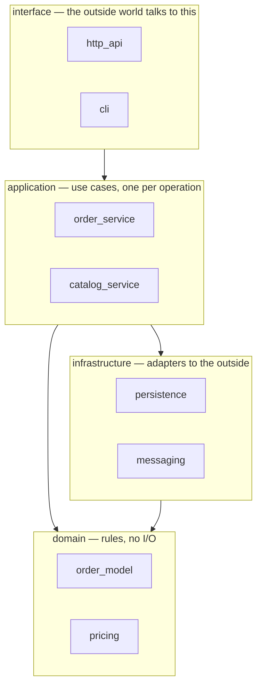
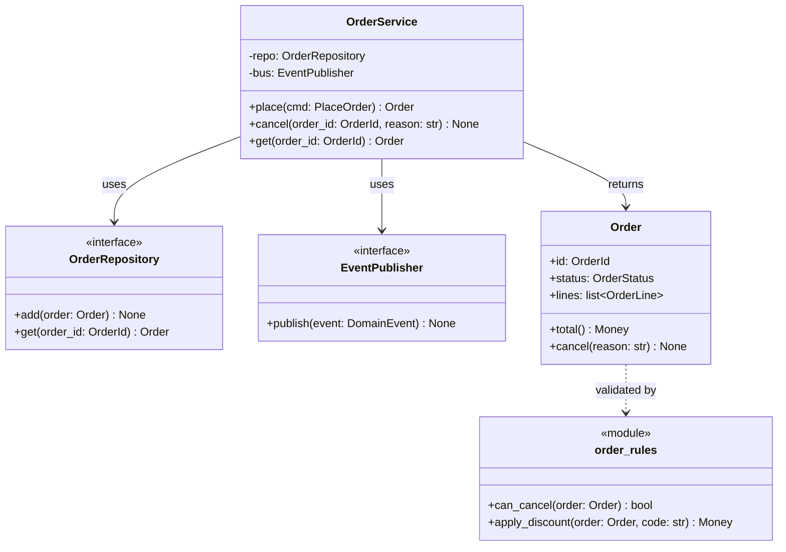
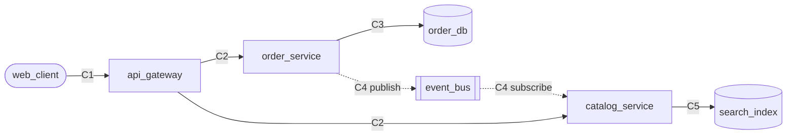
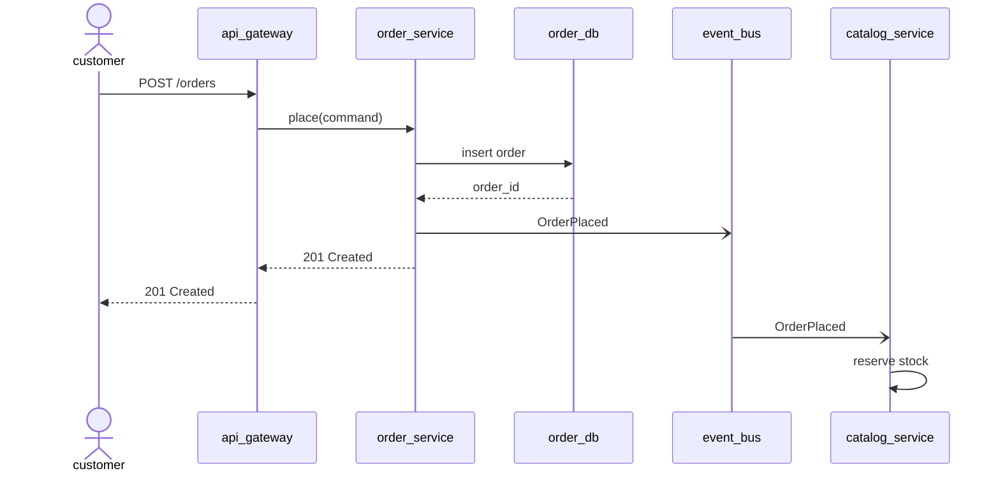
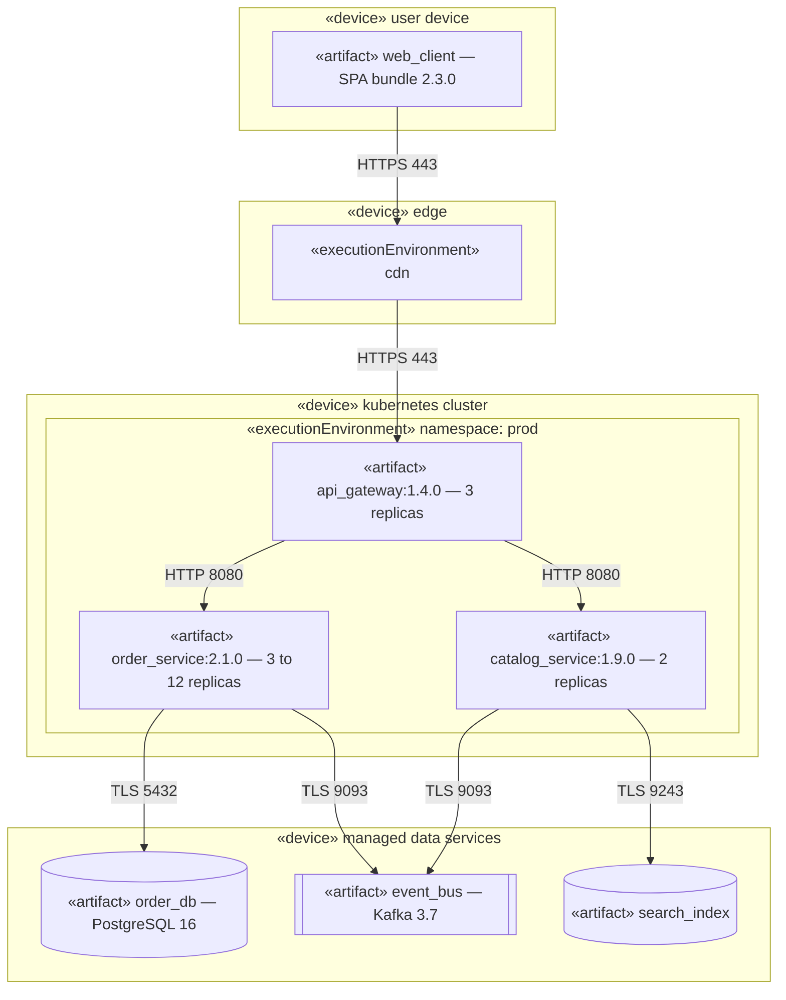

<!--
ARCHITECTURE template — the software architecture design document.

How to use it:
1. Copy this file to ARCHITECTURE.md in the target project, under docs/architecture/,
   and create docs/architecture/images/ next to it for the rendered diagrams.
2. Replace every {{PLACEHOLDER}}. `grep -n '{{' ARCHITECTURE.md` lists the ones left.
3. Replace the example values in the Mermaid and Python blocks — the element names
   (web_client, api_gateway, order_service, catalog_service, order_db, event_bus,
   search_index), the versions, and the ports. These are written as plain values, not
   as {{...}}: Mermaid node, class and subgraph ids allow only letters, digits and
   underscores, and a brace inside a Mermaid label is not reliably rendered.
4. Copy section 6.4 once for each module, and 7.4 once for each runtime scenario.
   Renumber the sections after them and the Contents list.
5. Render each Python block (section 3.2 gives the command) and commit the image it
   writes to docs/architecture/images/.
6. Delete these HTML comments when the document is done.

Placeholders use {{...}}, not angle brackets, for two reasons: angle brackets inside
a Mermaid label are parsed as an HTML tag and do not survive rendering, and the
placeholder check in CONTRIBUTING.md does not report this template.
-->

# {{PROJECT_NAME}} — software architecture

| | |
|---|---|
| **Document** | Architecture design for {{WHAT_THE_SYSTEM_IS}} |
| **Status** | {{STATUS — for example: Proposed, with ADR NNNN. The design becomes binding when that ADR is accepted}} |
| **Date** | {{YYYY-MM-DD}} |
| **Author** | {{AUTHOR}} |
| **Source of requirements** | {{SPEC_ID}} version {{SPEC_VERSION}} ([`{{SPEC_FILE}}`]({{SPEC_FILE}})) |
| **Related decisions** | {{ADR_LIST — one short reason for each ADR}} |
| **Related documents** | {{RELATED_DOCS — for example: docs/ERD.md for the data design, README.md for the operational summary}} |
| **Writing standard** | {{WRITING_STANDARD — for example: ASD-STE100 rules for sentence structure}} |

## Contents

1. [Purpose, scope and audience](#1-purpose-scope-and-audience)
2. [Terms](#2-terms)
3. [How to read this document](#3-how-to-read-this-document)
4. [Drivers and constraints](#4-drivers-and-constraints)
5. [Overall architecture](#5-overall-architecture)
6. [Module view](#6-module-view)
7. [Component-and-connector view](#7-component-and-connector-view)
8. [Deployment view](#8-deployment-view)
9. [Mapping between views](#9-mapping-between-views)
10. [Decisions and rationale](#10-decisions-and-rationale)
11. [Traceability](#11-traceability)
12. [Open items](#12-open-items)

## 1. Purpose, scope and audience

This document gives the architecture of {{THE_SYSTEM}}. It shows the system in three
views — the modules the source is organised into, the components that exist while the
system runs, and the machines those components are deployed onto — and gives the
reason for each significant decision.

The design covers {{SCOPE — for example: every use case of the specification, in the
production and staging environments}}.

This document does not contain code, and it does not duplicate the operational
runbook. It does not describe {{OUT_OF_SCOPE — name what a reader might expect here
and will not find, and say where it is instead}}.

<!-- GUIDANCE: Name the readers and what each comes here for. A document written for
     everyone is read by no one. Typical: a new engineer finding where to make a
     change, a reviewer judging a proposed change, an on-call engineer tracing a
     failure to a component, a security reviewer looking for trust boundaries. -->

| Reader | Comes here for | Starts at |
|---|---|---|
| {{READER}} | {{WHAT_THEY_NEED}} | {{SECTION}} |

## 2. Terms

<!-- Define every word that this document uses with a narrower meaning than usual.
     Keep the rows that apply, and delete the others. -->

| Term | Meaning in this document |
|---|---|
| Module | A unit of the source code — a package, a directory, a library. A module exists at build time. Section 6 shows the modules |
| Component | A unit that exists while the system runs — a process, a service, a worker, a store. Section 7 shows the components |
| Connector | The way two components interact — a call, a queue, a shared store. A connector has a protocol and a failure behaviour, so it is named and catalogued, not drawn as a bare line |
| Node | A machine or an execution environment that runs components. Section 8 shows the nodes |
| Artifact | A deployable file — a container image, a bundle, a binary. An artifact is built from modules and allocated to a node |
| View | One of the three structures above. A view answers some questions and is silent on the rest |
| {{TERM}} | {{MEANING}} |

## 3. How to read this document

### 3.1 The view model

Each view answers a different question. Read the one that matches your question; the
views are connected in section 9.

| View | Section | Answers | Does not answer |
|---|---|---|---|
| Overall | 5 | What is this system, and what does it talk to? | Anything in detail |
| Module | 6 | Where does my change go? What may depend on what? | What runs where |
| Component-and-connector | 7 | What exists at run time, and how does a request flow through it? | How the source is organised |
| Deployment | 8 | What is installed on which machine, and how does it scale? | What the code looks like |

### 3.2 Notation and toolchain

Two tools draw the diagrams in this document. Nothing else is needed, and this
document does not add a dependency to the application.

| Tool | Scope | Used by |
|---|---|---|
| [`diagrams`](https://diagrams.mingrammer.com/) | Python package, installed only to render | Sections 5 and 8.2 |
| [Graphviz](https://graphviz.org/download/) | System binary — `diagrams` renders through it | Sections 5 and 8.2 |
| [Mermaid](https://mermaid.js.org/) | None — GitHub and GitLab render it from the source | Sections 6, 7 and 8.1 |

Mermaid diagrams live in the Markdown and cannot drift out of date unnoticed. The
`diagrams` pictures are generated: the Python is the source, and the image it writes
is committed beside it. Change the Python, render again, commit both.

```bash
cd docs/architecture && uv run --with diagrams python overall.py
```

<!-- GUIDANCE: `filename` carries no extension — `outformat` supplies it — and it
     resolves against the directory the script runs from. The command above runs from
     docs/architecture/, so `filename="images/overall"` writes
     docs/architecture/images/overall.svg. If your project pins its tools some other
     way, replace the command, but keep the output path. -->

### 3.3 Notation key

| You see | It means |
|---|---|
| `«device»`, `«executionEnvironment»`, `«artifact»` | UML deployment stereotypes in section 8.1. A device is hardware or a managed service boundary; an execution environment runs inside it; an artifact is the deployed file |
| `<<interface>>` on a class | The type has no implementation here — it is a port that section 6.4 names an adapter for |
| `<<module>>` on a class | Not a class. A module, holding the free functions listed in it. Mermaid class diagrams have no notation for a module, so this is the convention used throughout section 6.4 |
| A solid arrow | A synchronous interaction. The caller waits |
| A dashed arrow | An asynchronous interaction. The caller does not wait |
| `C1`, `C2`, … on an edge in section 7 | A connector catalogued in 7.2 |

## 4. Drivers and constraints

### 4.1 Quality attribute scenarios

<!-- GUIDANCE: These are what the architecture is shaped by. A driver that cannot be
     measured is not a driver — "the system must be fast" tells a designer nothing and
     tells a reviewer less. Give the stimulus, the response and the measure, and name
     the requirement each comes from. Keep the handful that actually drove a decision;
     a list of twenty is a wish list, not a driver set. -->

| # | Attribute | Stimulus | Response | Measure | Source |
|---|---|---|---|---|---|
| QA-01 | {{ATTRIBUTE — for example: Latency}} | {{STIMULUS — for example: A customer submits an order at peak hour}} | {{RESPONSE — for example: The order is accepted and acknowledged}} | {{MEASURE — for example: p99 under 300 ms at 500 orders per second}} | {{REQUIREMENT_ID}} |
| QA-02 | {{ATTRIBUTE}} | {{STIMULUS}} | {{RESPONSE}} | {{MEASURE}} | {{REQUIREMENT_ID}} |

### 4.2 Constraints

<!-- Constraints are not negotiable and are not decisions — nobody on this project
     chose them. Name who imposed each one, so a later reader knows who to go to if it
     has to change. -->

| # | Constraint | Imposed by | Effect on the design |
|---|---|---|---|
| C-01 | {{CONSTRAINT — for example: Customer data stays in the EU}} | {{WHO — for example: Legal, DPA clause 7}} | {{EFFECT}} |
| C-02 | {{CONSTRAINT}} | {{WHO}} | {{EFFECT}} |

## 5. Overall architecture

### 5.1 System context

This diagram shows the system as one box and names everything outside it that it
depends on or that depends on it. It is the only diagram that shows the system
boundary; every later section is inside it.

```python
# docs/architecture/context.py
from diagrams import Cluster, Diagram, Edge
from diagrams.onprem.client import Users
from diagrams.onprem.compute import Server
from diagrams.onprem.queue import Kafka

with Diagram(
    "System context",
    filename="images/context",
    outformat="svg",
    show=False,
    direction="LR",
):
    customers = Users("customers")
    operators = Users("operators")

    with Cluster("order platform"):
        system = Server("order platform")

    payments = Server("payment provider")
    warehouse = Kafka("warehouse events")

    customers >> Edge(label="places orders") >> system
    operators >> Edge(label="administers") >> system
    system >> Edge(label="authorises payment") >> payments
    system >> Edge(label="publishes shipments", style="dashed") >> warehouse
```


### 5.2 The overall picture

<!-- GUIDANCE: One diagram, readable in about thirty seconds. Show the boundaries,
     the stores and the direction data moves. Do not show every module, every queue
     or every sidecar — the later views are where detail belongs, and a diagram that
     shows everything is consulted by nobody. -->

```python
# docs/architecture/overall.py
from diagrams import Cluster, Diagram, Edge
from diagrams.elastic.elasticsearch import Elasticsearch
from diagrams.onprem.client import Users
from diagrams.onprem.compute import Server
from diagrams.onprem.database import PostgreSQL
from diagrams.onprem.inmemory import Redis
from diagrams.onprem.network import Nginx
from diagrams.onprem.queue import Kafka

with Diagram(
    "Overall architecture",
    filename="images/overall",
    outformat="svg",
    show=False,
    direction="LR",
):
    customers = Users("customers")
    gateway = Nginx("api_gateway")
    session_cache = Redis("session_cache")
    event_bus = Kafka("event_bus")

    with Cluster("application"):
        order_service = Server("order_service")
        catalog_service = Server("catalog_service")

    with Cluster("state"):
        order_db = PostgreSQL("order_db")
        search_index = Elasticsearch("search_index")

    customers >> Edge(label="HTTPS") >> gateway
    gateway >> Edge(label="sessions") >> session_cache
    gateway >> [order_service, catalog_service]
    order_service >> Edge(label="reads, writes") >> order_db
    order_service >> Edge(label="publishes", style="dashed") >> event_bus
    event_bus >> Edge(label="subscribes", style="dashed") >> catalog_service
    catalog_service >> Edge(label="queries") >> search_index
```


### 5.3 Element catalog

| Element | Responsibility | Owner |
|---|---|---|
| {{ELEMENT}} | {{WHAT_IT_OWNS — one sentence, and nothing it does not own}} | {{TEAM}} |

### 5.4 External dependencies

<!-- GUIDANCE: Criticality answers one question — if this is down, what happens to
     us? Critical (we are down), Degraded (we lose a feature), Optional (no
     user-visible effect). -->

| Dependency | Purpose | Criticality | Owner | Failure behaviour |
|---|---|---|---|---|
| {{DEPENDENCY}} | {{WHY_WE_CALL_IT}} | {{CRITICAL / DEGRADED / OPTIONAL}} | {{OWNING_TEAM}} | {{WHAT_WE_DO_WHEN_IT_IS_DOWN}} |

## 6. Module view

This view shows the source code. It answers where a change goes and what is allowed
to depend on what. It says nothing about what runs — two modules in this view can end
up in one process, and one module can end up in three.

### 6.1 Decomposition



### 6.2 Allowed-to-use rules

<!-- GUIDANCE: This is the half of the module view that pays for itself. The diagram
     above shows what the dependencies are today; these rules say which ones are
     permitted, so a reviewer can reject a new edge without arguing about taste. State
     the rules as prohibitions where you can — they are easier to check. If a linter,
     an import-check test or a build rule enforces one, name it. An unenforced rule is
     a wish. -->

1. {{RULE — for example: `domain` imports nothing from `application`, `infrastructure`
   or `interface`. It has no I/O and no framework import}}
2. {{RULE — for example: `application` depends on `infrastructure` only through the
   port interfaces declared in `application`. The concrete adapter is injected}}
3. {{RULE}}

**Enforced by.** {{HOW — for example: `{{LINT_COMMAND}}` in CI, which fails the build
on a forbidden import. Or: nothing yet — see section 12}}

### 6.3 Element catalog

| Module | Responsibility | Source |
|---|---|---|
| `{{module_name}}` | {{WHAT_IT_OWNS}} | [`{{path/to/module}}`]({{path/to/module}}) |
| `{{module_name}}` | {{WHAT_IT_OWNS}} | [`{{path/to/module}}`]({{path/to/module}}) |

### 6.4 `{{module_name}}`

<!-- Copy this subsection once for each module in 6.3 that a reader needs the inside
     of. A module whose catalog row says enough does not need one. -->

**Purpose.** {{WHAT_ONE_SENTENCE}} ({{REQUIREMENT_IDS}}).

<!-- GUIDANCE: The class diagram shows the main types and the functions a caller
     uses — the module's surface, not its contents. Leave out private helpers, data
     holders with no behaviour, and anything a reader would not need in order to call
     the module or change it. If a class diagram of a module needs scrolling, the
     module is doing too much, or the diagram is showing too much. -->



**Key types.**

| Type | Kind | Note |
|---|---|---|
| `{{TypeName}}` | {{class / interface / module / enum}} | {{WHAT_A_CALLER_NEEDS_TO_KNOW}} |

**{{TOPIC}}.** {{EXPLANATION — one bold-titled paragraph per design point a reader
needs: why a type exists, why one does not, what is deliberately absent, which use
case drives it. Name the requirement each time.}}

## 7. Component-and-connector view

This view shows what exists while the system runs. Every box is a thing with a
lifetime — it starts, it can fail, it can be restarted — and every line is a
connector with a protocol and a failure behaviour.

### 7.1 Runtime structure



### 7.2 Connector catalog

<!-- GUIDANCE: This table is why the view is worth drawing. An unlabelled arrow
     between two services hides every question worth asking: is the caller blocked, is
     it retried, is the retry safe, and what does the caller do when it never gets an
     answer. The failure behaviour column is the one that gets read at 3am. -->

| # | From → To | Type | Protocol | Carries | Timeout and retry | Failure behaviour |
|---|---|---|---|---|---|---|
| C1 | web_client → api_gateway | Synchronous | {{HTTPS/1.1, JSON}} | {{WHAT}} | {{TIMEOUT, RETRY}} | {{WHAT_THE_CALLER_SEES}} |
| C2 | api_gateway → services | Synchronous | {{PROTOCOL}} | {{WHAT}} | {{TIMEOUT, RETRY}} | {{WHAT_THE_CALLER_SEES}} |
| C3 | order_service → order_db | Synchronous | {{PROTOCOL}} | {{WHAT}} | {{TIMEOUT, RETRY}} | {{WHAT_THE_CALLER_SEES}} |
| C4 | order_service → catalog_service | Asynchronous | {{PROTOCOL}} | {{EVENT_NAMES}} | {{REDELIVERY}} | {{WHAT_HAPPENS_TO_AN_UNPROCESSED_EVENT}} |
| C5 | catalog_service → search_index | Synchronous | {{PROTOCOL}} | {{WHAT}} | {{TIMEOUT, RETRY}} | {{WHAT_THE_CALLER_SEES}} |

**Delivery guarantee.** {{GUARANTEE — for example: C4 is at-least-once, so every
consumer is idempotent on the event id. Say which, and say where the idempotency is
implemented}}

### 7.3 Component catalog

| Component | Kind | Responsibility | State it owns | Built from |
|---|---|---|---|---|
| {{component}} | {{service / worker / store / cache / proxy}} | {{WHAT_IT_OWNS}} | {{STATE, or: none — stateless}} | {{MODULES_FROM_SECTION_6}} |

### 7.4 Scenario — {{SCENARIO_NAME}}

<!-- Copy this subsection once for each scenario worth tracing. Pick the ones that
     cross the most connectors, plus at least one failure path — a diagram of the
     happy path only is the one that misleads. -->

**Trigger.** {{WHAT_STARTS_IT}} ({{REQUIREMENT_IDS}})



**What happens when {{FAILURE}}.** {{BEHAVIOUR — which step fails, what the customer
sees, and what state is left behind}}

## 8. Deployment view

This view allocates the components of section 7 to machines. It answers what is
installed where, how many of each there are, and what scales.

### 8.1 UML deployment

<!-- GUIDANCE: Stereotypes carry the UML meaning: «device» is hardware or a managed
     service boundary, «executionEnvironment» runs inside a device, «artifact» is the
     deployed file. Put the version and the port on the diagram — they are the two
     things a reader checks against reality, and the two that go stale first. -->



### 8.2 Infrastructure

<!-- OPTIONAL: delete 8.2 if 8.1 already says everything, which it does for a small
     system. Keep it when the infrastructure itself needs showing — autoscaling,
     replicas, multiple zones, managed services with their own topology. -->

```python
# docs/architecture/deployment.py
from diagrams import Cluster, Diagram, Edge
from diagrams.k8s.clusterconfig import HPA
from diagrams.k8s.compute import Deployment
from diagrams.k8s.network import Ingress, Service
from diagrams.onprem.database import PostgreSQL
from diagrams.onprem.queue import Kafka

with Diagram(
    "Deployment — production",
    filename="images/deployment",
    outformat="svg",
    show=False,
    direction="TB",
):
    ingress = Ingress("ingress")

    with Cluster("namespace: prod"):
        gateway_svc = Service("api_gateway")
        gateway = Deployment("api_gateway — 3 replicas")
        order_svc = Service("order_service")
        order = Deployment("order_service — 3 to 12 replicas")
        autoscaler = HPA("cpu 70 percent")

    with Cluster("managed data services"):
        order_db = PostgreSQL("order_db — primary and replica")
        event_bus = Kafka("event_bus — 3 brokers")

    ingress >> gateway_svc >> gateway
    gateway >> order_svc >> order
    autoscaler >> Edge(label="scales", style="dotted") >> order
    order >> order_db
    order >> Edge(style="dashed") >> event_bus
```


### 8.3 Node catalog

| Node | Environment | Sizing | Scales on | Limit |
|---|---|---|---|---|
| {{node}} | {{production / staging}} | {{CPU, MEMORY, COUNT}} | {{SIGNAL, or: fixed}} | {{MAX, and what happens at it}} |

### 8.4 Artifact allocation

<!-- Every artifact of 8.1 appears once. Configuration source matters as much as the
     image: the same artifact on two nodes is two different running things if their
     configuration differs. -->

| Artifact | Built from | Runs on | Configuration from | Secrets from |
|---|---|---|---|---|
| {{artifact}} | {{MODULES_OR_REPO_PATH}} | {{NODE}} | {{SOURCE}} | {{SOURCE — never the value}} |

### 8.5 Environments

| | {{ENVIRONMENT}} | {{ENVIRONMENT}} |
|---|---|---|
| **Differs how** | {{DIFFERENCE}} | {{DIFFERENCE}} |
| **Data** | {{REAL / ANONYMISED / SYNTHETIC}} | {{REAL / ANONYMISED / SYNTHETIC}} |
| **Who can deploy** | {{WHO}} | {{WHO}} |

## 9. Mapping between views

<!-- GUIDANCE: One row per component. This is the table a new engineer uses to get
     from a bug report to a file: the report names a symptom in a deployed thing, this
     says which component that is and which modules it is built from. A module that
     appears in two components, or a component on two nodes, is worth a note — those
     are the places where a change has a second consequence. -->

| Module (§6) | Component (§7) | Node (§8) | Artifact |
|---|---|---|---|
| `{{module_name}}` | {{component}} | {{node}} | {{artifact}} |
| `{{module_name}}` | {{component}} | {{node}} | {{artifact}} |

{{ELEMENTS_NOT_MAPPED — name any module that ships in no artifact, or any component
built from no module in section 6, and say why}}

## 10. Decisions and rationale

{{WHO_DECIDED — for example: The author made each decision below during the design
review of YYYY-MM-DD.}}

<!-- One row per decision that shaped a view above. Give the driver or constraint it
     answers, and link the ADR that records it. A decision with no ADR and no driver
     is a preference; say so, so a later reader knows it can be changed cheaply.
     Architecturally significant decisions need an ADR before implementation — see
     docs/architecture/adr/. -->

| # | Decision | Answers | Alternative rejected | ADR |
|---|---|---|---|---|
| D-01 | {{DECISION}} | {{QA-NN or C-NN}} | {{WHAT_AND_WHY_NOT}} | {{ADR_LINK}} |
| D-02 | {{DECISION}} | {{QA-NN or C-NN}} | {{WHAT_AND_WHY_NOT}} | {{ADR_LINK}} |

## 11. Traceability

<!-- Every requirement that shaped a structure appears once. A requirement met by
     leaving something out names what is left out. -->

| Requirement | View | Elements |
|---|---|---|
| {{REQUIREMENT_IDS}} | {{Module / C&C / Deployment}} | {{ELEMENT_NAMES}} |

## 12. Open items

These items are outside this design, or need a decision before implementation.

1. **{{TITLE}}.** {{WHAT_IS_OPEN, and who or which ADR decides it}}

---

<!--
  BEFORE YOU PUBLISH
  ==================
  [ ] `grep -n '{{' ARCHITECTURE.md` returns nothing.
  [ ] Every example value is replaced — no web_client, api_gateway, order_service,
      catalog_service, order_db, event_bus or search_index survives unless it is
      genuinely yours. `grep -n 'order_service\|api_gateway\|event_bus'` finds them.
  [ ] Every GUIDANCE comment is deleted, and every OPTIONAL section is either filled
      in or deleted entirely — heading, marker and body.
  [ ] Every Mermaid block renders. View the file on the web, not in an editor.
  [ ] Every Python block runs, and the image it writes is committed and current.
      Rendering must produce no diff other than the one you intended.
  [ ] Every image referenced resolves, and no image is referenced that no script
      writes.
  [ ] Section 9 maps every component. A row missing there is a view that disagrees
      with another view.
  [ ] Every connector in 7.2 has a failure behaviour. "N/A" is not one.
  [ ] Every link resolves, including the ADR and requirement links.
  [ ] No secret, token, internal hostname, IP range or customer name appears
      anywhere — the deployment view is where these leak.
  [ ] Delete this checklist.
-->
